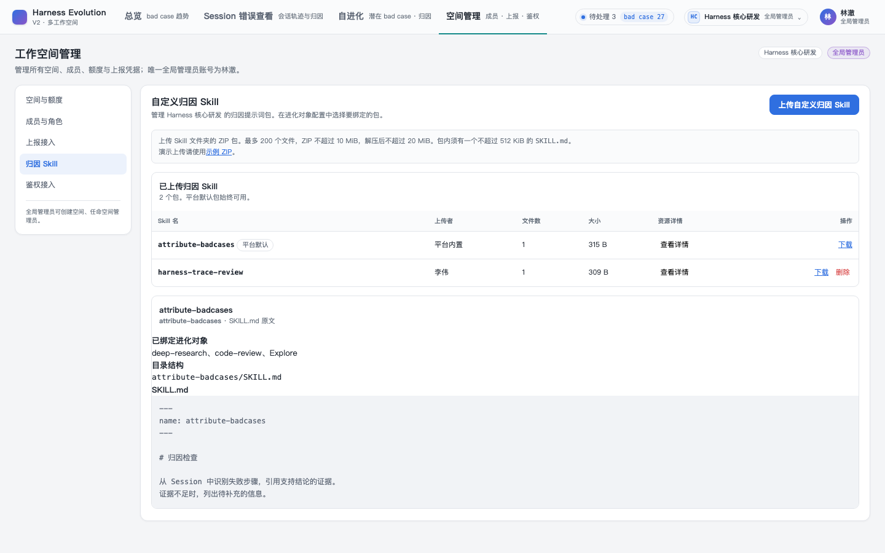
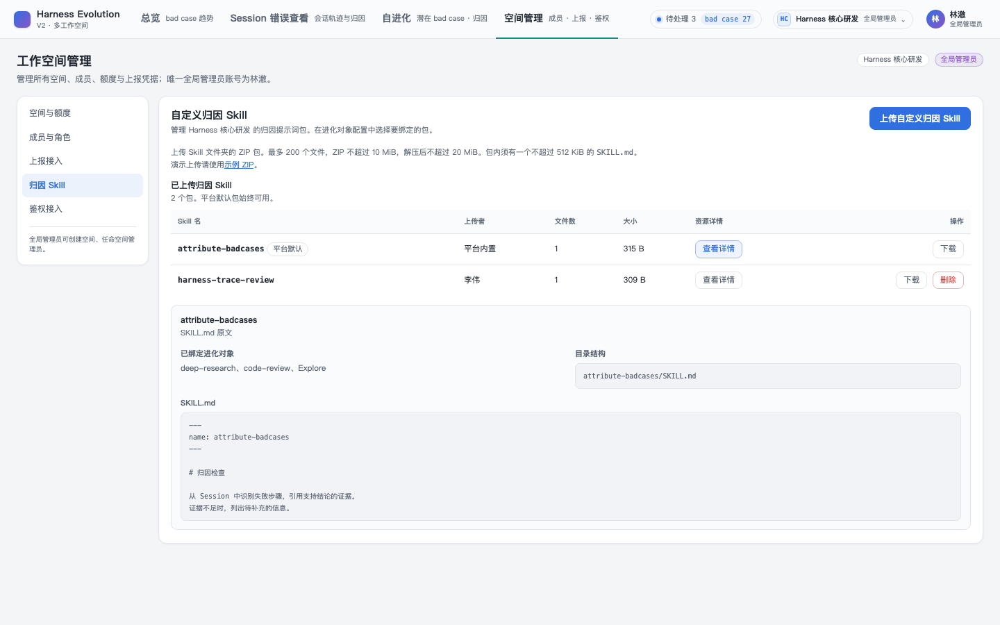

# Align Attribution Skill styling with Workspace Admin tabs

English | [中文](bugfix-attribution-skill-admin-style.md)

```yaml flow
kind: issue
id: bugfix-52
milestone: bugfix
depends:
  - m12-23
priority: P2
status: done
scope:
  - plans/ui-prototype-v2/harness-evolution.html
  - plans/ui-prototype-v2/evidence/attribution-skill-style/**
  - apps/web/src/pages/workspaces/components/AttributionSkillsTab.vue
  - .agents/notes/implemented/feature/2026-11-19-attribution-skill-prototype*
  - .agents/flow/issues/bugfix-attribution-skill-admin-style*
adr:
  - ../../notes/implemented/feature/2026-11-19-attribution-skill-prototype.md
github:
  number: 563
  url: https://github.com/Shadow-Azure/harness-evolution/issues/563
```

## Background

Workspace Admin → Attribution Skill shows ZIP packages and resource details. Its nested list border and control sizes differ from Spaces and Quotas and Members and Roles. The detail headings, directory and prompt lack consistent padding.

## Goals

- Match the sibling tabs' typography, spacing and colors for the heading, help, table and actions while preserving the existing content, permissions and operations.
- Show baseline and proposed prototype screenshots with the same demo workspace, role and viewport.

## Design basis

- [Target-bound attribution](../../../plans/fullstack-design/02-features.md#对象绑定归因) defines the ZIP resource, detail and target binding boundaries.
- Spaces and Quotas and Members and Roles provide the table and action references. Ingest provides the code preview reference.

## Implementation

- Align the primary action and table in the V2 prototype and Web tab. Provide consistent padding in the detail section for bound targets, the directory and SKILL.md.
- Stack the detail fields on narrow screens, allow local table scrolling, and wrap long directory and prompt lines in the panel.

## Prototype comparison

Both images use the same 1440 × 900 Chrome viewport, Harness Core R&D demo workspace, global admin and default attribute-badcases selection. Open either image to see it at full resolution.

| Baseline prototype (d39b1222) | Proposed prototype (this issue) |
| --- | --- |
| [](https://raw.githubusercontent.com/Shadow-Azure/harness-evolution/6eda3b8ae1ae67c944d17482a2c27f23f48b03cc/plans/ui-prototype-v2/evidence/attribution-skill-style/before.png) | [](https://raw.githubusercontent.com/Shadow-Azure/harness-evolution/6eda3b8ae1ae67c944d17482a2c27f23f48b03cc/plans/ui-prototype-v2/evidence/attribution-skill-style/after.png) |

## Steps

1. Capture the baseline, sibling reference and proposed prototype at the same Chrome viewport.
2. Apply the same visual rules to the prototype and Web tab. Check admin and read-only access.
3. Embed the comparison in this issue and run the frontend and workflow gates.

## Dependencies and delivery boundary

- Depends on the resource library in m12-23. Delivery covers the V2 prototype, Web tab styling and comparison images using synthetic data.

## Independent verification

```sh
python3 -m http.server 8765 --bind 127.0.0.1
pnpm --filter @harness/web exec vitest run src/pages/workspaces/Admin.test.ts
pnpm verify:web-style
```

- Open `/plans/ui-prototype-v2/harness-evolution.html?u=admin&page=admin&tab=attribution-skills` in Chrome. Harness Core R&D shows two demo packages, with bound targets, directory and SKILL.md in the detail. The table header and control density match Members and Roles.
- At 390 px, check local table scrolling and stacked detail fields. Read-only users retain download and detail actions.

## Acceptance criteria

- The 1440 × 900 comparisons use the same admin, workspace and selected default package. The issue links to the full-resolution images.
- Admins can upload, inspect, download and delete custom packages. Read-only users can inspect and download. The built-in package cannot be deleted.
- Workspace Admin has no page-level horizontal overflow at narrow width.

## Gates and CI

- Run Workspace Admin unit tests, type check, lint, style validation, `pnpm verify:flow` and `pnpm lint:docs`.

## Non-goals

- API, resource contents, permissions, the built-in package, bindings, storage and sibling tab behavior retain their current contracts.
