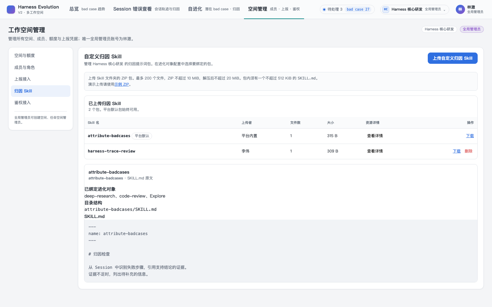
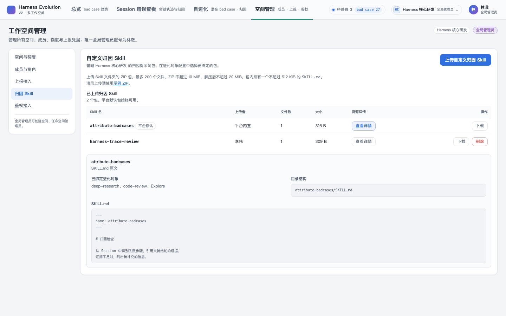

# 统一空间管理归因 Skill 页签样式

[English](bugfix-attribution-skill-admin-style.en.md) | 中文

```yaml flow
kind: issue
id: bugfix-51
milestone: bugfix
depends:
  - m12-23
priority: P2
status: done
scope:
  - plans/ui-prototype-v2/harness-evolution.html
  - plans/ui-prototype-v2/evidence/attribution-skill-style/**
  - apps/web/src/pages/workspaces/components/AttributionSkillsTab.vue
  - .agents/notes/implemented/feature/2026-11-19-attribution-skill-prototype*
  - .agents/flow/issues/bugfix-attribution-skill-admin-style*
adr:
  - ../../notes/implemented/feature/2026-11-19-attribution-skill-prototype.md
github:
  number: 563
  url: https://github.com/Shadow-Azure/harness-evolution/issues/563
```

## 背景

「空间管理 → 归因 Skill」提供 ZIP 资源列表与详情。列表套用了额外卡片边框，操作尺寸与「空间与额度」和「成员与角色」不一致，详情标题、目录与提示词也缺少统一的内边距。

## 目标

- 让归因 Skill 的标题、说明、表格和操作沿用空间管理其他页签的字号、间距与颜色；保持现有数据、文案、权限和操作。
- 用同一演示空间、角色与视口，提供修改前后原型的并排截图。

## 设计依据

- [对象绑定归因](../../../plans/fullstack-design/02-features.md#对象绑定归因)定义 ZIP、资源详情及对象绑定边界。
- 「空间与额度」「成员与角色」提供表格与操作样式参照，「上报接入」提供代码预览样式参照。

## 实现内容

- 在 V2 原型和归因 Skill 前端页签对齐主操作和表格，使用带留白的详情面板展示绑定对象、目录和 SKILL.md。
- 在窄屏让详情字段堆叠、表格局部横向滚动；长目录和提示词在面板内换行。

## 原型截图对照

同一 Chrome 1440 × 900 视口，使用 Harness 核心研发演示空间、全局管理员和默认选中的 attribute-badcases。点击图片可查看原尺寸。

| 当前原型（d39b1222） | 预期原型（本 Issue） |
| --- | --- |
| [](https://raw.githubusercontent.com/Shadow-Azure/harness-evolution/6eda3b8ae1ae67c944d17482a2c27f23f48b03cc/plans/ui-prototype-v2/evidence/attribution-skill-style/before.png) | [](https://raw.githubusercontent.com/Shadow-Azure/harness-evolution/6eda3b8ae1ae67c944d17482a2c27f23f48b03cc/plans/ui-prototype-v2/evidence/attribution-skill-style/after.png) |

## 实施步骤

1. 用同一 Chrome 视口保存基线、同页参照与预期原型。
2. 同步原型与 Web 的视觉规则，走查管理员与只读角色。
3. 把对照截图嵌入本 Issue，执行前端与流程门禁。

## 依赖与交付边界

- 依赖 m12-23 的归因 Skill 资源库。交付范围为 V2 原型、前端页签样式和对照截图；示例使用合成数据。

## 独立验证

```sh
python3 -m http.server 8765 --bind 127.0.0.1
pnpm --filter @harness/web exec vitest run src/pages/workspaces/Admin.test.ts
pnpm verify:web-style
```

- 在 Chrome 打开 `/plans/ui-prototype-v2/harness-evolution.html?u=admin&page=admin&tab=attribution-skills`。Harness 核心研发空间应显示 2 个演示包，详情展示绑定对象、目录和 SKILL.md；「成员与角色」表头和按钮密度应一致。
- 在 390 px 检查表格局部滚动和详情堆叠；只读入口保留下载和详情。

## 验收标准

- 1440 × 900 对照图为同一管理员、空间和默认选中包；可从 Issue 查看原尺寸。
- 管理员可上传、查看详情、下载与删除自定义包，只读角色可查看详情和下载，默认包不可删除。
- 空间管理页面在窄屏宽度下无整页横向溢出。

## 门禁与 CI

- 运行前端空间管理单测、类型、lint、样式检查、`pnpm verify:flow` 和 `pnpm lint:docs`。

## 非目标

- API、资源内容、权限、默认包、绑定、存储与其他页签的行为均保持现有契约。
