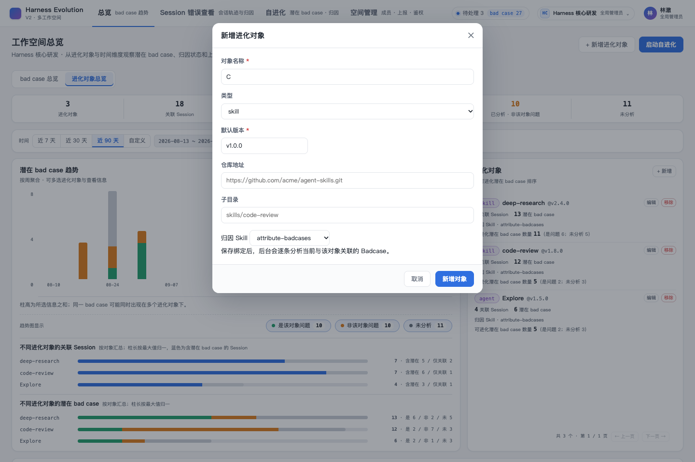
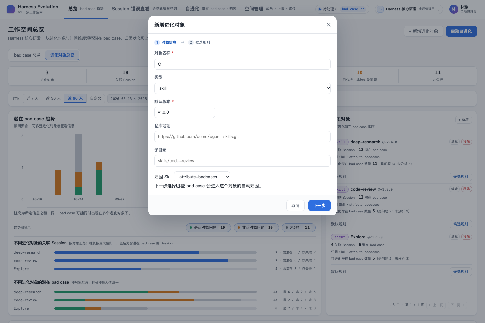
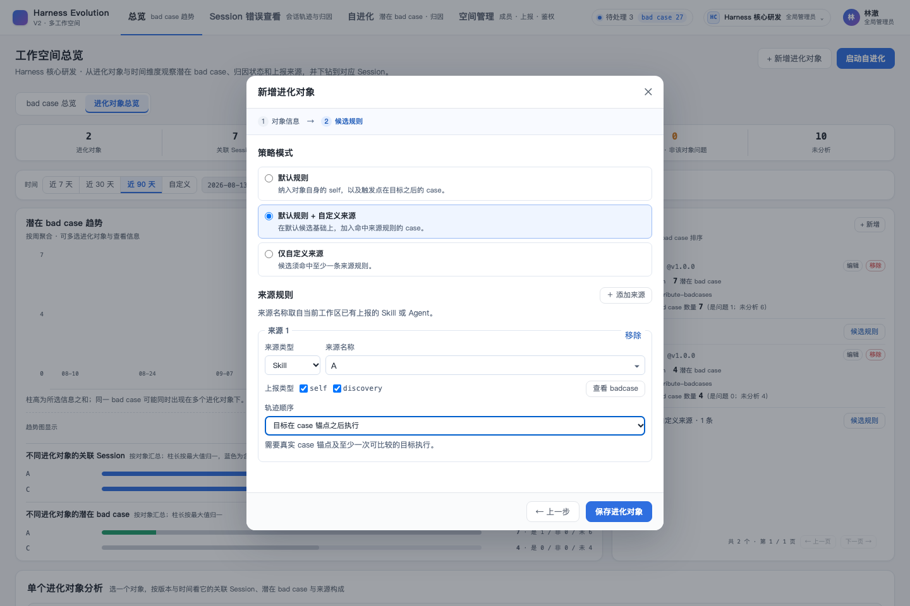
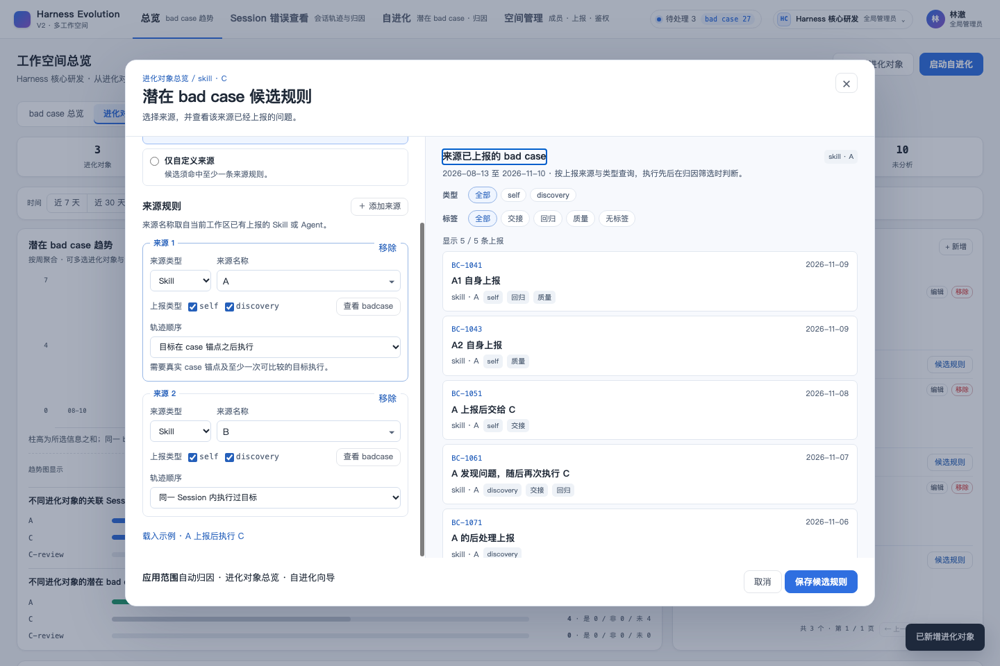
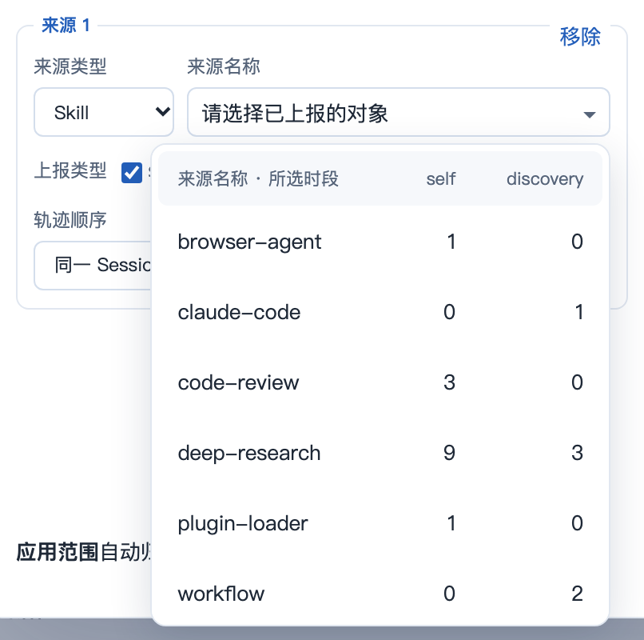

# Configure potential bad-case sources per target across overview, automatic attribution and evolution

English | [中文](bugfix-target-candidate-policy.md)

```yaml flow
kind: issue
id: bugfix-74
milestone: bugfix
depends: []
priority: P2
status: done
scope:
  - apps/api/**
  - apps/web/**
  - packages/contracts/**
  - tests/**
  - plans/ui-prototype-v2/**
  - .agents/notes/**
  - docs/**
  - .agents/flow/issues/bugfix-target-candidate-policy*
adr:
  - ../../notes/implemented/feature/2026-11-26-target-candidate-sources.md
github:
  number: 625
  url: https://github.com/Shadow-Azure/harness-evolution/issues/625
```

## Background

A Skill can report a problem before Skill C executes. The current wizard compares the case anchor with the earliest target occurrence, and the binding worker can schedule excluded rows. Users need reproducible, target-owned candidate selection.

## Goals

Let C select reports from A while preserving the original reporter and self/discovery type. Each target version reaches its own attribution conclusion.

## Prototype comparison

| Before · create from the details form | After · enter details and continue |
| --- | --- |
|  |  |

| Step two · configure sources in the same dialog | Existing target · inspect one reporting source |
| --- | --- |
|  |  |



[Download the single-file prototype](https://github.com/Shadow-Azure/harness-evolution/blob/8a7f30f2c03609ac22d41c30214f5859e6f1074d/plans/ui-prototype-v2/harness-evolution.html?raw=true). Open the file with `?u=admin&page=overview&tab=targets&demo=candidate-rules`, open candidate rules on C, and view the reports on source A.

## Design authority

See [Database design §7.5](../../../plans/fullstack-design/06-database-design.md#75-v2-口径空间--触发点--潜在--归因三态) and [API design §4.20](../../../plans/fullstack-design/05-api-design.md#420-自进化预览与启动v2).

## Implementation

1. Both create flows validate object details, then show a single-column rule form in the same-sized dialog. Keep the title, step indicator and footer in place. Save the object, Skill binding and policy together on final confirmation. Back preserves both drafts. Cancel creates nothing and schedules no job. Existing objects save metadata directly. Their overview cards show the active policy and a separate rule editor. Members can inspect rules and managers can edit.
2. Offer default, default plus custom sources, and custom sources only. Match exact Skill/Agent type and name, including the target itself. Only offer distinct names reported in this workspace for the chosen kind. Switching kind clears the name. Sources need no target registration. Keep the picker within the card width, with right-aligned self and discovery counts for the selected date range, including zeros. Require at least one report type per rule and one valid source for a custom mode.
3. Evaluate any target invocation in the same root Session. Support strictly before, strictly after, or presence only. Directional rules require a real anchor and comparable coordinates. Explain unknown order and post-processing anchors. Preserve default self and post-processing semantics.
4. Place a view-reports button beside report types on each source card. Query the bad case table for that one source, selected types, workspace and time window. Show results in the right pane for existing targets or a temporary dialog during creation. Preserve the draft on return. Filter the list by type and labels, including unlabelled records and the union of multiple labels. Reports without trace anchors remain visible. Evaluate execution order during candidate matching and count overlapping matches once per target version.
5. Share the matcher across overview, automatic attribution, the wizard and runs. Consume included cases only. Snapshot the applied rule version, match reasons and coordinates for each run or batch. Read legacy targets using the default policy.

## Implementation steps

1. Define storage, legacy defaults, access, validation, source enumeration, per-type counts and per-source report queries. Generate the updated contracts.
2. Extend the shared matcher with source identities and execution evidence. Persist the matches in batch and run snapshots.
3. Wire both create flows, the per-source report list, the overview and the wizard to the saved policy. Cover cancellation, retries and historical reads.

## Dependencies and boundary

Apply workspace scope and any applicable [label filter from #582](https://github.com/Shadow-Azure/harness-evolution/issues/582) first. Saving a changed policy on a bound target creates a new binding generation with its batch cutoff. Source reports use bad_cases.catalog_label and can fall back to metaData.label for direct reports.

## Verification

Use the linked prototype and A/B/C traces below. Run the same fixtures through API and browser tests and assert the exact selected IDs delivered to the automatic worker.

## Acceptance

- [ ] Final confirmation creates the object atomically. Cancel or failure leaves no partial object or job. Editing existing metadata remains a single step.
- [ ] On desktop and narrow screens, the source menu fits within the card and counts align. The fixture shows 3 / 2 for Skill A and 0 / 1 for Agent ReviewBot.
- [ ] Viewing A from C with both types selected shows five reports, including BC-1071 without an anchor. Viewing a second card for B shows its two reports. Viewing, filtering and returning preserve the unsaved policy.
- [ ] On `A1 → B1 → A2 → B2`, A selecting its own self reports and Session presence includes both A1 and A2. Requiring a later A includes only the A1 report, witnessed by A2.
- [ ] On `A1 → C1`, C accepts the A report with a later-C rule. On `C1 → A1 → C2`, C2 witnesses the match and overlapping rules produce one case.
- [ ] Separate source kinds with identical names. Respect report type, order evidence, Session and workspace. Only previously reported sources of the selected kind are selectable. Show zero when a report type is absent in the time window.
- [ ] Under identical inputs overview candidates, automatic batches and runs select the same IDs. Removed candidates retain accessible historical reports and snapshots.

## Gates and CI

Run `pnpm contract:check`, `pnpm test:api`, `pnpm typecheck:web`, `pnpm test`, relevant `pnpm test:e2e` scenarios and `pnpm verify:flow`.

## Non-goals

Report ingestion changes, attribution verdict changes, production replay and historical recomputation policy are outside candidate selection.
