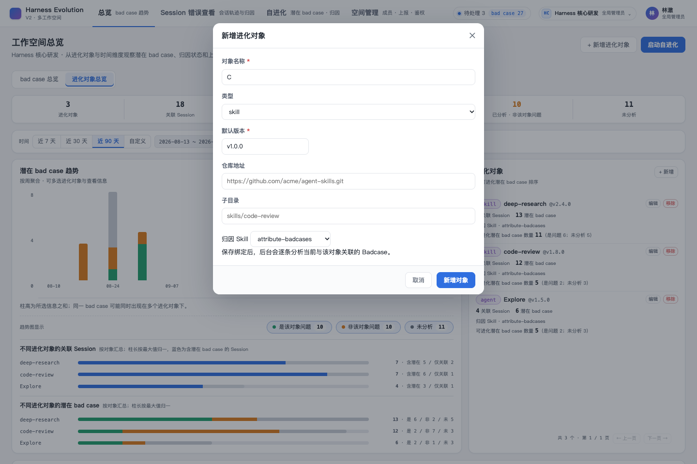
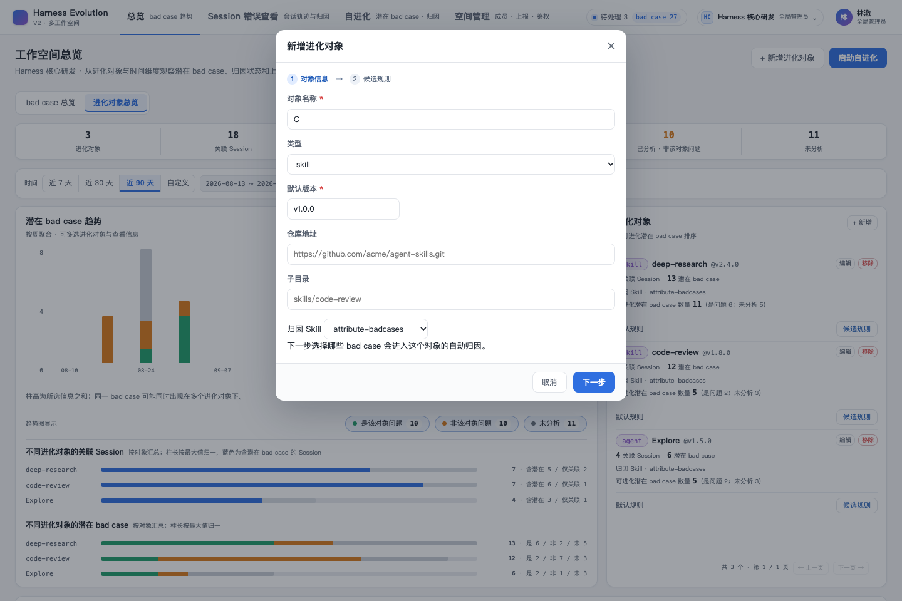
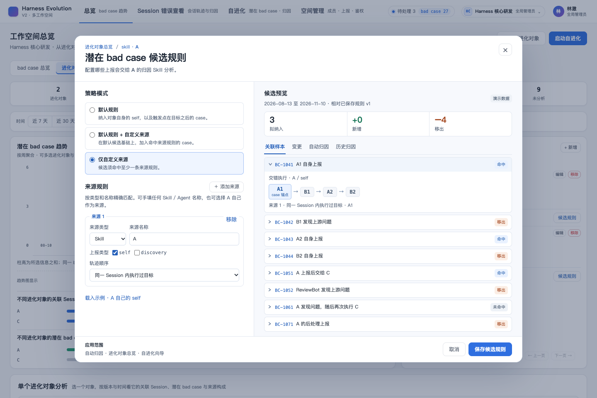
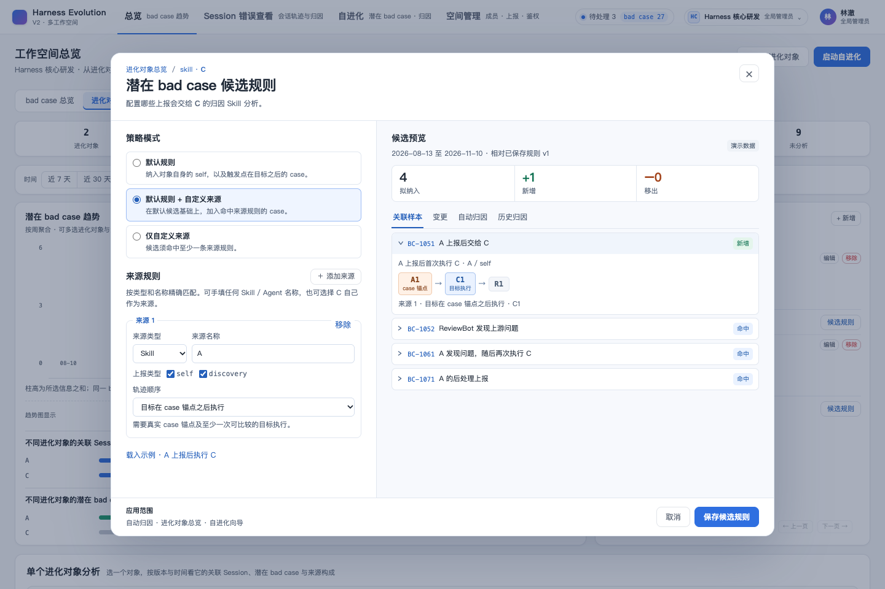

# 支持按进化对象配置潜在 bad case 来源，统一总览、自动归因与自进化候选范围

[English](bugfix-target-candidate-policy.en.md) | 中文

```yaml flow
kind: issue
id: bugfix-64
milestone: bugfix
depends: []
priority: P2
status: backlog
scope:
  - apps/api/**
  - apps/web/**
  - packages/contracts/**
  - tests/**
  - plans/ui-prototype-v2/**
  - .agents/notes/**
  - docs/**
  - .agents/flow/issues/bugfix-target-candidate-policy*
adr:
  - ../../notes/proposed/feature/2026-11-26-target-candidate-sources.md
github:
  number: 625
  url: https://github.com/Shadow-Azure/harness-evolution/issues/625
```

## 背景

A Skill 上报一条 bad case，随后 C Skill 在同一个根 Session 中执行。用户希望把这条 case 送给 C 的归因 Skill 判断原因。现有空间总览缺少对象级来源规则。向导的时序规则以目标最早出现点为参照，覆盖不了“上报之后才执行目标”。保存 Skill 绑定触发的后台批次还会把策略排除的行加入归因，导致用户在向导里看到的范围和后台实际处理的范围不同。

## 目标

从被归因对象 C 的视角配置候选来源。上报记录保留原来的来源 A 和 `self` / `discovery` 类型。同一 case 可以成为多个对象的候选，是否由某个对象造成，交给该对象版本的归因报告判断。

## 前端原型对比

同一管理员、1440 × 960 视口、同一新增对象 C。左图取自 `main@36160c8e`，右图取自本提案的交互原型。

| 修改前 · 填完基础信息即新增 | 修改后 · 第一步点击「下一步」 |
| --- | --- |
|  |  |

| 候选规则 · A 自己的 self | 候选规则 · A 上报后执行 C |
| --- | --- |
|  |  |

[下载单文件交互原型](https://github.com/Shadow-Azure/harness-evolution/blob/5f9948f9738f2059038d871ec90f5cbfabd7dcd9/plans/ui-prototype-v2/harness-evolution.html?raw=true)。浏览器打开后，在地址末尾追加 `?u=admin&page=overview&tab=targets&demo=candidate-rules`。从总览点「新增进化对象」体验两步流程，或在 A、C 卡片点「候选规则」载入示例。

## 设计依据

现行关联、进入点及比较口径见[数据库设计 §7.5](../../../plans/fullstack-design/06-database-design.md#75-v2-口径空间--触发点--潜在--归因三态)，预览与启动契约见[API 设计 §4.20](../../../plans/fullstack-design/05-api-design.md#420-自进化预览与启动v2)。本提案扩展对象级候选策略及其使用入口。

## 实现内容

1. **新增对象分两步。** 总览和自进化配置页的新增入口均先校验基础信息，再进入候选规则。用户可确认默认策略或配置来源。最后点「保存进化对象」一次提交对象、归因 Skill 绑定及规则。上一步保留两步草稿，取消不创建对象、不触发批次。已有对象点「编辑」直接保存基础信息。对象卡片显示生效策略，通过「候选规则」独立修改，普通成员可查看，管理权限控制写入。
2. **按来源精确匹配。** 提供默认、默认加自定义、仅自定义三种模式。来源键为上报对象类型（Skill / Agent）和名称，可选空间内历史来源，也可手填。来源无需先登记为进化对象，可以选择目标自己。每条来源至少勾选一种上报类型，自定义模式至少有一条有效来源。
3. **按每次执行判断。** 来源规则可以要求目标在 case 锚点之前、之后，或同一根 Session 执行过即可。比较所有可定位的目标执行，先后必须严格，同一触发点不满足任一方向。显式顺序规则需要真实锚点和可比较的执行坐标；仅有后处理锚点或顺序未知时展示原因。同 Session 规则只要求目标出现。保留已有默认策略的同名 self 与后处理语义。
4. **预览可核对。** 对比草稿与已保存规则，显示拟纳入、新增、移出。展开到具体上报、case 锚点、目标执行和命中规则。多条规则命中同一 case 时保留各项证据，同一对象版本只计一次。提供自动归因候选和历史报告视图，区分当前命中与仅历史归因。
5. **共用已生效的规则。** 总览、自动归因、向导和正式运行使用同一个匹配器。后台批次只消费入选行。运行和批次记录所用规则版本、匹配原因及坐标，以便追溯历史。规则调整可移出当前候选，已有报告仍可查阅。历史对象缺少规则时按默认策略读取。

## 实施步骤

1. 定义策略及版本、默认兼容、权限、校验、保存和预览契约，更新迁移及生成类型。
2. 给共享匹配器增加来源身份、执行实例匹配及命中证据，接入批次和运行快照。
3. 接入两个新增入口、对象卡片、候选差异及向导回显，覆盖取消、重试及历史读取。

## 依赖与交付边界

[#582](https://github.com/Shadow-Azure/harness-evolution/issues/582) 讨论空间级 label 输入范围。若共同启用，先满足工作空间及其输入范围，再应用对象级规则。规则保存后是否立即扫描历史、回扫多久，以及缓存复用的具体条件，留待详细设计确认。

## 独立验证

打开上方原型，以 A、B、C 示例轨迹验证下列结果。实现阶段使用相同 fixture 驱动 API 和浏览器测试，并断言自动批次收到的具体 case ID。

## 验收标准

- [ ] 新增对象只有在第二步确认后才生效。取消或提交失败均不产生半成品对象或后台批次。已有对象编辑和规则编辑两个入口分别可用。
- [ ] `A1 → B1 → A2 → B2`，A 只选自己的 self 且同 Session 即可时，纳入 A1 和 A2 各自的 self。改为“目标在锚点之后执行”时，仅 A1 的 self 入选，证据为 A2。
- [ ] `A1 → C1`，C 配置来源 A 且要求目标后执行时，A1 的上报成为 C 的候选。`C1 → A1 → C2` 中后执行证据为 C2，多条规则同时命中只计一次。
- [ ] 同名不同类型的来源、未选中的上报类型、无真实锚点、其他 Session 或空间不能误命中相应自定义规则。无匹配的手填名称可保存且预览为零。
- [ ] 同一空间、对象版本、窗口、规则版本及数据快照下，预览、自动批次和运行的入选 ID 一致。移出后可查历史报告和原批次的规则快照。

## 门禁与 CI

实现 PR 执行 `pnpm contract:check`、`pnpm test:api`、`pnpm typecheck:web`、`pnpm test` 和对应的 `pnpm test:e2e` 用例。流程变更运行 `pnpm verify:flow`。

## 非目标

本期范围为候选筛选。上报协议、正式归因结论、生产数据回放和历史报告重算策略单独处理。
