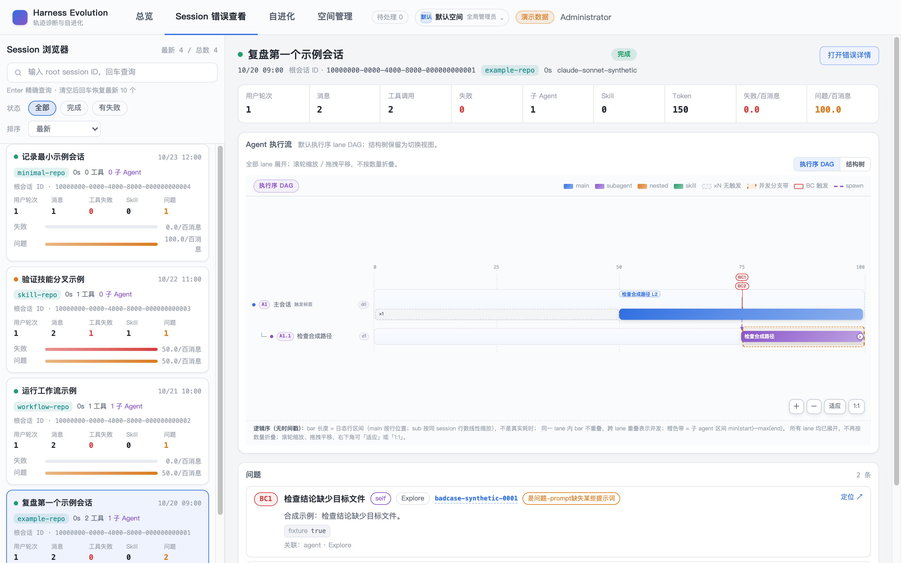

# Harness Evolution

English | [中文](README.md)

A trace-diagnosis and self-evolution service for coding agents: import real execution traces, reconstruct goals, tool calls, errors and results turn by turn, attribute bad cases to concrete objects and evidence, and feed the conclusions into the evolution flow.



<sub>Session browser and execution flow: inspect tool calls, subagents and failures lane by lane, with problem cards linking back to evidence. The capture uses local synthetic fixtures.</sub>

## Core capabilities

- **Trace inspection**: normalize Claude Code traces into root sessions, user turns, messages and an agent tree; the execution flow shows tool calls, failures and subagents lane by lane.
- **Problem attribution**: attribute a bad case to multiple objects, with problem cards carrying type, object, full ID and evidence; error details support deep links and attribution filters.
- **Evolution loop**: object configuration, a four-step wizard, seven-step runs and the lane DAG feed conclusions into the evolution flow for review before adoption.
- **Engineering boundaries**: workspaces isolate data, members, quotas and ingestion; contract, document, flow and E2E gates run in CI.

## Quick start

```sh
pnpm install
pnpm setup:api
pnpm fixtures:seed
pnpm dev
```

Web: http://localhost:5173 · API: http://127.0.0.1:8787/api/health

## Documentation

- [Architecture](docs/architecture.en.md): service boundaries, request chain and data layer
- [Development](docs/development.en.md): local environment and daily loop
- [Deployment](docs/deployment.en.md): production bootstrap, release and rollback
- [Documentation map](docs/README.en.md): every resident document
- [Development flow](.agents/flow/README.en.md): roadmap → milestone → issue
- [Decision records](.agents/notes/README.en.md): why the design is this way

## Layout

```text
apps/web/           Vue 3 + Vite frontend
apps/api/           Python 3.12 + FastAPI backend
packages/contracts  Shared protocols
docs/               Engineering docs
.agents/            Flow, notes and skills
research/           Evaluation tasks, adapters and experiments
scripts/            Dependency-free gates
```
