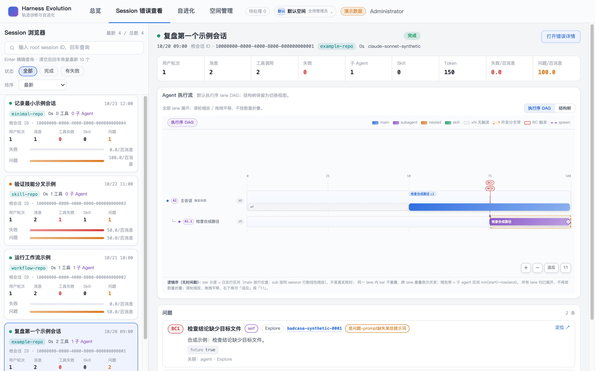

# Harness Evolution

[English](README.en.md) | 中文

面向 coding agent 的轨迹诊断与自进化服务：导入真实执行轨迹，按轮次还原目标、工具调用、错误与结果，把 bad case 归因到具体对象与证据，再送入自进化流程。



<sub>Session 浏览器与执行流：按 lane 查看工具调用、子 Agent 与失败，问题卡回链到证据。截图使用本地合成 fixtures。</sub>

## 核心能力

- **轨迹查看**：归一化 Claude Code 轨迹为根 Session、用户轮次、消息与 Agent 树；执行流按 lane 展示工具调用、失败与子 Agent。
- **问题归因**：bad case 支持多对象归因，问题卡带类型、对象、完整 ID 与证据；错误详情可深链和按归因过滤。
- **自进化闭环**：对象配置、四步向导、七步运行与 lane DAG，把结论送进自进化流程，先评审再接纳。
- **工程边界**：工作空间隔离数据、成员、额度与上报；契约、文档、流程与 E2E 门禁随 CI 执行。

## 快速开始

```sh
pnpm install
pnpm setup:api
pnpm fixtures:seed
pnpm dev
```

Web：http://localhost:5173 · API：http://127.0.0.1:8787/api/health

## 文档

- [架构](docs/architecture.md)：服务边界、请求链路与数据层
- [开发指南](docs/development.md)：本地环境与日常循环
- [部署](docs/deployment.md)：生产引导、发布与回滚
- [文档地图](docs/README.md)：全部常驻文档
- [开发流程](.agents/flow/README.md)：roadmap → milestone → issue
- [决策记录](.agents/notes/README.md)：为什么这样设计

## 结构

```text
apps/web/           Vue 3 + Vite frontend
apps/api/           Python 3.12 + FastAPI backend
packages/contracts  Shared protocols
docs/               Engineering docs
.agents/            Flow, notes and skills
research/           Evaluation tasks, adapters and experiments
scripts/            Dependency-free gates
```
