# 数据库关系图（30 表）

> 用 Mermaid 渲染：GitHub 网页、VS Code（装 Mermaid 插件）或 mermaid live editor 打开本文件即可。
> 实线 = 数据库外键（硬约束）；虚线 = 值引用（无外键，按列值对应）。
> 基准：PR #597 分支（含 #582 与合并进来的 #560）。`582`/`560` 标注对应引入的 PR。

```mermaid
erDiagram
    %% 身份与空间域
    users                ||--o{  workspaces                 : "created_by SET NULL"
    users                ||--o{  workspace_members          : ""
    workspaces           ||--o{  workspace_members          : "CASCADE"
    workspaces           ||--o{  workspace_ingest_credentials : "CASCADE"
    users                ||--o{  workspace_ingest_credentials : "created_by SET NULL"
    workspaces           ||--o{  workspace_bad_case_labels  : "CASCADE PR582"
    workspaces           ||--o{  workspace_bad_cases        : "CASCADE PR582"
    bad_cases            ||--o{  workspace_bad_cases        : "CASCADE PR582"

    %% badcase 事实表核心列
    bad_cases {
        string bad_case_id PK "全局主键"
        string workspace_id "直接上报归属兼容列"
        string origin "catalog 或 report 写者归属 PR560"
        string catalog_label "label 查询投影 PR582"
        bool   catalog_synced "公共目录标记 PR582"
        string bad_case_session_id "值引用根会话"
    }
    workspace_bad_case_labels {
        string workspace_id PK "规则表"
        string label PK "空间接受的 label"
    }
    workspace_bad_cases {
        string workspace_id PK "可见性关联 PR582"
        string bad_case_id PK ""
        string assignment_source PK "legacy_owner 或 direct_ingest 或 catalog_label"
        string label "仅 catalog_label 行"
    }

    %% 轨迹域
    sync_runs            ||--o{  source_records     : "last_sync_run_id SET NULL"
    source_records       ||--o{  session_families   : "main_record_id"
    session_families     ||--o{  agents             : "CASCADE"
    agents               ||--o{  agents             : "parent_agent_id SET NULL 自引用树"
    agents               ||--o{  agent_events       : "CASCADE"
    session_families     ||--o{  user_turns         : "CASCADE"
    agents               ||..o{  trajectory_payloads : "值引用 runtime root agent"

    %% 归因域
    bad_cases            ||--o{  bad_case_analysis  : "CASCADE"
    probe_reports        ||--o{  bad_case_analysis  : "不级联"
    session_families     ||..o{  bad_case_root_sync : "值引用 root_session_id"
    session_families     ||..o{  probe_reports      : "值引用 session_id"
    session_families     ||..o{  bad_cases          : "值引用 bad_case_session_id"

    %% 自进化域
    users                ||--o{  evolution_targets       : "created_by SET NULL"
    evolution_targets    ||--o{  evolution_runs          : "target_id SET NULL"
    users                ||--o{  evolution_runs          : "created_by SET NULL"
    evolution_runs       ||--o{  evolution_run_events    : "CASCADE"
    evolution_runs       ||--o{  evolution_run_candidates : "CASCADE"
    bad_cases            ||--o{  evolution_run_candidates : "CASCADE"
    probe_reports        ||--o|  evolution_run_candidates : "SET NULL"
    evolution_runs       ||--o{  probe_clusters          : "CASCADE"
    probe_clusters       ||--o{  probe_cluster_probes    : "CASCADE"
    probe_reports        ||--o{  probe_cluster_probes    : ""
    evolution_runs       ||--o{  evolution_rounds        : "CASCADE"
    probe_clusters       ||--o{  evolution_rounds        : "cluster_id"
    evolution_runs       ||--o|  evolution_finals        : "CASCADE"

    %% Skill 域
    attribution_skills            ||--o{  attribution_skill_revisions         : "CASCADE"
    attribution_skill_revisions   ||--o{  attribution_skill_quality_events    : "RESTRICT"
    attribution_skill_revisions   ||--o{  attribution_skill_bindings          : "RESTRICT"
    evolution_targets             ||--o{  attribution_skill_bindings          : "CASCADE"
    users                         ||--o{  attribution_skill_packages          : "created_by SET NULL"
    attribution_skill_packages    ||--o{  attribution_skill_package_bindings  : "CASCADE"
    users                         ||--o{  attribution_skill_package_bindings  : "SET NULL"

    %% 任务域
    users    ||--o{  job_runs   : "created_by SET NULL"
    job_runs ||--o|  sync_lock  : "CASCADE"
```

## 值引用（无外键，按列值对应）

以下引用**刻意不建外键**，保持外部表 bootstrap 不依赖跨 metadata：

| 列 | 指向 | 用途 |
|---|---|---|
| `bad_cases.workspace_id` | `workspaces.id` | 直接上报归属（可见性不走它，#582 后仅冲突检测） |
| `probe_reports.workspace_id` / `evolution_*.workspace_id` | `workspaces.id` | 持久化快照的空间归因 |
| `bad_cases.bad_case_session_id` | `session_families.id` | 坏例锚定的根会话 |
| `bad_case_root_sync.root_session_id` | `session_families.id` | 轨迹回填队列 |
| `probe_reports.session_id` | 根会话 id | 探针报告归属会话 |
| `trajectory_payloads.(runtime, root_session_id, agent_id)` | `agents` | 原始 payload 的逻辑键 |

## 可见性链路（#582 后的读路径）

读请求经 `WorkspaceReadScope.case_condition()`，用 `EXISTS (workspace_bad_cases WHERE workspace_id = 当前空间)` 过滤 `bad_cases`，不再读 `bad_cases.workspace_id`。
