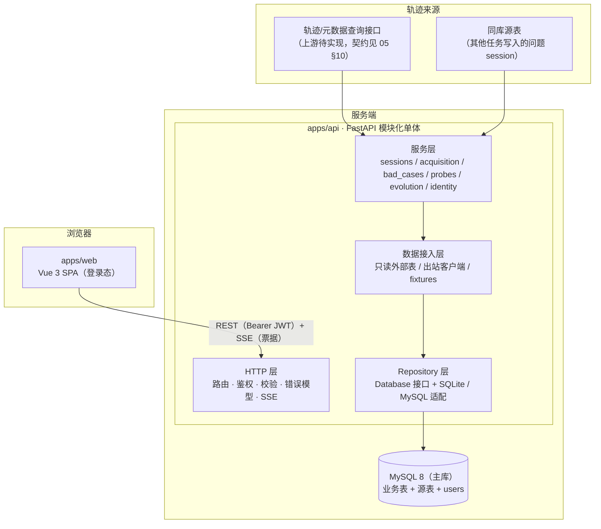
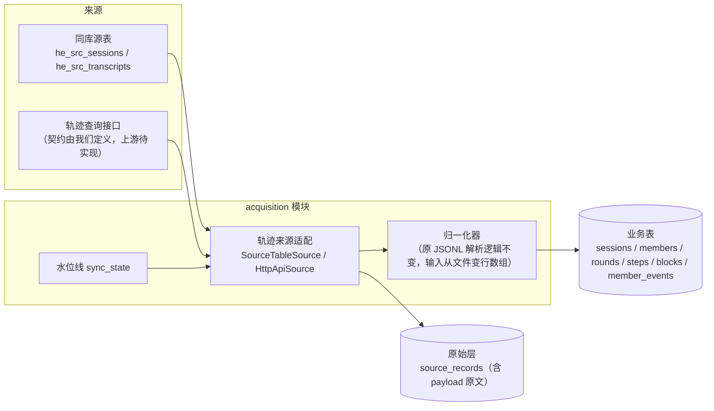
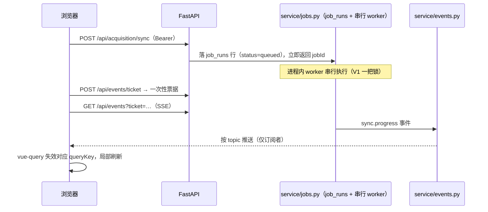
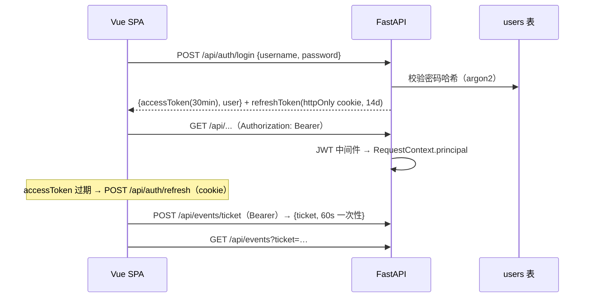
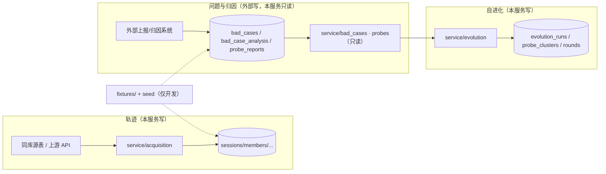

# 01 · 总体架构设计

> 本文回答：系统由哪几部分组成、数据怎么流动、外部数据怎么接入、部署形态是什么。
> 前置：[README · 文档地图与已确认决策](README.md)；下游：[02 功能点拆分](02-features.md)。
> 2026-10-22 重大修订：产品定位从"本地单机工具"改为 **SaaS 服务**，数据源从"本机文件扫描"改为"查询接口 + 同库源表"。

## 1. 系统边界

Harness Evolution 是一个 **SaaS 形态的组织内部服务**，不是装在本机上的工具：

- **输入**（两类轨迹来源，见 §4.1）：
  1. **同库源表**：其他任务把"有问题的 session 轨迹"写入我们 MySQL 里的一组源表，我们读取并归一化。
  2. **轨迹查询接口**：上游提供"Claude Code 轨迹 + 元数据"的查询 API（当前不存在，**契约由我们定义**，见 [05 §10](05-api-design.md)），按需拉取。
- **处理**：获取与归一化 → 存储（MySQL）→ 查询展示 → 问题与归因（外部只读）→ 自进化闭环（占位执行）。
- **输出**：浏览器里的两大视图（Session 错误查看 / 自进化），面向组织内全部登录用户，**单组织共享**——登录即可见全部数据，不做行级隔离。
- **不做什么**：不修改用户的 skill / agent 文件（V1 的 commit 也是演示数据）、不访问生产凭据、不做多租户、不做公网注册。

## 2. 组成与分层



四层职责一句话各一句：

| 层 | 职责 | 不做什么 |
|---|---|---|
| HTTP 层 | 路由注册、鉴权中间件、请求/响应的 Pydantic 校验、统一错误模型、SSE 通道 | 不写业务判断 |
| 服务层 | 业务规则（筛选、排序、聚合、状态机推进、ID 生成、同步编排） | 不直接拼 SQL、不直接访问外部接口 |
| 数据接入 | 只读外部表（问题/归因）、出站客户端（上游轨迹）、fixtures（演示） | 不写外部表；不把演示数据混进运行时分支 |
| Repository 层 | 表的读写，只暴露领域对象 | 不含业务规则、不含方言字符串 |

依赖方向只允许向下：HTTP → 服务 → 数据接入/CRUD。

## 3. 模块划分（垂直切片）

```text
apps/api/app/
  main.py                 # 组装入口：建 app、挂中间件（含鉴权）、注册全部路由
  config.py               # pydantic-settings：DB、鉴权、来源、同步间隔（必要补充）
  api/                    # 各域 router（薄，只做参数校验与 DTO 映射）
  api_req/                # 请求 DTO（Pydantic）
  api_resp/               # 响应 DTO（OpenAPI 契约源头）
  constants/              # 枚举、错误码、issue/topic 常量
  db/
    session.py            # engine / session / 事务上下文
    models/               # SQLAlchemy 表模型（轨迹侧 + 问题侧只读表）
    crud/                 # BaseCrud + 各表 CRUD（方法接收 AsyncSession）
  middleware/             # request_id、JWT 鉴权（含路径规则）、CORS、登录限速
  service/
    identity/             # 登录、token、用户、SSE 票据
    sessions/             # 会话列表、摘要、家族树
    acquisition/          # 轨迹来源、归一化、家族组装、幂等写入
    bad_cases/            # 问题列表与详情（外部表只读）
    probes/               # 归因结论读取（外部表只读）
    evolution/            # run、占位聚类、六步产出、推进
    catalogs/             # 目标/模型清单（只读聚合）
    jobs.py               # 串行任务执行器（job_runs）
    events.py             # 进程内 SSE 事件总线
  schemas/                # service 层数据结构（跨层传递）
  third_party_api/        # 出站 HTTP 客户端（接口 + 实现成对）
    trajectory/           # 上游轨迹查询（上游待实现）
    llm/                  # 预留：LLM 调用（V1 不用）
  utils/                  # 纯工具（JSONL 行辅助、哈希、时间、JWT）
fixtures/                 # 演示种子数据 + app/cli.py seed
alembic/                  # 迁移（项目根）
```

> 与你给的结构相比只多了 `config.py`（配置必要）与项目根 `fixtures/`、`alembic/`；`providers/`、`jobs/` 不建：轨迹来源在 `service/acquisition` + `third_party_api`，任务执行在 `service/jobs.py`。

前端（详见 [03](03-frontend-architecture.md)）：

```text
apps/web/src/
  api/                    # http 封装（Bearer 注入、401 刷新）、queryClient、queryKeys、生成契约
  composables/            # 每个域一个 useXxx（vue-query hooks）+ useAuth
  stores/                 # Pinia：登录态（access token + 当前用户）、当前 session
  pages/
    login/                # 登录页
    sessions/             # Session 浏览器（列表 + 家族摘要 + 家族树）
    errors/               # 错误详情与归因
    evolution/            # 运行列表 / 详情 / 仅聚类 / 启动向导
  components/             # family-tree / bad-cases / evolution / ui
  router/                 # 路由、深链、登录守卫
```

## 4. 数据流（四条主链路）

### 4.1 获取与同步链路（真实数据）



两类来源共用一个同步管道：

| 来源 | 触发方式 | 读取内容 | 幂等键 |
|---|---|---|---|
| 同库源表（其他任务写入的问题 session） | 手动触发 / 定时轮询（配置间隔） | 源表按 `updated_at` 水位线增量扫描 | `(source_type, source_ref)` + content hash |
| 轨迹查询接口（上游待实现） | 用户手动拉取（按 session id / 时间窗） | 按 [05 §10](05-api-design.md) 契约返回的轨迹包 | 同上 |

归一化规则不变（[06 §7.1](06-database-design.md)：轮次由"真实人类提问"派生、tool_result 回填、子转录按 `toolUseId` 挂接、家族树触发点预计算）——**输入从 `Path` 变成 `list[str]`（JSONL 行数组），解析器本身一行不改**。

原始层与归一化层分离依旧成立：`source_records` 存来源元数据 + 指纹 + **payload 原文**（SaaS 下没有"源文件"可以回读，原文必须落库，解析规则升级时据此重放）。

### 4.2 查询链路（轨迹真实 + 问题/归因外部只读）

```text
浏览器 ──GET /api/sessions/{sid}/bad-cases──► 鉴权中间件（JWT → principal）
                                              │
                                              ▼
                                        bad_cases 服务
                                              │
                          ┌───────────────────┴────────────────────┐
                          ▼                                        ▼
                  bad_cases / analysis / probe（外部表，只读）    sessions（轨迹表，真实）
                  按 session_id 联表                             校验 session 存在、取聚合数
                          └───────────────────┬────────────────────┘
                                              ▼
                               组装响应（badCaseId / probeId 真实 ID）
```

前端拿到的永远是一个完整响应；问题侧数据由外部系统写入，本服务只读。单组织共享下无行级过滤，`principal` 只记录进审计字段（`created_by`）。

### 4.3 任务与进度链路（SaaS 版）



SaaS 与单机的差别：**任务状态以 `job_runs` 表为准**（进程重启不丢、多用户共享可见），进程内 worker 只是执行器；SSE topic 按资源隔离（`run:{rid}`、`sync`），不向未订阅连接广播。

### 4.4 鉴权链路



- EventSource 不能自定义请求头，SSE 用**一次性短票据**（查询参数），不用长期 token。
- refresh token 用 httpOnly + SameSite=Strict cookie，SPA 不接触；access token 只存内存（Pinia），刷新页面时先走 refresh。

## 5. 数据来源、外部表与演示数据

### 5.1 三类数据，三种处理方式



| 数据 | 写入方 | 本服务 | 接入方式 |
|---|---|---|---|
| 轨迹（session/agent/transcript） | 源表由其他任务写；本服务同步归一化 | 读写 | `service/acquisition` + `third_party_api/trajectory` |
| 问题与归因（bad_cases / analysis / probe） | 外部系统 | **只读** | `db/models` 只读表 + `db/crud` |
| 自进化（runs / clusters / rounds / finals） | 本服务 | 读写 | `service/evolution` |
| 用户、任务审计 | 本服务 | 读写 | `service/identity`、`service/jobs.py` |

### 5.2 没有统一 Provider 层（2026-10-22 修订）

早期设计的"六类 Provider + 全量桩实现"已取消，原因：问题/归因数据由外部系统写入表，真实实现读表即可；强行加一层 Provider 只会把"读表"包成假接口。现在只有三种接缝：

1. **出站调用** → `third_party_api/`（轨迹查询接口，未来 LLM/CI），接口 + 实现成对；
2. **外部表** → `db/models` 只读映射 + `db/crud`，表契约即接口；
3. **演示数据** → `fixtures/` + `app/cli.py seed`，仅开发/演示时灌入真实表，**运行时没有 stub 分支**。

### 5.3 演示数据（fixtures）的边界

- `fixtures/` 内含原型 4 个会话、若干 bad_case / probe / 簇示例；`python -m app.cli seed` 写入真实表；
- 生产环境不执行 seed；UI 读到的永远是真实表；
- 与早期 D4 的差别：**不再有"Stub Provider 返回不入库数据"的运行时分支**，桩数据也从正式表结构走，避免字段对不上。

### 5.4 V1 的占位实现（不是 Provider）

| 占位点 | 位置 | 后续替换 |
|---|---|---|
| 聚类算法 | `service/evolution/simple_cluster`（按 attribute_type 分半） | 换真正的聚类实现，表不变 |
| patch / eval / commit | `evolution_rounds` 写入占位值 | 换真实执行器（本地或 CI） |
| 终评指标 | `evolution_finals` 占位 | 换真实评测 |
| 上游轨迹接口 | 未配置时 `HttpApiSource` 不可用 | 上游就绪后启用 |

## 6. 部署形态与扩展路径

**当前形态：单实例 SaaS**（一个 FastAPI 进程 + 一个 MySQL + 静态前端）：

```bash
uv run uvicorn app.main:app --host 0.0.0.0 --port 8787   # 生产主库 MySQL
pnpm --filter web build                                   # 前端构建产物由 FastAPI StaticFiles 或 nginx 托管
```

| 维度 | 现在 | 扩展路径 |
|---|---|---|
| 用户 | 自建账号 + JWT，单组织共享 | 需要 SSO 时加 OIDC Provider（鉴权是独立接缝） |
| 数据库 | MySQL 8 主库；SQLite 仅测试/本地开发 | 读写分离/分库暂无需求 |
| 任务 | `job_runs` 表 + 进程内串行 worker | 多实例时 worker 独立部署（同一 `job_runs` 表，`SELECT … FOR UPDATE SKIP LOCKED` 抢占） |
| SSE | 内存事件总线（单实例） | 多实例时换 Redis pub/sub（EventBus 已是接口） |
| 静态资源 | FastAPI `StaticFiles` | 换 nginx / CDN 无需改前端 |
| CORS | 配置的正式域名 | 同源托管后可关闭 |

## 7. 非功能设计要点

| 主题 | 决策 | 理由 |
|---|---|---|
| 鉴权 | 自建账号 + JWT；access 30min（内存）+ refresh 14d（httpOnly cookie）；SSE 一次性票据 | 不依赖外部 SSO；EventSource 不能带头的限制用票据绕开 |
| 首次启动 | users 表为空时用 `HE_ADMIN_USERNAME`/`HE_ADMIN_PASSWORD` 播种初始管理员 | 不自注册；后续用户由管理员创建 |
| 同步幂等 | `(source_type, source_ref)` + content hash + 水位线，重复同步零副作用 | 上游重推/重拉不得产生重复数据 |
| 大轨迹 | 家族树触发点同步时预计算；聚合统计入库时冗余；payload 原文单独表 | 375 步 / 57 个子 agent 的会话存在，不能查询时重算 |
| 契约防漂移 | OpenAPI 生成物进 `packages/contracts`，CI 校验"重新生成 = 无 diff" | D3 决策的执行保障 |
| 错误模型 | 全 API 统一 `{error:{code,message,details}}`；401/403 有独立 code | 前端一个拦截器处理所有失败态 |
| 深链可恢复 | 选中 session / bad_case / tab / step 全在 URL（真实 ID） | badCaseId / probeId 跨页溯源的载体 |
| 可观测 | 结构化日志 + sync_runs / job_runs 表留痕；不打印轨迹原文 | 轨迹可能含敏感内容 |
| 数据库可替换 | `Database` 接口 + SQLite/MySQL 适配器 | 测试用 SQLite 快跑；生产 MySQL |

## 8. 风险与对策

| 风险 | 影响 | 对策 |
|---|---|---|
| 上游查询接口迟迟不实现 | pull 来源一直空着 | 契约先行 + 源表同步先跑通；上游就绪只换适配器（[05 §10](05-api-design.md)） |
| 源表结构与我们预期不一致 | 同步解析失败 | 源表契约写入文档并约版本号；解析失败隔离到单条记录（不毁整批），错误进 `sync_runs.errors` |
| Vue Flow 与 React Flow 的 API 差异 | 家族树移植返工 | 布局几何纯 TS 原样移植，先做 `demo-nested` 最小树验证（[08 §3](08-frontend-implementation.md)） |
| 外部表契约 | 外部表结构/字段与文档漂移 | 表契约评审 + 查询层防御（字段缺失降级、日志告警）；fixtures 与真实表同构 |
| JWT 泄漏 | 组织数据暴露 | access token 短命 + 只在内存；refresh httpOnly + SameSite=Strict；所有流量走 HTTPS |
| SSE 长连接在代理下断流 | 进度不更新 | 事件带 id + Last-Event-ID 补发；REST 轮询兜底 |
| 单实例宕机 | 全员不可用 | 单组织内部工具可接受；`job_runs` 持久化保证重启续跑，横向扩展路径见 §6 |
