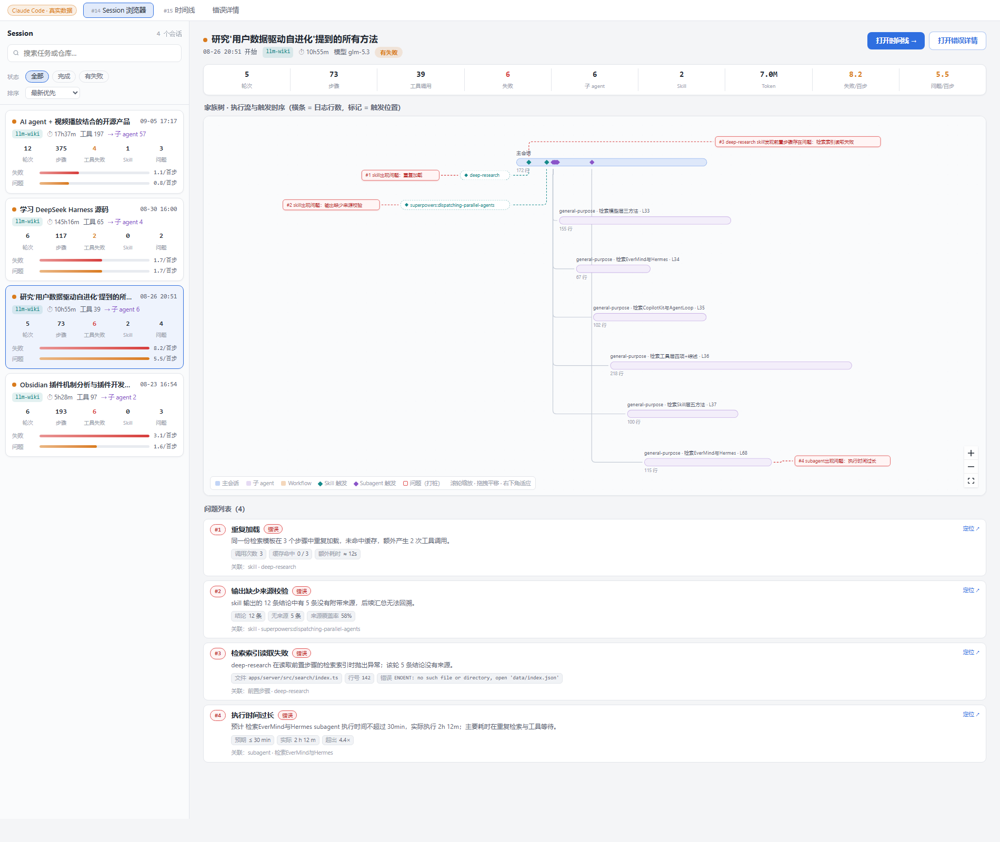
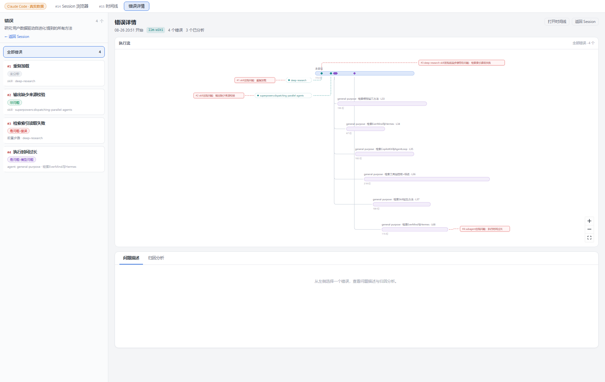
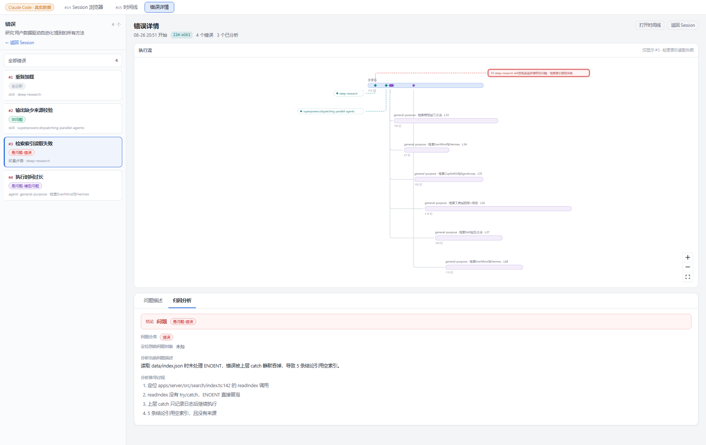
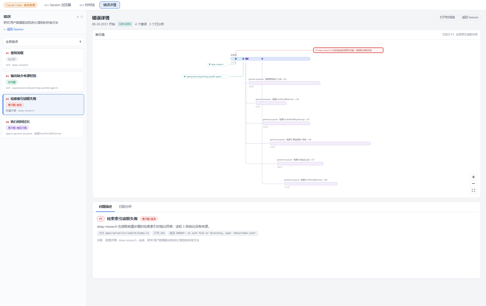
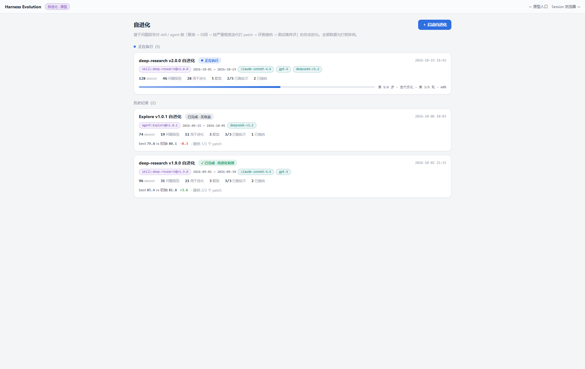
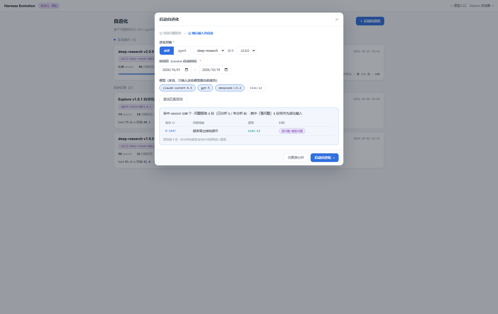
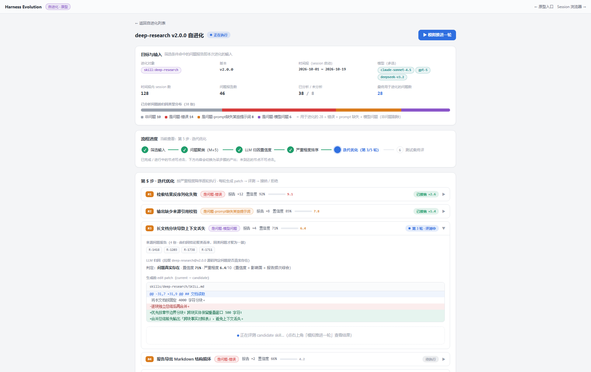
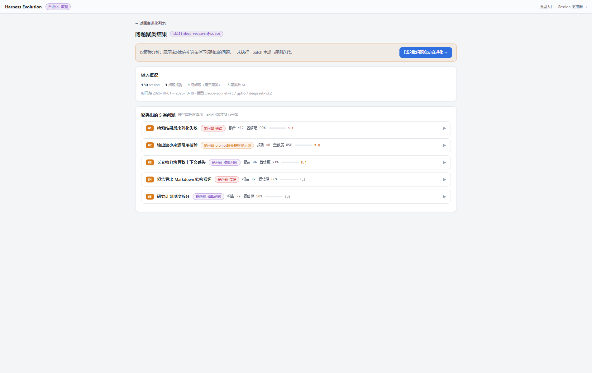

# 02 · 功能点拆分

> 本文回答：原型里到底有哪些功能、每个功能的数据是真是桩、它落在哪个域、对应哪个接口/表/组件。
> 前置：[01 总体架构](01-architecture.md)；下游：[03 前端架构](03-frontend-architecture.md) / [04 后端架构](04-backend-architecture.md) / [05 接口设计](05-api-design.md)。

## 1. 功能地图

先看一眼原型的关键截图（Session 4 张来自 `harness-evolution.html`，自进化 4 张来自 `evolution.html`，均在 [原型目录](../14-15-ui-prototype/)）：

**Session 错误查看**

| Agent 执行流图 | 错误详情与归因 |
|---|---|
|  |  |

| 归因分析 | 问题卡与定位 |
|---|---|
|  |  |

**自进化**

| 运行列表 | 启动向导（命中确认） |
|---|---|
|  |  |

| 运行详情（第 5 步迭代） | 仅聚类结果 |
|---|---|
|  |  |

> F19 对象配置、F20 执行日志是新增功能，原型没有对应截图；功能点仍在 §2.2 定义。

```text
                         ┌───────────────────┐
                         │ Harness Evolution │
                         └─────────┬─────────┘
          ┌────────────────────────┼────────────────────────┐
          ▼                        ▼                        ▼
┌─ Session 错误查看 ──┐  ┌─ 自进化 ─────────────┐  ┌─ 横切能力 ──────────┐
│ F3 Session 列表     │  │ F10 运行列表         │  │ F1 顶部导览          │
│ F4 会话概览         │  │ F11 启动向导         │  │ F2 ID 体系与深链     │
│ F5 Agent 执行流图   │  │ F12 仅聚类结果       │  │ F9 轨迹接入与归一化  │
│ F6 会话内问题列表   │  │ F13 运行详情         │  │ F14 进度推送（SSE）  │
│ F8 错误详情与归因   │  │ F19 进化对象配置     │  │ F15 对象/模型清单    │
│                     │  │ F20 执行日志         │  │ F18 登录与鉴权       │
└─────────────────────┘  └──────────────────────┘  └──────────────────────┘
```

## 2. 功能点明细

图例：**真实性** = 真实（由同步/外部表驱动）/ 占位（fixtures 或占位算法）/ 混合（真实骨架 + 占位内容）；**阶段**沿用 [README](README.md) 的定位（S=会话查看，E=自进化，C=横切）。

### 2.1 Session 错误查看域

| ID | 功能 | 原型出处 | 真实性 | 依赖接口 | 依赖表 | 前端落点 |
|---|---|---|---|---|---|---|
| F3 | Session 列表：搜索（标题/仓库）、状态 chips（全部/完成/有失败）、排序（最新/用户轮次/消息/子 agent）、卡片密度条（失败/百消息、问题/百消息） | [浏览器页](../14-15-ui-prototype/harness-evolution.html) | 真实 | `GET /api/sessions` | `session_families`（轨迹聚合列）+ `bad_cases`（问题数查询时聚合） | `pages/sessions/SessionList.vue` |
| F4 | 会话概览：标题、meta、状态徽章、9 项统计条、CTA（打开错误详情） | 同上 | 真实 | `GET /api/sessions/{sid}` | `session_families`（轨迹聚合列）+ `bad_cases`（问题数查询时聚合） | `pages/sessions/SessionOverview.vue` |
| F5 | Agent 执行流图：主会话/子 agent/workflow/forked skill 节点、节点链（skill/subagent/workflow 触发 + ×N message 间隔）、问题卡（`self` / `discovery` 两类锚定）、折叠组 | 同上 | **真实**：结构来自轨迹表，问题卡来自外部 `bad_cases` | `GET /api/sessions/{sid}/tree` | `agents`、`agent_events`、`bad_cases` | `components/agent-tree/*` |
| F6 | 会话内问题列表：bad_case 列表（title 短标题、reason 描述正文、归因数、上报对象、metaData 事实）、定位联动、`badCaseId` 深链 | 同上 | 真实（上报写入；归因只读） | `GET /api/sessions/{sid}/bad-cases` | `bad_cases`、`bad_case_analysis` | `components/bad-cases/BadCaseList.vue` |
| ~~F7~~ | ~~时间线：用户轮次分组、类型过滤、消息卡、展开/折叠~~ **已裁撤（2026-10-22）：完整时间线由外部平台承担**；本服务只保留 `user_turns` 作为用户输入锚点（prompt + 行号/message 偏移），供未来执行流展示；消息/内容块不落库 | — | — | —（不提供读接口） | `user_turns`（内部） | — |
| F8 | 错误详情与多归因：左栏可折叠 bad_case 组 + 归因子项分页（3 种状态：尚未归因 / 可归因 / 非该对象问题）、执行流按问题过滤、问题描述/归因分析双 Tab、结论横幅、对象·版本、推导过程（Markdown） | 同上 | 真实（`bad_cases` + `bad_case_attributions`，归因由 run 生成） | `GET /api/bad-cases/{badCaseId}`、`/analysis`、`GET /api/probes/{probeId}` | `bad_cases`、`bad_case_analysis`、`probe_reports` | `pages/errors/*` |

### 2.2 自进化域

| ID | 功能 | 原型出处 | 真实性 | 依赖接口 | 依赖表 | 前端落点 |
|---|---|---|---|---|---|---|
| F10 | 运行列表：进行中（脉冲+进度条+阶段文案）/ 历史两组；卡片含对象 chip、时间窗、策略/缓存 chip、关联 Session/潜在/可归因/复用统计、best vs 初始、已接纳数 | [自进化页](../14-15-ui-prototype/harness-evolution.html) | 真实（编排）+ 占位 patch/评测 | `GET /api/evolution/runs` | `evolution_runs`、`probe_clusters` | `pages/evolution/RunList.vue` |
| F11 | 启动向导：四步 Modal（范围+策略 → Session 关联 → 潜在 bad case → 归因预览与缓存开关）；对象/版本由本空间 targets 加载；出口「仅聚类」「启动自进化」均返回 `202` 后跳转显示 preparing | 同上 | 真实（probe 查询）+ 占位聚类 | `GET /api/catalogs/targets`、`GET /api/evolution/targets/{id}/versions`、`GET /api/catalogs/models`、`POST /api/evolution/probes/query`、`POST /api/evolution/cluster-previews`、`POST /api/evolution/runs` | `evolution_targets`、`agents`、`session_families`、`probe_reports`、`evolution_runs` | `pages/evolution/LaunchWizard.vue` |
| F12 | 仅聚类结果页：`preparing` 准备态、输入概况（关联 Session/潜在/聚类数）、聚类列表（簇内来源 bad case）、一键转完整自进化 | 同上 | 真实（占位聚类算法） | `POST /api/evolution/cluster-previews`、`GET /api/evolution/runs/{rid}/steps/clusters` | `probe_clusters`、`probe_cluster_probes` | `pages/evolution/ClusterPreview.vue` |
| F13 | 运行详情：`preparing/running/blocked` 状态、目标与输入 panel（策略/缓存、关联 Session/潜在/可归因、分支/base commit、eval/push 状态）、7 步 stepper、迭代步自动逐轮 candidate → push → 评测 → 接纳/拒绝 → 下一轮、终评；blocked 时按阶段重试（含 `attribution`） | 同上 | 编排/聚类/patch/commit/push 真实；评测走外部 gateway（V1 可 fake）；终评占位 | `GET /api/evolution/runs/{rid}`、`GET .../steps/{input / clusters / attribution / severity / iteration / final}`、`POST .../retry` | `evolution_targets/runs/evolution_rounds/finals`、`probe_clusters/probe_cluster_probes` | `pages/evolution/RunDetail.vue` + `pages/evolution/components/*` |
| F19 | 进化对象配置页：列表/新增/编辑/删除；字段 objectType/objectName/repoUrl/subDir/defaultRef/validationProjectId/testProjectId/enabled；列表合并展示验证集/测试集工程；入口在向导 Step1 提示文案内的「配置页」链接 | 新增（2026-10-23） | 真实 | `GET/POST/PUT/DELETE /api/evolution/targets`、`GET .../{id}/versions` | `evolution_targets`、`evolution_runs`（创建期快照） | `pages/evolution/targets/*` |
| F20 | 执行日志与异常：准备/候选/push/eval/接纳/拒绝/下一轮/阻塞/重试事件，失败与中断记录、错误详情、增量拉取 | 新增（2026-10-23） | 真实 | `GET /api/evolution/runs/{rid}/events`、SSE `run.event/run.blocked/run.failed/run.interrupted` | `evolution_run_events`、`evolution_runs.error_*` | `pages/evolution/components/RunLogPanel.vue` |

> F11 不读前端常量：对象/版本来自 `evolution_targets` + 仓库 tag，模型来自归一化后的 `agents.model`；三者都通过后端接口加载。
>
> 界面上的「未分析」不再是不可分析的死状态：潜在 bad case 在本 run 内必然被归因（可归因或非该对象），只有从未进入任何 run 的 bad case 才显示「尚未归因」。归因结果按对象·版本缓存，跨 run 复用。

### 2.3 横切能力

| ID | 功能 | 原型出处 | 真实性 | 依赖接口 | 依赖表 | 前端落点 |
|---|---|---|---|---|---|---|
| F1 | 顶部导览：两大视图切换、品牌、ID 串联网提示 | 全局 | 真实 | — | — | `App.vue` / `TopNav.vue` |
| F2 | ID 体系：URL 直接用 `badCaseId` / `attributionId` / `clusterId` / `runId`（真实 ID），UI 显示截短 ID；深链到 session 错误详情并指定 tab / 归因 | 全局 | 真实 | 随 bad-case / attributions 返回 | `bad_cases`、`probe_reports` | `utils/badCaseId.ts` + 深链 |
| F9 | 轨迹接入与归一化：第三方脚本只写 `trajectory_payloads`（原始 JSONL）；本服务后台定时读取、归一化、幂等写入业务表；保留上游 pull | design.md §7 + SaaS 前提 | 真实 | `POST /api/acquisition/sync`、`POST /api/acquisition/pull`、`GET /api/acquisition/status` | `trajectory_payloads`（只读）、`source_records`、`sync_runs` + `session_families/agents/user_turns/agent_events` | 顶栏状态角标（admin 可立即处理） |
| F14 | 进度推送：**页面级 SSE**，仅 `preparing/running` 的 run 订阅；ticket 绑定 topics 与 cursor、完成/阻塞即关闭；已完成任务和轨迹归一化都走普通 REST | — | 真实（机制） | `POST /api/events/ticket`、`GET /api/events` | `evolution_run_events` | `composables/useRunEvents.ts` |
| F15 | 对象/模型清单：可进化对象/版本（来自 `evolution_targets` 配置 + 远端仓库 tag）、模型 chips（来自归一化后的 `agents.model`） | 向导 | 真实（只读聚合） | `GET /api/catalogs/targets`、`GET /api/catalogs/models` | `evolution_targets`、`agents`、`session_families` | `composables/useTargets.ts` / `useCatalogs.ts` |
| F16 | ~~模拟推进：对运行中的 run 推进一步~~ **已取消（2026-10-23）**：改为后台自动逐轮推进，生产 UI 不再提供按钮 | 详情页按钮 | — | — | — | — |
| F17 | 基础壳：健康检查、全局错误处理、空态/加载态/失败态 | 各页面 | 真实 | `GET /api/health` | — | `App.vue` + 各页面三态 |
| F18 | 登录与鉴权：登录页、access/refresh token、401 自动刷新、首登强制改密、路由守卫、SSE 一次性票据、顶栏用户区与退出 | SaaS 前提 | 真实 | `POST /api/auth/login`、`POST /api/auth/refresh`、`POST /api/auth/logout`、`POST /api/auth/change-password`、`GET /api/auth/me`、`POST /api/events/ticket` | `users` | `pages/login/*` + `stores/auth.ts` |

### 2.4 V2 功能点（2026-11-11 增补；契约见 [05 §4.16–§4.20](05-api-design.md)，数据见 [06 §3.10–§3.12](06-database-design.md)/[06 §4.2](06-database-design.md)/[06 §5.3–§5.4](06-database-design.md)/[06 §5.9](06-database-design.md)，实现见 [07 §5.11–§5.15](07-backend-implementation.md)，前端见 [08 §4–§11](08-frontend-implementation.md)）

新增功能：

| ID | 功能 | 原型出处 | 依赖接口（空间前缀） | 依赖表 | 前端落点 |
|---|---|---|---|---|---|
| F21 | 登录与鉴权接入预留：会话聚合（user + workspaces）、AuthProvider 接缝、SSO 回调占位、不开放注册 | [V2 原型](../ui-prototype-v2/harness-evolution.html) 登录页/鉴权接入 Tab | `GET /api/auth/session`、`GET /api/auth/callback`（占位 501） | `users`、`workspace_members` | `stores/auth.ts` + 空间管理鉴权 Tab |
| F22 | 工作空间管理：创建（额度 + 初始空间管理员多选）、额度调整、成员与角色（space_admin/member/viewer）、自任空间管理员、上报凭据轮换 | 空间管理四 Tab | `GET/POST/PUT /api/workspaces`、`…/members`、`…/credentials`、`…/members/self-admin` | `workspaces`、`workspace_members`、`workspace_ingest_credentials` | `pages/workspaces/Admin.vue` |
| F23 | bad case 上报接入：每空间独立地址 + Bearer 凭据，body 即 `bad_cases` 类型，额度上限 409，幂等 upsert | 上报接入 Tab | `POST /api/workspaces/{wid}/bad-cases`（凭据鉴权） | `bad_cases`（`workspace_id`）、`workspaces.quota` | 上报接入 Tab（地址/示例/复制） |
| F24 | 工作空间总览（bad case 视角）：指标条、时间/粒度、来源多选、self/discovery 堆叠趋势、来源分布与矩阵、组合筛选分页列表、下钻错误详情 | 总览页一级 Tab | `GET …/overview/summary|trend|sources`、`GET …/bad-cases` | `bad_cases`、`session_families` | `pages/overview/Index.vue` |
| F25 | 进化对象总览（二级 Tab）：对象多选趋势与三态、关联 Session/潜在分布、对象列表（可进化排序、分页、就地增编删）、潜在 bad case 列表、单对象分析卡 | 总览页二级 Tab | `GET …/overview/targets`、`…/targets/trend|cases|{id}/detail` | `bad_cases`、`bad_case_attributions`、`evolution_targets` | `pages/overview/components/TargetsOverview.vue` |
| F26 | 归因进自进化：向导四步（范围+策略 → Session 关联 → 潜在 bad case → 归因预览与缓存开关）、run 七步详情、潜在策略（默认/自定义）、归因缓存与「非该对象问题」 | 向导/运行详情 | `POST …/evolution/preview/{sessions|potential|attribution}`、`POST …/evolution/runs`、`GET …/runs/{rid}/steps/{key}`（七步） | `evolution_runs`、`evolution_run_candidates`、`bad_case_attributions`、`evolution_cluster_cases` | `LaunchWizard.vue`、`RunDetail.vue` 新 step 组件 |
| F27 | 错误详情多归因：左栏可折叠 bad case 组 + 归因子项分页（2 条/页）、归因 Tab 承载多条结论、未归因一键启动自进化 | 错误详情页 | `GET …/bad-cases/{id}/attributions`（分页）、`GET …/attributions/{attributionId}` | `bad_case_attributions`、`evolution_run_candidates` | `ErrorSidebar.vue`、`AttributionReport.vue` |

修改的 V1 功能点：

| ID | V2 变更 |
|---|---|
| F3 | Session 列表改空间投影口径：默认最新 10 条（响应带 `total/pendingSessions`）、搜索回车触发；接口加空间前缀（[08 §5.2.1](08-frontend-implementation.md)） |
| F5/F6/F8 | 数据加空间校验；`BadCase` 带 `attributionCount/hasAttribution`；F8 归因来源改为 `bad_case_attributions`（由 `probe_reports` 演进），左栏从错误卡改为可折叠组 + 归因子项（[08 §7](08-frontend-implementation.md)） |
| F10/F11/F13 | run 卡片增空间/策略/缓存信息；向导两步改四步、移除模型多选；详情六步改七步（单一 schema，无历史双轨）（[08 §9/§10](08-frontend-implementation.md)） |
| F19 | 进化对象配置按空间隔离：唯一键 `(workspace_id, object_type, object_name)`，空间管理员可写（[06 §3.5](06-database-design.md)） |
| F9 | 目录同步默认停用（空间上报为主通道）；根轨迹补齐保持启用（[06 §4.1](06-database-design.md)） |
| F14/F15 | SSE topic 仍只有 `run:{rid}`，取票时校验空间可见性；模型/对象清单按空间过滤 |

### 2.5 V2 功能点的验收口径

与 §5 的 V1 口径同粒度，逐条可测：

- **F21 鉴权接入**：登录后 `GET /auth/session` 返回 `user + workspaces`；未登录任一业务端点 401；`mustChangePassword=true` 时仅改密/登出/`me`/`session` 放行；IdP 未配置时 `/auth/callback` 501；匹配不到用户 403 且不建号。
- **F22 空间管理**：全局管理员建空间（额度 + 初始管理员多选）→ 空间管理员可调额度/管成员/配对象/启动自进化 → 成员与只读成员写操作一律 403；名额授权边界（空间管理员不能授 `space_admin`、不能改 `space_admin` 行）逐条 403/409；「自任空间管理员」仅全局管理员可用。
- **F23 上报接入**：凭据 + body（17 字段边界）→ 201；重复 `badCaseId` 覆盖且 `used` 不变；额度满 409 且旧数据不丢；跨空间凭据 403；凭据轮换后旧凭据 401；上报后自动进入轨迹补齐队列。
- **F24 bad case 总览**：指标条 6 项与 SQL 手算一致；来源多选不选=全部；日/周/月分桶与空桶补零正确；列表组合筛选（时间/来源/类型任意为空）分页 8 条；点 ID 深链在新窗口恢复到对应 bad case 的问题描述 Tab。
- **F25 进化对象总览**：对象列表按可进化量降序、5 条/页；潜在数与向导/run 同条件一致；三态计数去重正确；版本分布允许同一 bad case 多版本出现且「去重后」真实去重；单对象卡的时间窗独立于总览。
- **F26 归因进自进化**：向导四步（② 只列对象出现过的 Session、③ 命中原因列、④ 潜在/复用/新增/历史非该对象四数）；默认策略两支并集可复现；自定义三开关真值表逐格；缓存第二次运行 `reused == potential`；「非该对象问题」不进簇但错误详情可见；七步详情与 `steps_schema` 双轨。
- **F27 错误详情多归因**：左栏可折叠组与组内分页（2 条/页）；父行→问题描述、子项→归因分析并定位；多条导航 `N/total`；未归因空态 + 启动入口（仅空间管理员可见）；深链 `?case=&tab=&at=` 可恢复。

## 3. 功能点 → 数据来源矩阵（哪些是桩）

| 数据 | 原型里的来源 | 本方案来源 | 接入真实实现的位置 |
|---|---|---|---|
| 会话列表/会话概览/Agent 会话树结构 | `SESSIONS` / `TREE` 常量 | 读 `trajectory_payloads` → 归一化业务表；上游 pull 同管线 | 外部脚本写 payload；本服务归一化 |
| Agent 执行流图上的问题卡 | `SESSIONS.findings` + 生成逻辑 | 外部 `bad_cases`（只读） | 上游上报/归因系统 |
| 问题的文案与事实 | `lastDefs` / `skillDef` / `reportedDef` 模板 | `bad_cases.title` + `bad_cases.bad_case_description` + `meta_data` | 同上 |
| 归因结论/分类/根因对象/推导 | `ERROR_META` | 自进化 run 生成的 `bad_case_attributions`（由 `probe_reports` 演进，对象·版本多条） | 归因引擎写；历史行为 `legacy-probe-import` |
| 工作空间与成员 | `WORKSPACES` 常量（原型） | `workspaces` / `workspace_members`；`used` 实时聚合 | 空间管理端点（[05 §4.16](05-api-design.md)） |
| bad case 上报 | 原型「上报接入」表单 | `POST /api/workspaces/{wid}/bad-cases`（凭据 + 额度） | 上报接口写入 `bad_cases.workspace_id`（[05 §4.17](05-api-design.md)） |
| 总览指标/趋势/来源 | 原型哈希抽样 | `bad_cases` 按 `created_at` 聚合 + 潜在匹配共用实现 | 总览聚合端点（[05 §4.18](05-api-design.md)） |
| 问题报告（R-） | `REPORTS` 常量 | **取消**：归因行即结论 | — |
| 自进化 runs / 簇 / patch / eval / commit / final | `RUNS` / `PATCH` 常量 | runs 与簇由本服务写；patch/eval/final 为占位 | 后续接真实执行器 |
| 进化对象/版本清单 | `OBJECTS` / `VERSIONS` | `evolution_targets` 配置（repoUrl + defaultRef + subDir；版本取远端 tag） | 配置页维护；后续接远端版本下载 |
| 模型清单 | `MODELS` | `SELECT DISTINCT model FROM agents`（归一化时写入；主/子 agent 可不同） | 随定时归一化数据更新 |

**演示数据要求**：开发/演示用 `fixtures/` 种子数据（原型 4 会话 + 若干 bad case 与归因行），通过 `python -m app.cli seed` 写入真实表；**运行时没有 Stub Provider 分支**，UI 永远读真实表。见 [07 §2](07-backend-implementation.md)。

## 4. 阶段切分建议（供后续 milestone 讨论，不是最终排期）

| 阶段 | 目标 | 包含功能 | 验收信号 |
|---|---|---|---|
| A. 骨架与契约 | 前后端架子、OpenAPI 契约、外部表接入、健康检查、登录鉴权 | F17、F1、F2 基建、F18、数据接入与 fixtures | 登录后能拉到 health 与清单；未登录访问 API 返回 401；`openapi-typescript` 生成物无漂移 |
| B. 轨迹接入与归一化 | 读 `trajectory_payloads` 待处理记录 + 上游 pull + 会话两页 | F9、F3、F4、F5（结构） | 同一 payload 重复处理不产生重复；payload 变更/parser 升级只重放对应 agent；切 MySQL 后同一套用例通过 |
| C. 问题与归因 | bad_case 列表/详情、归因 tab（归因只读） | F5（问题卡）、F6、F8 | bad_case 与归因行来自真实表；`badCaseId` 深链可用；3 种归因状态正确 |
| D. 自进化 | 运行列表、向导、对象配置、七步详情、执行日志（真实 workspace/candidate push、eval gateway、自动逐轮推进） | F10–F13、F15、F19、F20 | 配置页可维护；candidate 先 push 再评测，接纳 fast-forward、拒绝删 candidate；失败/阻塞可在日志看到并可重试 |
| E. 接真执行 | 换真实执行器（本地/CI）与真实上游来源 | 占位实现替换 | 前端零改动，仅换后端实现 |
| F. V2（2026-11-11） | 多用户鉴权接入 + 多工作空间 + 上报额度 + 总览 + 归因进自进化 + 多归因详情 | F21–F27，改造 F3/F5/F6/F8/F9/F10/F11/F13/F14/F15/F19 | 空间隔离与权限矩阵测试通过；上报额度与幂等正确；总览/向导/run 三处潜在口径一致；七步 run 与旧六步双轨；错误详情多归因分页与深链可用（详见 §2.5） |

> 阶段 A–D 是"能演示完整原型"的最小闭环；E 是占位实现的兑现。milestone 讨论时再把 A–D 拆到 M2/M3/M4 的 issue 里。

## 5. 每个功能点的验收口径（摘要）

- **F3**：四个 session 一屏放得下；搜索/筛选/排序都是纯前端状态 + 查询参数；空列表显示空态而不是空白。
- **F4**：9 项统计数字与后端口径一致（问题数来自 `bad_cases` 按会话实时聚合，其余来自整树聚合列）；密度分母 = `messages_count`（整棵树口径，design.md §7），满格 3/百消息。
- **F5**：问题卡归属由后端 `anchor.agentId + anchor.eventIndex` 决定，不按"最后一个 agent"猜测；`self + agent` 挂上报人节点，skill 挂最后一次触发，`discovery + agent` 挂父节点调用该 subagent 的触发点；子 agent 超过 8 个折叠。
- **F6**：bad_case 按 `createdAt` 升序；`badCaseId` 截短显示、tooltip 全量；点击新窗口打开对应 session 的对应问题；定位会滚动并高亮问题卡。
- **F7（裁撤）**：不做时间线页面，完整时间线由外部平台承担。本服务只保留 `user_turns` 用户输入锚点，消息/内容块不落库；不提供任何时间线读接口，Agent 执行流图上"打开时间线"入口一并移除。
- **F8**：3 种归因状态（尚未归因 / 可归因（附 category）/ 非该对象问题）；"全部错误"恢复完整执行流；选中单个错误时只保留该问题卡；归因 tab 顺序固定（结论 → 对象·版本与来源 run → 置信度与策略 → 触发点对照 → 说明 → 推导 bad_case）。
- **F10–F13**：真实 bad case / 归因 + 占位聚类；stepper 未到达节点不可点；进度百分比与阶段文案由后端给出；run 有独立 workspace 与 `evo/{YYYYMMDD}-{run_id}` 分支；每个 candidate 先 push 临时 ref 再评测，接纳后 fast-forward run 分支、拒绝删除 candidate。
- **F19**：只有配置且启用的对象出现在向导；配置校验 repoUrl/defaultRef/subDir，非法值返回 422；删除被 run 引用的配置返回 409。
- **F20**：每个 run 的阶段、candidate、评测、推送都有 `evolution_run_events` 行；`failed/interrupted` 有错误摘要与脱敏详情；刷新后日志仍可查。
- **F14**：断线 3 秒内自动重连；重连后进度不倒退。
- **F9**：同一 `(root_session_id, agent_id)` + 相同 hash/parser_version 重复处理零副作用；payload 变化或 parser 升级仅重放对应 agent；单条失败不毁整批（进 `sync_runs.errors`）；定时与手动并发只产生一个 sync job（`sync_lock`）。
- **F18**：未登录访问任意页面跳登录页；access 过期自动 refresh 一次，refresh 失效回登录页；SSE 票据一次性、60 秒有效、绑定 topics。
- **F2**：所有深链在新窗口打开后能恢复到同样的选中状态（session + case + tab / run + step）。
