# 02 · 功能点拆分

> 本文回答：原型里到底有哪些功能、每个功能的数据是真是桩、它落在哪个域、对应哪个接口/表/组件。
> 前置：[01 总体架构](01-architecture.md)；下游：[03 前端架构](03-frontend-architecture.md) / [04 后端架构](04-backend-architecture.md) / [05 接口设计](05-api-design.md)。

## 1. 功能地图

先看一眼原型的四张关键截图（全部来自 [原型目录](../14-15-ui-prototype/)），后面所有功能拆分都围绕它们展开：

| 家族树执行流 | 错误详情与归因 |
|---|---|
|  |  |

| 归因分析 | 问题卡与定位 |
|---|---|
|  |  |

```mermaid
flowchart TB
    ROOT["Harness Evolution"]
    ROOT --> A["Session 错误查看"]
    ROOT --> B["自进化"]

    A --> A1["F3 Session 列表<br/>搜索·筛选·排序·密度"]
    A --> A2["F4 家族摘要<br/>统计条·CTA"]
    A --> A3["F5 家族树执行流图<br/>节点链·问题卡·折叠"]
    A --> A4["F6 会话内问题列表"]
    A --> A5["F8 错误详情与归因<br/>状态·双 Tab·执行流联动"]

    B --> B1["F10 运行列表<br/>进行中·历史"]
    B --> B2["F11 启动向导<br/>筛选·命中确认·两出口"]
    B --> B3["F12 仅聚类结果"]
    B --> B4["F13 运行详情<br/>6 步 stepper·逐轮产出"]
    B --> B5["F19 进化对象配置<br/>repo/tag/子目录"]
    B --> B6["F20 执行日志<br/>过程/异常/重试"]

    ROOT --> C["横切能力"]
    C --> C1["F1 顶部导览"]
    C --> C2["F2 ID 体系与深链"]
    C --> C3["F9 轨迹获取与同步"]
    C --> C4["F14 进度推送（SSE）"]
    C --> C5["F15 对象/模型清单"]
    C --> C6["F16 模拟推进（演示）"]
    C --> C7["F18 登录与鉴权"]
```

## 2. 功能点明细

图例：**真实性** = 真实（由同步/外部表驱动）/ 占位（fixtures 或占位算法）/ 混合（真实骨架 + 占位内容）；**阶段**沿用 [README](README.md) 的定位（S=会话查看，E=自进化，C=横切）。

### 2.1 Session 错误查看域

| ID | 功能 | 原型出处 | 真实性 | 依赖接口 | 依赖表 | 前端落点 |
|---|---|---|---|---|---|---|
| F3 | Session 列表：搜索（标题/仓库）、状态 chips（全部/完成/有失败）、排序（最新/轮次/步骤/子 agent）、卡片密度条（失败/百问、问题/百步） | [浏览器页](../14-15-ui-prototype/harness-evolution.html) | 真实 | `GET /api/sessions` | `sessions`（聚合列） | `pages/sessions/SessionList.vue` |
| F4 | 家族摘要：标题、meta、状态徽章、9 项统计条、CTA（打开错误详情） | 同上 | 真实 | `GET /api/sessions/{sid}` | `sessions` | `pages/sessions/FamilySummary.vue` |
| F5 | 家族树：主会话/子 agent/workflow 节点、节点链（skill/subagent 触发 + ×N 压缩）、问题卡（`self` / `discovery` 两类锚定）、折叠组 | 同上 | **真实**：结构来自轨迹表，问题卡来自外部 `bad_cases` | `GET /api/sessions/{sid}/tree` | `members`、`member_events`、`bad_cases` | `components/family-tree/*` |
| F6 | 会话内问题列表：bad_case 列表（reason 文案、状态、上报对象、metaData 事实）、定位联动、`badCaseId` 深链 | 同上 | 真实（外部写入，只读） | `GET /api/sessions/{sid}/bad-cases` | `bad_cases`、`bad_case_analysis` | `components/bad-cases/BadCaseList.vue` |
| ~~F7~~ | ~~时间线：轮次分组、类型过滤、步骤卡、展开/折叠~~ **已裁撤（2026-10-22 决策：不做）**；`rounds/steps/blocks` 表仍保留，仅用于列表/摘要的统计聚合与后续诊断 | — | — | —（不提供读接口） | `rounds/steps/blocks`（内部） | — |
| F8 | 错误详情与归因：左栏 bad_case 卡（5 种展示状态）、执行流按问题过滤、问题描述/归因分析双 Tab、结论横幅、根因对象、推导过程、非问题原因 | 同上 | 真实（`bad_cases` + 外部归因 `probe_reports`，只读） | `GET /api/bad-cases/{badCaseId}`、`/analysis`、`GET /api/probes/{probeId}` | `bad_cases`、`bad_case_analysis`、`probe_reports` | `pages/errors/*` |

### 2.2 自进化域

| ID | 功能 | 原型出处 | 真实性 | 依赖接口 | 依赖表 | 前端落点 |
|---|---|---|---|---|---|---|
| F10 | 运行列表：进行中（脉冲+进度条+阶段文案）/ 历史两组；卡片含根因对象 chip、时间窗、模型 chips、probe/簇统计、best vs 初始 | [自进化页](../14-15-ui-prototype/harness-evolution.html) | 真实（编排）+ 占位 patch/评测 | `GET /api/evolution/runs` | `evolution_runs`、`probe_clusters` | `pages/evolution/RunList.vue` |
| F11 | 启动向导：两步 Modal（根因对象/版本/时间段/模型 → 命中统计+属性分布+分页 probe 表），出口「仅聚类」「启动自进化」 | 同上 | 真实（probe 查询）+ 占位聚类 | `POST /api/evolution/probes/query`、`POST /api/evolution/cluster-previews`、`POST /api/evolution/runs` | `probe_reports`、`evolution_runs` | `pages/evolution/LaunchWizard.vue` |
| F12 | 仅聚类结果页：输入概况、聚类列表（簇内 probe）、一键转完整自进化 | 同上 | 真实（占位聚类算法） | `POST /api/evolution/cluster-previews`、`GET /api/evolution/runs/{rid}/steps/1` | `probe_clusters`、`probe_cluster_probes` | `pages/evolution/ClusterPreview.vue` |
| F13 | 运行详情：目标与输入 panel（属性分布条、分支/base commit、push 状态）、6 步 stepper、第 1 步 probe 筛选、第 2 步聚类、第 3 步归因确认、第 4 步排序、第 5 步逐轮 patch/评测/接纳/commit、第 6 步终评 | 同上 | 编排/聚类/patch 落盘与 commit 真实；eval/终评占位；完成后 push | `GET /api/evolution/runs/{rid}`、`GET /api/evolution/runs/{rid}/steps/{0..5}`、`POST /api/evolution/runs/{rid}/push` | `evolution_targets/runs/rounds/finals`、`probe_clusters/probe_cluster_probes` | `pages/evolution/RunDetail.vue` + `components/evolution/*` |
| F19 | 进化对象配置页：列表/新增/编辑/删除；字段 objectType/objectName/repoPath/subDir/defaultRef/enabled；入口在向导选择器右侧齿轮 | 新增（2026-10-23） | 真实 | `GET/POST/PUT/DELETE /api/evolution/targets`、`GET .../{id}/versions` | `evolution_targets` | `pages/evolution/targets/*` |
| F20 | 执行日志与异常：run 执行事件时间线（阶段/candidate/评测/接纳/推送）、失败与中断记录、错误详情、增量拉取 | 新增（2026-10-23） | 真实 | `GET /api/evolution/runs/{rid}/events`、SSE `run.event/run.failed/run.interrupted` | `evolution_run_events`、`evolution_runs.error_*` | `components/evolution/RunLogPanel.vue` |

### 2.3 横切能力

| ID | 功能 | 原型出处 | 真实性 | 依赖接口 | 依赖表 | 前端落点 |
|---|---|---|---|---|---|---|
| F1 | 顶部导览：两大视图切换、品牌、ID 串联网提示 | 全局 | 真实 | — | — | `App.vue` / `TopNav.vue` |
| F2 | ID 体系：URL 直接用 `badCaseId` / `probeId` / `runId`（真实 ID），UI 显示截短 ID；深链到 session 错误详情并指定 tab | 全局 | 真实 | 随 bad-case / probe 返回 | `bad_cases`、`probe_reports` | `utils/badCaseId.ts` + 深链 |
| F9 | 轨迹获取与同步：读同库源表（其他任务写入的问题 session）+ 按需拉取上游查询接口（契约先行，上游待实现）；水位线增量、幂等归一化、同步状态查询 | design.md §7 + SaaS 前提 | 真实 | `POST /api/acquisition/sync`、`POST /api/acquisition/pull`、`GET /api/acquisition/status` | `source_records/sync_runs/sync_state` + `sessions/members/rounds/steps/blocks/member_events` | 顶栏同步入口 + 状态角标 |
| F14 | 进度推送：SSE 长连接，run 进度 / 同步进度事件；一次性票据鉴权、断线重连 | — | 真实（机制） | `POST /api/events/ticket`、`GET /api/events` | `job_runs` | `composables/useEvents.ts` |
| F15 | 对象/模型清单：可进化对象/版本（来自 `evolution_targets` 配置 + 本地 tag）、模型 chips | 向导 | 真实（只读聚合） | `GET /api/catalogs/targets`、`GET /api/catalogs/models` | `evolution_targets`、`sessions` | `composables/useCatalogs.ts` |
| F16 | 模拟推进：对运行中的 run 推进一步（真实落盘 + 真实 commit，eval 占位） | 详情页按钮 | 执行真实，评分为占位 | `POST /api/evolution/runs/{rid}/advance` | `evolution_runs`、`evolution_rounds` | `RunDetail.vue` 按钮 |
| F17 | 基础壳：健康检查、全局错误处理、空态/加载态/失败态 | 各页面 | 真实 | `GET /api/health` | — | `App.vue` + 各页面三态 |
| F18 | 登录与鉴权：登录页、access/refresh token、401 自动刷新、路由守卫、SSE 一次性票据、顶栏用户区与退出 | SaaS 前提 | 真实 | `POST /api/auth/login`、`POST /api/auth/refresh`、`POST /api/auth/logout`、`GET /api/auth/me`、`POST /api/events/ticket` | `users` | `pages/login/*` + `stores/auth.ts` |

## 3. 功能点 → 数据来源矩阵（哪些是桩）

| 数据 | 原型里的来源 | 本方案来源 | 接入真实实现的位置 |
|---|---|---|---|
| 会话列表/摘要/家族树结构 | `SESSIONS` / `TREE` 常量 | acquisition 同步（源表读取 / 上游接口拉取） | 轨迹源表/上游接口 |
| 家族树上的问题卡 | `SESSIONS.findings` + 生成逻辑 | 外部 `bad_cases`（只读） | 上游上报/归因系统 |
| 问题的文案与事实 | `lastDefs` / `skillDef` / `reportedDef` 模板 | `bad_cases.reason` + `meta_data` | 同上 |
| 归因结论/分类/根因对象/推导 | `ERROR_META` | 外部 `probe_reports` + `bad_case_analysis`（只读） | 上游归因系统 |
| 问题报告（R-） | `REPORTS` 常量 | **取消**：probe 即归因报告 | — |
| 自进化 runs / 簇 / patch / eval / commit / final | `RUNS` / `PATCH` 常量 | runs 与簇由本服务写；patch/eval/final 为占位 | 后续接真实执行器 |
| 进化对象/版本清单 | `OBJECTS` / `VERSIONS` | `evolution_targets` 配置（本地仓库 + tag） | 配置页维护；后续接远端版本下载 |
| 模型清单 | `MODELS` | `SELECT DISTINCT model FROM sessions` | 随同步数据更新 |

**演示数据要求**：开发/演示用 `fixtures/` 种子数据（原型 4 会话 + 若干 bad_case/probe），通过 `python -m app.cli seed` 写入真实表；**运行时没有 Stub Provider 分支**，UI 永远读真实表。见 [07 §2](07-backend-implementation.md)。

## 4. 阶段切分建议（供后续 milestone 讨论，不是最终排期）

| 阶段 | 目标 | 包含功能 | 验收信号 |
|---|---|---|---|
| A. 骨架与契约 | 前后端架子、OpenAPI 契约、外部表接入、健康检查、登录鉴权 | F17、F1、F2 基建、F18、数据接入与 fixtures | 登录后能拉到 health 与清单；未登录访问 API 返回 401；`openapi-typescript` 生成物无漂移 |
| B. 轨迹获取与同步 | 同库源表同步 + 上游契约拉取 + 会话两页 | F9、F3、F4、F5（结构） | 同一来源重复同步不产生重复；列表/摘要/家族树与原型一致；切 MySQL 后同一套用例通过 |
| C. 问题与归因 | bad_case 列表/详情、归因 tab（外部只读） | F5（问题卡）、F6、F8 | bad_case 与 probe 来自真实表；`badCaseId` 深链可用；5 种展示状态正确 |
| D. 自进化 | 运行列表、向导、对象配置、六步详情、执行日志（真实 workspace/commit，占位聚类与评测） | F10–F13、F15、F16、F19、F20 | 配置页可维护；candidate 先 commit，接纳 amend、拒绝 reset；失败/中断可在日志中看到 |
| E. 接真执行 | 换真实执行器（本地/CI）与真实上游来源 | 占位实现替换 | 前端零改动，仅换后端实现 |

> 阶段 A–D 是"能演示完整原型"的最小闭环；E 是占位实现的兑现。milestone 讨论时再把 A–D 拆到 M2/M3/M4 的 issue 里。

## 5. 每个功能点的验收口径（摘要）

- **F3**：四个 session 一屏放得下；搜索/筛选/排序都是纯前端状态 + 查询参数；空列表显示空态而不是空白。
- **F4**：9 项统计数字与后端聚合一致；密度分母 = 步骤数（design.md §7 确定的口径），满格 3/百步。
- **F5**：问题卡归属由后端 `targetMemberId`（由 `badCaseSessionId` 解析）决定，不按"最后一个 agent"猜测；`self` 与 `discovery` 的挂载方向正确；子 agent 超过 8 个折叠。
- **F6**：bad_case 按 `createdAt` 升序；`badCaseId` 截短显示、tooltip 全量；点击新窗口打开对应 session 的对应问题；定位会滚动并高亮问题卡。
- **F7（裁撤）**：不做时间线页面。轮次/步骤/块仍入库，用于列表与摘要的统计（轮次、步骤、工具失败、token）与后续诊断；不提供任何时间线读接口，家族树上"打开时间线"入口一并移除。
- **F8**：5 种展示状态（未分析/非问题/模型/prompt/错误）；"全部错误"恢复完整执行流；选中单个错误时只保留该问题卡；归因 tab 顺序固定（结论 → 原因/分类与根因对象 → 描述 → 推导 → 来源 bad_case）。
- **F10–F13**：真实 probe 数据 + 占位聚类；stepper 未到达节点不可点；进度百分比与阶段文案由后端给出；run 有独立 workspace 与 `evo/{YYYYMMDD}-{run_id}` 分支；每个 candidate 先 commit，接纳 amend 评测对比、拒绝 reset。
- **F19**：只有配置且启用的对象出现在向导；配置校验 repo/ref，非法值返回 422；删除被 run 引用的配置返回 409。
- **F20**：每个 run 的阶段、candidate、评测、推送都有 `evolution_run_events` 行；`failed/interrupted` 有错误摘要与脱敏详情；刷新后日志仍可查。
- **F14**：断线 3 秒内自动重连；重连后进度不倒退。
- **F9**：同一 `(source_type, source_ref)` 重复同步零副作用；上游重推仅指纹变化的记录被重解析；单条解析失败不毁整批（进 `sync_runs.errors`）。
- **F18**：未登录访问任意页面跳登录页；access 过期自动 refresh 一次，refresh 失效回登录页；SSE 票据一次性、60 秒有效。
- **F2**：所有深链在新窗口打开后能恢复到同样的选中状态（session + case + tab / run + step）。
