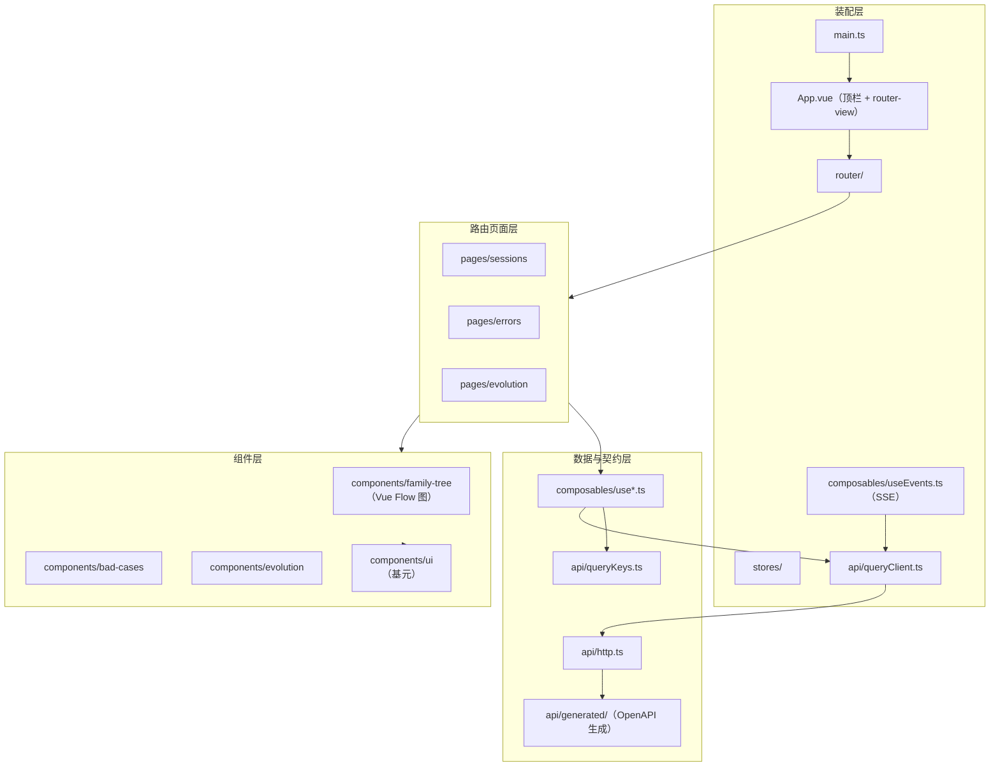
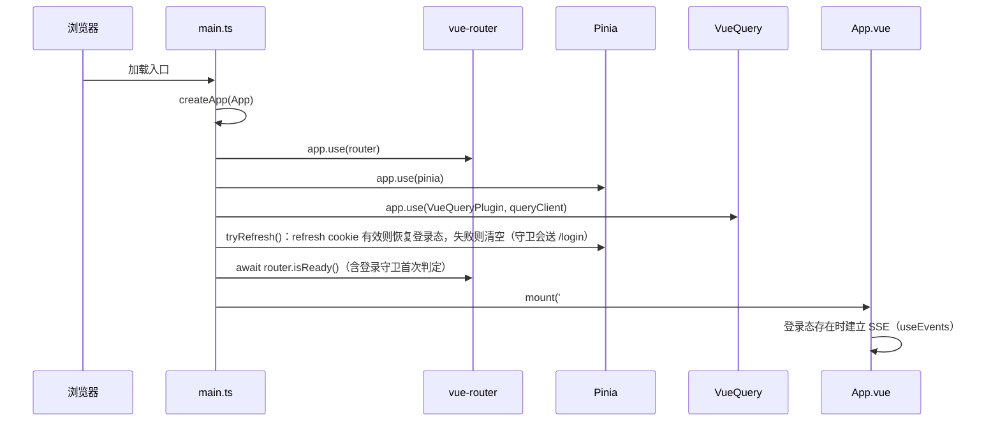
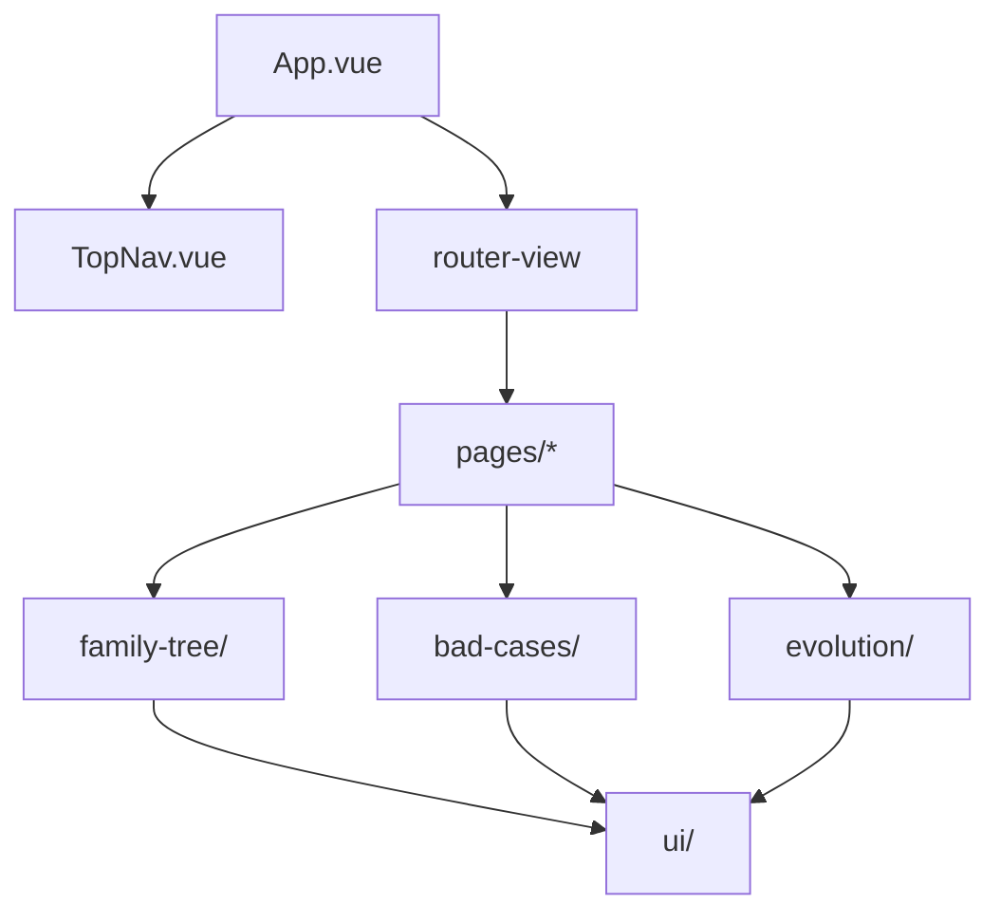
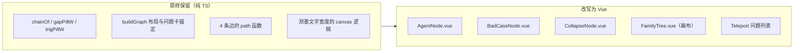

# 03 · 前端架构与组件选型

> 本文回答：前端用什么技术搭、怎么分层、组件如何组织、状态放哪、家族树怎么从 React Flow 迁到 Vue。
> 参考基线：[无线 AI 极客汇前端架构分析报告](../../../wireless-ai-forum/docs/reports/frontend-architecture-report-2026-10-22.md)（Vue 3 项目，借鉴其**架构模式**而非照搬实现）。
> 下游：[05 接口设计](05-api-design.md) · [08 前端实现设计](08-frontend-implementation.md)。

## 1. 一句话架构

**Vue 3 单页应用 + 分层（装配 / 路由页面 / 领域组件 / UI 基元 / 数据契约）+ 服务端状态交给 vue-query + 页面态留在组件 + Pinia 只放真正跨页的少量客户端状态。**

## 2. 技术选型总表

| 类别 | 选型 | 版本基线 | 角色 | 为什么不选替代品 |
|---|---|---|---|---|
| 视图框架 | Vue 3（`<script setup>` + Composition API） | ^3.5 | 全站 | 已拍板（D1）；参考报告同栈，模式可直接借鉴 |
| 构建 | Vite | ^7 | 开发/构建 | 参考报告同栈；Rolldown 版本过新，首版取稳定版 |
| 语言 | TypeScript strict | ~5.9 | 全站 | 契约生成物需要强类型 |
| 路由 | vue-router | ^4 | History 模式 + 深链 | 参考报告用 v5（生态前沿），首版取 v4 稳定线 |
| 服务端状态 | @tanstack/vue-query | ^5 | 缓存/去重/失效联动 | 参考报告已用该模式验证；手写缓存会重造轮子 |
| 客户端状态 | Pinia | ^3 | 登录态（access token + 当前用户）、当前 session、视图偏好 | 页面内状态用 `ref`，不进 Pinia |
| UI 控件 | Element Plus | ^2.11 | 表单控件、弹窗、日期、分页、消息 | 参考报告同选型；"控件用库、结构自研"的分工 |
| 样式 | Tailwind CSS 3 + CSS 变量设计令牌 | ^3.4 | 布局与视觉 | 原型已是 CSS 变量体系，令牌直接移植 |
| 图标 | lucide-vue-next | latest | 统一图标门面 | 参考报告同选型 |
| 图/树 | **Vue Flow（@vue-flow/core）** | ^1.4x | 家族树执行流图 | xyflow 官方 Vue 移植，Handle/自定义节点/边语义与 React Flow 对齐；备选 AntV G6 太重、自研 SVG 要重写缩放与命中测试 |
| 测试 | Vitest + Vue Test Utils + MSW（node） | ^3 / ^2 | 单元、组件、契约 | 参考报告同栈 |
| 契约生成 | openapi-typescript | ^7 | `apps/api` OpenAPI → TS 类型 | 比 orval/hey-api 轻，只生成类型不绑定客户端实现，传输层自写更可控 |

> 版本号为设计基线，落地时按 `package.json` 实测锁定；不要为了"新"引入 Rolldown 版 Vite（参考报告 R11 已提示前沿组合的回归成本）。

## 3. 从参考报告借鉴什么、不借鉴什么

| 参考报告的做法 | 本方案 | 理由 |
|---|---|---|
| 分层：装配层 / 路由页面层 / 组件层 / 数据契约层 | ✅ 借鉴，层名与职责对齐 | 与"页面切片自治"一致，新成员易上手 |
| vue-query 管服务端状态 + queryKey 分层工厂 + 写路径显式失效 | ✅ 借鉴 | 正是本项目需要的（session 列表 / 会话详情 / run 详情都是服务端状态） |
| queryKey 按域分层（`['sessions', …]` / `['session', sid, 'bad-cases']` / `['evolution', rid, step]`） | ✅ 借鉴 | 前缀失效能力：一次推进失效整棵 run 树 |
| MSW 一份 handler 服务 dev 与测试 | ❌ 不借鉴 | 数据来自真实表（问题侧外部只读、演示用 fixtures seed），前端不需要 mock 拦截器；测试用 MSW 仅用于组件测试的隔离 |
| 静态数据 + API 双轨 | ❌ 不借鉴 | 本方案数据一律走 API；只有 UI 词典（状态文案、颜色映射）是前端常量 |
| 手动 vendor 分包 + 构建守卫 + 体积预算 | ✅ 借鉴精简版 | ECharts 类重库本项目没有，但 Vue Flow 与 Element Plus 要独立成 chunk |
| Pinia + 持久化插件全量装配 | ⚠️ 精简 | 只装 Pinia（不装持久化插件）：登录态用 refresh cookie 恢复，access token 不落 localStorage |
| Element Plus 自动导入 + 全局组件注册 | ✅ 借鉴但收敛 | 只对 EP 用自动导入；自研组件显式 import（避免"组件从哪来"的困惑） |
| 首页配置驱动 + IntersectionObserver 懒挂载 | ❌ 不适用 | 本项目是工具型应用，无长落地页 |

## 4. 分层架构



层职责与依赖方向：

| 层 | 目录 | 职责 | 允许依赖 |
|---|---|---|---|
| 装配层 | `main.ts`、`App.vue`、`router/`、`stores/`、`api/queryClient.ts` | 建应用、装插件、注册路由、建立 SSE | 所有下层 |
| 路由页面层 | `pages/*` | 路由入口、页面编排、页面态（筛选/分页/展开） | 组件层、数据层 |
| 组件层 | `components/*` | 家族树、问题卡、自进化卡片、UI 基元 | 数据层的类型、UI 基元 |
| 数据与契约层 | `api/`、`composables/` | 传输、缓存、queryKey、域 hooks、契约类型 | 外部依赖 |

**单向依赖**：页面 → 组件 → 基元；页面 → hooks → api。组件不得直接 import `api/http`（必须经 composable），避免"组件偷偷取数"导致缓存语义失控。

## 5. 应用启动与装配顺序



四条顺序约束（参考报告 §3.1 的教训）：

1. **插件全部注册先于 mount**：query/pinia 注入上下文必须对根组件可见。
2. **refresh 先于 `router.isReady()`**：否则守卫会把已登录用户误判成未登录，首屏闪到登录页再跳回。
3. **`router.isReady()` 先于 mount**：避免首屏先渲染空路由再跳转的闪动与重复请求。
4. **SSE 在挂载后且登录态存在时建立**：不阻塞首屏；登出时断开，重新登录后重建。

## 6. 路由与深链设计

History 模式，`createWebHistory(import.meta.env.BASE_URL)`。URL 即状态（#14 验收硬要求）：

| 路由 | 页面 | 承载状态 |
|---|---|---|
| `/login` | 登录页（唯一公开页） | `?redirect=/sessions/...` |
| `/sessions` | Session 浏览器（列表 + 家族摘要） | `?q=&status=&sort=`；选中 session 用 `/sessions/:sid` |
| `/sessions/:sid` | 家族摘要（默认落地页） | — |
| `/sessions/:sid/errors` | 错误详情与归因 | `?case={badCaseId}&tab=desc\|attr` |
| `/evolution` | 运行列表 | — |
| `/evolution/cluster/:previewId` | 仅聚类结果 | — |
| `/evolution/runs/:rid` | 运行详情 | `?step=0..5` |

**登录守卫**：全局 `beforeEach`——未登录（无 access token 且 refresh 失败）且目标不是 `/login` 时跳 `/login?redirect=<原路径>`；已登录访问 `/login` 跳回 `/sessions`。登录后跳回 `redirect` 或 `/sessions`。

**真实 ID 深链契约**：URL 直接用 `badCaseId` / `probeId` / `runId`（不再造 `I-`/`R-` 展示号）；问题描述与归因 tab 用 `?case={badCaseId}&tab=desc|attr`。`sessionId` 由后端在 bad-case 响应中给出，前端不拼接、不反推。

路由守卫/兜底：`/:pathMatch(.*)*` → NotFound 页；每页统一三态（加载骨架 / 空态 / 错误重试）。

## 7. 状态管理：谁负责什么

| 状态 | 载体 | 例子 | 生命周期 |
|---|---|---|---|
| 服务端状态 | vue-query 缓存 | session 列表、会话详情、bad_cases、run 详情、六步产出 | 应用会话（`gcTime` 5min） |
| 页面 UI 状态 | 组件 `ref` / `reactive` | 筛选词、排序、展开的轮次、选中的错误、展开的 cluster | 页面挂载期 |
| 跨页客户端状态 | Pinia | **登录态（access token + 当前用户）**、当前选中的 session（列表与详情共享）、家族树布局偏好（是否展开全部） | 应用会话（access token 只存内存） |
| URL 状态 | vue-router | 选中 issue、tab、step、过滤条件 | 刷新可恢复 |
| 持久化状态 | localStorage（手写小工具，不引插件） | 折叠偏好、家族树缩放偏好 | 长期 |

**queryKey 工厂**（[08 §2](08-frontend-implementation.md) 给出完整代码结构）：

```text
['sessions']                      → 列表
['sessions', filters]             → 列表（带筛选）
['session', sid]                  → 摘要
['session', sid, 'tree']          → 家族树
['session', sid, 'bad-cases']     → 问题列表
['bad-case', badCaseId]           → 问题详情
['bad-case', badCaseId, 'analysis'] → 归因状态
['probe', probeId]                → 归因结论
['probes', query]                 → 向导命中查询（mutation，一次性结果，不常驻缓存）
['acquisition', 'sources']        → 来源清单与健康度
['acquisition', 'status']         → 最近一次同步状态
['evolution', 'runs']             → 运行列表
['evolution', rid]                → 运行详情（stepper 进度）
['evolution', rid, 'step', n]     → 第 n 步产出
['catalogs']                      → 对象/模型清单（staleTime ∞）
```

写路径的失效规则：`POST /runs` → 失效 `['evolution','runs']`；`POST /advance` → 失效 `['evolution', rid]` 整棵前缀（详情 + 所有 step）；SSE `run.progress` 事件同样只失效前缀，页面自己决定要不要立即重取。

## 8. 组件体系

### 8.1 分层与清单



| 层 | 组件 | 复用范围 | 说明 |
|---|---|---|---|
| 全局壳 | `App.vue`、`TopNav.vue` | 全站 | 导览、品牌、SSE 生命周期 |
| 页面编排 | `pages/*/Index.vue` | 单页面 | 只做布局与组合，数据来自 composable |
| 领域组件 | `family-tree/*`、`bad-cases/*`、`evolution/*` | 多页面局部 | 有业务语义，props/emits 交互 |
| UI 基元 | `ui/BaseCard.vue`、`Chip.vue`、`Badge.vue`、`StatStrip.vue`、`DensityBar.vue`、`EmptyState.vue`、`ErrorState.vue`、`LoadingSkeleton.vue`、`Pagination.vue`、`Modal.vue`、`Tabs.vue` | 任意 | 无业务语义；颜色/间距全部走设计令牌 |

**关键领域组件**（与原型一一对应）：

| 组件 | 对应原型 | 备注 |
|---|---|---|
| `family-tree/FamilyTree.vue` | React 岛 `<App sid findingsBudget>` | Vue Flow 画布容器，负责挂载、fitView、筛选 |
| `family-tree/AgentNode.vue` | `AgentNode` | 节点外框 + 标签 + 节点链 + 触发桩（下/上引线） |
| `family-tree/BadCaseNode.vue` | `FindingNode` | 问题卡（badCaseId 截短 + reason 短标签） |
| `family-tree/CollapseNode.vue` | `GroupNode` | "N 个子 agent · 点击展开" |
| `family-tree/edges/*.ts` | `OrthEdge/FindingEdge/ReportEdge/TriggerEdge` | 改为 `OrthEdge/BadCaseEdge/DiscoveryEdge/TriggerEdge`，SVG path 生成是纯函数 |
| `bad-cases/BadCaseCard.vue` | `.finding-item` | 列表卡（reason/状态/事实/上报对象） |
| `bad-cases/ProbeReport.vue` | `AttributionReport` | 结论横幅 + 根因对象 + 推导过程 |
| `evolution/Stepper.vue` | `stepperHTML` | 6 步进度，可点击已到达节点 |
| `evolution/RunCard.vue` | `runCard` | 进行中/历史卡片 |
| `evolution/LaunchWizard.vue` | `renderWizard` | 两步 Modal |
| `evolution/ClusterCard.vue` | `clusterHTML` | 聚类卡（来源报告/归因/patch/评测/commit） |
| `evolution/DiffView.vue` | `diffHTML` | patch 着色 diff |
| `evolution/EvalCompare.vue` | `evalHTML` | current vs candidate 条形对比 |
| `evolution/FinalVerdict.vue` | `stepFinalHTML` | 终评横幅 + 指标表 |

### 8.2 家族树：React Flow → Vue Flow 的迁移方案

这是 D1 决策下最大的单项工作量，拆开看并不大：

| 部分 | 原型位置 | 迁移方式 |
|---|---|---|
| 布局几何（链式计算、节点定位、trunk 聚合、问题卡左右侧判定） | `chainOf` / `buildGraph` / `place` / `pickFindingSide` 等，约 600 行 | **纯 TS，无 React 依赖**，原样移到 `family-tree/layout.ts`，补类型与单测 |
| 4 条自定义边的 path 生成 | `FindingEdge` / `TriggerEdge` / `ReportEdge` / `OrthEdge` | 纯 SVG path 字符串函数；Vue 版命名 `BadCaseEdge` / `TriggerEdge` / `DiscoveryEdge` / `OrthEdge` |
| 自定义节点渲染 | `AgentNode` / `GroupNode` / `FindingNode`（htm 模板） | 改写为 SFC；Vue Flow 的 `<Handle>` API 与 React Flow 语义一致（`type/position/id`） |
| 画布与交互 | `<ReactFlow fitView nodesDraggable=false …>` | `FamilyTree.vue` 用 `<VueFlow>`；`fitView` 在节点测量完成后执行（沿用原型 `FitTree` 的等待逻辑） |
| 画布内 portal 到页面的问题列表 | `createPortal(..., findingList)` | Vue 用 `<Teleport to="#bad-case-list">` |



**验收方式**：先迁移 `demo-nested` 最小树（design.md §8 的嵌套示例），验证"问题归属、子 agent 内触发、折叠组、连线不穿兄弟分支"四件事，再切真实会话数据。

## 9. 样式体系

三层叠加（与参考报告同构，但令牌直接来自原型）：

```text
styles/tokens.css        原型 :root 的全部 CSS 变量（颜色/字体/mono）
styles/main.css          Tailwind 指令 + 全局重置 + 滚动条
styles/element-overrides.css  Element Plus 变量映射到本项目令牌
```

- **令牌是唯一颜色源**：`--blue/--green/--orange/--red/--purple/--cyan` 及 `--bg-*/--text-*/--border` 原样移植，组件里禁止写死色值。
- **状态色映射表**（前端常量，唯一允许的"静态数据"）：归因状态 → 色（`unanalyzed` 灰 / `analyzed` 蓝 / `nonissue` 绿 / `issue-model` 紫 / `issue-prompt` 橙 / `issue-error` 红）；问题类型 → 色（非问题灰 / 错误红 / prompt 橙 / 模型紫）。与原型 `TYPE_COLOR` / `STATUS_LABEL` 一致。
- **Element Plus 覆盖**：只覆盖 `--el-color-primary`、圆角、字体，不做全量皮肤；EP 样式运行时注入，覆盖文件需提高特异性（参考报告 §8 的坑）。
- 响应式：顶栏在 <1100px 隐藏副标题（原型同规则）；家族树画布固定高度 720px，详情页 413px（原型值）。

## 10. 构建、性能与质量门禁

| 项 | 方案 |
|---|---|
| 代码分割 | 路由级懒加载（`() => import(...)`）；`vendor-vue`（vue/router/pinia/query）、`vendor-element-plus`、`vendor-vue-flow` 三个手动 chunk；其余按 20KB 兜底合并 |
| 首屏 | `/sessions` 为默认路由，同步加载；其余页面懒加载 |
| 体积预算 | 入口 JS ≤ 250KB（gzip ≤ 90KB），每个 vendor chunk ≤ 400KB；超限 CI 红 |
| 构建守卫 | 构建后校验：Vue Flow 不得进入首屏闭包；`/evolution` 路由必须能动态到达 Vue Flow |
| Lint | ESLint 9 flat + eslint-plugin-vue，`--max-warnings=0` |
| 类型 | `vue-tsc --noEmit` strict |
| 测试 | Vitest：布局纯函数（`layout.spec.ts`）、queryKey 工厂、ID 解析/深链、关键组件渲染；MSW 只用于组件测试 |
| 契约漂移 | `pnpm contract:check`：重新生成 `packages/contracts` 与仓库内文件比对，有 diff 即失败 |

## 11. 目录职责速查

```text
apps/web/src/
  main.ts                 启动装配
  App.vue                 全局壳（TopNav + router-view + SSE 生命周期）
  router/index.ts         路由表 + 深链解析
  api/
    http.ts               fetch 封装（Bearer 注入、401 自动 refresh 一次、错误模型、取消）
    queryClient.ts        QueryClient 默认策略（staleTime 30s / gc 5min / 4xx 不重试）
    queryKeys.ts          queryKey 工厂
    generated/            openapi-typescript 生成物（禁止手改）
  composables/
    useAuth.ts            登录/登出/refresh/当前用户
    useSessions.ts        列表/摘要/家族树/问题
    useBadCases.ts         问题详情与归因
    useEvolution.ts       runs / 六步产出 / 启动 / 推进
    useCatalogs.ts        对象/模型清单
    useEvents.ts          SSE 票据 + 连接与事件分发
  stores/
    auth.ts               登录态（access token 内存 + 当前用户）
    selection.ts          当前 session（跨列表/详情）
    preferences.ts        折叠/缩放偏好（localStorage）
  pages/
    login/  sessions/  errors/  evolution/
  components/
    family-tree/  bad-cases/  evolution/  ui/
  utils/
    badCaseId.ts          真实 ID 截短与深链构造
    format.ts             时间、token、百分比
  styles/
    tokens.css  main.css  element-overrides.css
```
