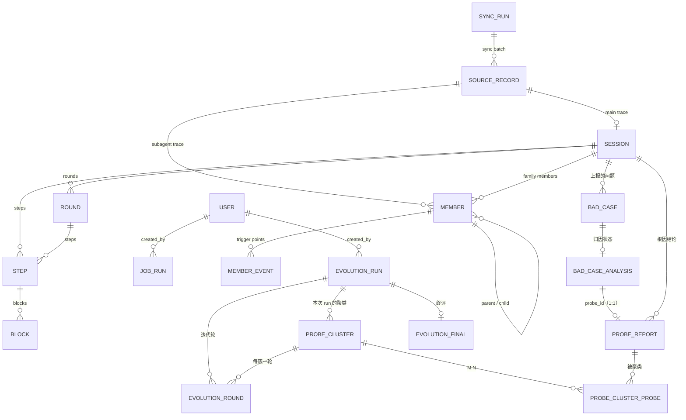
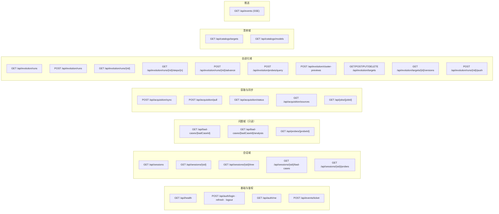
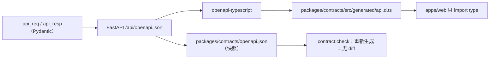

# 05 · 后端接口设计

> 本文回答：前后端之间的 REST 契约长什么样、SSE 推什么、深链怎么约定、OpenAPI 到 TS 怎么生成。
> 前置：[04 后端架构](04-backend-architecture.md)；配套：[06 数据库设计](06-database-design.md)。
> 所有响应示例均为真实表查询结果（开发环境用 `fixtures` seed 造数），真实实现接入后字段不变。

## 1. 通用约定

| 项 | 约定 |
|---|---|
| Base path | `/api`；OpenAPI 文档 `/api/docs`（dev 开放，prod 关闭） |
| 鉴权 | 除 `/api/health`、`/api/auth/login`、`/api/auth/refresh` 外一律 `Authorization: Bearer <accessToken>`；401 用 `AUTH_*` 错误码；SSE 用一次性票据（见 §4.1） |
| 命名 | JSON 一律 **camelCase**（Pydantic `alias_generator=to_camel`）；数据库列 snake_case；两者转换只在 Pydantic 层发生 |
| 时间 | ISO 8601 带时区，UTC，如 `2026-08-30T08:00:33.573Z`；时长用整数秒 |
| ID | `sessionId` 为根会话 UUID；`badCaseId` / `probeId` / `probeClusterId` 由外部或本服务生成（字符串，URL 直接用）；`memberSessionId` 是每个 agent 自己的会话 id |
| 列表 | `{ "items": [...], "total": 0, "page": 1, "pageSize": 20 }`；无分页的小列表直接 `{ "items": [...] }` |
| 错误 | `{ "error": { "code": "SESSION_NOT_FOUND", "message": "...", "details": {} } }`，见 §8 |
| 幂等 | `POST /api/acquisition/sync` 可重复调用（进行中返回 409）；`POST /evolution/runs` 无幂等键（每次启动都是新 run） |
| 版本 | 不做 URL 版本号；契约以 OpenAPI 快照为准，破坏性变更必须同步前端生成物（CI 拦截） |

## 2. 资源模型总览



> 轨迹侧表由本服务同步写入；`BAD_CASE / BAD_CASE_ANALYSIS / PROBE_REPORT` 由外部归因/上报系统写入，本服务只读；`EVOLUTION_*` 与 `PROBE_CLUSTER*` 由本服务写。`ROUND/STEP/BLOCK` 是内部表，不对外暴露（见 §3.3）。

## 3. 领域模型（OpenAPI Schema 的源头）

### 3.1 Session 列表项与摘要

```json
{
  "id": "cb819c5b-286f-4eab-a681-4ba5414b844d",
  "short": "AI agent + 视频播放结合的开源产品",
  "title": "AI agent + 视频播放结合的开源产品调研",
  "repo": "llm-wiki",
  "model": "glm-5.3",
  "startedAt": "2026-09-05T09:17:53Z",
  "durationSeconds": 63420,
  "status": "partial",
  "skills": ["deep-research"],
  "stats": {
    "rounds": 12, "steps": 375, "tools": 197, "errors": 4,
    "agents": 57, "badCases": 3, "tokens": 58368517,
    "failPer100Steps": 1.07, "badCasesPer100Steps": 0.8
  }
}
```

- `status`：`ok`（完成）/ `partial`（有失败）/ `fail`（整体失败）。密度只由后端计算，前端不算（避免口径漂移）。
- `short`：列表卡标题（截断展示）；`title`：完整标题。两者都由首个用户提问派生，`short` 允许为空（前端回退到 title）。

### 3.2 家族树

```json
{
  "sessionId": "cb819c5b-...",
  "main": {
    "memberId": "m-main", "label": "主会话", "lines": 765,
    "events": [
      { "line": 24, "kind": "skill", "name": "deep-research" },
      { "line": 30, "kind": "workflow", "name": "deep-research", "toolUseId": "call_ca6f..." }
    ]
  },
  "subs": [
    {
      "memberId": "a2895fbf", "parentMemberId": "m-main", "type": "general-purpose",
      "desc": "检索工具层四项+综述", "toolUseId": "call_721e...", "lines": 218,
      "events": [ { "line": 12, "kind": "skill", "name": "deep-research" } ],
      "children": []
    }
  ],
  "badCases": [
    {
      "badCaseId": "bc-050b-03", "badCaseType": "discovery",
      "objectName": "deep-research", "objectType": "skill", "objectVersion": "v2.0.0",
      "badCaseSessionId": "5e7a…", "targetMemberId": "m-main",
      "reason": "deep-research skill发现前置步骤存在问题：检索索引读取失败",
      "anchorEventIndex": 0
    }
  ]
}
```

设计要点：

- **事件只给 line/kind/name/desc/toolUseId**，×N 压缩行数、药丸宽度、问题卡左右侧全部由前端布局计算（布局逻辑见 [08 §3](08-frontend-implementation.md)）——与服务端解耦，数据量也小。
- **问题卡归属显式给出**：`badCaseSessionId` 是问题上报者所在 agent 的 session id，服务端用 `members.member_session_id` 解析成 `targetMemberId`；`badCaseType` 决定锚定规则（`self` 挂对象自身触发点，`discovery` 挂发现者触发点上方）。
- `anchorEventIndex`：问题挂在哪个触发点（`-1` = 未匹配到同名触发点，前端挂到成员节点）。

### 3.3 内部轨迹模型（不对外暴露）

时间线页面在 2026-10-22 评审中裁撤，因此**不提供轮次/步骤/块的读接口**。`rounds/steps/blocks` 三张表仍然保留（见 [06 §3.5–3.7](06-database-design.md)），用途是：

- 同步时计算 `sessions` 的聚合列（轮次数、步骤数、工具调用数、错误数、token 总数）；
- 为后续诊断器保留证据（工具输入/输出/错误原文）；
- 解析规则升级时可重放。

也就是说：**数据照常入库，契约里没有 `Timeline/Round/Step/Block` 这些响应模型**。如果未来恢复时间线，按原设计补 `GET /api/sessions/{sid}/timeline` 与 `.../rounds/{index}/steps` 两个端点即可，表结构无需迁移。

### 3.4 问题（bad_case）、归因状态与 probe

`BadCase`（问题列表项）：

```json
{
  "badCaseId": "bc-050b-03",
  "sessionId": "050b81ba-...", "sessionTitle": "研究'用户数据驱动自进化'提到的所有方法",
  "badCaseType": "discovery",
  "objectName": "deep-research", "objectType": "skill", "objectVersion": "v2.0.0",
  "badCaseSessionId": "5e7a9c…",
  "targetMemberId": "m-main", "anchorEventIndex": 0,
  "reason": "deep-research skill发现前置步骤存在问题：检索索引读取失败",
  "metaData": { "file": "apps/server/src/search/index.ts", "line": 142, "error": "ENOENT" },
  "analysis": { "status": "analyzed_issue", "probeId": "pr-050b-03" }
}
```

- `objectName/objectType/objectVersion` 是**上报者/发现者**，不是根因；根因看 `probe`。
- `badCaseSessionId` 是上报者所在 agent 的 session id，服务端解析成 `targetMemberId`（`badCaseType` 决定锚定方式）。
- `metaData` 原样返回；前端按通用 KV 渲染成事实 chips（值过长截断）。
- `analysis.status` 与原型展示的映射：

| `analysis.status` | 附加条件 | 原型展示 |
|---|---|---|
| `unanalyzed` | — | 未分析 |
| `analyzed_nonissue` | — | 非问题 |
| `analyzed_issue` | `probe.attributeType = model` | 是问题-模型问题 |
| `analyzed_issue` | `probe.attributeType = prompt` | 是问题-prompt缺失某些提示词 |
| `analyzed_issue` | `probe.attributeType = error` | 是问题-错误 |

`ProbeReport`（归因结论；由 bad_case 的 `probeId` 取）：

```json
{
  "probeId": "pr-050b-03",
  "sessionId": "050b81ba-...",
  "probeType": "agent", "probeObject": "Explore", "objectVersion": "v1.0.1",
  "attributeType": "prompt",
  "probeDescription": "prompt 未要求读取快照前校验 turns 字段，subagent 直接读取导致越界。",
  "probeAnalysis": "从 bad_case 的 reason 与 meta_data 定位到 Explore 的读取步骤；同批次有校验的 subagent 未报错，说明是 prompt 约定缺失。",
  "fromBadCases": ["bc-050b-03"], "fromBadCasesCount": 1
}
```

- `probeObject @ objectVersion` 是**自进化 target 的唯一来源**。
- `fromBadCases` / `fromBadCasesCount` 由 `bad_case_analysis.probe_id` 反查得出（V1 恒 1 条）。

### 3.5 自进化运行

`RunCard`（列表项）：

```json
{
  "runId": "evo-20261019-01",
  "title": "deep-research v2.0.0 自进化",
  "mode": "full",
  "target": { "type": "skill", "name": "deep-research", "version": "v2.0.0" },
  "window": { "from": "2026-08-20", "to": "2026-09-10" },
  "models": ["glm-5.3", "glm-5.3-flash"],
  "createdAt": "2026-10-19T18:42:00+08:00",
  "status": "running",
  "error": null,
  "stats": { "sessions": 4, "probes": 12, "usedProbes": 7, "clusters": 5,
    "byAttributeType": { "model": 3, "prompt": 1, "error": 3 } },
  "progress": { "unit": 6, "total": 10, "percent": 60,
    "stageLabel": "第 5/6 步 · 迭代优化 · 第 3/5 轮", "doneRounds": 2, "accepted": 1 },
  "final": null
}
```

已完成的 run 附带 `final`：

```json
"final": { "bestVersion": "v2.0.0-best", "branchName": "evo/20261023-evo-20261023-01", "pushStatus": "succeeded", "verdict": true, "bestScore": 88.9, "initScore": 84.3 }
```

`RunDetail` 在 RunCard 基础上多 `steps` 与 `workspace`（六步状态由后端算，前端不推算）：

```json
"workspace": {
  "repoPath": "/srv/skill-repo", "baseRef": "v2.0.0", "baseCommit": "9f3c2a1…",
  "branchName": "evo/20261023-evo-20261023-01", "workspacePath": "data/workspaces/evo-20261023-01",
  "remote": "origin", "pushStatus": "pending", "pushedAt": null, "pushError": null
},
"error": { "stage": "eval", "message": "评测执行失败：sandbox timeout", "at": "2026-10-23T09:41:02+08:00" },
"lastEventSeq": 42,
"steps": [
  { "index": 0, "title": "筛选输入", "status": "done" },
  { "index": 1, "title": "问题聚类", "status": "done" },
  { "index": 2, "title": "归因确认", "status": "done" },
  { "index": 3, "title": "严重程度排序", "status": "done" },
  { "index": 4, "title": "迭代优化", "status": "active", "detail": "第 3/5 轮" },
  { "index": 5, "title": "测试集终评", "status": "pending" }
]
```

- `status` ∈ `running|completed|failed|interrupted`；`error` 为 `null` 或 `{stage, message, at}`（列表只给摘要）。
- `lastEventSeq`：当前最大事件序号，前端可用它增量拉 `GET /runs/{rid}/events?afterSeq=`。

`status` ∈ `done | active | pending`；`clickable = status != pending`。

### 3.6 六步产出（判别式响应）

`GET /evolution/runs/{rid}/steps/{index}` 返回统一外壳 + 按 step 的 `payload`：

```json
{ "index": 0, "title": "筛选输入", "payload": { "...": "见下" } }
```

| step | payload 关键字段 |
|---|---|
| 0 筛选输入 | `condition`、`hits`（sessions/probes/usedProbes/byAttributeType）、`rows[]`（probe 行，含 `clusterId`） |
| 1 问题聚类 | `clusters[]`：`probeClusterId/description/type/probeCount/probes[]`（V1 占位算法生成） |
| 2 归因确认 | `items[]`：probeId/probeObject/objectVersion/attributeType/description/analysis |
| 3 严重程度排序 | `rows[]`：rank/clusterId/type/probeCount/severity（V1 简单排序） |
| 4 迭代优化 | `rounds[]`：clusterId/title/type/probeCount/probes[]/status/patch/eval/accepted/commit |
| 5 测试集终评 | `verdict/bestVersion/bestScore/initScore/metrics[]/changes[]` |

迭代轮结构与原设计一致：`rounds[]` 含 `patch {file, lines[]}`、`eval {current, candidate}`、`status ∈ pending|evaluating|accepted|rejected`、`commit {hash, message}`。candidate commit 在评测前产生；接纳后 `commit.hash/message` 是 amend 后的值，拒绝后 `commit` 为 null（对应提交已被 reset 丢弃）。「来源问题」从报告改为 `probes[]`（归属该簇的 probe 列表）。

## 4. 端点清单



### 4.1 基础端点：健康检查与鉴权

`GET /api/health` → `200`（公开，无需登录）

```json
{ "ok": true, "service": "harness-evolution", "phase": "demo", "version": "0.2.0",
  "db": { "dialect": "mysql", "ok": true, "latencyMs": 3 } }
```

`phase` ∈ `scaffold | demo | live`：`demo` 表示开发/演示数据已 seed（顶栏可显示"演示数据"角标）；`live` 表示接真实来源。`db.dialect` 取值 `sqlite | mysql`；`ok=false` 时 HTTP 返回 `503` 且 `db` 带错误摘要（API 进程仍可达）。

**鉴权端点**（`/api/auth/login` 与 `/api/auth/refresh` 公开，其余需登录）：

| 端点 | 说明 |
|---|---|
| `POST /api/auth/login` | body `{username, password}` → `200 {accessToken, expiresIn, user:{id, username, displayName, role}}`；refresh token 写入 httpOnly + SameSite=Strict cookie（14 天）。密码错误 → `401 AUTH_INVALID`；账号停用 → `403 FORBIDDEN` |
| `POST /api/auth/refresh` | 读取 refresh cookie → 新 `{accessToken, expiresIn}`；cookie 缺失/失效 → `401 AUTH_EXPIRED` |
| `POST /api/auth/logout` | 使 refresh cookie 失效（过期化）→ `204` |
| `POST /api/auth/change-password` | 登录用户修改自己的密码 `{oldPassword, newPassword}` → `204`；旧密码校验失败 `401 AUTH_INVALID` |
| `GET /api/auth/me` | 当前用户信息 `{id, username, displayName, role}` |
| `GET /api/users`、`POST /api/users` | 管理员创建/列出用户（单组织共享，仅 `role=admin`）；成员管理界面首版从简，可先只用 API |

**SSE 票据**：`POST /api/events/ticket`（需登录）→ `{ "ticket": "t-…", "expiresIn": 60 }`。票据一次性、60 秒有效；`GET /api/events?ticket=…` 校验后立即作废。用票据而不用 JWT 查询参数，是为了不把长期 token 写进 URL（会进代理日志）。

### 4.2 会话列表

`GET /api/sessions?q=&status=&sort=latest&limit=100`

| 参数 | 类型 | 说明 |
|---|---|---|
| `q` | string | 标题/仓库模糊匹配（大小写不敏感） |
| `status` | `all\|ok\|partial\|fail` | 默认 all |
| `sort` | `latest\|rounds\|steps\|agents` | 默认 latest |
| `limit` | int | 默认 100，最大 500 |

响应 `{ "items": [SessionListItem] }`。**排序与计数全部后端做**，前端只渲染。

### 4.3 会话摘要

`GET /api/sessions/{sid}` → `SessionListItem`（与列表项同构，避免两套模型）。

### 4.4 家族树

`GET /api/sessions/{sid}/tree` → `SessionTree`（§3.2）。

### 4.5 时间线端点（已裁撤）

时间线页面不做，因此不提供 `GET /api/sessions/{sid}/timeline` 及其步骤展开端点。轮次/步骤/块照常入库，仅用于统计聚合与后续诊断（见 §3.3）。

轮次内需要计数时（列表/摘要），使用 `sessions` 上的聚合列，不读 `steps` 明细。

### 4.6 会话问题列表

`GET /api/sessions/{sid}/bad-cases` → `{ "items": [BadCase] }`（按 `createdAt` 升序）。

### 4.7 问题、归因与 probe

- `GET /api/bad-cases/{badCaseId}` → `BadCase`（含 `sessionId`，用于深链校验）
- `GET /api/bad-cases/{badCaseId}/analysis` → `{ "status": AnalysisStatus, "probeId": string|null, "result": object|null }`；无归因记录时返回 `status=unanalyzed` 占位
- `GET /api/probes/{probeId}` → `ProbeReport`（含 `fromBadCases[]` / `fromBadCasesCount`）
- `GET /api/sessions/{sid}/probes` → `{ "items": [ProbeReport] }`（可选，给"仅看根因"的场景用）

> 归因由外部系统完成并写入 `bad_case_analysis` / `probe_reports`，本服务**不提供"触发分析"端点**；没有归因记录就是 `unanalyzed`。

### 4.8 获取与同步（acquisition）

- `POST /api/acquisition/sync` → `202 { "jobId": "job-..." }`：按配置扫描启用的来源（同库源表按水位线增量；上游接口暂不自动扫）。已有同步任务在跑 → `409 SYNC_IN_PROGRESS`。
- `POST /api/acquisition/pull` → `202 { "jobId": ... }`：按需拉取。body：

```json
{ "sessionRefs": ["cb819c5b-..."], "window": null }
```

  `sessionRefs` 与 `window`（`{from,to}`）二选一；上游未实现时返回 `409 UPSTREAM_NOT_AVAILABLE`。
- `GET /api/acquisition/status` → 最近一次同步状态：

```json
{ "jobId": "job-1", "status": "running", "sourceType": "source_table",
  "watermark": "2026-10-22T08:00:00Z",
  "recordsTotal": 12, "recordsDone": 5, "imported": 4, "skipped": 1,
  "errors": [ { "sourceRef": "src-10086", "message": "第 42 行非法 JSON" } ] }
```

- `GET /api/acquisition/sources` → 来源清单与健康度：`{ "items": [ { "type": "source_table", "enabled": true, "lastSyncAt": "...", "lastWatermark": "...", "pendingEstimate": 3 }, { "type": "http_api", "enabled": false, "note": "上游未实现，契约见文档 §10" } ] }`
- `GET /api/jobs/{jobId}` → 通用任务状态（`status: queued|running|completed|failed|interrupted`，`progress: 0..1`，`createdBy`）。

### 4.9 probe 命中查询（向导第 2 步）

`POST /api/evolution/probes/query`

```json
{ "targetType": "skill", "targetName": "deep-research", "targetVersion": "v2.0.0",
  "from": "2026-08-20", "to": "2026-09-10",
  "models": ["glm-5.3", "glm-5.3-flash"], "page": 1, "pageSize": 8 }
```

响应：

```json
{
  "summary": { "sessions": 4, "probes": 12, "usedProbes": 12,
    "byAttributeType": { "model": 3, "prompt": 1, "error": 8 } },
  "items": [ { "probeId": "pr-050b-03", "sessionId": "050b81ba-...",
    "sessionTitle": "研究'用户数据驱动自进化'提到的所有方法",
    "probeType": "skill", "probeObject": "deep-research", "objectVersion": "v2.0.0",
    "attributeType": "error", "probeDescription": "检索索引读取失败…",
    "sourceBadCaseIds": ["bc-050b-03"] } ],
  "total": 12, "page": 1, "pageSize": 8
}
```

- `from/to` 按 **session 启动时间**过滤。
- 命中的 probe 必然属于该 target（`probeObject @ objectVersion`），所以 `usedProbes = probes`。

### 4.10 自进化运行

- `GET /api/evolution/runs` → `{ "running": [RunCard], "history": [RunCard] }`（后端分组）
- `POST /api/evolution/runs`（body 同 4.9 的查询条件 + `"mode": "full"`）→ `201 RunDetail`；无匹配 probe → `409 NO_PROBES_MATCHED`；目标未配置/仓库不可用 → `409 TARGET_NOT_CONFIGURED` / `422 REPO_INVALID`
- `GET /api/evolution/runs/{rid}` → `RunDetail`（含 `workspace`：`repoPath/baseRef/baseCommit/branchName`）
- `GET /api/evolution/runs/{rid}/steps/{index}` → `EvolutionStep`（§3.6；`index` 越界或未到达 → `404 STEP_NOT_READY`）
- `POST /api/evolution/runs/{rid}/advance` → `200 RunDetail`；run 已结束 → `409 RUN_ALREADY_FINISHED`（V1 用于演示推进；patch 内容/评分为占位，candidate commit 与 amend/reset 真实）
- `POST /api/evolution/runs/{rid}/push` → `200 RunDetail`：完成后校验分支并 push；未完成 → `409 RUN_NOT_FINISHED`；已推送幂等返回；失败 → `500 GIT_ERROR`（`details.stage="push"`，消息脱敏）

运行创建时同步完成第 0–1 步（筛选 + 占位聚类），并**准备工作区**：从配置的 `repo_path` 以 `base_ref`（tag）clone 到 `data/workspaces/{runId}`，创建分支 `evo/{YYYYMMDD}-{runId}`，记录 `base_commit`；因此 `mode=full` 的 run 创建后第 1 步即可查看簇。

### 4.11 进化对象配置（仅配置后可自进化）

| 端点 | 说明 |
|---|---|
| `GET /api/evolution/targets` | 列出配置：`{ "items": [ { id, objectType, objectName, repoPath, subDir, defaultRef, enabled } ] }` |
| `POST /api/evolution/targets` | 新增（admin）；body 同上；`409 TARGET_EXISTS` |
| `PUT /api/evolution/targets/{id}` | 修改（admin）；`404 TARGET_NOT_FOUND` |
| `DELETE /api/evolution/targets/{id}` | 删除（admin）；有进行中 run 时 `409 TARGET_IN_USE` |
| `GET /api/evolution/targets/{id}/versions` | V1 从本地仓库 `git tag --list` 返回 `{ "versions": ["v2.0.0", ...] }`；仓库不可用 → `422 REPO_INVALID` |

- 只有 `enabled=true` 的配置出现在向导的"对象/版本"下拉里；
- 配置页入口在向导 Step1 选择器右侧的齿轮图标（[08 §9.2](08-frontend-implementation.md)）。

### 4.12 仅聚类预览

`POST /api/evolution/cluster-previews`（body 同 4.9 + `"mode": "cluster_only"`）→ `201 { "runId": "evo-...", "clusters": [ProbeCluster] }`

- 预览落一条 `mode=cluster_only` 的 `evolution_runs`，簇按 run 归属（与正式 run 同表）；后续页用 `GET /runs/{rid}/steps/1` 取簇。
- 不做 patch/评测，`GET /runs/{rid}` 的 steps 只到第 1 步。

### 4.13 清单

- `GET /api/catalogs/targets` → 已启用且配置的对象：`{ "skill": [{ "id": "…", "name": "deep-research", "versions": ["v2.0.0","v1.9.0"] }], "agent": [...] }`（versions 取自本地仓库 tag；与 `/evolution/targets` 一致，前端可只用后者）
- `GET /api/catalogs/models` → `{ "models": ["glm-5.3", "glm-5.3-flash", ...] }`（来自 `sessions.model` 去重）

### 4.14 SSE

`GET /api/events?ticket=…&topics=run:evo-20261019-01,sync`（ticket 见 §4.1，一次性）

```text
id: 42
event: run.progress
data: {"runId":"evo-20261019-01","unit":7,"total":10,"percent":70,"status":"running","stageLabel":"第 5/6 步 · 迭代优化 · 第 3/5 轮"}

: heartbeat
```

| event | data 字段 |
|---|---|
| `ping` | `{}`（每 15s） |
| `sync.progress` | jobId / sourceType / recordsTotal / recordsDone / imported / skipped |
| `sync.completed` | jobId / imported / skipped / errors[] |
| `run.progress` | runId / unit / total / percent / status / stageLabel / doneRounds / accepted |
| `run.completed` | runId / verdict / bestScore / initScore |
| `run.failed` | runId / stage / message / eventSeq |
| `run.interrupted` | runId / stage / message / eventSeq |

- `Last-Event-ID` 支持补发最近 100 条。
- 事件 id 为字符串自增整数；前端重连后从断点续传。
- SSE 只做通知，数据仍以 REST 为准（前端收到事件后失效 queryKey；历史过程读 `GET /runs/{rid}/events`，见 4.15）。

### 4.15 运行执行日志（过程与异常）

`GET /api/evolution/runs/{rid}/events?afterSeq=0&limit=100&level=error` →

```json
{
  "items": [
    { "seq": 18, "eventType": "candidate_committed", "level": "info", "stage": "candidate",
      "stepIndex": 4, "clusterId": "C1", "roundId": "r-01", "jobId": "job-…",
      "message": "candidate 已提交", "createdAt": "2026-10-23T09:40:12+08:00",
      "payload": { "commit": "ab12…", "patchHash": "sha256:…", "files": ["SKILL.md"], "durationMs": 812 },
      "error": null },
    { "seq": 19, "eventType": "eval_completed", "level": "info", "stage": "eval", "stepIndex": 4,
      "clusterId": "C1", "roundId": "r-01", "jobId": "job-…",
      "message": "评测完成：84.6 → 87.2", "createdAt": "2026-10-23T09:40:20+08:00",
      "payload": { "current": 84.6, "candidate": 87.2, "delta": 2.6, "verdict": "accepted" },
      "error": null },
    { "seq": 20, "eventType": "run_failed", "level": "error", "stage": "push", "stepIndex": 5,
      "clusterId": null, "roundId": null, "jobId": "job-…",
      "message": "push 失败：remote rejected", "createdAt": "2026-10-23T09:41:02+08:00",
      "payload": { "remote": "origin", "branch": "evo/20261023-evo-20261023-01" },
      "error": { "type": "GitError", "message": "remote rejected: protected branch", "detail": "…" } }
  ],
  "nextSeq": 20,
  "hasMore": false
}
```

- `afterSeq` 默认 0；`limit` 默认 100、最大 500；`level=error` 只看异常。
- 事件按 `(run_id, seq)` 稳定排序；`nextSeq` 供前端增量拉取。
- **刷新/重进页面以本接口为准**，SSE 只负责实时通知；异常（`run_failed/run_interrupted/push_failed`）也在这里可查。
- `error.detail` 已脱敏并截断（不含 token/环境变量/完整 payload）。

## 5. 深链契约

ID 策略（2026-10-22 定稿）：**URL 直接用真实 ID**（`bad_case_id` / `probe_id` / `run_id`），不再造 `I-`/`R-` 展示号；UI 显示时取前 8 位 + tooltip 展示全量。

| 目标 | URL（前端路由） | 需要的后端字段 |
|---|---|---|
| 会话摘要 | `/sessions/{sid}` | — |
| 问题描述 | `/sessions/{sid}/errors?case={badCaseId}&tab=desc` | `BadCase.badCaseId/sessionId` |
| 归因分析 | `/sessions/{sid}/errors?case={badCaseId}&tab=attr` | `BadCase.analysis.probeId` |
| 自进化某步 | `/evolution/runs/{rid}?step=4` | `RunDetail.steps[].status` |

**解析规则**：

- 深链必须用 URL 里的 `sid` 去 `GET /api/bad-cases/{badCaseId}`，响应 `sessionId` 与 URL 不一致 → 显示"问题不属于该会话"错误态；
- 后端在 bad_case/probe 响应中**始终带齐 `sessionId` 与两个 ID**，前端不拼接、不反推；
- UI 展示 ID 时截短（如 `bc-050b-0…`），`title` 属性给全量；不引入新的展示号体系。

## 6. OpenAPI 与 TS 契约生成



- 生成命令：`pnpm contract:generate`（内部 `uv run python scripts/export_openapi.py` → `openapi-typescript`）。
- 生成物**禁止手改**，文件头写 `@generated`。
- `packages/contracts/src/index.ts` 只做两件事：re-export 生成类型 + 放少量跨端常量（如 `STATUS_LABELS` 的键名、事件名枚举）。**不再手写业务字段**。
- CI：`pnpm contract:check` 在临时目录重新生成并 diff，有差异即失败（防"后端改了没重新生成"）。
- 前端 `api/http.ts` 用生成类型标注返回值，请求路径不硬编码（集中在一个 `endpoints.ts`，或直接用生成的 `paths` 类型做模板字符串约束）。

## 7. 分页、排序与过滤约定

| 场景 | 方式 | 参数 |
|---|---|---|
| probe 表（向导） | 页码分页 | `page=1&pageSize=8` |
| 会话列表 | 一次性 + limit | `limit=100` |
| 自进化运行 | 一次性 | 分 `running/history` 两组 |
| 过滤 | 查询参数 | `q/status/sort/models/from/to` |

## 8. 错误码表

| code | HTTP | 触发场景 |
|---|---|---|
| `AUTH_REQUIRED` | 401 | 未携带或携带非法 access token |
| `AUTH_INVALID` | 401 | 用户名或密码错误 |
| `AUTH_EXPIRED` | 401 | access/refresh token 过期（前端先尝试 refresh，再跳登录） |
| `FORBIDDEN` | 403 | 已登录但无权限（如非 admin 调用户管理、账号被停用） |
| `SESSION_NOT_FOUND` | 404 | sid 不存在 |
| `BAD_CASE_NOT_FOUND` | 404 | badCaseId 不存在 |
| `BAD_CASE_SESSION_MISMATCH` | 409 | badCaseId 存在但不属于 URL 里的 sid |
| `PROBE_NOT_FOUND` | 404 | probeId 不存在 |
| `PROBE_CLUSTER_NOT_FOUND` | 404 | probeClusterId 不存在 |
| `STEP_NOT_READY` | 404 | 请求的 step 尚未到达 |
| `RUN_NOT_FOUND` | 404 | runId 不存在 |
| `RUN_NOT_FINISHED` | 409 | 未完成时调用 push |
| `RUN_ALREADY_FINISHED` | 409 | 已完成的 run 调 advance |
| `RUN_BUSY` | 409 | 同一 run 有进行中任务 |
| `NO_PROBES_MATCHED` | 409 | 启动自进化时筛选结果为空 |
| `TARGET_NOT_FOUND` | 404 | 进化对象配置不存在 |
| `TARGET_EXISTS` | 409 | 同一 `(objectType, objectName)` 已配置 |
| `TARGET_NOT_CONFIGURED` | 409 | 启动 run 时目标未配置或已停用 |
| `TARGET_IN_USE` | 409 | 删除配置时仍有进行中的 run |
| `REPO_INVALID` | 422 | 仓库路径不存在/不是 git 仓库/ref 不存在 |
| `GIT_ERROR` | 500 | git 操作失败（clone/branch/commit；消息含 stderr 摘要） |
| `SYNC_IN_PROGRESS` | 409 | 已有同步任务在跑 |
| `UPSTREAM_NOT_AVAILABLE` | 409 | 上游查询接口未配置或未实现时的 pull 请求 |
| `USERNAME_CONFLICT` | 409 | 创建用户时用户名已存在 |
| `JOB_NOT_FOUND` | 404 | jobId 不存在 |
| `DB_UNAVAILABLE` | 503 | 数据库不可达（仅健康检查与依赖 DB 的端点；消息含方言与错误摘要） |
| `INTERNAL` | 500 | 未捕获异常（`details` 只含 requestId） |

## 9. 与原型字段的映射对照

| 原型字段 | 接口字段 | 说明 |
|---|---|---|
| `SESSIONS[].short/title/repo/clock/ts/dur/model/rounds/steps/tools/errors/agents/findings/skills/tok/status` | `SessionListItem` 同名语义 | `findings` → `stats.badCases`；`clock/ts` → `startedAt`；`tok` → `stats.tokens` |
| `TREE[sid].main/subs` | `SessionTree.main/subs` | 子节点 `id/type/desc/toolUseId/lines/events/children` 一一对应；成员新增 `memberSessionId` |
| `TREE[sid].findings[]`（原型问题卡） | `SessionTree.badCases[]` | `bad_case_id` → `badCaseId`；`bad_case_type + object*` 替换原 `targetKind/targetLabel` |
| `ERROR_META[title].status` | `BadCase.analysis.status` | `unanalyzed / analyzed_nonissue / analyzed_issue`（5 种展示值） |
| `ERROR_META[title].issue/nonissue/analyzed` | `ProbeReport` | `probe_description/analysis/attribute_type` 对应"问题描述/推导过程/分类" |
| `REPORTS[]` | `ProbeReport` | 原"问题报告"= 归因报告；`reportId` → `probeId`，`issueId` → `badCaseId` |
| `RUNS[]` | `RunCard` / `RunDetail` | `stats.reports/used/byType` → `stats.probes/usedProbes/byAttributeType` |
| `PATCH.deser` | `patch.file/lines` | diff 行数组原样传给前端着色 |

## 10. 上游轨迹查询契约（由我们定义，待上游实现）

> 本节是 **Harness Evolution 作为客户端** 对上游提出的需求契约（D12：上游接口当前不存在）。上游实现后，`HttpApiSource` 按本节调用；在此之前用同库源表 + fixtures 演示。上游可按此契约直接实现，也可以提供自己的契约由我们适配——如果上游已有不同设计，以讨论结果修订本节。

### 10.1 会话轨迹包（核心）

`GET {UPSTREAM_BASE}/trajectories/{sessionId}`

```json
{
  "sessionId": "cb819c5b-286f-4eab-a681-4ba5414b844d",
  "metadata": {
    "project": "llm-wiki",
    "model": "glm-5.3",
    "startedAt": "2026-09-05T09:17:53Z",
    "endedAt": "2026-09-06T02:55:13Z",
    "problemFlag": true,
    "problemTags": ["tool-error"]
  },
  "transcripts": [
    { "kind": "main", "memberSessionId": "cb819c5b-286f-4eab-a681-4ba5414b844d",
      "lines": ["{\"type\":\"user\",...}", "{\"type\":\"assistant\",...}"] },
    { "kind": "subagent", "memberSessionId": "2b7e9d4f-...", "agentType": "general-purpose",
      "parentToolUseId": "call_721e...", "parentMemberSessionId": "cb819c5b-...",
      "lines": ["..."] }
  ]
}
```

- 每个 agent/subagent 都带自己的 `memberSessionId`（问题侧 `bad_case_session_id` 与它对齐），`parentToolUseId` / `parentMemberSessionId` 表达父子关系。
- `lines` 是**原始 JSONL 行数组**（不解析、不裁剪）；我们的归一化器复用既有解析逻辑。
- 响应可能很大（单会话数十 MB）：支持 `Accept-Encoding: gzip`；上游可分 transcript 返回（`GET /trajectories/{sid}/transcripts/{memberSessionId}` 作为可选补充）。

### 10.2 窗口列举

`GET {UPSTREAM_BASE}/trajectories?from=2026-08-20&to=2026-09-10&problemOnly=true&cursor=`

```json
{ "items": [ { "sessionId": "cb819c5b-...", "startedAt": "2026-09-05T09:17:53Z",
    "model": "glm-5.3", "problemFlag": true } ],
  "nextCursor": "eyJvZmZzZXQiOjEwfQ" }
```

- `problemOnly=true` 只返回被标记为"有问题"的 session（与源表同步的数据范围对齐）。
- 游标分页；空 `nextCursor` 表示结束。

### 10.3 元数据补充（可选）

`GET {UPSTREAM_BASE}/trajectories/{sessionId}/metadata` → 会话级元数据（模型、项目、环境、标记）。当 10.1 的 `metadata` 字段不完整时按需补充。

### 10.4 约定

- 鉴权：`Authorization: Bearer {HE_UPSTREAM_TOKEN}`（env 注入）。
- 错误：`404` session 不存在；`429` 限流（我们指数退避）；`5xx` 重试 3 次后按条隔离（记 `sync_runs.errors`，不毁整批）。
- 版本：上游在响应头 `X-Trajectory-Api-Version` 声明；主版本不兼容时 `HttpApiSource` 拒绝启动并在日志给出明确错误。
