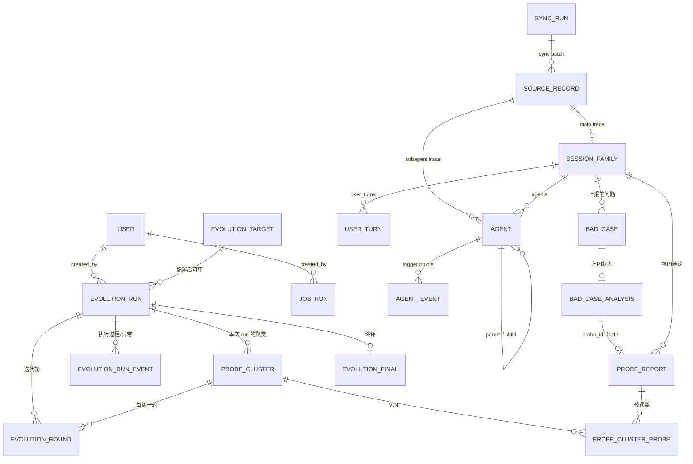

# 05 · 后端接口设计

> 本文回答：前后端之间的 REST 契约长什么样、SSE 推什么、深链怎么约定、OpenAPI 到 TS 怎么生成。
> 前置：[04 后端架构](04-backend-architecture.md)；配套：[06 数据库设计](06-database-design.md)。
> 所有响应示例均为真实表查询结果（开发环境用 `fixtures` seed 造数），真实实现接入后字段不变。

## 1. 通用约定

| 项 | 约定 |
|---|---|
| Base path | `/api`；OpenAPI 文档 `/api/docs`（dev 开放，prod 关闭） |
| 鉴权 | 除 `/api/health`、`/api/auth/login`、`/api/auth/refresh` 外一律 `Authorization: Bearer <accessToken>`；401 用 `AUTH_*` 错误码；SSE 用一次性票据（见 §4.1） |
| 命名 | JSON 一律 **camelCase**（Pydantic `alias_generator=to_camel`）；数据库列 snake_case；两者转换只在 Pydantic 层发生 |
| 时间 | ISO 8601 带时区，统一 **Asia/Shanghai（UTC+8）**，如 `2026-08-30T16:00:33.573+08:00`；不使用 `Z` 结尾；时长用整数秒 |
| ID | `sessionId` 为根会话 UUID；`agentId` 主 agent = root session id、子 agent = 真实 `agentId`；`badCaseId` / `probeId` / `probeClusterId` 由外部或本服务生成 |
| 列表 | `{ "items": [...], "total": 0, "page": 1, "pageSize": 20 }`；无分页的小列表直接 `{ "items": [...] }` |
| 错误 | `{ "error": { "code": "SESSION_NOT_FOUND", "message": "...", "details": {} } }`，见 §8 |
| 幂等 | `POST /api/acquisition/sync` 可重复调用（进行中返回 409）；`POST /evolution/runs` 无幂等键（每次启动都是新 run） |
| 版本 | 不做 URL 版本号；契约以 OpenAPI 快照为准，破坏性变更必须同步前端生成物（CI 拦截） |
| API 粒度 | **按资源/模块拆分**；只有列表页、静态元数据做页面级聚合；详情页禁止“整页单接口”（见 §1.1） |

### 1.1 API 粒度约定（2026-10-23）

- **默认**：一个页面由多个资源接口并行取数，前端按区块独立渲染；每个接口只返回自己模块的数据。
- **允许页面级聚合**：列表页（`GET /sessions`、`GET /evolution/runs`）、静态元数据（`GET /catalogs`、向导 targets/versions）。
- **不做整页聚合**：`/sessions/{sid}` 的会话概览、Agent 会话树、问题列表分别由 3 个接口提供；Agent 会话树/执行日志/大列表不得塞进一个“page”响应。
- **依赖顺序**：详情/选中项可串行（先列表后详情），同一页的独立区块必须并行（例如会话概览 + Agent 会话树 + 问题列表）。
- **体积预算**：单接口响应超过约 300KB 时必须拆分；Agent 会话树另行按消息/agent 分页或裁剪。
- **BFF 例外**：未来移动端/弱网需要一次往返时，新增独立 BFF `/app/...` 聚合端点，不替换现有资源接口。

## 2. 资源模型总览



> 轨迹侧表由本服务同步写入；`BAD_CASE / BAD_CASE_ANALYSIS / PROBE_REPORT` 由外部归因/上报系统写入，本服务只读；`EVOLUTION_*` 与 `PROBE_CLUSTER*` 由本服务写。`USER_TURN` 是内部表，不对外暴露（见 §3.3）。

## 3. 领域模型（OpenAPI Schema 的源头）

### 3.1 Session 列表项与会话概览

```json
{
  "id": "cb819c5b-286f-4eab-a681-4ba5414b844d",
  "short": "AI agent + 视频播放结合的开源产品",
  "title": "AI agent + 视频播放结合的开源产品调研",
  "repo": "llm-wiki",
  "model": "glm-5.3",
  "startedAt": "2026-09-05T17:17:53+08:00",
  "durationSeconds": 63420,
  "status": "partial",
  "skills": ["deep-research"],
  "stats": {
    "userTurns": 12, "messages": 1103, "tools": 197, "errors": 4,
    "agents": 57, "badCases": 3, "tokens": 58368517,
    "failPer100Messages": 0.36, "badCasesPer100Messages": 0.27
  }
}
```

- `status`：`ok`（完成）/ `partial`（有失败）/ `fail`（整体失败）。密度只由后端计算，前端不算（避免口径漂移）。
- `short`：列表卡标题（截断展示）；`title`：完整标题。两者都由首个用户提问派生，`short` 允许为空（前端回退到 title）。
- `stats.badCases` 是**查询时**按会话聚合 `bad_cases` 的计数（问题侧外部写入、随上报/删除实时变化），不落 `session_families` 列；`stats` 中其余计数来自同步聚合列（整棵树口径，见 [06 §3.2](06-database-design.md)）。
- 示例的 `agents[]` 是节选，`stats` 为整树口径（含未展示节点），数值仅示意，不要用可见行手算。

### 3.2 Agent 会话树

```json
{
  "sessionId": "cb819c5b-...",
  "agents": [
    {
      "agentId": "cb819c5b-...",
      "parentAgentId": null, "kind": "main", "agentType": null,
      "taskKind": null, "spawnDepth": 0,
      "label": "主会话", "lines": 765, "messagesCount": 375,
      "events": [
        { "line": 24, "kind": "skill", "name": "deep-research", "messageOffset": 0 },
        { "line": 30, "kind": "workflow", "name": "deep-research",
          "toolUseId": "call_ca6f...", "messageOffset": 6 },
        { "line": 42, "kind": "agent", "name": "general-purpose",
          "desc": "检索工具层四项+综述", "toolUseId": "call_721e...", "messageOffset": 18 }
      ]
    },
    {
      "agentId": "wf_1fb8ca61-c70",
      "parentAgentId": "cb819c5b-...", "kind": "workflow", "agentType": "workflow",
      "label": "workflow",
      "taskKind": null, "spawnDepth": 1,
      "desc": "56 个 workflow 子 agent", "toolUseId": "call_ca6f...",
      "lines": 0, "messagesCount": 0, "events": []
    },
    {
      "agentId": "a000f718c770a5b36",
      "parentAgentId": "cb819c5b-...", "kind": "subagent", "agentType": "general-purpose",
      "label": "general-purpose",
      "taskKind": null, "spawnDepth": 1,
      "desc": "检索工具层四项+综述", "toolUseId": "call_721e...",
      "lines": 218, "messagesCount": 120,
      "events": [
        { "line": 12, "kind": "skill", "name": "deep-research", "messageOffset": 0 },
        { "line": 28, "kind": "agent", "name": "Explore",
          "desc": "只读检索子任务", "toolUseId": "call_b", "messageOffset": 4 }
      ]
    },
    {
      "agentId": "a17945bf58c8af55f",
      "parentAgentId": "a000f718c770a5b36", "kind": "subagent", "agentType": "Explore",
      "label": "Explore",
      "taskKind": null, "spawnDepth": 2,
      "desc": "只读检索子任务", "toolUseId": "call_b",
      "lines": 96, "messagesCount": 48, "events": []
    },
    {
      "agentId": "wf-sub-1...",
      "parentAgentId": "wf_1fb8ca61-c70", "kind": "subagent", "agentType": "workflow-subagent",
      "label": "workflow-subagent",
      "taskKind": null, "spawnDepth": 2,
      "desc": "", "toolUseId": null,
      "lines": 18, "messagesCount": 10, "events": []
    }
  ],
  "badCases": [
    {
      "badCaseId": "bc-050b-03", "badCaseType": "discovery",
      "objectName": "deep-research", "objectType": "skill", "objectVersion": "v2.0.0",
      "anchor": { "agentId": "a000f718c770a5b36", "eventIndex": 0 },
      "badCaseAgent": { "sessionId": "cb819c5b-...", "agentId": "a000f718c770a5b36" },
      "title": "检索索引读取失败",
      "reason": "deep-research skill发现前置步骤存在问题：检索索引读取失败"
    },
    {
      "badCaseId": "bc-050b-04", "badCaseType": "discovery",
      "objectName": "general-purpose", "objectType": "agent", "objectVersion": null,
      "anchor": { "agentId": "cb819c5b-...", "eventIndex": 2 },
      "badCaseAgent": { "sessionId": "cb819c5b-...", "agentId": "a000f718c770a5b36" },
      "title": "工具层检索结果未去重",
      "reason": "subagent发现前置步骤存在问题：工具层检索结果未去重"
    }
  ]
}
```

设计要点：

- **`agents` 是扁平列表**，不再有 `main/subs/children` 嵌套；前端用 `parentAgentId` 建树。`main` 也作为一行，`parentAgentId=null`。
- **结构关系**：`parentAgentId` 指向父节点；`toolUseId` 指向父节点中触发该节点的调用，用于画布边锚点。workflow 的 `toolUseId` 填父级 workflow 调用；workflow-subagent 允许为 `null`。
- **节点类型**：`kind` 是 `main / subagent / workflow`；`agentType` 是 `general-purpose / Explore / 自定义 teammate / workflow / workflow-subagent`；`taskKind` 是 `in_process_teammate / forked_skill / null`；`spawnDepth` 来自 meta.spawnDepth。workflow 节点没有独立 transcript，`lines=0`；forked skill 是 `kind=subagent` + `taskKind=forked_skill`、`agentType=null`，靠 `label` 显示 skill 名。
- **普通 skill 不是节点**：只以父节点 `events[]`（`kind=skill`）出现；forked skill 同时有父节点的 skill 事件和自己的节点。
- **`label` 必填、由后端算**：主节点固定“主会话”；其余按 `name` → `skill_name`（forked skill）→ `agentType` → `kind` 取。前端不重算显示名。
- `events[].name` 是触发调用名，不是类型；workflow 名可以与 skill 同名（原型 line 30 的 `deep-research` 就是 workflow 名，line 24 的 `deep-research` 是 skill 名）。
- **`×N` 间隔**：`messagesCount` 是该节点自己的 assistant message 总数；`events[].messageOffset` 是该触发点之前已经出现的 assistant message 数。前端计算：
  - 首个触发点之前：`first.messageOffset`
  - 两个触发点之间：`next.messageOffset - current.messageOffset`
  - 尾部：`messagesCount - last.messageOffset`
- `line` 仍保留，用于显示 `L30`、定位/调试；`×N` 不再用行号差。
- 示例只展示 workflow 的 1 个 `workflow-subagent`，实际原型有 56 个；扁平列表省略其余。
- **问题卡锚点**：API 只暴露 `anchor.agentId + anchor.eventIndex`，不暴露上报者 session。服务端以 `bad_case_agent_id`（上报人 A）为起点计算宿主：`self + agent` → A 节点（`eventIndex=-1`）；`self/discovery + skill` → A 中该 skill 的最后一次触发；`discovery + agent` → A 的父节点 P 中调用 A 的 `agent` 事件（用 `A.toolUseId` 匹配）。`eventIndex=-1` 表示未匹配到触发点，前端挂到宿主节点本身。
- `anchor.eventIndex` 是目标 agent `events[]` 的 0-based 下标，不是 line，也不是 messageOffset。
- **`badCaseAgent` 不一定是宿主**：示例 `bc-050b-04` 是 `discovery + agent`，上报人是 a000，但卡片挂在主会话调用 a000 的 L42 `agent` 触发点上；这类卡片的 `anchor.agentId` 是父节点。
- **命名映射**：API 的 `sessionId` = 根会话；`agentId` = 主 agent 的 root session id / 子 agent 的真实 `agentId`，对应 DB `agents.id`；`root_session_id` 只在内部表出现。

### 3.3 内部轨迹模型（不对外暴露）

时间线页面在 2026-10-22 评审中裁撤，完整时间线由外部平台承担，因此**不提供用户轮次/消息/内容块的读接口**。归一化只保留 `user_turns` 作为用户输入锚点（`promptText` + `lineNo`/`messageOffset`，见 [06 §3.5](06-database-design.md)），供未来在 Agent 执行流图里展示用户输入。

- 消息与内容块只在解析期存在：用于整树统计（消息数、token、工具、错误）、usage 去重与状态判定，**不落库**；
- 需要原文证据时，按 `(sessionId, agentId)` 从 `trajectory_payloads` 回读，或走外部平台的时间线。

也就是说：**契约里没有 `Timeline/UserTurn/Message/ContentBlock` 响应模型**，轨迹明细层只保留 `user_turns` 输入锚点。未来若在流图里显示用户输入，只需在读接口补 `userTurns`（含 `promptText` / `lineNo` / `messageOffset`），不恢复消息/内容块表。

### 3.4 问题（bad_case）、归因状态与 probe

`BadCase`（问题列表项）：

```json
{
  "badCaseId": "bc-050b-03",
  "sessionId": "050b81ba-...", "sessionTitle": "研究'用户数据驱动自进化'提到的所有方法",
  "badCaseType": "discovery",
  "objectName": "deep-research", "objectType": "skill", "objectVersion": "v2.0.0",
  "anchor": { "agentId": "050b81ba-...", "eventIndex": 0 },
  "badCaseAgent": { "sessionId": "050b81ba-...", "agentId": null },
  "title": "检索索引读取失败",
  "reason": "deep-research skill发现前置步骤存在问题：检索索引读取失败",
  "metaData": { "file": "apps/server/src/search/index.ts", "line": 142, "error": "ENOENT" },
  "analysis": { "status": "analyzed_issue", "probeId": "pr-050b-03", "attributeType": "error" }
}
```

- `objectName/objectType/objectVersion` 是**上报者/发现者**，不是根因；根因看 `probe`。
- `badCaseAgent` 记录**上报/发现问题的 agent**：`sessionId` 是根会话，`agentId` 主 agent 为 `null`、子 agent 为真实 `agentId`。它是锚点计算的输入，不一定是卡片宿主；`discovery + agent` 时 `anchor.agentId` 会解析到父节点。
- 上报契约：`badCaseAgent.agentId` 指向的 agent 必须包含 `objectName` 的触发记录；skill 型问题只在该 agent 的 `agent_events` 里查找，找不到时 `anchor.eventIndex=-1`。
- `title` 是外部上报必填的短标题：问题列表卡、执行流图问题卡与详情页标题行的主文本；`reason` 是描述正文，渲染在详情页正文块。
- DB 列映射：`title` ↔ `bad_cases.title`，`reason` ↔ `bad_cases.bad_case_description`——存储层列名带 `bad_case_` 前缀，DTO 字段保留 `reason`（见 [06 §4.1](06-database-design.md)）。
- `anchor` 是后端算出的挂载点：`anchor.agentId` 是宿主节点（可能是上报人的父节点），`anchor.eventIndex` 是该节点 `events[]` 下标；上报者 session 不对外暴露。
- `metaData` 原样返回；前端按通用 KV 渲染成事实 chips（值过长截断）。
- `analysis.attributeType`：仅 `analyzed_issue` 非空（冗余自 `probe.attributeType`），问题列表/错误页左栏据此一次渲染 5 种展示态，无需逐条取 probe；`unanalyzed` / `analyzed_nonissue` 为 `null`。
- `analysis.status` 与原型展示的映射：

| `analysis.status` | 附加条件 | 原型展示 |
|---|---|---|
| `unanalyzed` | — | 未分析 |
| `analyzed_nonissue` | — | 非问题 |
| `analyzed_issue` | `probe.attributeType = model` | 是问题-模型问题 |
| `analyzed_issue` | `probe.attributeType = prompt` | 是问题-prompt缺失某些提示词 |
| `analyzed_issue` | `probe.attributeType = error` | 是问题-错误 |

`ProbeReport`（归因结论；由 bad_case 的 `probeId` 取）：

```json
{
  "probeId": "pr-050b-03",
  "sessionId": "050b81ba-...",
  "probeType": "agent", "probeObject": "Explore", "objectVersion": "v1.0.1",
  "attributeType": "prompt",
  "probeDescription": "prompt 未要求读取快照前校验用户轮次字段，subagent 直接读取导致越界。",
  "probeAnalysis": "1. 从 bad_case 的 `reason` 与 `meta_data` 定位到 Explore 的读取步骤。\n2. 同批次有校验的 subagent 未报错，说明是 prompt 约定缺失。\n\n~~~ts\nconst snap = readSnapshot(id); // 未校验 userTurn\n~~~",
  "fromBadCases": ["bc-050b-03"], "fromBadCasesCount": 1
}
```

- `probeObject @ objectVersion` 是**自进化 target 的唯一来源**。
- `fromBadCases` / `fromBadCasesCount` 由 `bad_case_analysis.probe_id` 反查得出（V1 恒 1 条）。
- `probeAnalysis` 是 **Markdown 字符串**（对应 DB `probe_reports.probe_analysis`，`TEXT`）；前端按 Markdown 渲染，保留换行、列表与代码块。渲染时禁用裸 HTML、外链加安全属性；不接语法高亮，代码块按等宽 + 横向滚动展示。

### 3.5 自进化运行

`RunCard`（列表项）：

```json
{
  "runId": "evo-20261019-01",
  "title": "deep-research v2.0.0 自进化",
  "mode": "full",
  "target": { "type": "skill", "name": "deep-research", "version": "v2.0.0" },
  "window": { "from": "2026-08-20", "to": "2026-09-10" },
  "models": ["glm-5.3", "glm-5.3-flash"],
  "createdBy": "Administrator",
  "createdAt": "2026-10-19T18:42:00+08:00",
  "status": "running",
  "error": null,
  "stats": { "sessions": 4, "probes": 12, "usedProbes": 7, "clusters": 5,
    "byAttributeType": { "model": 3, "prompt": 1, "error": 3, "nonIssue": 2 } },
  "progress": { "unit": 6, "total": 10, "percent": 60,
    "stageLabel": "第 5/6 步 · 迭代优化 · 第 3/5 轮", "doneRounds": 2, "accepted": 1 },
  "final": null
}
```

已完成的 run 附带 `final`：

```json
"final": { "bestVersion": "v2.0.0-best", "branchName": "evo/20261023-evo-20261023-01", "pushStatus": "succeeded", "verdict": true, "bestScore": 88.9, "initScore": 84.3 }
```

`RunDetail` 在 RunCard 基础上多 `steps` 与 `workspace`（六步状态由后端算，前端不推算）：

```json
"status": "blocked",
"blockedStage": "eval",
"retryAttempts": 0,
"nextRetryAt": null,
"evalStatus": "failed",
"workspace": {
  "repoUrl": "https://git.example.com/agent-skills.git",
  "subDir": "skills/deep-research",
  "repoPath": "data/repos/tgt-123", "baseRef": "v2.0.0", "baseCommit": "9f3c2a1…",
  "branchName": "evo/20261023-evo-20261023-01", "workspacePath": "data/workspaces/evo-20261023-01",
  "remote": "origin", "pushStatus": "succeeded", "pushedAt": "2026-10-23T09:40:00+08:00", "pushError": null
},
"error": { "stage": "eval", "message": "评测执行失败：sandbox timeout", "at": "2026-10-23T09:41:02+08:00" },
"lastEventSeq": 42,
"steps": [
  { "index": 0, "key": "input", "title": "筛选输入", "status": "done" },
  { "index": 1, "key": "clusters", "title": "问题聚类", "status": "done" },
  { "index": 2, "key": "attribution", "title": "LLM 归因置信度", "status": "done" },
  { "index": 3, "key": "severity", "title": "严重程度排序", "status": "done" },
  { "index": 4, "key": "iteration", "title": "迭代优化", "status": "active", "detail": "第 3/5 轮" },
  { "index": 5, "key": "final", "title": "测试集终评", "status": "pending" }
]
```

- `status` ∈ `preparing|running|blocked|completed|failed|interrupted`；`error` 为 `null` 或 `{stage, message, at}`（列表只给摘要）。
- `createdBy` 是创建人的可空显示名；删除用户后为 `null`。Issue 要求展示创建人，前端把它与 `createdAt` 放在原型右上 meta 槽，不新增视觉行。
- `byAttributeType.nonIssue` 在自进化口径下恒为 0：`analyzed_nonissue` 没有 probe，无法归属任何 target；`usedProbes = model + prompt + error`（非问题剔除、未分析不计入），原型"剔除非问题 N 份"与分布条图例直接取该字段。
- `lastEventSeq`：DB 当前最大事件序号，可用于检查/增量拉取；**ticket 的 `lastEventId` 不要直接用它**，应用已加载事件的最后一条 `seq`（events 分页可能还没拉完）。

`status` ∈ `done | active | pending`；`clickable = status != pending`。

### 3.6 六步产出（六个独立端点）

每个 step 一个端点，响应均为 `EvolutionStep` 外壳 + 该步的 `payload`：

| step | key | 端点 | payload 关键字段 |
|---|---|---|---|
| 0 筛选输入 | `input` | `GET /evolution/runs/{rid}/steps/input` | `condition`、`hits`（sessions/probes/usedProbes/byAttributeType 含 nonIssue）、`rows[]`（`ProbeRow` + `clusterId`） |
| 1 问题聚类 | `clusters` | `GET /evolution/runs/{rid}/steps/clusters` | `clusters[]`：`probeClusterId/title/description/type/probeCount/confidence/severity/probes[]`（`ProbeRow`；confidence/severity 未算完时为 `null`） |
| 2 LLM 归因置信度 | `attribution` | `GET /evolution/runs/{rid}/steps/attribution` | `items[]`：clusterId/probeId/probeObject/objectVersion/attributeType/description/analysis/confidence（confidence 取所属簇的值） |
| 3 严重程度排序 | `severity` | `GET /evolution/runs/{rid}/steps/severity` | `rows[]`：rank/clusterId/title/type/probeCount/reportCount/confidence/impact/severity（按落库 severity 降序） |
| 4 迭代优化 | `iteration` | `GET /evolution/runs/{rid}/steps/iteration` | `rounds[]`：clusterId/title/type/probeCount/confidence/severity/probes[]（`ProbeRow`）/status/candidate/push/eval/accepted/finalCommit |
| 5 测试集终评 | `final` | `GET /evolution/runs/{rid}/steps/final` | `verdict/bestVersion/bestScore/initScore/metrics[]/changes[]`（结构化修改点） |

统一外壳：

```json
{ "key": "clusters", "index": 1, "title": "问题聚类", "status": "done", "payload": { "clusters": [] } }
```

- `index` 是步骤顺序（0–5），`key` 是稳定语义标识；两个都保留，前端路由/缓存优先用 `key`。
- `confidence` 是**簇级**（第 2 步归因完成写入 `probe_clusters.confidence`）；`impact` 是建簇时按 `probe_cluster_type` 的固定映射（V1：`error=9` / `prompt=7` / `model=5`）；`severity = round(min(10, confidence × impact × reportWeight), 1)`，`reportWeight = 1 + 0.1 × min(reportCount - 1, 5)`，`reportCount` 是簇内 probe 反查到的 distinct `bad_case_id` 数。第 3 步写入 `probe_clusters.severity/rank`；接口只读这些列，不再占位计算；未到达对应步骤时值为 `null`。
- 示例：`confidence=0.82, impact=9, reportCount=1 → severity=7.4`；`reportCount=3 → 8.9`（封顶 10）。
- `attribution.items[]` 仍按 probe 展开，`confidence` 取所属簇的值（同一簇内相同）；归因结果不包含 `verdict`。
- 端点未到达时返回 `404 STEP_NOT_READY`；`input` 在 `preparing` 时返回准备态，不返回 404。
- `final` 在 `active` 且终评尚未写入（`evolution_finals` 无行）时 `verdict/bestVersion/bestScore/initScore` 为 `null`、`metrics` 为 `[]`，`changes` 仍按已接纳轮次给出；消费方按 `status` 渲染，不把 `null` 解读为终评失败。
- 第 0 步 `hits` 按该 run 已落簇的 probe（`probe_cluster_probes`）计数、不按条件重查；`preparing` 时为零值。
- 六个端点共享同一 run 的权限和 readiness；服务端只复用同一个 `build_step_payload`，不复制业务逻辑。

共享 `ProbeRow`（`steps/input` 的 `rows[]`、`steps/clusters` 与 `steps/iteration` 的 `probes[]`、向导 `probes/query` 的 `items[]` 同构）：

```json
{ "probeId": "pr-050b-03", "sessionId": "050b81ba-...",
  "sessionTitle": "研究'用户数据驱动自进化'提到的所有方法", "model": "glm-5.3",
  "probeType": "skill", "probeObject": "deep-research", "objectVersion": "v2.0.0",
  "attributeType": "error", "description": "检索索引读取失败…",
  "sourceBadCaseIds": ["bc-050b-03"] }
```

- `sourceBadCaseIds` 由 `bad_case_analysis.probe_id` 反查（V1 恒 1 条）；深链用 `sessionId + sourceBadCaseIds[0]` 拼 `/sessions/{sid}/errors?case={badCaseId}&tab=attr|desc`（报告 ID 落归因 tab，来源问题 ID 落问题描述 tab）。
- `description` 即 `probeDescription`（原型报告表的"问题现象"列）；`steps/input` 的行在此基础上多一个 `clusterId`。

#### 3.6.1 返回示例

`steps/input`：

```json
{
  "key": "input", "index": 0, "title": "筛选输入", "status": "done",
  "payload": {
    "condition": { "targetType": "skill", "targetName": "deep-research", "targetVersion": "v2.0.0",
      "from": "2026-08-20", "to": "2026-09-10", "models": ["glm-5.3"] },
    "hits": { "sessions": 130, "badCases": 1, "analyzed": 1, "unanalyzed": 0,
      "probes": 1, "usedProbes": 1, "byAttributeType": { "model": 0, "prompt": 0, "error": 1, "nonIssue": 0 } },
    "rows": [
      { "probeId": "pr-050b-03", "sessionId": "050b81ba-...", "sessionTitle": "研究…",
        "model": "glm-5.3", "probeType": "skill", "probeObject": "deep-research",
        "objectVersion": "v2.0.0", "attributeType": "error", "description": "检索索引读取失败…",
        "sourceBadCaseIds": ["bc-050b-03"], "clusterId": "C1" }
    ]
  }
}
```

`steps/clusters`：

```json
{
  "key": "clusters", "index": 1, "title": "问题聚类", "status": "done",
  "payload": {
    "clusters": [
      { "probeClusterId": "C1", "title": "检索索引读取失败", "description": "检索索引读取失败",
        "type": "error", "probeCount": 1, "confidence": 0.82, "severity": 7.4,
        "probes": [ { "probeId": "pr-050b-03", "sessionId": "050b81ba-...", "sessionTitle": "研究…",
          "model": "glm-5.3", "probeType": "skill", "probeObject": "deep-research",
          "objectVersion": "v2.0.0", "attributeType": "error", "description": "检索索引读取失败…",
          "sourceBadCaseIds": ["bc-050b-03"] } ] }
    ]
  }
}
```

`steps/attribution`：

```json
{
  "key": "attribution", "index": 2, "title": "LLM 归因置信度", "status": "done",
  "payload": {
    "items": [
      { "clusterId": "C1", "probeId": "pr-050b-03", "probeObject": "deep-research",
        "objectVersion": "v2.0.0", "attributeType": "error",
        "description": "检索索引读取失败", "analysis": "在对象逻辑中复现并确认索引未校验",
        "confidence": 0.82 }
    ]
  }
}
```

`steps/severity`：

```json
{
  "key": "severity", "index": 3, "title": "严重程度排序", "status": "done",
  "payload": {
    "rows": [
      { "rank": 1, "clusterId": "C1", "title": "检索索引读取失败", "type": "error", "probeCount": 1,
        "reportCount": 1, "confidence": 0.82, "impact": 9, "severity": 7.4 }
    ]
  }
}
```

`steps/iteration`：

```json
{
  "key": "iteration", "index": 4, "title": "迭代优化", "status": "active", "detail": "第 1/1 轮",
  "payload": {
    "rounds": [
      { "roundId": "r-01", "clusterId": "C1", "title": "检索索引读取失败", "type": "error",
        "probeCount": 1, "confidence": 0.82, "severity": 7.4, "status": "accepted",
        "probes": [ { "probeId": "pr-050b-03", "sessionId": "050b81ba-...", "sessionTitle": "研究…",
          "model": "glm-5.3", "attributeType": "error", "description": "检索索引读取失败…",
          "sourceBadCaseIds": ["bc-050b-03"] } ],
        "candidate": { "ref": "evo/20261023-evo-20261023-01/candidate/r1",
          "commit": "ab12…", "message": "evolve(deep-research@v2.0.0): 针对「检索索引读取失败」的候选变更" },
        "patch": { "file": "SKILL.md", "lines": ["+ 读取索引前校验快照字段"] },
        "push": { "status": "succeeded", "attempts": 1, "error": null },
        "eval": { "status": "completed", "current": 84.6, "candidate": 87.2, "nextPollAt": null },
        "accepted": true,
        "finalCommit": { "hash": "cd34…", "message": "evolve(deep-research@v2.0.0): 修复检索索引未校验导致的越界读取" } }
    ]
  }
}
```

`steps/final`：

```json
{
  "key": "final", "index": 5, "title": "测试集终评", "status": "done",
  "payload": {
    "verdict": true, "bestVersion": "v2.0.0-best", "bestScore": 88.9, "initScore": 84.3,
    "metrics": [ { "name": "任务完成率", "init": 78.0, "best": 84.0, "delta": 6.0, "unit": "%" },
      { "name": "平均耗时", "init": 42.0, "best": 36.0, "delta": -6.0, "unit": "s" } ],
    "changes": [ { "commit": "cd34…", "clusterId": "C1", "title": "检索索引读取失败",
      "type": "error", "reportCount": 1 } ]
  }
}
```

迭代轮结构：`rounds[]` 含 `patch {file, lines[]}`、`candidate {ref, commit, message}`、`push {status, attempts, error}`、`eval {status, current, candidate, nextPollAt}`、`status ∈ pending|patching|pushing|evaluating|deciding|accepted|rejected|failed`、`finalCommit {hash, message}`（接纳后的 amend 结果）。candidate 先 push 临时 ref 再评测；接纳后 run 分支 fast-forward，拒绝后删除 candidate、`finalCommit=null`。「来源问题」是 `probes[]`（`ProbeRow`），展开即渲染原型的"来源问题报告"6 列表格；`final.changes[]` 每项对应一个已接纳轮次（`commit` = `finalCommit.hash`），原型"修改点"列表直接渲染。

## 4. 端点清单

```text
┌─ 基础与鉴权 ──────────────────────────────────────────────┐
│ GET  /api/health                                         │
│ POST /api/auth/login · refresh · logout                  │
│ POST /api/auth/change-password                           │
│ GET  /api/auth/me                                        │
│ POST /api/events/ticket                                  │
└──────────────────────────────────────────────────────────┘

┌─ 会话域 ──────────────────────────────────────────────────┐
│ GET  /api/sessions                                       │
│ GET  /api/sessions/{sid}                                 │
│ GET  /api/sessions/{sid}/tree                            │
│ GET  /api/sessions/{sid}/bad-cases                       │
│ GET  /api/sessions/{sid}/probes                          │
└──────────────────────────────────────────────────────────┘

┌─ 问题域（只读） ──────────────────────────────────────────┐
│ GET  /api/bad-cases/{badCaseId}                          │
│ GET  /api/bad-cases/{badCaseId}/analysis                 │
│ GET  /api/probes/{probeId}                               │
└──────────────────────────────────────────────────────────┘

┌─ 轨迹接入 ────────────────────────────────────────────────┐
│ POST /api/acquisition/sync                               │
│ POST /api/acquisition/pull                               │
│ GET  /api/acquisition/status                             │
│ GET  /api/jobs/{jobId}                                   │
└──────────────────────────────────────────────────────────┘

┌─ 自进化域 ────────────────────────────────────────────────┐
│ GET  /api/evolution/runs                                 │
│ POST /api/evolution/runs                                 │
│ GET  /api/evolution/runs/{rid}                           │
│ GET  /api/evolution/runs/{rid}/steps/input               │
│ GET  /api/evolution/runs/{rid}/steps/clusters            │
│ GET  /api/evolution/runs/{rid}/steps/attribution         │
│ GET  /api/evolution/runs/{rid}/steps/severity            │
│ GET  /api/evolution/runs/{rid}/steps/iteration           │
│ GET  /api/evolution/runs/{rid}/steps/final               │
│ POST /api/evolution/runs/{rid}/retry                     │
│ POST /api/evolution/probes/query                         │
│ POST /api/evolution/cluster-previews                     │
│ GET/POST/PUT/DELETE /api/evolution/targets               │
│ GET  /api/evolution/targets/{id}/versions                │
└──────────────────────────────────────────────────────────┘

┌─ 清单与推送 ──────────────────────────────────────────────┐
│ GET  /api/catalogs/targets                               │
│ GET  /api/catalogs/models                                │
│ GET  /api/events（SSE）                                  │
└──────────────────────────────────────────────────────────┘
```

### 4.1 基础端点：健康检查与鉴权

`GET /api/health` → `200`（公开，无需登录）

```json
{ "ok": true, "service": "harness-evolution", "phase": "demo", "version": "0.2.0",
  "db": { "dialect": "mysql", "ok": true, "latencyMs": 3 } }
```

`phase` ∈ `scaffold | demo | live`：`demo` 表示开发/演示数据已 seed（顶栏可显示"演示数据"角标）；`live` 表示接真实来源。`db.dialect` 取值 `sqlite | mysql`；`ok=false` 时 HTTP 返回 `503` 且 `db` 带错误摘要（API 进程仍可达）。

**鉴权端点**（`/api/auth/login` 与 `/api/auth/refresh` 公开，其余需登录）：

| 端点 | 说明 |
|---|---|
| `POST /api/auth/login` | body `{username, password}` → `200 {accessToken, expiresIn, user:{id, username, displayName, role, mustChangePassword}}`；refresh token 写入 httpOnly + SameSite=Strict cookie（14 天）。密码错误 → `401 AUTH_INVALID`；账号停用 → `403 FORBIDDEN` |
| `POST /api/auth/refresh` | 读取 refresh cookie → 重读用户行 → 新 `{accessToken, expiresIn}`（token 内 `mcp` 声明取最新值）；cookie 缺失/失效 → `401 AUTH_EXPIRED` |
| `POST /api/auth/logout` | 使 refresh cookie 失效（过期化）→ `204` |
| `POST /api/auth/change-password` | 登录用户修改自己的密码 `{oldPassword, newPassword}` → `204`，成功后清 `must_change_password`；旧密码校验失败 `401 AUTH_INVALID` |
| `GET /api/auth/me` | 当前用户信息 `{id, username, displayName, role, mustChangePassword}` |
| `GET /api/users`、`POST /api/users` | 管理员创建/列出用户（单组织共享，仅 `role=admin`）；成员管理界面首版从简，可先只用 API。新建账号的 `mustChangePassword` 恒为 `true` |

**强制改密**：账号只能由 admin 创建或由 env 播种，初始密码一律由他人设定，因此服务端用 `must_change_password` 硬卡——该标记为 true 时仍签发 token，但除 `POST /api/auth/change-password`、`POST /api/auth/logout`、`GET /api/auth/me` 外的请求一律 `403 PASSWORD_CHANGE_REQUIRED`。改密成功后前端先 `POST /api/auth/refresh` 换新 access token、再 `GET /api/auth/me` 取到 `mustChangePassword=false`，然后放行到 `redirect`（[07 §8.2](07-backend-implementation.md) · [08 §4.1](08-frontend-implementation.md)）。

`GET /users` 示例：

```json
{ "items": [
  { "id": "u-admin", "username": "admin", "displayName": "管理员", "role": "admin", "isActive": true, "mustChangePassword": true }
] }
```

`POST /users` body：

```json
{ "username": "alice", "displayName": "Alice", "password": "临时密码", "role": "member" }
```

→ `201` 创建后的用户（不含密码哈希；`mustChangePassword` 恒为 `true`，用户首次登录必须改密）。

**SSE 票据**：`POST /api/events/ticket`（需登录）

```json
{ "topics": ["run:evo-20261019-01"], "lastEventId": 42 }
```

→ `{ "ticket": "t-…", "expiresIn": 60, "topics": ["run:evo-20261019-01"] }`

- 票据一次性、60 秒有效，**绑定 topics**；`GET /api/events?ticket=…` 只按票据内 topics 订阅，URL 不再接受 `topics` 参数。
- topics 仅接受 `run:{rid}`；轨迹归一化（sync）不提供 SSE，不能申请 `sync` topic。
- `lastEventId` 可选：首连从该游标之后回放；不传则从当前时刻开始。
- 已完成任务不需要取票；只有 `preparing/running` 的 run 页面才申请。轨迹归一化（sync）不提供 SSE。

### 4.2 会话列表

`GET /api/sessions?q=&status=&sort=latest&limit=100`

| 参数 | 类型 | 说明 |
|---|---|---|
| `q` | string | 标题/仓库模糊匹配（大小写不敏感） |
| `status` | `all\|ok\|partial\|fail\|problem` | 默认 all；`problem` = `partial`+`fail`（前端"有失败"chip 的合并筛选） |
| `sort` | `latest\|userTurns\|messages\|agents` | 默认 latest |
| `limit` | int | 默认 100，最大 500 |

响应 `{ "items": [SessionListItem] }`。**排序与计数全部后端做**，前端只渲染。

### 4.3 会话概览

`GET /api/sessions/{sid}` → `SessionListItem`（与列表项同构，避免两套模型）。

### 4.4 Agent 会话树

`GET /api/sessions/{sid}/tree` → `SessionTree`（§3.2）。

### 4.5 时间线端点（已裁撤）

时间线页面不做，因此不提供 `GET /api/sessions/{sid}/timeline` 及其消息展开端点。`user_turns` 只保留用户输入锚点；消息/内容块不落库（见 §3.3）。

列表/会话概览的计数全部来自 `session_families` 上的整树聚合列；消息/内容块明细不存在，也没有按轮次计数的读接口。`stats.badCases` 不在这批聚合列里，按会话聚合 `bad_cases`（见 [06 §3.2](06-database-design.md)）。

### 4.6 会话问题列表

`GET /api/sessions/{sid}/bad-cases` → `{ "items": [BadCase] }`（按 `createdAt` 升序）。

```json
{
  "items": [
    { "badCaseId": "bc-050b-03", "sessionId": "050b81ba-...",
      "sessionTitle": "研究'用户数据驱动自进化'提到的所有方法",
      "badCaseType": "discovery",
      "objectName": "deep-research", "objectType": "skill", "objectVersion": "v2.0.0",
      "anchor": { "agentId": "050b81ba-...", "eventIndex": 0 },
      "badCaseAgent": { "sessionId": "050b81ba-...", "agentId": null },
      "title": "检索索引读取失败",
      "reason": "deep-research skill发现前置步骤存在问题：检索索引读取失败",
      "analysis": { "status": "analyzed_issue", "probeId": "pr-050b-03", "attributeType": "error" } }
  ]
}
```

### 4.7 问题、归因与 probe

- `GET /api/bad-cases/{badCaseId}` → `BadCase`（含 `sessionId`，用于深链校验）
- `GET /api/bad-cases/{badCaseId}/analysis` → `{ "status": AnalysisStatus, "probeId": string|null, "result": object|null }`；无归因记录时返回 `status=unanalyzed` 占位
- `GET /api/probes/{probeId}` → `ProbeReport`（含 `fromBadCases[]` / `fromBadCasesCount`）
- `GET /api/sessions/{sid}/probes` → `{ "items": [ProbeReport] }`（可选，给"仅看根因"的场景用）

`GET /bad-cases/{badCaseId}` 示例：

```json
{
  "badCaseId": "bc-050b-03", "sessionId": "050b81ba-...",
  "sessionTitle": "研究'用户数据驱动自进化'提到的所有方法",
  "badCaseType": "discovery",
  "objectName": "deep-research", "objectType": "skill", "objectVersion": "v2.0.0",
  "anchor": { "agentId": "050b81ba-...", "eventIndex": 0 },
  "badCaseAgent": { "sessionId": "050b81ba-...", "agentId": null },
  "title": "检索索引读取失败",
  "reason": "deep-research skill发现前置步骤存在问题：检索索引读取失败",
  "metaData": { "file": "apps/server/src/search/index.ts", "line": 142, "error": "ENOENT" },
  "analysis": { "status": "analyzed_issue", "probeId": "pr-050b-03", "attributeType": "error" }
}
```

`GET /bad-cases/{badCaseId}/analysis` 示例：

```json
{
  "status": "analyzed_issue",
  "probeId": "pr-050b-03",
  "result": { "summary": "检索索引读取失败，属于对象自身错误" }
}
```

未归因时：

```json
{ "status": "unanalyzed", "probeId": null, "result": null }
```

`result` 口径：`analyzed_issue` 用 `{summary}`（推导过程看 probe 的 `probeAnalysis`）；`analyzed_nonissue` 用 `{reason, reasoning[]}`（`reasoning` 为有序推导步骤数组）；`unanalyzed` 为 `null`。

`GET /probes/{probeId}` 示例：

```json
{
  "probeId": "pr-050b-03", "sessionId": "050b81ba-...",
  "probeType": "skill", "probeObject": "deep-research", "objectVersion": "v2.0.0",
  "attributeType": "error",
  "probeDescription": "检索索引读取失败",
  "probeAnalysis": "1. 从 bad_case 的 `reason` 与 `meta_data` 定位到索引读取步骤。\n2. 当前版本未做快照校验。",
  "fromBadCases": ["bc-050b-03"], "fromBadCasesCount": 1
}
```

`GET /sessions/{sid}/probes` 示例：

```json
{ "items": [ { "probeId": "pr-050b-03", "sessionId": "050b81ba-...",
  "probeObject": "deep-research", "attributeType": "error",
  "fromBadCases": ["bc-050b-03"], "fromBadCasesCount": 1 } ] }
```

> 归因由外部系统完成并写入 `bad_case_analysis` / `probe_reports`，本服务**不提供"触发分析"端点**；没有归因记录就是 `unanalyzed`。

### 4.8 原始轨迹接入（acquisition）

- `POST /api/acquisition/sync`（**仅 admin**）→ `202 { "jobId": "...", "reused": false }`：立即处理 `trajectory_payloads` 中待归一化的记录（新建/内容变化/解析器版本升级）。已有同步任务在跑 → `202 { "jobId": 正在执行的 jobId, "reused": true }`，**不重复入队**。
- 后台 scheduler 默认每 60s 自动调用同一逻辑；无 pending 时跳过。
- `POST /api/acquisition/pull` → `202 { "jobId": ... }`：按需拉取上游接口，先把返回的 payload upsert 到 `trajectory_payloads`，再走同一归一化管线。body：

```json
{ "sessionIds": ["cb819c5b-..."], "window": null }
```

  `sessionIds` 与 `window`（`{from,to}`）二选一；上游未实现时返回 `409 UPSTREAM_NOT_AVAILABLE`。
- `GET /api/acquisition/status` → 当前状态：

```json
{ "activeJobId": "job-1", "status": "running", "payloadTable": "trajectory_payloads",
  "pending": 3, "processed": 8, "imported": 4, "skipped": 1,
  "lastRunAt": "2026-10-23T17:00:00+08:00", "nextRunAt": "2026-10-23T17:01:00+08:00",
  "errors": [ { "sessionId": "2b7e9d4f-...", "message": "第 42 行非法 JSON" } ] }
```

- 不再有 `watermark` / `sourceType` / `GET /acquisition/sources`：来源由 `trajectory_payloads` 的 `(root_session_id, agent_id)` 表达，待处理状态由 `source_records.processed_*` 表达。
- `GET /api/jobs/{jobId}` → 通用任务状态：

```json
{ "jobId": "job-01H...", "kind": "sync", "refId": "sync-01H...",
  "status": "running", "progress": 0.42, "attempt": 1,
  "createdBy": "u-admin", "createdAt": "2026-10-23T17:00:00+08:00",
  "startedAt": "2026-10-23T17:00:02+08:00", "finishedAt": null,
  "error": null }
```

`status` ∈ `queued|running|completed|failed|interrupted`；`progress` 为 `0..1`。

### 4.9 probe 命中查询（向导第 2 步）

`POST /api/evolution/probes/query`

```json
{ "targetType": "skill", "targetName": "deep-research", "targetVersion": "v2.0.0",
  "from": "2026-08-20", "to": "2026-09-10",
  "models": ["glm-5.3", "glm-5.3-flash"], "page": 1, "pageSize": 8 }
```

响应：

```json
{
  "summary": { "sessions": 130, "badCases": 1, "analyzed": 1, "unanalyzed": 0,
    "probes": 1, "usedProbes": 1,
    "byAttributeType": { "model": 0, "prompt": 0, "error": 1, "nonIssue": 0 } },
  "items": [ { "probeId": "pr-050b-03", "sessionId": "050b81ba-...",
    "sessionTitle": "研究'用户数据驱动自进化'提到的所有方法",
    "model": "glm-5.3",
    "probeType": "skill", "probeObject": "deep-research", "objectVersion": "v2.0.0",
    "attributeType": "error", "description": "检索索引读取失败…",
    "sourceBadCaseIds": ["bc-050b-03"] } ],
  "total": 1, "page": 1, "pageSize": 8
}
```

- 命中以 `probe_reports` 为准：按 `probe_object @ object_version`（并匹配 `probe_type`）选 probe，再经 `bad_case_analysis.probe_id` 反查 bad case、按 `probe_reports.session_id` 反查 session。
- `badCases` 是命中 probe 关联的去重问题数；`analyzed` 是其中 `analyzed_issue` 的去重问题数；`unanalyzed` 恒为 0——未分析报告没有 probe，不参与自进化命中，界面保留该统计格显示 0。
- `sessions` 是命中 probe 的去重 session 数。
- **未分析报告不进入 `items`，也不计入 `probes` / `usedProbes`**：归因由外部系统完成，本服务不提供“触发分析”端点；自进化环节不感知未分析报告。
- `items[].model` 是该 probe 归属 agent 的模型；按 `bad_cases.bad_case_agent_id` → `agents.model` 解析，缺失时回退主 agent 模型。
- `items[]` 即 §3.6 的 `ProbeRow`；命中 probe 数为 0 时返回 `409 NO_PROBES_MATCHED`（与启动 run 同一校验口径），向导把该 409 映射为空结果：进入 Step2 渲染未命中空态并禁用两个出口，其余错误仍停在 Step1 提示。

- `from/to` 按 **probe 所属 session 的启动时间**过滤。
- `models[]` 匹配 **该 probe 所属 Agent 会话树内任一 agent 的模型**（`agents.model`），不是只看主 agent；没有模型时按“全部模型”处理。
- `usedProbes = probes`（命中的 probe 必然已归因为 `analyzed_issue`）。

### 4.10 自进化运行（异步任务）

- `GET /api/evolution/runs` → `{ "running": [RunCard], "history": [RunCard] }`（后端分组；`preparing/running/blocked` 归 running，终态归 history）

```json
{
  "running": [
    { "runId": "evo-20261019-01", "title": "deep-research v2.0.0 自进化",
      "status": "blocked", "progress": { "unit": 6, "total": 10, "percent": 60,
        "stageLabel": "第 5/6 步 · 迭代优化 · 第 3/5 轮" } }
  ],
  "history": [
    { "runId": "evo-20261018-02", "title": "Explore v1.0.1 自进化",
      "status": "completed", "final": { "bestVersion": "v1.0.1-best", "bestScore": 88.9 } }
  ]
}
```

`RunCard` 完整字段见 §3.5。
- `POST /api/evolution/runs`（body 同 4.9 的查询条件 + `"mode": "full"`）→ `202 { "runId": "evo-...", "jobId": "job-...", "status": "preparing" }`

```json
{ "targetType": "skill", "targetName": "deep-research", "targetVersion": "v2.0.0",
  "from": "2026-08-20", "to": "2026-09-10", "models": ["glm-5.3"],
  "mode": "full" }
```
  - 同步前置校验：target 已配置/启用、条件合法、probe 数 > 0；失败直接 `409 TARGET_NOT_CONFIGURED` / `409 NO_PROBES_MATCHED`
  - 可选字段：`engineKey`（执行引擎，默认 = `mode`）与 `eval`（评测接入配置，缺省用全局 `HE_EVAL_*`；密钥用 env 引用名，不落库）；两者随 run 快照（[07 §5.3](07-backend-implementation.md)）；`engineKey` 未注册或 `eval` 非法 → `422 ENGINE_INVALID`
  - 校验通过后只创建 `status=preparing` 的 run 并入队 `evolution_prepare`；workspace clone、repo/ref 校验、聚类、迭代轮（`evolution_rounds`）全部在后台完成；repo/ref 失败使 run `failed(error_stage=clone)`
- `GET /api/evolution/runs/{rid}` → `RunDetail`
  - `status`：`preparing | running | blocked | completed | failed | interrupted`
  - 额外字段：`blockedStage`、`retryAttempts`、`nextRetryAt`、`evalStatus`
  - `workspace`：`repoUrl/repoPath/baseRef/baseCommit/branchName/workspacePath`
- `GET /api/evolution/runs/{rid}/steps/{key}` 拆成六个独立端点（`input` / `clusters` / `attribution` / `severity` / `iteration` / `final`）→ `EvolutionStep`（§3.6；未到达 → `404 STEP_NOT_READY`；`preparing` 时 `input` 可返回准备态）
- `POST /api/evolution/runs/{rid}/retry` → `202 { "jobId": "job-...", "reused": false }`
  - 所有登录用户可调用；只允许 `status=blocked`
  - 按 `blockedStage` 重试：`push` 重推当前 candidate；`eval` 重新提交评测
  - 已有 retry job 排队/执行 → `202 { jobId: 已有, reused: true }`，不重复入队
  - 非 blocked → `409 RUN_NOT_RETRYABLE`

**执行链路**：

```text
POST /runs（同步校验）
  → run(preparing)
  → evolution_prepare
       → 查 probe
       → simple_cluster
       → workspace clone / 建 run 分支
       → clusters / evolution_rounds
       → run(running)
  → evolution_advance(round 1)
       → patch → candidate commit
       → push candidate（3 次立即 / 5s）
       → submit eval → evalId
       → round(evaluating)
  → eval_poller（每 5 分钟轮询）
       → completed → 入队 evolution_apply
       → failed/timeout → run(blocked, stage=eval)
  → evolution_apply
       → 接纳：amend → push candidate → ff run 分支 → push run 分支 → 删 candidate
       → 拒绝：删 candidate → 切回 run 分支（不 reset 已接纳轮次）
       → 下一轮 / finalize
```

- 没有 `POST /advance`：逐轮推进由后台任务自动完成，生产 UI 不提供“推进一轮”按钮。
- 没有 `POST /push`：push 是每轮评测前置条件，失败进入 `blocked`，由 `POST /retry` 或自动退避恢复。
- `POST /runs` 的 202 不是“已开始运行”，只是“已受理准备”；前端跳转详情后先显示 `preparing`。
- 仅聚类预览（`mode=cluster_only`）也走 `evolution_prepare`，但不建 workspace、不生成 `evolution_rounds`、不提交评测。

### 4.11 进化对象配置（仅配置后可自进化）

| 端点 | 说明 |
|---|---|
| `GET /api/evolution/targets` | 列出配置：`{ "items": [ { id, objectType, objectName, repoUrl, subDir, defaultRef, enabled } ] }` |
| `POST /api/evolution/targets` | 新增（admin）；body 同上；`repoUrl` 为 git 远端地址，`defaultRef` 为基线分支或 tag，`subDir` 为对象目录相对仓库根；`409 TARGET_EXISTS` |
| `PUT /api/evolution/targets/{id}` | 修改（admin）；`404 TARGET_NOT_FOUND` |
| `DELETE /api/evolution/targets/{id}` | 删除（admin）；有进行中 run 时 `409 TARGET_IN_USE` |
| `GET /api/evolution/targets/{id}/versions` | 从配置仓库读取 tag 列表：`{ "versions": ["v2.0.0", ...], "defaultRef": "main" }`；仓库不可用 → `422 REPO_INVALID` |

`GET /evolution/targets` 示例：

```json
{ "items": [
  { "id": "tgt-123", "objectType": "skill", "objectName": "deep-research",
    "repoUrl": "https://git.example.com/agent-skills.git", "subDir": "skills/deep-research",
    "defaultRef": "main", "enabled": true }
] }
```

`POST /evolution/targets` / `PUT /evolution/targets/{id}` body：

```json
{ "objectType": "skill", "objectName": "deep-research",
  "repoUrl": "https://git.example.com/agent-skills.git", "subDir": "skills/deep-research",
  "defaultRef": "main", "enabled": true }
```

`POST` → `201` 创建后的 target；`PUT` → `200` 更新后的 target；`DELETE` → `204`。

- `repoUrl` 支持 https/ssh；**不要**把 token 写进 URL（用 SSH agent / 凭据助手），错误信息脱敏。
- `subDir` 必须是仓库内相对路径，禁止 `..` 越界；保存和创建 run 前都校验。
- 只有 `enabled=true` 的配置出现在向导的“对象/版本”下拉里。
- 配置页入口在向导 Step1 提示文案内的「配置页」链接（[08 §9.2](08-frontend-implementation.md)）。

### 4.12 仅聚类预览

`POST /api/evolution/cluster-previews`（body 同 4.9 + `"mode": "cluster_only"`）→ `202 { "runId": "evo-...", "jobId": "job-...", "status": "preparing" }`

```json
{ "targetType": "skill", "targetName": "deep-research", "targetVersion": "v2.0.0",
  "from": "2026-08-20", "to": "2026-09-10", "models": ["glm-5.3"],
  "mode": "cluster_only" }
```

- 预览落一条 `mode=cluster_only` 的 `evolution_runs`，先 `preparing`，由 `evolution_prepare` 完成筛选与聚类；
- body 同样支持可选 `engineKey` / `eval`（同 §4.10；`cluster_only` 默认引擎不做 patch/评测，`eval` 仅在为该 mode 注册的引擎需要时生效）；
- 完成后 `GET /runs/{rid}/steps/clusters` 取簇；不建 workspace、不做 patch/评测；
- 前端跳转 `/evolution/cluster/:runId` 后先显示准备中，再轮询/SSE 到簇生成。
- `steps/clusters` 的簇带落库的 `confidence/severity`（未算完为 `null`；仅聚类页簇头要渲染置信度与严重程度条）；`cluster_only` 的 run 请求 `attribution/severity/iteration/final` 步一律 `404 STEP_NOT_READY`。

### 4.13 清单

- `GET /api/catalogs/targets` → 已启用且配置的对象：`{ "skill": [{ "id": "…", "name": "deep-research", "repoUrl": "https://…", "subDir": "skills/deep-research", "defaultRef": "main", "versions": ["v2.0.0","v1.9.0"] }], "agent": [...] }`（versions 取自配置仓库的 tag；与 `/evolution/targets` 一致，前端可只用后者）
- `GET /api/catalogs/models` → 从归一化后的 `agents.model` 聚合，主/子 agent 都计入：

```json
{ "items": [
  { "model": "glm-5.3", "sessionCount": 12, "agentCount": 20 },
  { "model": "glm-5.3-flash", "sessionCount": 7, "agentCount": 9 }
] }
```

- 模型列表不实时解析 JSONL；由定时归一化写入 `agents.model` / `session_families.models` 后查询，页面刷新即可见。
- 启动向导打开时并行加载 `catalogs/targets` 与 `catalogs/models`；选择对象后再按 id 拉 `targets/{id}/versions`。

### 4.14 SSE

`GET /api/events?ticket=…`（topics 与 cursor 由 ticket 携带，见 §4.1）

```text
id: 42
event: run.progress
data: {"runId":"evo-20261019-01","unit":7,"total":10,"percent":70,"status":"running","stageLabel":"第 5/6 步 · 迭代优化 · 第 3/5 轮"}

: heartbeat
```

| event | data 字段 |
|---|---|
| `ping` | `{}`（每 15s） |
| `run.event` | runId + 完整事件对象（`seq/eventType/level/stage/stepIndex/clusterId/roundId/jobId/message/createdAt/payload/error`，与 `GET /runs/{rid}/events` 单条同构，前端直接 append 到执行日志列表） |
| `run.progress` | runId / unit / total / percent / status / stageLabel / doneRounds / accepted |
| `run.blocked` | runId / stage(push 或 eval) / retryAttempts / nextRetryAt / message |
| `run.resumed` | runId / stage / retryAttempts |
| `run.completed` | runId / verdict / bestScore / initScore |
| `run.failed` | runId / stage / message / eventSeq |
| `run.interrupted` | runId / stage / message / eventSeq |
| `reset` | runId / reason（事件游标已失效，要求前端重新拉 REST 快照） |

- **首连**：ticket 的 `lastEventId` 指定起点；服务端从 `evolution_run_events` 按 `seq > cursor` 回放，再转入实时。
- **重连**：浏览器自动带 `Last-Event-ID`；服务端同样从该 seq 之后回放。事件已超出保留范围时发 `event: reset`，前端重新拉 `GET /runs/{rid}` + `/events`。
- 事件 id 用 `evolution_run_events.seq`（DB 单调递增），不再只靠内存环形缓冲。
- SSE 只做通知：`run.event` 可增量追加日志；`run.progress` 只失效 queryKey，数据仍以 REST 为准。
- **订阅按页面生命周期**：`preparing/running` 订阅；`blocked` 走轮询/重试，完成后关闭；已完成/失败/中断不建立 SSE。
- 轨迹归一化（sync）不提供 SSE：进度通过 `GET /acquisition/status` / `GET /jobs/{jobId}` 轮询。

### 4.15 运行执行日志（过程与异常）

`GET /api/evolution/runs/{rid}/events?afterSeq=0&limit=100&level=error` →

```json
{
  "items": [
    { "seq": 18, "eventType": "candidate_committed", "level": "info", "stage": "candidate",
      "stepIndex": 4, "clusterId": "C1", "roundId": "r-01", "jobId": "job-…",
      "message": "candidate 已提交", "createdAt": "2026-10-23T09:40:12+08:00",
      "payload": { "commit": "ab12…", "patchHash": "sha256:…", "files": ["SKILL.md"], "durationMs": 812 },
      "error": null },
    { "seq": 19, "eventType": "eval_completed", "level": "info", "stage": "eval", "stepIndex": 4,
      "clusterId": "C1", "roundId": "r-01", "jobId": "job-…",
      "message": "评测完成：84.6 → 87.2", "createdAt": "2026-10-23T09:40:20+08:00",
      "payload": { "current": 84.6, "candidate": 87.2, "delta": 2.6, "verdict": "accepted" },
      "error": null },
    { "seq": 20, "eventType": "run_failed", "level": "error", "stage": "push", "stepIndex": 5,
      "clusterId": null, "roundId": null, "jobId": "job-…",
      "message": "push 失败：remote rejected", "createdAt": "2026-10-23T09:41:02+08:00",
      "payload": { "remote": "origin", "branch": "evo/20261023-evo-20261023-01" },
      "error": { "type": "GitError", "message": "remote rejected: protected branch", "detail": "…" } }
  ],
  "nextSeq": 20,
  "hasMore": false
}
```

- `afterSeq` 默认 0；`limit` 默认 100、最大 500；`level=error` 只看异常。
- 事件按 `(run_id, seq)` 稳定排序；`nextSeq` 供前端增量拉取。
- **刷新/重进页面以本接口为准**，SSE 只负责实时通知；异常（`run_failed/run_interrupted/push_failed`）也在这里可查。
- `error.detail` 已脱敏并截断（不含 token/环境变量/完整 payload）。

## 5. 深链契约

ID 策略（2026-10-22 定稿）：**URL 直接用真实 ID**（`bad_case_id` / `probe_id` / `run_id`），不再造 `I-`/`R-` 展示号；UI 显示时取前 8 位 + tooltip 展示全量。

| 目标 | URL（前端路由） | 需要的后端字段 |
|---|---|---|
| 会话概览 | `/sessions/{sid}` | — |
| 问题描述 | `/sessions/{sid}/errors?case={badCaseId}&tab=desc` | `BadCase.badCaseId/sessionId` |
| 归因分析 | `/sessions/{sid}/errors?case={badCaseId}&tab=attr` | `BadCase.analysis.probeId` |
| 自进化某步 | `/evolution/runs/{rid}?step=iteration` | `RunDetail.steps[].status` |
| 自进化某簇 | `/evolution/runs/{rid}?step=clusters&cluster={probeClusterId}` | `steps/clusters` 的 `probeClusterId`；未命中时忽略参数并提示 |

**解析规则**：

- 深链必须用 URL 里的 `sid` 去 `GET /api/bad-cases/{badCaseId}`，响应 `sessionId` 与 URL 不一致 → 显示"问题不属于该会话"错误态；
- 后端在 bad_case/probe 响应中**始终带齐 `sessionId` 与两个 ID**，前端不拼接、不反推；
- UI 展示 ID 时截短（如 `bc-050b-0…`），`title` 属性给全量；不引入新的展示号体系。

## 6. OpenAPI 与 TS 契约生成

```text
api_req / api_resp（Pydantic）
        │
        ▼
FastAPI /api/openapi.json
        ├──► openapi-typescript ──► packages/contracts/src/generated/api.d.ts
        │                                   └──► apps/web（只 import type）
        └──► packages/contracts/openapi.json（快照）
                    └──► contract:check：重新生成 = 无 diff
```

- 生成命令：`pnpm contract:generate`（内部 `python scripts/export_openapi.py` → `openapi-typescript`）。
- 生成物**禁止手改**，文件头写 `@generated`。
- `packages/contracts/src/index.ts` 只做两件事：re-export 生成类型 + 放少量跨端常量（如 `STATUS_LABELS` 的键名、事件名枚举）。**不再手写业务字段**。
- CI：`pnpm contract:check` 在临时目录重新生成并 diff，有差异即失败（防"后端改了没重新生成"）。
- 前端 `api/http.ts` 用生成类型标注返回值，请求路径不硬编码（集中在一个 `endpoints.ts`，或直接用生成的 `paths` 类型做模板字符串约束）。

## 7. 分页、排序与过滤约定

| 场景 | 方式 | 参数 |
|---|---|---|
| probe 表（向导） | 页码分页 | `page=1&pageSize=8` |
| 会话列表 | 一次性 + limit | `limit=100` |
| 自进化运行 | 一次性 | 分 `running/history` 两组 |
| 过滤 | 查询参数 | `q/status/sort/models/from/to` |

## 8. 错误码表

| code | HTTP | 触发场景 |
|---|---|---|
| `AUTH_REQUIRED` | 401 | 未携带或携带非法 access token |
| `AUTH_INVALID` | 401 | 用户名或密码错误 |
| `AUTH_EXPIRED` | 401 | access/refresh token 过期（前端先尝试 refresh，再跳登录） |
| `TICKET_INVALID` | 401 | SSE 票据不存在、已被使用或 topics 非法 |
| `TICKET_EXPIRED` | 401 | SSE 票据超过 60 秒 |
| `FORBIDDEN` | 403 | 已登录但无权限（如非 admin 调用户管理、账号被停用） |
| `PASSWORD_CHANGE_REQUIRED` | 403 | 已登录但 `mustChangePassword=true`；除改密、登出与 `GET /api/auth/me` 外一律拒绝（前端跳改密页） |
| `SESSION_NOT_FOUND` | 404 | sid 不存在 |
| `BAD_CASE_NOT_FOUND` | 404 | badCaseId 不存在 |
| `BAD_CASE_SESSION_MISMATCH` | 409 | badCaseId 存在但不属于 URL 里的 sid |
| `PROBE_NOT_FOUND` | 404 | probeId 不存在 |
| `PROBE_CLUSTER_NOT_FOUND` | 404 | probeClusterId 不存在 |
| `STEP_NOT_READY` | 404 | 请求的 step 尚未到达 |
| `RUN_NOT_FOUND` | 404 | runId 不存在 |
| `RUN_NOT_FINISHED` | 409 | 未完成时调用 push |
| `RUN_NOT_RETRYABLE` | 409 | run 不是 blocked，不能 retry |
| `RUN_BUSY` | 409 | 同一 run 有进行中的 prepare/advance/apply/retry 任务 |
| `NO_PROBES_MATCHED` | 409 | 启动自进化或 `probes/query` 时筛选结果为空（命中 probe 数为 0） |
| `TARGET_NOT_FOUND` | 404 | 进化对象配置不存在 |
| `TARGET_EXISTS` | 409 | 同一 `(objectType, objectName)` 已配置 |
| `TARGET_NOT_CONFIGURED` | 409 | 启动 run 时目标未配置或已停用 |
| `TARGET_IN_USE` | 409 | 删除配置时仍有进行中的 run |
| `REPO_INVALID` | 422 | 仓库路径不存在/不是 git 仓库/ref 不存在 |
| `ENGINE_INVALID` | 422 | `engineKey` 未注册或 `eval` 评测接入配置非法 |
| `GIT_ERROR` | 500 | git 操作失败（clone/branch/commit；消息含 stderr 摘要） |
| `UPSTREAM_NOT_AVAILABLE` | 409 | 上游查询接口未配置或未实现时的 pull 请求 |
| `USERNAME_CONFLICT` | 409 | 创建用户时用户名已存在 |
| `JOB_NOT_FOUND` | 404 | jobId 不存在 |
| `DB_UNAVAILABLE` | 503 | 数据库不可达（仅健康检查与依赖 DB 的端点；消息含方言与错误摘要） |
| `INTERNAL` | 500 | 未捕获异常（`details` 只含 requestId） |

## 9. 与原型字段的映射对照

| 原型字段 | 接口字段 | 说明 |
|---|---|---|
| `SESSIONS[].short/title/repo/clock/ts/dur/model/userTurns/messages/tools/errors/agents/findings/skills/tok/status` | `SessionListItem` 同名语义 | `findings` → `stats.badCases`；`clock/ts` → `startedAt`；`tok` → `stats.tokens` |
| `TREE[sid].main/subs` | `SessionTree.agents[]` | 改为扁平列表；`id/agentType/desc/toolUseId/lines/events` 一一对应，新增 `agentId/parentAgentId/taskKind/spawnDepth/messagesCount`，事件新增 `messageOffset` |
| `TREE[sid].findings[]`（原型问题卡） | `SessionTree.badCases[]` | `bad_case_id` → `badCaseId`；`bad_case_type + object*` 替换原 `targetKind/targetLabel`；挂载位置改为 `anchor {agentId,eventIndex}` |
| `TREE[sid].findings[].title / detail` | `SessionTree.badCases[].title / reason` | 短标题与描述正文两级文本；原型 `detail` 语义由 `reason` 承载 |
| `ERROR_META[title].status` | `BadCase.analysis.status` | `unanalyzed / analyzed_nonissue / analyzed_issue`（5 种展示值） |
| `ERROR_META[title].issue/nonissue/analyzed` | `ProbeReport` + `analysis.result` | `probe_description / probe_analysis(Markdown) / attribute_type` 对应"问题描述/推导过程/分类"；非问题的 `{reason, reasoning[]}` 在 `analysis.result` |
| `REPORTS[]` | `ProbeReport` | 原"问题报告"= 归因报告；`reportId` → `probeId`，`issueId` → `badCaseId` |
| `RUNS[]` | `RunCard` / `RunDetail` | `stats.reports/used/byType` → `stats.probes/usedProbes/byAttributeType` |
| `PATCH.deser` | `patch.file/lines` | diff 行数组原样传给前端着色 |

## 10. 上游轨迹查询契约（由我们定义，待上游实现）

> 本节是 **Harness Evolution 作为客户端** 对上游提出的需求契约（D12：上游接口当前不存在）。上游实现后，`HttpApiSource` 按本节调用；在此之前用第三方脚本写入的 `trajectory_payloads` + fixtures 演示。上游可按此契约直接实现，也可以提供自己的契约由我们适配——如果上游已有不同设计，以讨论结果修订本节。

### 10.1 会话轨迹包（核心）

`GET {UPSTREAM_BASE}/trajectories/{sessionId}`

```json
{
  "sessionId": "cb819c5b-286f-4eab-a681-4ba5414b844d",
  "metadata": {
    "project": "llm-wiki",
    "model": "glm-5.3",
    "startedAt": "2026-09-05T17:17:53+08:00",
    "endedAt": "2026-09-06T10:55:13+08:00",
    "problemFlag": true,
    "problemTags": ["tool-error"]
  },
  "transcripts": [
    { "kind": "main", "agentId": null,
      "lines": ["{\"type\":\"user\",...}", "{\"type\":\"assistant\",...}"] },
    { "kind": "subagent", "agentId": "a000f718c770a5b36",
      "agentType": "general-purpose", "parentToolUseId": "call_721e...",
      "lines": ["..."] }
  ]
}
```

- 根会话 id 只在上层 `sessionId` 出现一次，transcript 不重复；子 agent 带真实 `agentId`，`parentToolUseId` 表达父 Agent 调用。
- 上游主 agent 的 `agentId` 可为 `null`；归一化后 API 主 agent 的 `agentId` = root session id。
- agent 唯一键是 `agentId`（主 agent 为 `null`）；同一根会话的 transcript 不靠 session id 区分。
- `lines` 是**原始 JSONL 行数组**（不解析、不裁剪）；我们的归一化器复用既有解析逻辑。
- 响应可能很大（单会话数十 MB）：支持 `Accept-Encoding: gzip`；上游可分 transcript 返回（`GET /trajectories/{sid}/transcripts/{agentId}` 作为可选补充）。

### 10.2 窗口列举

`GET {UPSTREAM_BASE}/trajectories?from=2026-08-20&to=2026-09-10&problemOnly=true&cursor=`

```json
{ "items": [ { "sessionId": "cb819c5b-...", "startedAt": "2026-09-05T17:17:53+08:00",
    "model": "glm-5.3", "problemFlag": true } ],
  "nextCursor": "eyJvZmZzZXQiOjEwfQ" }
```

- `problemOnly=true` 只返回被标记为"有问题"的 session（与第三方脚本写入 payload 的范围对齐）。
- 游标分页；空 `nextCursor` 表示结束。

### 10.3 元数据补充（可选）

`GET {UPSTREAM_BASE}/trajectories/{sessionId}/metadata` → 会话级元数据（模型、项目、环境、标记）。当 10.1 的 `metadata` 字段不完整时按需补充。

### 10.4 约定

- 鉴权：`Authorization: Bearer {HE_UPSTREAM_TOKEN}`（env 注入）。
- 错误：`404` session 不存在；`429` 限流（我们指数退避）；`5xx` 重试 3 次后按条隔离（记 `sync_runs.errors`，不毁整批）。
- 版本：上游在响应头 `X-Trajectory-Api-Version` 声明；主版本不兼容时 `HttpApiSource` 拒绝启动并在日志给出明确错误。
