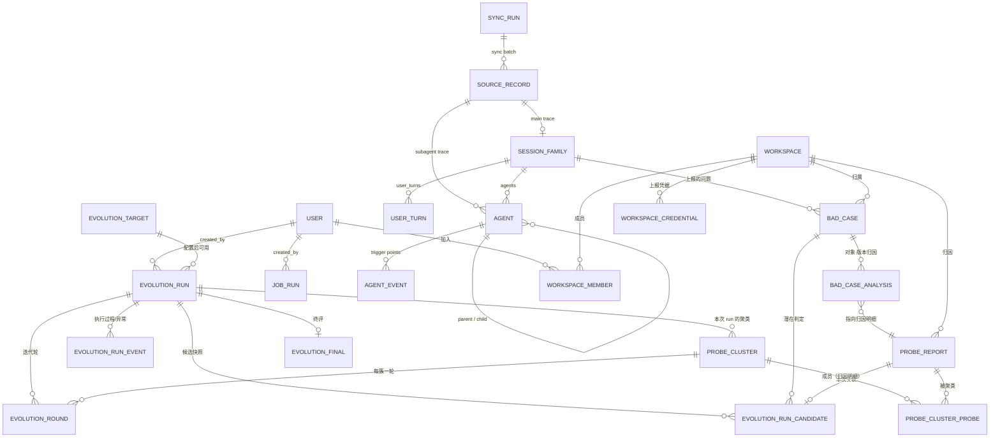

# 05 · 后端接口设计

> 本文回答：前后端之间的 REST 契约长什么样、SSE 推什么、深链怎么约定、OpenAPI 到 TS 怎么生成。
> 前置：[04 后端架构](04-backend-architecture.md)；配套：[06 数据库设计](06-database-design.md)。
> V1 响应示例对应已实现接口与 fixtures seed；V2 示例定义目标态契约，实施后以 OpenAPI 快照与数据库迁移为准。

## 1. 通用约定

| 项 | 约定 |
|---|---|
| Base path | `/api`；OpenAPI 文档 `/api/docs`（dev 开放，prod 关闭） |
| 鉴权 | `/api/health`、`/api/auth/login`、`/api/auth/refresh` 公开；配置 IdP 时 `/api/auth/callback` 也公开；`/api/events` 用一次性票据；其余业务请求使用 `Authorization: Bearer <accessToken>`。401 用 `AUTH_*` 错误码；**V2 上报端点另用空间凭据**（§4.17） |
| 空间前缀（V2） | 业务资源一律 `/api/workspaces/{workspaceId}/...`；`workspaceId` 只在路径出现，body 不重复；对当前用户不可见的空间统一 `404 WORKSPACE_NOT_FOUND`（防枚举）。V1 无前缀路径冻结保留一个版本（§4.5 末段） |
| 命名 | JSON 一律 **camelCase**（Pydantic `alias_generator=to_camel`）；数据库列 snake_case；两者转换只在 Pydantic 层发生 |
| 时间 | ISO 8601 带时区，统一 **Asia/Shanghai（UTC+8）**，如 `2026-08-30T16:00:33.573+08:00`；不使用 `Z` 结尾；时长用整数秒 |
| ID | `sessionId` 为根会话 UUID；`agentId` 主 agent = root session id、子 agent = 真实 `agentId`；`badCaseId` / `attributionId` / `clusterId` / `runId` 由本服务生成 |
| 列表 | `{ "items": [...], "total": 0, "page": 1, "pageSize": 20 }`；无分页的小列表直接 `{ "items": [...] }` |
| 错误 | `{ "error": { "code": "SESSION_NOT_FOUND", "message": "...", "details": {} } }`，见 §8 |
| 幂等 | `POST /api/acquisition/sync` 可重复调用（进行中返回 409）；`POST /evolution/runs` 无幂等键（每次启动都是新 run）；**V2 上报按 `badCaseId` 幂等 upsert**（§4.17） |
| 版本 | 不做 URL 版本号；契约以 OpenAPI 快照为准，破坏性变更必须同步前端生成物（CI 拦截） |
| API 粒度 | **按资源/模块拆分**；只有列表页、静态元数据做页面级聚合；详情页禁止“整页单接口”（见 §1.1） |

### 1.1 API 粒度约定（2026-10-23）

- **默认**：一个页面由多个资源接口并行取数，前端按区块独立渲染；每个接口只返回自己模块的数据。
- **允许页面级聚合**：列表页（`GET /sessions`、`GET /evolution/runs`）、静态元数据（`GET /catalogs`、向导 targets/versions）。
- **不做整页聚合**：`/sessions/{sid}` 的会话概览、Agent 会话树、问题列表分别由 3 个接口提供；Agent 会话树/执行日志/大列表不得塞进一个“page”响应。
- **依赖顺序**：详情/选中项可串行（先列表后详情），同一页的独立区块必须并行（例如会话概览 + Agent 会话树 + 问题列表）。
- **体积预算**：单接口响应超过约 300KB 时必须拆分；Agent 会话树另行按消息/agent 分页或裁剪。
- **BFF 例外**：未来移动端/弱网需要一次往返时，新增独立 BFF `/app/...` 聚合端点，不替换现有资源接口。

## 2. 资源模型总览



> 轨迹侧表由本服务同步写入；`BAD_CASE` 由空间上报接口与目录同步写入；`BAD_CASE_ANALYSIS` / `PROBE_REPORT` / `EVOLUTION_RUN_CANDIDATE` / `PROBE_CLUSTER` / `PROBE_CLUSTER_PROBE` 由自进化 run 写。物理表继续使用 V1 名称 `bad_case_analysis`、`probe_reports`、`probe_clusters`、`probe_cluster_probes`；API 的 `attributionId` 映射 `probe_reports.probe_id`，`USER_TURN` 是内部表，不对外暴露（见 §3.3）。

## 3. 领域模型（OpenAPI Schema 的源头）

### 3.1 Session 列表项与会话概览

```json
{
  "id": "cb819c5b-286f-4eab-a681-4ba5414b844d",
  "short": "AI agent + 视频播放结合的开源产品",
  "title": "AI agent + 视频播放结合的开源产品调研",
  "repo": "llm-wiki",
  "runtimeKey": "claude-code",
  "model": "glm-5.3",
  "startedAt": "2026-09-05T17:17:53+08:00",
  "durationSeconds": 63420,
  "status": "partial",
  "executionOutcome": "completed",
  "skills": ["deep-research"],
  "stats": {
    "userTurns": 12, "messages": 1103, "tools": 197, "errors": 4,
    "agents": 57, "badCases": 3, "tokens": 58368517,
    "failPer100Messages": 0.36, "badCasesPer100Messages": 0.27
  }
}
```

- `status`：`ok`（完成）/ `partial`（有失败）/ `fail`（整体失败）。密度只由后端计算，前端不算（避免口径漂移）。
- `runtimeKey`：产生该 Session 的 AI agent runtime；`sourceType` 不入 Session DTO。`executionOutcome` 是 M9 的执行闭环，独立于解析 `status`，封闭集合为 `completed / interrupted / failed / legacy_unknown`（存量迁移行默认为 `legacy_unknown`）。
- `short`：列表卡标题（截断展示）；`title`：完整标题。两者都由首个用户提问派生，`short` 允许为空（前端回退到 title）。
- `stats.badCases` 是**查询时**按会话聚合 `bad_cases` 的计数（问题侧外部写入、随上报/删除实时变化），不落 `session_families` 列；`stats` 中其余计数来自同步聚合列（整棵树口径，见 [06 §3.2](06-database-design.md)）。
- 示例的 `agents[]` 是节选，`stats` 为整树口径（含未展示节点），数值仅示意，不要用可见行手算。

### 3.2 Agent 会话树

```json
{
  "sessionId": "cb819c5b-...",
  "runtimeKey": "claude-code",
  "agents": [
    {
      "agentId": "cb819c5b-...",
      "parentAgentId": null, "kind": "main", "agentType": null,
      "taskKind": null, "spawnDepth": 0,
      "executionOutcome": "completed", "endReason": "end_turn",
      "label": "主会话", "lines": 765, "messagesCount": 375,
      "events": [
        { "line": 24, "kind": "skill", "name": "deep-research", "messageOffset": 0 },
        { "line": 30, "kind": "workflow", "name": "deep-research",
          "toolUseId": "call_ca6f...", "messageOffset": 6 },
        { "line": 42, "kind": "agent", "name": "general-purpose",
          "desc": "检索工具层四项+综述", "toolUseId": "call_721e...", "messageOffset": 18 }
      ]
    },
    {
      "agentId": "wf_1fb8ca61-c70",
      "parentAgentId": "cb819c5b-...", "kind": "workflow", "agentType": "workflow",
      "label": "workflow",
      "taskKind": null, "spawnDepth": 1,
      "desc": "56 个 workflow 子 agent", "toolUseId": "call_ca6f...",
      "lines": 0, "messagesCount": 0, "events": []
    },
    {
      "agentId": "a000f718c770a5b36",
      "parentAgentId": "cb819c5b-...", "kind": "subagent", "agentType": "general-purpose",
      "label": "general-purpose",
      "taskKind": null, "spawnDepth": 1,
      "desc": "检索工具层四项+综述", "toolUseId": "call_721e...",
      "lines": 218, "messagesCount": 120,
      "events": [
        { "line": 12, "kind": "skill", "name": "deep-research", "messageOffset": 0 },
        { "line": 28, "kind": "agent", "name": "Explore",
          "desc": "只读检索子任务", "toolUseId": "call_b", "messageOffset": 4 }
      ]
    },
    {
      "agentId": "a17945bf58c8af55f",
      "parentAgentId": "a000f718c770a5b36", "kind": "subagent", "agentType": "Explore",
      "label": "Explore",
      "taskKind": null, "spawnDepth": 2,
      "desc": "只读检索子任务", "toolUseId": "call_b",
      "lines": 96, "messagesCount": 48, "events": []
    },
    {
      "agentId": "wf-sub-1...",
      "parentAgentId": "wf_1fb8ca61-c70", "kind": "subagent", "agentType": "workflow-subagent",
      "label": "workflow-subagent",
      "taskKind": null, "spawnDepth": 2,
      "desc": "", "toolUseId": null,
      "lines": 18, "messagesCount": 10, "events": []
    }
  ],
  "badCases": [
    {
      "badCaseId": "bc-050b-03", "badCaseType": "discovery",
      "objectName": "deep-research", "objectType": "skill", "objectVersion": "v2.0.0",
      "anchor": { "agentId": "a000f718c770a5b36", "eventIndex": 0 },
      "badCaseAgent": { "sessionId": "cb819c5b-...", "agentId": "a000f718c770a5b36" },
      "title": "检索索引读取失败",
      "reason": "deep-research skill发现前置步骤存在问题：检索索引读取失败"
    },
    {
      "badCaseId": "bc-050b-04", "badCaseType": "discovery",
      "objectName": "general-purpose", "objectType": "agent", "objectVersion": null,
      "anchor": { "agentId": "cb819c5b-...", "eventIndex": 2 },
      "badCaseAgent": { "sessionId": "cb819c5b-...", "agentId": "a000f718c770a5b36" },
      "title": "工具层检索结果未去重",
      "reason": "subagent发现前置步骤存在问题：工具层检索结果未去重"
    }
  ]
}
```

设计要点：

- **`agents` 是扁平列表**，不再有 `main/subs/children` 嵌套；前端用 `parentAgentId` 建树。`main` 也作为一行，`parentAgentId=null`。
- **结构关系**：`parentAgentId` 指向父节点；`toolUseId` 指向父节点中触发该节点的调用，用于画布边锚点。workflow 的 `toolUseId` 填父级 workflow 调用；workflow-subagent 允许为 `null`。
- **节点类型**：`kind` 是 `main / subagent / workflow`；`agentType` 是 `general-purpose / Explore / 自定义 teammate / workflow / workflow-subagent`；`taskKind` 是 `in_process_teammate / forked_skill / null`；`spawnDepth` 来自 meta.spawnDepth。workflow 节点没有独立 transcript，`lines=0`；forked skill 是 `kind=subagent` + `taskKind=forked_skill`、`agentType=null`，靠 `label` 显示 skill 名。
- **runtime 与执行闭环**：`runtimeKey` 在根级出现；`executionOutcome/endReason` 在 agent 级出现，分别表达 runtime 和 M9 的执行闭环。`executionOutcome` 是 `completed / interrupted / failed / legacy_unknown`，`endReason` 是 `end_turn / tool_use_open / missing_report / external_failed / external_interrupted`。Agent 节点自身的定义证据用 `agentDefinitionHash`（body hash）与 `definitionSource`（`prompt_snapshot / api_request_shape / builtin / unknown`）。
- **触发对象证据**：事件可选返回 `objectRevision`（`tag:<tag>` / `digest:<hash>` / `provider:<value>` / `unknown`；`provider:` 只用于知识文档的 Provider 原始 revision）、`definitionHash`（skill/agent 定义 body hash）、`fileReadHash`、`readComplete` 与 `relationConfidence`（`authoritative / derived / synthetic / unresolved`）；这些字段只在存在时返回，前端不拼接、不猜测。
- **知识库触发证据**：事件 `kind` 增加 `knowledge`，并可选返回 `documentId`（稳定文档身份）、`documentRevision`（`digest:<hash>` / Provider 原始 revision / `unknown`；与 `objectRevision` 语义不同）、`sourcePath`（知识根内的文档路径）、`retrievalKind`（`file_read / mcp_search / mcp_retrieve`）与 `retrievalScope`（命中的知识根或 Provider collection）。文档正文、chunk 与 MCP 原始响应不进入 DTO，也不落库；知识事件与 skill/agent 事件共用同一 `line / messageOffset / eventIndex` 坐标口径，普通源码 `Read` 不产生该事件。
- **普通 skill 不是节点**：只以父节点 `events[]`（`kind=skill`）出现；forked skill 同时有父节点的 skill 事件和自己的节点。
- **`label` 必填、由后端算**：主节点固定“主会话”；其余按 `name` → `skill_name`（forked skill）→ `agentType` → `kind` 取。前端不重算显示名。
- `events[].name` 是触发调用名，不是类型；workflow 名可以与 skill 同名（原型 line 30 的 `deep-research` 就是 workflow 名，line 24 的 `deep-research` 是 skill 名）。
- **`×N` 双口径**：`line` 与 `messageOffset` 都保留。V2 lane DAG 的 `×N 无触发` 是**日志行区间**，用 `line` 计算 bar 宽度；结构树的 message gap 仍用 `messageOffset`，不得把两者混为同一个 N。
- `line` 用于 lane DAG 的 0–100 逻辑轴、`L30` 标签和定位；`messageOffset` 只服务结构树的 message gap。
- 示例只展示 workflow 的 1 个 `workflow-subagent`，实际原型有 56 个；扁平列表省略其余。
- **问题卡锚点**：API 只暴露 `anchor.agentId + anchor.eventIndex`，不暴露上报者 session。服务端以 `bad_case_agent_id`（上报人 A）为起点计算宿主：`self + agent` → A 节点（`eventIndex=-1`）；`self/discovery + skill` → A 中该 skill 的最后一次触发；`discovery + agent` → A 的父节点 P 中调用 A 的 `agent` 事件（用 `A.toolUseId` 匹配）。`eventIndex=-1` 表示未匹配到触发点，前端挂到宿主节点本身。
- `anchor.eventIndex` 是目标 agent `events[]` 的 0-based 下标，不是 line，也不是 messageOffset。
- **`badCaseAgent` 不一定是宿主**：示例 `bc-050b-04` 是 `discovery + agent`，上报人是 a000，但卡片挂在主会话调用 a000 的 L42 `agent` 触发点上；这类卡片的 `anchor.agentId` 是父节点。
- **命名映射**：API 的 `sessionId` = 根会话；`agentId` = 主 agent 的 root session id / 子 agent 的真实 `agentId`，对应 DB `agents.id`；`root_session_id` 只在内部表出现。

### 3.3 内部轨迹模型（不对外暴露）

时间线页面在 2026-10-22 评审中裁撤，完整时间线由外部平台承担，因此**不提供用户轮次/消息/内容块的读接口**。归一化只保留 `user_turns` 作为用户输入锚点（`promptText` + `lineNo`/`messageOffset`，见 [06 §3.5](06-database-design.md)），供未来在 Agent 执行流图里展示用户输入。

- 消息与内容块只在解析期存在：用于整树统计（消息数、token、工具、错误）、usage 去重与状态判定，**不落库**；
- 需要原文证据时，按 `(sessionId, agentId)` 从 `trajectory_payloads` 回读，或走外部平台的时间线。

也就是说：**契约里没有 `Timeline/UserTurn/Message/ContentBlock` 响应模型**，轨迹明细层只保留 `user_turns` 输入锚点。未来若在流图里显示用户输入，只需在读接口补 `userTurns`（含 `promptText` / `lineNo` / `messageOffset`），不恢复消息/内容块表。

### 3.4 问题（bad_case）、归因状态与 probe

`BadCase`（问题列表项）：

```json
{
  "badCaseId": "bc-050b-03",
  "sessionId": "050b81ba-...", "sessionTitle": "研究'用户数据驱动自进化'提到的所有方法",
  "badCaseType": "discovery",
  "objectName": "deep-research", "objectType": "skill", "objectVersion": "v2.0.0",
  "anchor": { "agentId": "050b81ba-...", "eventIndex": 0 },
  "badCaseAgent": { "sessionId": "050b81ba-...", "agentId": null },
  "title": "检索索引读取失败",
  "reason": "deep-research skill发现前置步骤存在问题：检索索引读取失败",
  "metaData": { "file": "apps/server/src/search/index.ts", "line": 142, "error": "ENOENT" },
  "attributionCount": 3, "hasAttribution": true
}
```

- `objectName/objectType/objectVersion` 是**上报者/发现者**，不是根因；根因看该 bad case 的归因（§3.9）。
- `badCaseAgent` 记录**上报/发现问题的 agent**：`sessionId` 是根会话，`agentId` 主 agent 为 `null`、子 agent 为真实 `agentId`。它是锚点计算的输入，不一定是卡片宿主；`discovery + agent` 时 `anchor.agentId` 会解析到父节点。
- 上报契约：`badCaseAgent.agentId` 指向的 agent 必须包含 `objectName` 的触发记录；skill 型问题只在该 agent 的 `agent_events` 里查找，找不到时 `anchor.eventIndex=-1`。
- `title` 是上报必填的短标题：问题列表卡、执行流图问题卡与详情页标题行的主文本；`reason` 是描述正文，渲染在详情页正文块。
- DB 列映射：`title` ↔ `bad_cases.title`，`reason` ↔ `bad_cases.bad_case_description`——存储层列名带 `bad_case_` 前缀，DTO 字段保留 `reason`（见 [06 §4.1](06-database-design.md)）。
- `anchor` 是后端算出的挂载点：`anchor.agentId` 是宿主节点（可能是上报人的父节点），`anchor.eventIndex` 是该节点 `events[]` 下标；上报者 session 不对外暴露。
- `metaData` 原样返回；前端按通用 KV 渲染成事实 chips（值过长截断）。
- **归因状态（V2）**：`attributionCount` 是该 bad case 的去重「对象·版本」归因数，唯一定义见 §3.10（经 `bad_case_analysis JOIN probe_reports` 去重 `(probe_type, probe_object, object_version)`，[06 §4.2.1](06-database-design.md)）；`hasAttribution = attributionCount > 0`。没有关联归因就是未归因；`BadCase` 不再内联单条 `analysis`，历史 `bad_case_analysis` 行保留并与多条 probe 归因关联。
- 展示状态由归因子项决定：无归因 → 「尚未归因」；有 `attributed` → 「可归因」（附带 `category`：模型 / prompt / 错误）；只有 `non_target` → 「非该对象问题」。具体条数看 §4.19 的分页接口。

### 3.5 自进化运行

`RunCard`（列表项）：

```json
{
  "runId": "evo-20261019-01",
  "title": "deep-research v2.0.0 自进化",
  "mode": "full",
  "target": { "type": "skill", "name": "deep-research", "version": "v2.0.0" },
  "window": { "from": "2026-08-20", "to": "2026-09-10" },
  "models": ["glm-5.3", "glm-5.3-flash"],
  "policy": { "preset": "default" },
  "cacheEnabled": true,
  "createdBy": "Administrator",
  "createdAt": "2026-10-19T18:42:00+08:00",
  "status": "running",
  "error": null,
  "stats": { "sessions": 9, "versionUnresolvedSessions": 2, "badCases": 42, "potential": 18, "attributed": 11,
    "reused": 7, "clusters": 3, "byCategory": { "error": 6, "prompt": 3, "model": 2 } },
  "progress": { "unit": 5, "total": 9, "percent": 55,
    "stageLabel": "第 5/7 步 · 聚类与严重度", "doneRounds": 1, "accepted": 1 },
  "final": null
}
```

已完成的 run 附带 `final`：

```json
"final": { "bestVersion": "v2.0.0-best", "branchName": "evo/20261023-evo-20261023-01", "pushStatus": "succeeded", "verdict": true, "bestScore": 88.9, "initScore": 84.3 }
```

`RunDetail` 在 RunCard 基础上多 `steps` 与 `workspace`（七步状态由后端算，前端不推算）：

```json
"status": "blocked",
"blockedStage": "eval",
"retryAttempts": 0,
"nextRetryAt": null,
"evalStatus": "failed",
"workspace": {
  "repoUrl": "https://git.example.com/agent-skills.git",
  "subDir": "skills/deep-research",
  "repoPath": "data/repos/tgt-123", "baseRef": "v2.0.0", "baseCommit": "9f3c2a1…",
  "branchName": "evo/20261023-evo-20261023-01", "workspacePath": "data/workspaces/evo-20261023-01",
  "remote": "origin", "pushStatus": "succeeded", "pushedAt": "2026-10-23T09:40:00+08:00", "pushError": null
},
"error": { "stage": "eval", "message": "评测执行失败：sandbox timeout", "at": "2026-10-23T09:41:02+08:00" },
"lastEventSeq": 42,
"steps": [
  { "index": 0, "key": "range", "title": "选择范围", "status": "done" },
  { "index": 1, "key": "sessions", "title": "Session 关联", "status": "done" },
  { "index": 2, "key": "potential", "title": "潜在 bad case", "status": "done" },
  { "index": 3, "key": "attribution", "title": "对象归因", "status": "done" },
  { "index": 4, "key": "clusters", "title": "聚类与严重度", "status": "done" },
  { "index": 5, "key": "iteration", "title": "迭代优化", "status": "active", "detail": "第 3/5 轮" },
  { "index": 6, "key": "final", "title": "测试集终评", "status": "pending" }
]
```

- `status` ∈ `preparing|running|blocked|completed|failed|interrupted`；`error` 为 `null` 或 `{stage, message, at}`（列表只给摘要）。
- `createdBy` 是创建人的可空显示名；删除用户后为 `null`。Issue 要求展示创建人，前端把它与 `createdAt` 放在原型右上 meta 槽，不新增视觉行。
- `stats` 是 V2 口径：`sessions`（版本精确关联的 Session）、`versionUnresolvedSessions`（对象版本未知而跳过的 Session）、`badCases`（时间窗内 bad case 数）、`potential`（潜在）、`attributed`（可归因）、`reused`（复用缓存数）、`clusters`、`byCategory`（按 `category` 分布）。不再有 `probes/usedProbes/byAttributeType/nonIssue`。
- `lastEventSeq`：DB 当前最大事件序号，可用于检查/增量拉取；**ticket 的 `lastEventId` 不要直接用它**，应用已加载事件的最后一条 `seq`（events 分页可能还没拉完）。

`status` ∈ `done | active | pending`；`clickable = status != pending`。

### 3.6 七步产出（七个独立端点）

每个 step 一个端点，响应均为 `EvolutionStep` 外壳 + 该步的 `payload`：

| step | key | 端点 | payload 关键字段 |
|---|---|---|---|
| 0 选择范围 | `range` | `GET …/evolution/runs/{rid}/steps/range` | `condition`（target/版本/时间窗/policy/cacheEnabled）+ `stats`（sessions/badCases/potential） |
| 1 Session 关联 | `sessions` | `GET …/steps/sessions` | `summary`（reported/associated/skipped/pending）+ `rows[]`（sessionId/title/objectTriggerAt/badCaseCount/potentialCount），4 条/页 |
| 2 潜在 bad case | `potential` | `GET …/steps/potential` | `summary`（badCases/potential/byReason）+ `rows[]`（badCaseId/objectName/badCaseType/triggerAt/sessionId/hitReason/orderState），5 条/页 |
| 3 对象归因 | `attribution` | `GET …/steps/attribution` | `summary`（potential/reused/fresh/nonTarget）+ `rows[]`（badCaseId/attributionId/category/description/source/confidence） |
| 4 聚类与严重度 | `clusters` | `GET …/steps/clusters` | `clusters[]`：`clusterId/title/description/category/caseCount/confidence/severity/rank/cases[]`（按 severity 降序） |
| 5 迭代优化 | `iteration` | `GET …/steps/iteration` | `rounds[]`：roundId/clusterId/title/category/caseCount/severity/cases[]/status/candidate/patch/push/eval/accepted/finalCommit |
| 6 测试集终评 | `final` | `GET …/steps/final` | `verdict/bestVersion/bestScore/initScore/metrics[]/changes[]` |

统一外壳：

```json
{ "key": "potential", "index": 2, "title": "潜在 bad case", "status": "done",
  "detail": "18 / 42", "payload": { "summary": {}, "rows": [] } }
```

- `index` 是步骤顺序（0–6），`key` 是稳定语义标识；前端路由/缓存优先用 `key`，`detail` 给 stepper 副标题。
- 进度公式 `5 + M + 1`（M = 簇数）：选择范围/Session 关联/潜在/归因/聚类各占 1，迭代占 M，终评占 1；`stageLabel` 文案按上表。
- `confidence` 在 `clusters` 上是**簇级**占位值（按 `category`：error 0.82 / prompt 0.74 / model 0.66）；归因行上的 `confidence` 是单条结论置信度，两者不互相推导。
- `impact` 按 `category` 固定映射（`error=9` / `prompt=7` / `model=5`）；`severity = round(min(10, confidence × impact × reportWeight), 1)`，`reportWeight = 1 + 0.1 × min(reportCount - 1, 5)`，`reportCount` 是簇内成员 join 归因行统计的 distinct `bad_case_id` 数。
- 端点未到达时返回 `404 STEP_NOT_READY`；`range` 在 `preparing` 时返回准备态（不 404）。
- `final` 在 `active` 且终评尚未写入时 `verdict/bestVersion/bestScore/initScore` 为 `null`、`metrics` 为 `[]`，`changes` 仍按已接纳轮次给出。
- `attribution.rows[].source` ∈ `cached | fresh`：本次复用缓存还是新计算；`summary.nonTarget` 是本 run 判定为非该对象的候选数。
- `clusters[].cases[]` 字段：`badCaseId/title/objectName/badCaseType/triggerAt/createdAt`；簇标题取簇内最高频 bad case `title`，描述 = 「N 个 bad case 共同表现」+ 归因 reason 摘要。
- 七个端点共享同一 run 的权限与 readiness；服务端只复用同一个 `build_step_payload`，不复制业务逻辑。

#### 3.6.1 返回示例

`steps/range`：

```json
{
  "key": "range", "index": 0, "title": "选择范围", "status": "done",
  "detail": "18 / 42", "payload": {
    "condition": { "targetType": "skill", "targetName": "deep-research", "targetVersion": "v2.0.0",
      "from": "2026-08-20", "to": "2026-09-10", "policy": { "preset": "default" },
      "cacheEnabled": true, "workspaceId": "ws-harness" },
    "stats": { "sessions": 9, "badCases": 42, "potential": 18 } } }
```

`steps/sessions`：

```json
{
  "key": "sessions", "index": 1, "title": "Session 关联", "status": "done",
  "payload": {
    "summary": { "reportedSessions": 12, "associatedSessions": 9, "skippedSessions": 3, "pendingSessions": 1 },
    "rows": [ { "sessionId": "cb819c5b-…", "title": "AI agent + 视频播放…",
      "objectTriggerAt": "2026-09-05T17:40:12+08:00", "badCaseCount": 3, "potentialCount": 2 } ],
    "total": 9, "page": 1, "pageSize": 4 } }
```

`steps/potential`：

```json
{
  "key": "potential", "index": 2, "title": "潜在 bad case", "status": "done",
  "payload": {
    "summary": { "badCases": 42, "potential": 18,
      "byReason": { "self_report": 6, "after_object": 9, "both": 3 } },
    "rows": [ { "badCaseId": "BC-HC-0007", "objectName": "deep-research", "badCaseType": "self",
      "triggerAt": "2026-09-06T09:12:00+08:00", "sessionId": "cb819c5b-…",
      "hitReason": "self_report", "orderState": "comparable" } ],
    "total": 18, "page": 1, "pageSize": 5 } }
```

`steps/attribution`：

```json
{
  "key": "attribution", "index": 3, "title": "对象归因", "status": "done",
  "payload": {
    "summary": { "potential": 18, "reused": 11, "fresh": 7, "nonTarget": 4 },
    "rows": [ { "badCaseId": "BC-HC-0007", "attributionId": "AT-01J9…", "category": "error",
      "description": "检索索引读取失败", "source": "cached", "confidence": 0.8 } ] } }
```

`steps/clusters`：

```json
{
  "key": "clusters", "index": 4, "title": "聚类与严重度", "status": "done", "detail": "3 簇",
  "payload": {
    "clusters": [
      { "clusterId": "C1", "title": "检索索引读取失败",
        "description": "索引读取前未校验快照字段（3 个 bad case 共同表现）",
        "category": "error", "caseCount": 3, "confidence": 0.82, "severity": 7.4, "rank": 1,
        "cases": [ { "badCaseId": "BC-HC-0007", "title": "检索索引读取失败",
          "objectName": "deep-research", "badCaseType": "self",
          "triggerAt": "2026-09-06T09:12:00+08:00", "createdAt": "2026-09-06T09:20:00+08:00" } ] } ] } }
```

`steps/iteration` 的 `rounds[]` 结构：

```json
{ "roundId": "r-01", "clusterId": "C1", "title": "检索索引读取失败", "category": "error",
  "caseCount": 3, "severity": 7.4, "status": "accepted",
  "cases": [ { "badCaseId": "BC-HC-0007", "title": "检索索引读取失败",
    "objectName": "deep-research", "badCaseType": "self",
    "triggerAt": "2026-09-06T09:12:00+08:00", "createdAt": "2026-09-06T09:20:00+08:00" } ],
  "patch": { "file": "SKILL.md", "lines": ["+ 读取索引前校验快照字段"] },
  "candidate": { "ref": "evo/20261023-evo-20261023-01/candidate/r1", "commit": "ab12…",
    "message": "evolve(deep-research@v2.0.0): 针对「检索索引读取失败」的候选变更" },
  "push": { "status": "succeeded", "attempts": 1, "error": null },
  "eval": { "status": "completed", "current": 84.6, "candidate": 87.2, "nextPollAt": null },
  "accepted": true,
  "finalCommit": { "hash": "cd34…", "message": "evolve(deep-research@v2.0.0): 修复检索索引未校验导致的越界读取" } }
```

`steps/final`：

```json
{
  "key": "final", "index": 6, "title": "测试集终评", "status": "done",
  "payload": {
    "verdict": true, "bestVersion": "v2.0.0-best", "bestScore": 88.9, "initScore": 84.3,
    "metrics": [ { "name": "任务完成率", "init": 78.0, "best": 84.0, "delta": 6.0, "unit": "%" } ],
    "changes": [ { "commit": "cd34…", "clusterId": "C1", "title": "检索索引读取失败",
      "category": "error", "caseCount": 3 } ] } }
```

### 3.7 身份、工作空间与成员

`SessionPayload`（`GET /api/auth/session`）：

```json
{
  "user": { "id": "u-admin", "username": "admin", "displayName": "管理员",
            "role": "admin", "mustChangePassword": false },
  "workspaces": [
    { "id": "ws-harness", "name": "Harness 核心研发", "mark": "HC",
      "role": "global_admin", "quota": 60, "used": 25,
      "memberCount": 4, "spaceAdminCount": 2 }
  ],
  "truncated": false
}
```

- `user.role` 只有 `admin|member`；全局管理员唯一，且不提供 `POST /auth/register`。
- `workspaces[].role` 是当前用户的有效角色：全局管理员返回 `global_admin`，其余是 `workspace_members.role` 的 `space_admin|member|viewer`。
- `used` 是实时 `COUNT(bad_cases WHERE workspace_id)`；超过 200 个可见空间时最多返回 200 条并置 `truncated=true`。

`Workspace`：

```json
{ "id": "ws-harness", "name": "Harness 核心研发", "mark": "HC",
  "quota": 60, "used": 25, "memberCount": 4,
  "spaceAdmins": [ { "id": "u-admin", "displayName": "管理员" } ],
  "knowledgeRoots": [ "/workspace/knowledge" ],
  "createdAt": "2026-09-12T10:00:00+08:00" }
```

`WorkspaceMember`：

```json
{ "workspaceId": "ws-harness", "userId": "u-admin", "username": "admin",
  "displayName": "管理员", "role": "space_admin",
  "joinedAt": "2026-09-12T10:01:00+08:00", "updatedAt": "2026-09-12T10:01:00+08:00" }
```

- `role` ∈ `space_admin|member|viewer`；一个空间可有多个 `space_admin`，创建时必须至少一个。
- 空间管理员只能授予 `member|viewer`，不能修改或移除 `space_admin` 行；全局管理员可任命/撤销空间管理员。
- 成员与只读角色能读取空间业务数据；只有空间管理员及以上能改额度、成员、凭据、对象配置和启动自进化。
- `knowledgeRoots` 是空间级知识库根配置：必须是绝对路径且不能是文件系统根 `/`，每空间最多 20 条、每条 ≤512 字符，拒绝 `..` 与 NUL；写入前归一化为正斜杠、去尾斜杠并去重，非法值返回 `422 KNOWLEDGE_ROOTS_INVALID`（details 带 `{reason}`）。清空配置请传 `[]`（显式 `null` 等同未提供）。普通 `Read` 只有命中这些根才成为 `kind=knowledge` 事件；未配置的空间不做知识识别。
- `knowledgeRoots` 的**读权限**：`GET /api/workspaces` 对空间管理员与全局管理员返回真实路径；member / viewer 返回 `[]`。它是部署拓扑信息，普通成员无需知道；`GET /api/auth/session` 从不携带 roots。

`WorkspaceCredential`：

```json
{ "id": "cred-01J…", "prefix": "whk_9f2e…", "createdAt": "2026-11-11T11:00:00+08:00",
  "lastUsedAt": null, "revokedAt": null }
```

创建响应额外返回一次 `credential` 明文；数据库只存 SHA-256 哈希，列表永不回显明文。

### 3.8 bad case 上报

`BadCaseIngest` 的字段集合与 `bad_cases` 表一致，沿用 JSON camelCase；`workspace_id`、`updated_at` 由服务端从 URL 和写入时间补齐：

```json
{
  "badCaseId": "BC-HC-021",
  "sessionId": "a7d3e0f2-91b4-4d6a-8e33-5c1f0b2d7a10",
  "badCaseType": "self",
  "objectName": "deep-research",
  "objectType": "skill",
  "objectVersion": "v2.4.0",
  "badCaseAgentId": "a7d3e0f2-91b4-4d6a-8e33-5c1f0b2d7a10",
  "title": "输出缺少来源校验",
  "reason": "12 条结论中有 5 条没有附带来源。",
  "metaData": { "file": "skills/deep-research/SKILL.md", "line": 91 },
  "source": "agent-runtime",
  "createdAt": "2026-11-09T15:58:00+08:00"
}
```

- `badCaseId`、`sessionId`、`badCaseType`、`objectName`、`objectType`、`title`、`reason`、`createdAt` 必填；`objectVersion`、`badCaseAgentId`、`metaData`、`source` 可空。
- `sessionId` 映射 `bad_case_session_id`；`reason` 映射 `bad_case_description`；`badCaseAgentId` 主 agent 可空。
- `badCaseType` 仅 `self|discovery`，`objectType` 仅 `skill|agent`；body 不接受 `workspaceId`。
- `metaData` 必须是 JSON object，可为 `null`；数组、字符串等标量一律 `422 VALIDATION_INVALID`（与读模型 `Record<string, unknown>` 一致）。
- `createdAt` 必须带时区偏移（如 `2026-11-09T15:58:00+08:00` 或 `...Z`）；无偏移的 naive 时间戳一律 `422 VALIDATION_INVALID`，不会按 `+08:00` 静默解释。
- `sessionSource` 可选，形状为 `{ runtime?, sessionUrlTemplate }`：模板必须是 http(s) 绝对 URL、长度 ≤ 2048、恰好包含一个 `{sessionId}` 占位符；body 不接受 headers/token 等凭据字段，授权由模板自带的短时签名承担。`runtime` 只是预声明（`^[a-z0-9][a-z0-9-]{0,31}$`），最终以 envelope 回报为准，不一致只记诊断不失败。不传该字段时后端行为与旧版完全一致。

### 3.8.1 bad case 轨迹状态

bad case 行与 Session 投影是两种存在：前者由上报写入，后者由 root-sync 补齐。总览列表项增加 `syncStatus ∈ ready|pending|syncing|failed|unavailable`、`sessionReady`、`lastError`、`retryable`、`nextRetryAt`，由 `bad_case_root_sync` 与 Session 是否可读批量派生，列表不为每行额外查询。

详情只在 `bad_cases` 行不存在时返回 `404 BAD_CASE_NOT_FOUND`；行存在但 Session 未就绪时返回 `409 BAD_CASE_SESSION_PENDING`（pending/syncing）或 `503 BAD_CASE_SESSION_UNAVAILABLE`（failed/unavailable），`details` 带 `badCaseId/sessionId/title/objectName/createdAt/sessionReady/syncStatus/lastError/retryable/nextRetryAt/lastAttemptAt`。确定性失败（如没有 `sessionSource` 且全局轨迹查询未配置）`retryable=false`，自动重试停止；没有任何可用 source 时所有未就绪状态都报 `retryable=false`。进程启动且可用 source 存在时把确定性失败复位为 pending，作为配置变化后的重新触发入口。真正的 404 语义不变。

### 3.9 归因

`AttributionItem`：

```json
{
  "attributionId": "pr-050b-03",
  "badCaseId": "bc-050b-03",
  "objectType": "skill",
  "objectName": "deep-research",
  "objectVersion": "v2.4.0",
  "conclusion": "attributed",
  "category": "error",
  "confidence": 0.8,
  "runId": "evo-20261111-01",
  "isCached": true,
  "reusedCount": 3,
  "createdAt": "2026-11-09T15:02:00+08:00",
  "updatedAt": "2026-11-11T10:00:00+08:00"
}
```

`AttributionDetail` 在 Item 基础上增加：

```json
{
  "reason": "对象自身读取索引前未校验快照字段。",
  "reasoning": "1. 定位到 deep-research 的索引读取步骤\n2. 同批次其他子 agent 有校验且未报错",
  "policyVersion": "v1",
  "attributionEngine": "rule-v1",
  "triggerCompare": {
    "objectTriggerAt": "2026-09-05T17:40:12+08:00",
    "caseTriggerAt": "2026-09-06T09:12:00+08:00",
    "order": "after",
    "versionState": "exact"
  }
}
```

- `attributionId` 映射 `probe_reports.probe_id`；`conclusion` ∈ `attributed|non_target`；`category` ∈ `model|prompt|error|null`。
- `runId` 优先取 `last_reused_run_id`，没有复用时取 `created_run_id`；它用于深链查看最近一次产生该显示结果的 run。
- `triggerCompare.order` ∈ `before|after|same|unknown`；`versionState` ∈ `exact|unknown`。新 run 只产生 `exact`；历史 legacy 行可为 `unknown`，UI 不能把它描述为版本精确命中。
- 同一 bad case 可有多条 AttributionItem；没有关联行时接口返回空列表，页面显示“尚未归因”。

### 3.10 总览与空间 Session

`OverviewSummary`：

```json
{ "window": { "from": "2026-08-13", "to": "2026-11-10" },
  "totals": { "badCases": 25, "self": 16, "discovery": 9,
              "sessions": 10, "sources": 6, "quota": 60, "used": 25 },
  "objects": ["deep-research", "Explore", "workflow"] }
```

`TrendBucket` 固定补零：

```json
{ "bucket": "2026-11-03", "label": "11-03", "self": 3, "discovery": 2, "total": 5 }
```

`SourceRow`：

```json
{ "object": "deep-research", "total": 12, "self": 9, "discovery": 3, "sessions": 4 }
```

`BadCaseListItem`：

```json
{ "badCaseId": "BC-HC-014", "sessionId": "a7d3e0f2-91b4-...",
  "objectName": "deep-research", "badCaseType": "self",
  "badCaseTypeLabel": "自身存在问题", "title": "输出缺少来源校验",
  "triggerAt": "2026-11-09T15:58:00+08:00", "createdAt": "2026-11-09T15:58:00+08:00",
  "attributionCount": 3 }
```

- `triggerAt` 当前临时等于 `createdAt`：m9-04 对象触发点坐标落地前不存独立触发时间，调用方不得把它当排序键或相等判断依据，也不得按「触发早于上报」做假设。
- `attributionCount` 的唯一定义是经 `bad_case_analysis JOIN probe_reports` 去重的 `(probe_type, probe_object, object_version)` 三元组数（见 [06 §4.2.1](06-database-design.md)）；§3.4、§4.7 与 [07 §4.1](07-backend-implementation.md) 都引用该定义，不再各自表述。
- `totals.sessions` 数的是窗口内被上报的 root（`COUNT(DISTINCT bad_case_session_id)`），**包含还没有归一化轨迹的 pending 根**；它不是 [06 §7.5](06-database-design.md) 的空间 Session 集合（JOIN `session_families` 的投影），也不等于 Session 页 `total + pendingSessions`，页面不能把三个数相加。
- 所有 overview 读路径只统计 `bad_case_type IN ('self','discovery')` 的行：legacy 目录同步可能写入越界类型，这些行不计入 `badCases/self/discovery/sessions/sources/objects` 与趋势，但仍计入空间级 `used`，从而保持 `badCases = self + discovery` 与趋势总和一致。
- 所有 overview 接口的 `objects[]` 空 = 全部，多选项取并集；时间窗按 `bad_cases.created_at`，Session 启动时间只用于 Session 页展示。
- `GET …/sessions?q=` 在 V2 中把非空 `q` 当作 root session ID 精确查询；不传 `q` 返回最新 10 条，响应额外带 `total` 与 `pendingSessions`。

`TargetOverviewItem`：

```json
{ "targetId": "tgt-123", "objectType": "skill", "objectName": "deep-research",
  "versions": ["v2.4.0", "v2.3.0"], "sessions": 4, "potential": 9,
  "attributed": 7, "nonTarget": 1, "unanalyzed": 1, "evolvable": 7 }
```

- `attributed + nonTarget + unanalyzed = potential`；版本趋势允许同一 bad case 在多个版本各有一条归因，列表按 `badCaseId + attributionId` 去重展示。

## 4. 端点清单
```text
┌─ 基础与鉴权 ──────────────────────────────────────────────┐
│ GET  /api/health                                         │
│ POST /api/auth/login · refresh · logout                  │
│ POST /api/auth/change-password                           │
│ GET  /api/auth/me                                        │
│ POST /api/events/ticket                                  │
└──────────────────────────────────────────────────────────┘

┌─ 会话域 ──────────────────────────────────────────────────┐
│ GET  /api/sessions                                       │
│ GET  /api/sessions/{sid}                                 │
│ GET  /api/sessions/{sid}/tree                            │
│ GET  /api/sessions/{sid}/bad-cases                       │
└──────────────────────────────────────────────────────────┘

┌─ 问题域（只读） ──────────────────────────────────────────┐
│ GET  /api/bad-cases/{badCaseId}                          │
│ GET  /api/bad-cases/{badCaseId}/attributions             │
└──────────────────────────────────────────────────────────┘

┌─ 轨迹接入 ────────────────────────────────────────────────┐
│ POST /api/acquisition/sync                               │
│ POST /api/acquisition/pull                               │
│ GET  /api/acquisition/status                             │
│ GET  /api/jobs/{jobId}                                   │
└──────────────────────────────────────────────────────────┘

┌─ 自进化域 ────────────────────────────────────────────────┐
│ GET  /api/evolution/runs                                 │
│ POST /api/evolution/runs                                 │
│ GET  /api/evolution/runs/{rid}                           │
│ GET  /api/evolution/runs/{rid}/steps/range               │
│ GET  /api/evolution/runs/{rid}/steps/sessions            │
│ GET  /api/evolution/runs/{rid}/steps/potential           │
│ GET  /api/evolution/runs/{rid}/steps/attribution         │
│ GET  /api/evolution/runs/{rid}/steps/clusters            │
│ GET  /api/evolution/runs/{rid}/steps/iteration           │
│ GET  /api/evolution/runs/{rid}/steps/final               │
│ POST /api/evolution/runs/{rid}/retry                     │
│ POST /api/evolution/probes/query（V1 兼容）              │
│ POST /api/evolution/cluster-previews                     │
│ GET/POST/PUT/DELETE /api/evolution/targets               │
│ GET  /api/evolution/targets/{id}/versions                │
└──────────────────────────────────────────────────────────┘

┌─ 清单与推送 ──────────────────────────────────────────────┐
│ GET  /api/catalogs/targets                               │
│ GET  /api/catalogs/models                                │
│ GET  /api/events（SSE）                                  │
└──────────────────────────────────────────────────────────┘

┌─ V2 增补（2026-11-11；空间前缀贯穿全部业务资源）──────────┐
│ GET  /api/auth/session                                   │
│ GET  /api/auth/callback（SSO 占位；未配置 501）           │
│ GET  /api/workspaces · POST /api/workspaces               │
│ PUT  /api/workspaces/{wid}                                │
│ GET/POST /api/workspaces/{wid}/members                    │
│ GET  /api/workspaces/{wid}/member-candidates              │
│ PUT/DELETE /api/workspaces/{wid}/members/{userId}         │
│ POST /api/workspaces/{wid}/members/self-admin             │
│ GET/POST /api/workspaces/{wid}/credentials                │
│ DELETE /api/workspaces/{wid}/credentials/{cid}            │
│ POST /api/workspaces/{wid}/bad-cases（凭据鉴权，上报）     │
│ GET  /api/workspaces/{wid}/sessions（最新 10 + total）     │
│ GET  /api/workspaces/{wid}/sessions/{sid}                 │
│ GET  /api/workspaces/{wid}/sessions/{sid}/tree            │
│ GET  /api/workspaces/{wid}/sessions/{sid}/bad-cases       │
│ GET  /api/workspaces/{wid}/overview/summary|trend|sources  │
│ GET  /api/workspaces/{wid}/bad-cases（组合筛选分页）       │
│ GET  /api/workspaces/{wid}/overview/targets               │
│ GET  /api/workspaces/{wid}/overview/targets/trend         │
│ GET  /api/workspaces/{wid}/overview/targets/cases         │
│ GET  /api/workspaces/{wid}/overview/targets/{id}/detail   │
│ GET  /api/workspaces/{wid}/bad-cases/{id}/attributions    │
│ GET  /api/workspaces/{wid}/…/attributions/{attributionId} │
│ GET  /api/workspaces/{wid}/catalogs/targets|models        │
│ GET/POST/PUT/DELETE /api/workspaces/{wid}/evolution/targets│
│ GET  /api/workspaces/{wid}/evolution/targets/{id}/versions│
│ GET  /api/workspaces/{wid}/evolution/runs                 │
│ GET  /api/workspaces/{wid}/evolution/runs/{rid}           │
│ GET  /api/workspaces/{wid}/evolution/runs/{rid}/steps/{key}│
│ POST /api/workspaces/{wid}/evolution/preview/sessions     │
│ POST /api/workspaces/{wid}/evolution/preview/potential    │
│ POST /api/workspaces/{wid}/evolution/preview/attribution  │
│ POST /api/workspaces/{wid}/evolution/runs                 │
│ POST /api/workspaces/{wid}/evolution/cluster-previews     │
│ POST /api/workspaces/{wid}/evolution/runs/{rid}/retry     │
│ GET  /api/workspaces/{wid}/evolution/runs/{rid}/events    │
└──────────────────────────────────────────────────────────┘
```

### 4.1 基础端点：健康检查与鉴权

`GET /api/health` → `200`（公开，无需登录）

```json
{ "ok": true, "service": "harness-evolution", "phase": "demo", "version": "0.2.0",
  "db": { "dialect": "mysql", "ok": true, "latencyMs": 3 } }
```

`phase` ∈ `scaffold | demo | live`：`demo` 表示开发/演示数据已 seed（顶栏可显示"演示数据"角标）；`live` 表示接真实来源。`db.dialect` 取值 `sqlite | mysql`；`ok=false` 时 HTTP 返回 `503` 且 `db` 带错误摘要（API 进程仍可达）。

**鉴权端点**（`/api/auth/login` 与 `/api/auth/refresh` 公开，其余需登录）：

| 端点 | 说明 |
|---|---|
| `POST /api/auth/login` | body `{username, password}` → `200 {accessToken, expiresIn, user:{id, username, displayName, role, mustChangePassword}}`；refresh token 写入 httpOnly + SameSite=Strict cookie（14 天）。密码错误 → `401 AUTH_INVALID`；账号停用 → `403 FORBIDDEN` |
| `POST /api/auth/refresh` | 读取 refresh cookie → 重读用户行 → 新 `{accessToken, expiresIn}`（token 内 `mcp` 声明取最新值）；cookie 缺失/失效 → `401 AUTH_EXPIRED` |
| `POST /api/auth/logout` | 使 refresh cookie 失效（过期化）→ `204` |
| `POST /api/auth/change-password` | 登录用户修改自己的密码 `{oldPassword, newPassword}` → `204`，成功后清 `must_change_password`；旧密码校验失败 `401 AUTH_INVALID` |
| `GET /api/auth/me` | 当前用户信息 `{id, username, displayName, role, mustChangePassword}` |
| `GET /api/users`、`POST /api/users` | 全局管理员创建/列出普通用户；V2 禁止通过该端点创建第二个 `admin`。新建账号的 `mustChangePassword` 恒为 `true` |

**强制改密**：账号只能由 admin 创建或由 env 播种，初始密码一律由他人设定，因此服务端用 `must_change_password` 硬卡——该标记为 true 时仍签发 token，但除 `POST /api/auth/change-password`、`POST /api/auth/logout`、`GET /api/auth/me` 与 `GET /api/auth/session` 外的请求一律 `403 PASSWORD_CHANGE_REQUIRED`。改密成功后前端先 `POST /api/auth/refresh` 换新 access token、再 `GET /api/auth/session` 取到 `mustChangePassword=false` 与空间列表，然后放行到 `redirect`（[07 §8.2](07-backend-implementation.md) · [08 §4.1](08-frontend-implementation.md)）。

`GET /users` 示例：

```json
{ "items": [
  { "id": "u-admin", "username": "admin", "displayName": "管理员", "role": "admin", "isActive": true, "mustChangePassword": true }
] }
```

`POST /users` body：

```json
{ "username": "alice", "displayName": "Alice", "password": "临时密码", "role": "member" }
```

→ `201` 创建后的用户（不含密码哈希；`mustChangePassword` 恒为 `true`，用户首次登录必须改密）。

**SSE 票据**：`POST /api/events/ticket`（需登录）

```json
{ "topics": ["run:evo-20261019-01"], "lastEventId": 42 }
```

→ `{ "ticket": "t-…", "expiresIn": 60, "topics": ["run:evo-20261019-01"] }`

- 票据一次性、60 秒有效，**绑定 topics**；`GET /api/events?ticket=…` 只按票据内 topics 订阅，URL 不再接受 `topics` 参数。
- topics 仅接受 `run:{rid}`；轨迹归一化（sync）不提供 SSE，不能申请 `sync` topic。
- `lastEventId` 可选：首连从该游标之后回放；不传则从当前时刻开始。
- 已完成任务不需要取票；只有 `preparing/running` 的 run 页面才申请。轨迹归一化（sync）不提供 SSE。

### 4.2 会话列表（V1 兼容端点）

`GET /api/sessions?q=&status=&sort=latest&limit=100`

| 参数 | 类型 | 说明 |
|---|---|---|
| `q` | string | 标题/仓库/根会话 ID 模糊匹配（大小写不敏感；ID 支持完整值、前缀与子串，见 [13](13-root-session-id.md)） |
| `status` | `all\|ok\|partial\|fail\|problem` | 默认 all；`problem` = `partial`+`fail`（前端"有失败"chip 的合并筛选） |
| `sort` | `latest\|userTurns\|messages\|agents` | 默认 latest |
| `limit` | int | 默认 100，最大 500 |

响应 `{ "items": [SessionListItem], "total": 0, "pendingSessions": 0 }`。`total` 与 `pendingSessions` 是 additive 新增：`total` 是当前 `q`/`status` 下可见空间并集内已归一化根的去重数；`pendingSessions` 是同一可见空间并集内、被 bad case 提到但没有归一化轨迹的根数（跨空间按根去重，与 V2 的单空间口径不同）。请求参数、检索语义与默认 `limit` 不变。**排序与计数全部后端做**，前端只渲染。

### 4.3 会话概览（V1 兼容端点）

`GET /api/sessions/{sid}` → `SessionListItem`（与列表项同构，避免两套模型）。

### 4.4 Agent 会话树（V1 兼容端点）

`GET /api/sessions/{sid}/tree` → `SessionTree`（§3.2）。

### 4.5 时间线端点（已裁撤）

时间线页面不做，因此不提供 `GET /api/sessions/{sid}/timeline` 及其消息展开端点。`user_turns` 只保留用户输入锚点；消息/内容块不落库（见 §3.3）。

列表/会话概览的计数全部来自 `session_families` 上的整树聚合列；消息/内容块明细不存在，也没有按轮次计数的读接口。`stats.badCases` 不在这批聚合列里，按会话聚合 `bad_cases`（见 [06 §3.2](06-database-design.md)）。

### 4.6 会话问题列表（V1 兼容端点）

`GET /api/sessions/{sid}/bad-cases` → `{ "items": [BadCase] }`（按 `createdAt` 升序）。

```json
{
  "items": [
    { "badCaseId": "bc-050b-03", "sessionId": "050b81ba-...",
      "sessionTitle": "研究'用户数据驱动自进化'提到的所有方法",
      "badCaseType": "discovery",
      "objectName": "deep-research", "objectType": "skill", "objectVersion": "v2.0.0",
      "anchor": { "agentId": "050b81ba-...", "eventIndex": 0 },
      "badCaseAgent": { "sessionId": "050b81ba-...", "agentId": null },
      "title": "检索索引读取失败",
      "reason": "deep-research skill发现前置步骤存在问题：检索索引读取失败",
      "attributionCount": 3, "hasAttribution": true }
  ]
}
```

> V1 会话与问题端点保留一个版本：`GET /api/sessions`、`/api/sessions/{sid}`、`/api/sessions/{sid}/tree`、`/api/sessions/{sid}/bad-cases`、`/api/sessions/{sid}/probes`、`/api/bad-cases/{id}`、`/api/bad-cases/{id}/analysis` 与 `/api/probes/{id}` 都按当前用户全部可见空间过滤；Session 或 bad case 不在可见空间投影内时统一返回 `404`。空间前缀版本见 §4.7 与 §4.18。

### 4.7 问题与归因读取

| 端点 | 返回 |
|---|---|
| `GET /api/workspaces/{wid}/bad-cases/{badCaseId}` | `BadCase`（含 `attributionCount` / `hasAttribution`），用于深链归属校验与左栏状态 |
| `GET /api/workspaces/{wid}/bad-cases/{badCaseId}/attributions` | 分页归因列表（§4.19） |
| `GET /api/workspaces/{wid}/bad-cases/{badCaseId}/attributions/{attributionId}` | 单条归因详情（§4.19，含触发点对照） |
| `GET /api/workspaces/{wid}/sessions/{sid}/bad-cases` | 会话内问题列表（结构见 §3.4） |

> `/api/bad-cases/{id}/analysis` 与 `/api/sessions/{sid}/probes` 作为 V1 兼容端点保留至 V3（条件见 [docs/compatibility.md](../../docs/compatibility.md)）；前者只返回最新一条关联的 legacy 形状，后者返回该 Session 的全部归因明细。V2 页面只调用归因分页/详情端点。`/api/probes/{id}` 继续可读，但响应中的 `probeId` 是兼容别名，值等于 V2 `attributionId`。

`GET /bad-cases/{badCaseId}` 示例：

```json
{
  "badCaseId": "bc-050b-03", "sessionId": "050b81ba-...",
  "sessionTitle": "研究'用户数据驱动自进化'提到的所有方法",
  "badCaseType": "discovery",
  "objectName": "deep-research", "objectType": "skill", "objectVersion": "v2.0.0",
  "anchor": { "agentId": "050b81ba-...", "eventIndex": 0 },
  "badCaseAgent": { "sessionId": "050b81ba-...", "agentId": null },
  "title": "检索索引读取失败",
  "reason": "deep-research skill发现前置步骤存在问题：检索索引读取失败",
  "metaData": { "file": "apps/server/src/search/index.ts", "line": 142, "error": "ENOENT" },
  "attributionCount": 3, "hasAttribution": true
}
```

`GET …/attributions?page=1&pageSize=2` 示例：

```json
{
  "items": [
    { "attributionId": "AT-01J9…", "objectType": "skill", "objectName": "deep-research",
      "objectVersion": "v2.0.0", "conclusion": "attributed", "category": "error",
      "confidence": 0.8, "runId": "evo-20261111-01", "isCached": true,
      "createdAt": "2026-11-09T15:02:00+08:00" },
    { "attributionId": "AT-01J8…", "objectType": "agent", "objectName": "Explore",
      "objectVersion": "v1.0.1", "conclusion": "non_target", "category": null,
      "confidence": 0.7, "runId": "evo-20261110-03", "isCached": false,
      "createdAt": "2026-11-10T09:31:00+08:00" }
  ],
  "total": 2, "page": 1, "pageSize": 2
}
```

`GET …/attributions/{attributionId}` 示例（完整推导与触发点对照）：

```json
{
  "attributionId": "AT-01J9…", "objectType": "skill", "objectName": "deep-research",
  "objectVersion": "v2.0.0", "conclusion": "attributed", "category": "error", "confidence": 0.8,
  "runId": "evo-20261111-01", "isCached": true, "reusedCount": 3,
  "policyVersion": "v1", "attributionEngine": "rule-v1",
  "reason": "对象自身上报：检索索引读取失败；证据：ENOENT apps/server/src/search/index.ts:142",
  "reasoning": "1. bad_case 上报人即 deep-research 的宿主 agent\n2. 对象在 L142 读取索引前未校验快照字段\n3. 同批次另一 subagent 有校验且未报错\n4. 结论只作用于 v2.0.0",
  "triggerCompare": { "objectTriggerAt": "2026-09-05T17:40:12+08:00",
                      "caseTriggerAt": "2026-09-06T09:12:00+08:00", "order": "after" },
  "createdAt": "2026-11-09T15:02:00+08:00", "updatedAt": "2026-11-11T10:00:00+08:00"
}
```

- `reason` 是纯文本结论说明（列由原 `probe_description` 演进）；`reasoning` 是 **Markdown 字符串**（列由原 `probe_analysis` 演进），前端按 Markdown 渲染（禁用裸 HTML、外链加安全属性；不接语法高亮）。
- `conclusion ∈ attributed|non_target`：后者是「非该对象问题」——不是未分析，也不否定 bad case 本身；同一 bad case 可对多个对象各有结论。
- `category ∈ model|prompt|error`（`non_target` 为 `null`）；`policyVersion` / `attributionEngine` 进缓存键。
- 归因由自进化 run 生成：`probe_reports` 保存对象·版本结论与缓存元数据，`bad_case_analysis` 保存 case↔probe 的多行关联；本服务**不提供「手动触发单条归因」端点**——没有关联行就是未归因，用户可「以该 bad case 启动自进化」触发。

`GET /sessions/{sid}/bad-cases` 示例（会话内问题列表，不内联归因正文）：

```json
{ "items": [ { "badCaseId": "bc-050b-03", "sessionId": "050b81ba-...",
  "badCaseType": "discovery", "objectName": "deep-research", "objectType": "skill",
  "objectVersion": "v2.0.0", "title": "检索索引读取失败",
  "attributionCount": 3, "hasAttribution": true } ] }
```

`attributionCount` 按 §3.10 的唯一定义：经 `bad_case_analysis JOIN probe_reports` 去重的 `(probe_type, probe_object, object_version)` 三元组数（[06 §4.2.1](06-database-design.md)）；左栏据此显示「尚未归因 / N 条归因」并按 §4.19 分页取子项。

### 4.8 原始轨迹接入（acquisition）

- `POST /api/acquisition/sync`（**仅 admin**）→ `202 { "jobId": "...", "reused": false }`：立即处理 `trajectory_payloads` 中待归一化的记录（新建/内容变化/解析器版本升级）。已有同步任务在跑 → `202 { "jobId": 正在执行的 jobId, "reused": true }`，**不重复入队**。
- 后台 scheduler 默认每 60s 自动调用同一逻辑；无 pending 时跳过。
- `POST /api/acquisition/pull` → `202 { "jobId": ... }`：按需拉取上游接口，先把返回的 payload upsert 到 `trajectory_payloads`，再走同一归一化管线。body：

```json
{ "sessionIds": ["cb819c5b-..."], "window": null }
```

  `sessionIds` 与 `window`（`{from,to}`）二选一；上游未实现时返回 `409 UPSTREAM_NOT_AVAILABLE`。
- `GET /api/acquisition/status` → 当前状态：

```json
{ "activeJobId": "job-1", "status": "running", "payloadTable": "trajectory_payloads",
  "pending": 3, "processed": 8, "imported": 4, "skipped": 1,
  "lastRunAt": "2026-10-23T17:00:00+08:00", "nextRunAt": "2026-10-23T17:01:00+08:00",
  "errors": [ { "sessionId": "2b7e9d4f-...", "message": "第 42 行非法 JSON" } ],
  "badCaseSync": { "total": 12, "synced": 7, "unsynced": 5, "syncing": 1, "failed": 2,
    "status": "idle", "lastRunAt": "2026-10-23T17:00:00+08:00", "lastError": null },
  "badCaseCatalogSync": { "synced": 120, "unsynced": 8, "lastBadCaseId": 128,
    "status": "idle", "lastRunAt": "2026-10-23T17:00:00+08:00", "lastError": null } }
```

- `badCaseSync`：问题轨迹（根会话轨迹补齐）统计；`total`/`synced`/`unsynced` 以 `bad_cases` 当前根会话为准。
- `badCaseCatalogSync`：`bad_cases` 目录同步统计；`synced = COUNT(bad_cases)`，`unsynced` 为上游剩余量，`lastBadCaseId` 是游标。
- 归因进度改由 `bad_case_analysis JOIN probe_reports` 聚合（关联数、`attributed` / `non_target` 数）；V1 字段 `badCaseAnalysis` 保留一个兼容版本后删除。
- 前端“数据同步”浮层按问题数量 → 问题轨迹 → 会话归一化 → 归因分析排列，只消费本接口。

- 不再有 `watermark` / `sourceType` / `GET /acquisition/sources`：来源由 `trajectory_payloads` 的 `(runtime_key, root_session_id, agent_id)` 表达，待处理状态由 `source_records.processed_*` 表达。
- `GET /api/jobs/{jobId}` → 通用任务状态：

```json
{ "jobId": "job-01H...", "kind": "sync", "refId": "sync-01H...",
  "status": "running", "progress": 0.42, "attempt": 1,
  "createdBy": "u-admin", "createdAt": "2026-10-23T17:00:00+08:00",
  "startedAt": "2026-10-23T17:00:02+08:00", "finishedAt": null,
  "error": null }
```

`status` ∈ `queued|running|completed|failed|interrupted`；`progress` 为 `0..1`。

### 4.9 向导预览（V2，见 §4.20）

V1 的 `POST /api/evolution/probes/query` 进入兼容期，V2 页面不调用，按 [docs/compatibility.md](../../docs/compatibility.md) 的 V3 条件删除。向导预演由三个端点承担（§4.20）：`preview/sessions`（第 2 步）、`preview/potential`（第 3 步）、`preview/attribution`（第 4 步）。命中源从 probe 换成「空间 bad case → Session 关联 → 潜在 bad case」。`targetType` 在预览与 target 配置中取 `skill|agent|knowledge`；`bad_cases.object_type` 仍只有 `skill|agent`。

- 三段 `summary` 各管一段：Session 段用 `reported/associated/skipped/versionUnresolved/pending`，潜在段用 `badCases/potential/byReason`，归因段用 `potential/reused/fresh/nonTargetKnown`；不再有 `probes / usedProbes / byAttributeType`。
- 行结构用 `PotentialRow`（badCaseId/objectName/badCaseType/triggerAt/sessionId/hitReason/orderState），替代 V1 的 `ProbeRow`；`hitReason ∈ self_report|after_object|both|policy_excluded|order_unknown`，`orderState ∈ comparable|unknown`。
- 时间窗按 bad case 的 `created_at` 过滤，Asia/Shanghai 日边界；无 `from/to` 默认最近 90 天，`from > to` 或超过 366 天 → `422 WINDOW_INVALID`。
- 版本口径：`targetVersion` 是选择入口，服务端解析为规范化 revision 后再关联：已带 `tag:`/`digest:`/`provider:` 前缀的值原样使用，否则补 `tag:`；匹配同时接受 revision、原始版本与裸 tag，因此历史 `object_version` 与 M9 的 `object_revision` 都能命中。
- 零命中：无关联 Session → `409 NO_ASSOCIATED_SESSIONS`，`details.summary` 带 `reported/associated/skipped/versionUnresolved/pending`，让向导能解释“为什么没有关联”；有关联但潜在为 0 → `409 NO_POTENTIAL_MATCHED`。向导把 409 映射为空态并禁用出口。
- 三段预览只读：不写 `probe_reports`、`bad_case_analysis`、`evolution_run_candidates`，也不执行归因引擎。

### 4.10 自进化运行（异步任务）

> 创建 run 的 body 增加 `policy` 与 `cacheEnabled`（见 §4.20）；新 run 的 `steps` 为七步（§3.6），进度公式 `5+M+1`。历史 V1 run 只在服务端映射为同一 DTO，前端不维护第二套步骤 schema。

- `GET /api/evolution/runs` → `{ "running": [RunCard], "history": [RunCard] }`（后端分组；`preparing/running/blocked` 归 running，终态归 history）

```json
{
  "running": [
    { "runId": "evo-20261019-01", "title": "deep-research v2.0.0 自进化",
      "status": "blocked", "progress": { "unit": 5, "total": 9, "percent": 56,
        "stageLabel": "第 5/7 步 · 聚类与严重度" } }
  ],
  "history": [
    { "runId": "evo-20261018-02", "title": "Explore v1.0.1 自进化",
      "status": "completed", "final": { "bestVersion": "v1.0.1-best", "bestScore": 88.9 } }
  ]
}
```

`RunCard` 完整字段见 §3.5。
- `POST /api/evolution/runs`（body 同 §4.20 的条件 + `policy` + `cacheEnabled` + `"mode": "full"`）→ `202 { "runId": "evo-...", "jobId": "job-...", "status": "preparing" }`

```json
{ "targetType": "skill", "targetName": "deep-research", "targetVersion": "v2.0.0",
  "from": "2026-08-20", "to": "2026-09-10", "models": [],
  "policy": { "preset": "default" }, "cacheEnabled": true, "mode": "full" }
```
  - 同步前置校验：target 空间内已配置/启用、条件合法、policy 合法、关联 Session > 0、潜在 > 0；失败 `409 TARGET_NOT_CONFIGURED` / `422 POLICY_INVALID` / `409 NO_ASSOCIATED_SESSIONS` / `409 NO_POTENTIAL_MATCHED`
  - 可选字段：`engineKey`（执行引擎，默认 = `mode`）与 `eval`（评测接入配置，缺省用全局 `HE_EVAL_*`；密钥用 env 引用名，不落库）；两者随 run 快照（[07 §5.3](07-backend-implementation.md)）；`engineKey` 未注册或 `eval` 非法 → `422 ENGINE_INVALID`
  - 校验通过后只创建 `status=preparing` 的 run 并入队 `evolution_prepare`；workspace clone、repo/ref 校验、聚类、迭代轮（`evolution_rounds`）全部在后台完成；repo/ref 失败使 run `failed(error_stage=clone)`
- `GET /api/evolution/runs/{rid}` → `RunDetail`
  - `status`：`preparing | running | blocked | completed | failed | interrupted`
  - 额外字段：`blockedStage`、`retryAttempts`、`nextRetryAt`、`evalStatus`
  - `workspace`：`repoUrl/repoPath/baseRef/baseCommit/branchName/workspacePath`
- `GET /api/evolution/runs/{rid}/steps/{key}` 七个独立端点（`range` / `sessions` / `potential` / `attribution` / `clusters` / `iteration` / `final`）→ `EvolutionStep`（§3.6；未到达 → `404 STEP_NOT_READY`；`preparing` 时 `range` 可返回准备态）
- `POST /api/evolution/runs/{rid}/retry` → `202 { "jobId": "job-...", "reused": false }`
  - 需要当前空间的 `space_admin` 或全局管理员；只允许 `status=blocked`
  - 按 `blockedStage` 重试：`push` 重推当前 candidate；`eval` 重新提交评测
  - 已有 retry job 排队/执行 → `202 { jobId: 已有, reused: true }`，不重复入队
  - 非 blocked → `409 RUN_NOT_RETRYABLE`

**执行链路**：

```text
POST /runs（同步校验）
  → run(preparing)
  → evolution_prepare
       → Session 关联 / 潜在筛选 / 对象归因
       → 聚类与严重度
       → workspace clone / 建 run 分支
       → clusters / evolution_rounds
       → run(running)
  → evolution_advance(round 1)
       → patch → candidate commit
       → push candidate（3 次立即 / 5s）
       → submit eval → evalId
       → round(evaluating)
  → eval_poller（每 5 分钟轮询）
       → completed → 入队 evolution_apply
       → failed/timeout → run(blocked, stage=eval)
  → evolution_apply
       → 接纳：amend → push candidate → ff run 分支 → push run 分支 → 删 candidate
       → 拒绝：删 candidate → 切回 run 分支（不 reset 已接纳轮次）
       → 下一轮 / finalize
```

- 没有 `POST /advance`：逐轮推进由后台任务自动完成，生产 UI 不提供“推进一轮”按钮。
- 没有 `POST /push`：push 是每轮评测前置条件，失败进入 `blocked`，由 `POST /retry` 或自动退避恢复。
- `POST /runs` 的 202 不是“已开始运行”，只是“已受理准备”；前端跳转详情后先显示 `preparing`。
- 仅聚类预览（`mode=cluster_only`）也走 `evolution_prepare`，但不建 workspace、不生成 `evolution_rounds`、不提交评测。

### 4.11 进化对象配置（仅配置后可自进化）

| 端点 | 说明 |
|---|---|
| `GET /api/evolution/targets` | V2 路径为 `/api/workspaces/{wid}/evolution/targets`；列出本空间配置 |
| `POST /api/evolution/targets` | V2 生效路径同上；空间管理员或全局管理员可新增，body 含 `repoUrl/subDir/defaultRef/validationProjectId/testProjectId/enabled`；`409 TARGET_EXISTS`、`422 PROJECT_ID_INVALID` |
| `PUT /api/evolution/targets/{id}` | 空间管理员或全局管理员修改；`404 TARGET_NOT_FOUND` |
| `DELETE /api/evolution/targets/{id}` | 空间管理员或全局管理员删除；有进行中 run 时 `409 TARGET_IN_USE` |
| `GET /api/evolution/targets/{id}/versions` | V2 路径为 `/api/workspaces/{wid}/evolution/targets/{id}/versions`；读取 tag 列表；仓库不可用 → `422 REPO_INVALID` |

`GET /evolution/targets` 示例：

```json
{ "items": [
  { "id": "tgt-123", "objectType": "skill", "objectName": "deep-research",
    "repoUrl": "https://git.example.com/agent-skills.git", "subDir": "skills/deep-research",
    "defaultRef": "main", "validationProjectId": "val-2026-q3",
    "testProjectId": "test-2026-q3", "enabled": true }
] }
```

`POST /evolution/targets` / `PUT /evolution/targets/{id}` body：

```json
{ "objectType": "skill", "objectName": "deep-research",
  "repoUrl": "https://git.example.com/agent-skills.git", "subDir": "skills/deep-research",
  "defaultRef": "main", "validationProjectId": "val-2026-q3",
  "testProjectId": "test-2026-q3", "enabled": true }
```

`POST` → `201` 创建后的 target；`PUT` → `200` 更新后的 target；`DELETE` → `204`。

- `repoUrl` 支持 https/ssh；**不要**把 token 写进 URL（用 SSH agent / 凭据助手），错误信息脱敏。
- `subDir` 必须是仓库内相对路径，禁止 `..` 越界；保存时只校验格式，目录存在性在创建 run 的准备阶段校验。
- `validationProjectId` / `testProjectId` 是不透明字符串，trim 后非空、不含空白或控制字符；超过 128 由请求校验返回 `422 VALIDATION_INVALID`（前端 `maxlength` 拦截），空值与空白/控制字符失败返回 `422 PROJECT_ID_INVALID`，`details` 为 `{ "field": "validationProjectId" | "testProjectId", "reason": "project_id_required" | "project_id_format" }`。本服务不校验工程是否存在。
- `REPO_INVALID` 的 `details` 只出现在 admin 的 create/update 响应：`{ "field": "objectName" | "repoUrl" | "subDir" | "defaultRef", "reason": "<见下表>", "command"?: { "name": "git ls-remote", "exitCode": 128 }, "output"?: "<有界脱敏输出>" }`。member 可读的 versions 接口继续返回空 `details`，不暴露命令输出。
- `reason` 取值：`object_name_invalid`、`repo_url_format`、`repo_url_credentials`、`sub_dir_format`、`ref_format`、`ref_not_found`、`repo_unreachable`、`git_timeout`、`git_unavailable`。本地格式失败不带 `command`/`output`；远端失败在 `command` 给出命令名与退出码（超时/无法启动 git 时无退出码），`output` 为 git stderr 的末 40 行、最多 4096 字节，经运行日志同一链路脱敏并替换本机绝对路径，保留远端 URL 路径。
- 示例：`{"error": {"code": "REPO_INVALID", "message": "repository or ref is invalid", "details": {"field": "defaultRef", "reason": "ref_not_found", "command": {"name": "git ls-remote", "exitCode": 2}, "output": "fatal: couldn't find remote ref v9.9.9"}}}`。
- 创建 run 时把两个 project ID 从 target 快照到 `evolution_runs`；run API 响应不变。
- 只有 `enabled=true` 的配置出现在向导的“对象/版本”下拉里。
- 配置页入口在向导 Step1 提示文案内的「配置页」链接（[08 §9.2](08-frontend-implementation.md)）。

### 4.12 仅聚类预览

`POST /api/evolution/cluster-previews`（body 同 4.9 + `"mode": "cluster_only"`）→ `202 { "runId": "evo-...", "jobId": "job-...", "status": "preparing" }`

```json
{ "targetType": "skill", "targetName": "deep-research", "targetVersion": "v2.0.0",
  "from": "2026-08-20", "to": "2026-09-10", "models": ["glm-5.3"],
  "mode": "cluster_only" }
```

- 预览落一条 `mode=cluster_only` 的 `evolution_runs`，先 `preparing`，由 `evolution_prepare` 完成筛选与聚类；
- body 同样支持可选 `engineKey` / `eval`（同 §4.10；`cluster_only` 默认引擎不做 patch/评测，`eval` 仅在为该 mode 注册的引擎需要时生效）；
- 完成后 `GET /runs/{rid}/steps/clusters` 取簇；不建 workspace、不做 patch/评测；
- 前端跳转 `/evolution/cluster/:runId` 后先显示准备中，再轮询/SSE 到簇生成。
- `steps/clusters` 的簇带落库的 `confidence/severity`（未算完为 `null`；仅聚类页簇头要渲染置信度与严重程度条）；`cluster_only` 的 run 请求 `iteration/final` 步一律 `404 STEP_NOT_READY`。

### 4.13 清单

- V2 的对象清单路径为 `GET /api/workspaces/{wid}/catalogs/targets`，只返回本空间已启用配置；versions 读取失败只影响对应对象的版本控件。
- V2 的模型清单路径为 `GET /api/workspaces/{wid}/catalogs/models`，从该空间 bad case 投影出的 Session 树聚合 `agents.model`。V2 向导不展示该清单，字段仅为兼容与后续筛选保留。

```json
{ "items": [
  { "model": "glm-5.3", "sessionCount": 12, "agentCount": 20 },
  { "model": "glm-5.3-flash", "sessionCount": 7, "agentCount": 9 }
] }
```

- 模型列表不实时解析 JSONL；由定时归一化写入 `agents.model` / `session_families.models` 后查询，页面刷新即可见。
- 启动向导打开时并行加载 `catalogs/targets` 与 `catalogs/models`；选择对象后再按 id 拉 `targets/{id}/versions`。

### 4.14 SSE

`GET /api/events?ticket=…`（topics 与 cursor 由 ticket 携带，见 §4.1）

```text
id: 42
event: run.progress
data: {"runId":"evo-20261019-01","unit":7,"total":10,"percent":70,"status":"running","stageLabel":"第 6/7 步 · 迭代优化 · 第 3/5 轮"}

: heartbeat
```

| event | data 字段 |
|---|---|
| `ping` | `{}`（每 15s） |
| `run.event` | runId + 完整事件对象（`seq/eventType/level/stage/stepIndex/clusterId/roundId/jobId/message/createdAt/payload/error`，与 `GET /runs/{rid}/events` 单条同构，前端直接 append 到执行日志列表） |
| `run.progress` | runId / unit / total / percent / status / stageLabel / doneRounds / accepted |
| `run.blocked` | runId / stage(push 或 eval) / retryAttempts / nextRetryAt / message |
| `run.resumed` | runId / stage / retryAttempts |
| `run.completed` | runId / verdict / bestScore / initScore |
| `run.failed` | runId / stage / message / eventSeq |
| `run.interrupted` | runId / stage / message / eventSeq |
| `reset` | runId / reason（事件游标已失效，要求前端重新拉 REST 快照） |

- **首连**：ticket 的 `lastEventId` 指定起点；服务端从 `evolution_run_events` 按 `seq > cursor` 回放，再转入实时。
- **重连**：浏览器自动带 `Last-Event-ID`；服务端同样从该 seq 之后回放。事件已超出保留范围时发 `event: reset`，前端重新拉 `GET /runs/{rid}` + `/events`。
- 事件 id 用 `evolution_run_events.seq`（DB 单调递增），不再只靠内存环形缓冲。
- SSE 只做通知：`run.event` 可增量追加日志；`run.progress` 只失效 queryKey，数据仍以 REST 为准。
- **订阅按页面生命周期**：`preparing/running` 订阅；`blocked` 走轮询/重试，完成后关闭；已完成/失败/中断不建立 SSE。
- 轨迹归一化（sync）不提供 SSE：进度通过 `GET /acquisition/status` / `GET /jobs/{jobId}` 轮询。

### 4.15 运行执行日志（过程与异常）

`GET /api/evolution/runs/{rid}/events?afterSeq=0&limit=100&level=error` →

```json
{
  "items": [
    { "seq": 18, "eventType": "candidate_committed", "level": "info", "stage": "candidate",
      "stepIndex": 4, "clusterId": "C1", "roundId": "r-01", "jobId": "job-…",
      "message": "candidate 已提交", "createdAt": "2026-10-23T09:40:12+08:00",
      "payload": { "commit": "ab12…", "patchHash": "sha256:…", "files": ["SKILL.md"], "durationMs": 812 },
      "error": null },
    { "seq": 19, "eventType": "eval_completed", "level": "info", "stage": "eval", "stepIndex": 4,
      "clusterId": "C1", "roundId": "r-01", "jobId": "job-…",
      "message": "评测完成：84.6 → 87.2", "createdAt": "2026-10-23T09:40:20+08:00",
      "payload": { "current": 84.6, "candidate": 87.2, "delta": 2.6, "verdict": "accepted" },
      "error": null },
    { "seq": 20, "eventType": "run_failed", "level": "error", "stage": "push", "stepIndex": 5,
      "clusterId": null, "roundId": null, "jobId": "job-…",
      "message": "push 失败：remote rejected", "createdAt": "2026-10-23T09:41:02+08:00",
      "payload": { "remote": "origin", "branch": "evo/20261023-evo-20261023-01" },
      "error": { "type": "GitError", "message": "remote rejected: protected branch", "detail": "…" } }
  ],
  "nextSeq": 20,
  "hasMore": false
}
```

- `afterSeq` 默认 0；`limit` 默认 100、最大 500；`level=error` 只看异常。
- 事件按 `(run_id, seq)` 稳定排序；`nextSeq` 供前端增量拉取。
- **刷新/重进页面以本接口为准**，SSE 只负责实时通知；异常（`run_failed/run_interrupted/push_failed`）也在这里可查。
- `error.detail` 已脱敏并截断（不含 token/环境变量/完整 payload）。

### 4.16 工作空间、成员与凭据（V2）

| 端点 | 权限 | 请求 | 响应 |
|---|---|---|---|
| `GET /api/auth/session` | 登录（含 `mustChangePassword`） | — | §3.7 `SessionPayload`；`workspaces` 超 200 条时截断并带 `truncated: true` |
| `GET /api/auth/callback` | 公开（IdP 回调） | `?code=&state=` | `302` 回前端；未配置 IdP `501 AUTH_PROVIDER_NOT_CONFIGURED`；`state` 失效 `400 AUTH_STATE_INVALID`；换取失败 `502 AUTH_PROVIDER_ERROR`；匹配不到用户 `403 AUTH_NO_MAPPING` |
| `GET /api/workspaces` | 登录 | — | `{items:[Workspace]}`：普通用户=所在空间；全局管理员=全部空间 |
| `POST /api/workspaces` | 全局管理员 | `{name, mark, quota, spaceAdminIds[], knowledgeRoots?}` | `201 Workspace`；`409 WORKSPACE_EXISTS`、`422 QUOTA_INVALID`、`422 ROLE_INVALID`、`422 KNOWLEDGE_ROOTS_INVALID` |
| `PUT /api/workspaces/{wid}` | 全局管理员（全字段）/ 空间管理员（仅 `quota`/`knowledgeRoots`） | `{name?, mark?, quota?, knowledgeRoots?}` | `200 Workspace`；空间管理员改 `name/mark` → `403`；`quota < used` → `422 QUOTA_INVALID`（details 带 `{quota, used}`）；知识根非法 → `422 KNOWLEDGE_ROOTS_INVALID`（details 带 `{reason}`） |
| `GET /api/workspaces/{wid}/members` | 成员及以上 | — | `{items:[WorkspaceMember]}`（角色降序、再按 `joinedAt`） |
| `GET /api/workspaces/{wid}/member-candidates` | 空间管理员 / 全局管理员 | `q`、`limit≤20` | `{items:[{id,username,displayName,active}]}`；排除已是成员的账号，供“添加成员”搜索，不暴露全局用户目录 |
| `POST /api/workspaces/{wid}/members` | 空间管理员 / 全局管理员 | `{userId, role}` | `201 WorkspaceMember`；`409 MEMBER_EXISTS`；空间管理员授 `space_admin` → `403` |
| `PUT /api/workspaces/{wid}/members/{userId}` | 同上 | `{role}` | `200`；改 `space_admin` 行 → `409 ROLE_LOCKED`（空间管理员调用时） |
| `DELETE /api/workspaces/{wid}/members/{userId}` | 同上 | — | `204`；移除最后一个空间管理员 → `409 ROLE_LOCKED` |
| `POST /api/workspaces/{wid}/members/self-admin` | **全局管理员** | — | `200 WorkspaceMember`（幂等：已存在则升为 `space_admin`） |
| `GET /api/workspaces/{wid}/credentials` | 空间管理员 / 全局管理员 | — | `{items:[WorkspaceCredential]}` |
| `POST /api/workspaces/{wid}/credentials` | 同上 | — | `201 {credentialId, prefix, credential}`（明文仅此一次；新旧凭据可短暂并存，最多 3 个有效） |
| `DELETE /api/workspaces/{wid}/credentials/{cid}` | 同上 | — | `204`；`404 CREDENTIAL_NOT_FOUND` |

- 对当前用户不可见的空间一律 `404 WORKSPACE_NOT_FOUND`（不存在与无权同码，防枚举）。
- 成员角色规则：空间管理员只能授 `member/viewer`；不能改/移除 `space_admin` 行；不能移除最后一个空间管理员（`409 ROLE_LOCKED`）。全局管理员无此限制。
- 凭据轮换 = 先建新凭据并完成调用方切换，再 `DELETE` 旧 cid；切换窗口内新旧并存，避免中断上报。

### 4.17 bad case 上报（V2，凭据鉴权）

```text
POST /api/workspaces/{workspaceId}/bad-cases
Authorization: Bearer <workspace credential>
Content-Type: application/json
```

- 请求/字段校验见 §3.8；空间身份只从 URL + 凭据解析。
- 响应 `201 {badCaseId, workspaceUsed}`（新建）或 `200`（同空间重报），body 两种状态相同；头 `X-HE-Workspace-Used` 的值是十进制整数的字符串（HTTP 头值恒为字符串，OpenAPI 声明 `type: string` + `pattern: ^[0-9]+$`）。
- 幂等：同空间内同 `badCaseId` 重报（无论顺序还是并发）一律返回 `200`，更新全部上游字段、`used` 不变；并发插入撞主键时退化为 upsert，属于正常路径而不是错误。
- 若 ID 已属于其它空间 → `409 BAD_CASE_ID_CONFLICT`，不能跨空间搬移或覆盖。
- 额度：插入前在事务内 `SELECT quota … FOR UPDATE` + `COUNT(bad_cases WHERE workspace_id)`；`used >= quota` → `409 QUOTA_EXCEEDED`（`details:{quota,used}`），不自动丢弃旧数据；upsert 已存在 ID 不占新额度。
- 写入 case 的同一事务里以 insert-if-absent 语义标记该 `sessionId` 待补轨迹（`bad_case_root_sync`，[11 §5.2](11-bad-case-session-sync.md) 允许显式 `pending` 行）；没有独立的异步任务，已提交的 case 不会缺标记；`synced`/`failed` 行保持原状态。上报不要求轨迹已存在。
- 错误矩阵：`401 CREDENTIAL_INVALID`、`403 WORKSPACE_FORBIDDEN`（凭据与 URL 空间不匹配）、`404 WORKSPACE_NOT_FOUND`、`422 VALIDATION_INVALID`（字段）、`409 QUOTA_EXCEEDED`。

```bash
curl -X POST "https://he.example.com/api/workspaces/ws-harness/bad-cases" \
  -H "Authorization: Bearer $HE_WORKSPACE_CREDENTIAL" \
  -H "Content-Type: application/json" \
  -d '{"badCaseId":"BC-HC-021","sessionId":"cb819c5b-286f-4eab-a681-4ba5414b844d",
       "badCaseType":"self",
       "objectName":"deep-research","objectType":"skill","objectVersion":"v2.0.0",
       "title":"检索索引读取失败","reason":"ENOENT apps/server/src/search/index.ts:142",
       "metaData":{"file":"apps/server/src/search/index.ts","line":142,"error":"ENOENT"},
       "createdAt":"2026-11-09T15:58:00+08:00"}'
```

### 4.18 总览与空间 Session 列表（V2）

全部挂 `require_workspace_role(wid, "viewer")`；DTO 见 §3.10。

| 端点 | 参数 | 响应 |
|---|---|---|
| `GET /api/workspaces/{wid}/overview/summary` | `from/to` 或 `range=7\|30\|90`（默认 90）、`objects[]` | `OverviewSummary` |
| `GET /api/workspaces/{wid}/overview/trend` | 同上 + `grain=day\|week\|month`（默认 `day`） | `{window, grain, buckets:[TrendBucket]}`；`grain` 是本次实际生效的粒度（>92 天日粒度降级为 `week` 并如实返回），空桶补零 |
| `GET /api/workspaces/{wid}/overview/sources` | 同上 | `{items:[{object,total,self,discovery,sessions}]}`；`sessions` 含 pending 根 |
| `GET /api/workspaces/{wid}/bad-cases` | `from/to`、`range=7\|30\|90`（默认 90）、`objects[]`、`badCaseType`、`page`、`pageSize=8` | `{items:[BadCaseListItem], total, page, pageSize}`；`attributionCount` 按 §3.10 的三元组定义；`triggerAt` 当前等于 `createdAt` |
| `GET /api/workspaces/{wid}/overview/targets` | `from/to`、`page`、`pageSize=5` | `{summary:{targets,sessions,potential,attributed,nonTarget,unanalyzed}, items:[TargetOverviewItem], total, page, pageSize}`（按 `evolvable` 降序） |
| `GET /api/workspaces/{wid}/overview/targets/trend` | `from/to`、`grain`、`targets[]`、`states[]` | `{window, buckets:[{bucket,label,attributed,nonTarget,unanalyzed,byTarget[]}], meta:{bucketPolicy}}` |
| `GET /api/workspaces/{wid}/overview/targets/cases` | `targets[]`、`objects[]`、`states[]`、`from/to`、`page`、`pageSize=8` | `{items:[{badCaseId,objectType,objectName,objectVersion,source,state,badCaseType,title,createdAt,sessionId,attributionId,category}], total, page, pageSize}` |
| `GET /api/workspaces/{wid}/overview/targets/{targetId}/detail` | `versions[]`、`versionLimit∈{5,10,20,0}`、`from/to` | `{target, stats{sessions,potential,distinctCases,versions}, byVersion[], bySource[]}` |
| `GET /api/workspaces/{wid}/sessions` | `q`、`status`、`sort`、`limit`（默认 10） | `{items:[SessionListItem], total, pendingSessions}` |

- 筛选参数可全空（不限制）；`objects` 同时接受重复参数（`?objects=a&objects=b`）与逗号分隔值（`?objects=a,b`），两侧去空白后按首次出现去重，空 = 全部，去重后 >50 项 → `422 OBJECT_FILTER_TOO_LARGE`；窗口 >366 天、`from > to`、只给一个边界且没有 `range`、需要用 `range` 推导窗口而它不在 7/30/90 内、边界落在 1970-01-01..2999-12-31 之外（含日期运算溢出）→ `422 WINDOW_INVALID`；`grain` 非法 → `422 GRAIN_INVALID`。
- 四个总览读端点都接受 `range`（含列表）。同时给 `from` 与 `to` 时两者直接定义窗口，`range` 被忽略且**不校验**（`from/to/range=0` 合法）；默认窗口是 `[今天-89, 今天]`（90 天）。只有不带边界或只带单一边界时，`range` 才参与推导并要求是 7/30/90。
- `pageSize` 默认 8、允许 1..50；`badCaseType` 默认 `all`。
- 桶的 `label` 格式：日桶与周桶 `MM-DD`，月桶 `YYYY-MM`；`bucket` 始终是完整 ISO 日期，跨年周仍可从 `bucket` 读出年份。
- `totals.sessions` 是窗口内 `COUNT(DISTINCT bad_case_session_id)`，**包含 pending 根**（已上报但还没有归一化轨迹）；它不是 06 §7.5 的空间 Session 集合，也不是 Session 页的 `total`，且不能与 `pendingSessions` 相加。
- 所有 overview 聚合只统计 `bad_case_type IN ('self','discovery')`：legacy 目录同步写入的越界类型不计入 `badCases/self/discovery/sessions/sources/objects` 与趋势，但仍计入空间级 `used`。
- `attributionCount` 的唯一口径见 §3.10：经 `bad_case_analysis JOIN probe_reports` 去重 `(probe_type, probe_object, object_version)`，当前一 case 至多一条归因，m10 放宽后仍按三元组去重。
- `triggerAt` 当前临时等于 `createdAt`（m9-04 对象触发点坐标落地后才变真实时间），不得作为排序键；`badCaseTypeLabel` 由服务端给出。
- V2 Session 列表的 `q` 是完整 root session ID（trim 后大小写不敏感精确匹配；子串与标题不命中）；不传或全空白 `q` 返回最新 10 条。去掉 `limit` 的分页只影响 `items`，不影响 `total`。
- `total` 的口径公式：只数当前 `q`/`status` 下已归一化的根，**不含 pending**。`pendingSessions` 与 `q`/`status`/`sort`/`limit` 无关，只按空间投影计算；两者不是同一集合的划分，`total + pendingSessions` 不等于「空间全部被上报的根」。
- 共享 root：同一 root 被两个空间上报时，V2 的 `total` 与 `pendingSessions` 在每个空间各算一次（每个空间都需要自己的轨迹与计数）；V1 的可见空间并集对同一根去重，只算一次。
- 趋势的 `attributed/nonTarget` 按归因时间落桶、`unanalyzed` 按上报时间落桶，差异在 `meta.bucketPolicy` 声明。
- V1 无前缀的 `GET /api/sessions` 冻结保留（按当前用户全部可见空间过滤），按 [docs/compatibility.md](../../docs/compatibility.md) 的 V3 条件删除；本版本仅 additive 增加 `total`/`pendingSessions`（见 §4.2）。

### 4.19 归因读取（V2，错误详情）

| 端点 | 说明 |
|---|---|
| `GET /api/workspaces/{wid}/bad-cases/{badCaseId}/attributions?page=1&pageSize=2` | `{items:[AttributionItem], total, page, pageSize}`；按 `updated_at` 倒序 |
| `GET /api/workspaces/{wid}/bad-cases/{badCaseId}/attributions/{attributionId}` | `AttributionDetail`（含 `triggerCompare`）；`404 ATTRIBUTION_NOT_FOUND`（不存在或不属于该 bad case） |

- `BadCase` 直接带 `attributionCount`（去重对象·版本）与 `hasAttribution`；V2 DTO 不再内联 `analysis` 字段，但 `bad_case_analysis` 表保留并扩为一对多关联。
- 深链：`?case={badCaseId}&tab=desc|attr&at={attributionId}`；`at` 缺失时取该 case 第一条归因；`obj=<objectName>` 兼容参数取该对象第一条。

### 4.20 自进化预览与启动（V2）

| 端点 | 用途 | 关键参数 |
|---|---|---|
| `POST …/evolution/preview/sessions` | 第 2 步：关联 Session 分页 | `{targetType,targetName,targetVersion?,from?,to?,page,pageSize=4}` → `{summary:{reported,associated,skipped,versionUnresolved,pending},items:[{sessionId,title,objectTriggerAt,badCaseCount}],total,page,pageSize}`；第 2 步只做关联，不算潜在 |
| `POST …/evolution/preview/potential` | 第 3 步：潜在 bad case 分页 | 同上 + `policy`、`pageSize=5` → `{summary{badCases,potential,byReason},items:[PotentialRow],total,page,pageSize}`；`items` 只含纳入潜在的 case |
| `POST …/evolution/preview/attribution` | 第 4 步：归因预览（**不执行归因**） | 同条件 + `policy`、`cacheEnabled=true` → `{summary{potential,reused,fresh,nonTargetKnown}}`；不接收 `engineKey` 或分页 |
| `POST …/evolution/runs` | 启动完整自进化 | 条件 + `policy` + `cacheEnabled` + `mode:"full"` + 可选 `engineKey`/`eval` → `202 {runId,jobId,status:"preparing"}` |
| `POST …/evolution/cluster-previews` | 仅聚类 | 同上 `mode:"cluster_only"` → `202` |
| `POST …/evolution/runs/{rid}/retry` | blocked 恢复 | 按 `blockedStage`（含 `attribution`）重入 |

- `targetType ∈ skill|agent|knowledge`；未配置或已停用（必须在 URL 空间内）→ `409 TARGET_NOT_CONFIGURED`。未带 `targetVersion` 时取 target 的 `defaultRef`。`targetVersion` / `defaultRef` 最长 96（digest revision 71 字符）；服务端解析为 `targetRevision`：已带 `tag:`/`digest:`/`provider:` 原样使用，否则补 `tag:`。关联同时接受 `{targetVersion, targetRevision, tag 裸值}`，所以历史 `object_version` 与 M9 的 `object_revision` 都能命中。
- Session 段五个计数互不重叠：`reported = associated + versionUnresolved + skipped + pending`。`associated` 才进 `items`；`pending` 是没有归一化轨迹的上报根；`versionUnresolved` 是命中名称但事件既无 `object_version` 也无可用 `object_revision`（NULL/`unknown`）；`skipped` 是其余已归一化但没有任何 identity 匹配的 Session，包括有 digest/tag/provider 但不匹配目标 revision。`objectTriggerAt` 取对象进入点时间，进入事件无 `triggered_at` 时回退 Session `startedAt`；混合时间戳时比较与取最早都按“双方都有时间才比时间，否则坐标”口径。
- 潜在段：`badCases` 是关联 Session 内的候选 case 数（含被策略排除的行），`potential` 是纳入数，`total = potential`；`byReason` 是封闭集合五键的零填充计数。`triggerAt` 取 bad case 锚点时间，锚点缺失时退化为 `createdAt`；行序按 `triggerAt` 倒序、`badCaseId` 升序。
- `self` 与 `sameObjectOnly` 只按 `object_name` 判定，不比较 `bad_cases.object_type` 或 `object_version`：同名 skill/agent 或跨版本 self 会被纳入，这是明确的过渡语义；`object_type` 扩到 knowledge 后如需收紧，另开切片。
- `policy` 结构：`{preset:"default"}` 或 `{preset:"custom", includeSelfReport, includeAfterObject, sameObjectOnly}`。default 携带任一开关、custom 缺任一开关、或 custom 同时关闭两条匹配规则 → `422 POLICY_INVALID`。custom 先取启用规则的并集，`sameObjectOnly` 再过滤；启动 run 时 policy 全量快照进 `evolution_runs.potential_policy`（m10-04）。
- `orderState` 由两个触发点比较得出：双方 `triggered_at` 非空按时间严格大于；否则按 `(agents.tree_index, agent_events.event_index)` 字典序；锚点缺失或坐标不全 → `unknown`，且不满足“之后”。
- 第 4 步预览的四数语义：`reused` = 潜在集合中既有 `probe_reports.cache_key` 的精确数（`cacheEnabled=false` 时为 0）；`fresh = potential - reused`；`nonTargetKnown` = 该对象历史 `non_target` 去重 case 数（参考值，不是本次预计结果，可能与 `reused` 重叠，UI 不得把四数相加）。缓存键用解析后的 `targetRevision`、`policy_version=v1` 与归因引擎 `rule-v1` 计算；预览只读，不写 `probe_reports`、`bad_case_analysis` 或 `evolution_run_candidates`。
- 三段预览共用同一条件归一化：target 空间内 enabled、版本缺省 `defaultRef`、窗口合法（无边界默认最近 90 天）、policy 合法。归因预览不接收 `engineKey`，也不执行归因引擎。
- knowledge target 只通过 target CRUD API 配置，`defaultRef` 接受 `tag:`/`digest:`/`provider:` revision；创建/更新跳过 git `ls-remote`，`versions` 返回空列表 + `defaultRef`。向导 catalog 与 target 表单暂不展示 knowledge（无选择器），run 启动也不接受 knowledge（m10-04）。
- 零命中：无关联 Session（三段都触发）→ `409 NO_ASSOCIATED_SESSIONS`，`details.summary` 带五个分区计数；潜在段与归因段有关联但 `potential=0` → `409 NO_POTENTIAL_MATCHED`。第 2 步不返回 200 空页，而是同一个 409 + summary，向导据 `details.summary` 解释空态。
- `models` 字段保留可选（向导不再收集，默认空 = 全部模型）；`probes/query` 只保留兼容入口，不进入 V2 页面。
- `cluster_only` 同样执行 0–4 步（聚类依赖归因），只是不建 rounds、不迭代、不终评。

## 5. 深链契约

ID 策略（2026-10-22 定稿，V2 更新）：**URL 直接用真实 ID**（`badCaseId` / `attributionId` / `clusterId` / `runId`），不再造 `I-`/`R-` 展示号；UI 显示时取前 8 位 + tooltip 展示全量。

| 目标 | URL（前端路由） | 需要的后端字段 |
|---|---|---|
| 空间总览 | `/workspaces/{wid}/overview?tab=cases\|targets&range=&grain=&objects=&badCaseType=&page=` | `OverviewSummary` / `TrendBucket` |
| 工作空间管理 | `/workspaces/{wid}/admin?tab=spaces\|members\|ingest\|auth` | `Workspace` / `WorkspaceMember` / `WorkspaceCredential` |
| 会话概览 | `/workspaces/{wid}/sessions/{sid}` | — |
| 问题描述 | `/workspaces/{wid}/sessions/{sid}/errors?case={badCaseId}&tab=desc` | `BadCase.badCaseId/sessionId` |
| 归因分析（V2） | `/workspaces/{wid}/sessions/{sid}/errors?case={badCaseId}&tab=attr&at={attributionId}` | `AttributionItem/AttributionDetail`；`at` 缺省取第一条；`obj={objectName}` 兼容 |
| 自进化某步 | `/workspaces/{wid}/evolution/runs/{rid}?step={key}` | `RunDetail.steps[].status`；后端统一返回七 key，legacy run 在服务端映射 |
| 自进化某簇 | `/workspaces/{wid}/evolution/runs/{rid}?step=clusters&cluster={clusterId}` | `steps/clusters` 的 `clusterId`；未命中时忽略参数并提示 |
| 旧深链（迁移期） | `/sessions/**`、`/evolution/**` | 前端按最近访问空间重定向（[08 §1.2](08-frontend-implementation.md)） |

**解析规则**：

- 深链必须用 URL 里的 `wid + sid` 去 `GET /api/workspaces/{wid}/bad-cases/{badCaseId}`，空间无权按 404、响应 `sessionId` 与 URL 不一致 → `409 BAD_CASE_SESSION_MISMATCH`；
- 后端在 bad case / 归因响应中**始终带齐 `sessionId` 与对应 ID**，前端不拼接、不反推；
- UI 展示 ID 时截短（如 `bc-050b-0…`），`title` 属性给全量；不引入新的展示号体系。

## 6. OpenAPI 与 TS 契约生成

```text
api_req / api_resp（Pydantic）
        │
        ▼
FastAPI /api/openapi.json
        ├──► openapi-typescript ──► packages/contracts/src/generated/api.d.ts
        │                                   └──► apps/web（只 import type）
        └──► packages/contracts/openapi.json（快照）
                    └──► contract:check：重新生成 = 无 diff
```

- 生成命令：`pnpm contract:generate`（内部 `python scripts/export_openapi.py` → `openapi-typescript`）。
- 生成物**禁止手改**，文件头写 `@generated`。
- `packages/contracts/src/index.ts` 只做两件事：re-export 生成类型 + 放少量跨端常量（如 `STATUS_LABELS` 的键名、事件名枚举）。**不再手写业务字段**。
- CI：`pnpm contract:check` 在临时目录重新生成并 diff，有差异即失败（防"后端改了没重新生成"）。
- 前端 `api/http.ts` 用生成类型标注返回值，请求路径不硬编码（集中在一个 `endpoints.ts`，或直接用生成的 `paths` 类型做模板字符串约束）。

## 7. 分页、排序与过滤约定

| 场景 | 方式 | 参数 |
|---|---|---|
| 预览表（向导） | 页码分页 | sessions 4/页、potential 5/页 |
| Session 列表 | 一次性 + limit | V2 默认 `limit=10`，响应带 `total/pendingSessions`；V1 兼容端点仍允许大 limit |
| 自进化运行 | 一次性 | 分 `running/history` 两组 |
| 过滤 | 查询参数 | `q/status/sort/models/from/to` |

## 8. 错误码表

| code | HTTP | 触发场景 |
|---|---|---|
| `AUTH_REQUIRED` | 401 | 未携带或携带非法 access token |
| `AUTH_INVALID` | 401 | 用户名或密码错误 |
| `AUTH_EXPIRED` | 401 | access/refresh token 过期（前端先尝试 refresh，再跳登录） |
| `TICKET_INVALID` | 401 | SSE 票据不存在、已被使用或 topics 非法 |
| `TICKET_EXPIRED` | 401 | SSE 票据超过 60 秒 |
| `FORBIDDEN` | 403 | 已登录但无权限（如非 admin 调用户管理、账号被停用） |
| `PASSWORD_CHANGE_REQUIRED` | 403 | 已登录但 `mustChangePassword=true`；除改密、登出与 `GET /api/auth/me` 外一律拒绝（前端跳改密页） |
| `SESSION_NOT_FOUND` | 404 | sid 不存在 |
| `BAD_CASE_NOT_FOUND` | 404 | badCaseId 不存在 |
| `BAD_CASE_SESSION_PENDING` | 409 | badCaseId 存在，但对应 Session 轨迹仍在待同步/同步中 |
| `BAD_CASE_SESSION_UNAVAILABLE` | 503 | badCaseId 存在，但轨迹同步失败或没有可用轨迹 |
| `BAD_CASE_ID_CONFLICT` | 409 | 上报的 badCaseId 已属于其它工作空间 |
| `BAD_CASE_SESSION_MISMATCH` | 409 | badCaseId 存在但不属于 URL 里的 sid |
| `STEP_NOT_READY` | 404 | 请求的 step 尚未到达 |
| `RUN_NOT_FOUND` | 404 | runId 不存在 |
| `RUN_NOT_RETRYABLE` | 409 | run 不是 blocked，不能 retry |
| `RUN_BUSY` | 409 | 同一 run 有进行中的 prepare/advance/apply/retry 任务 |
| `TARGET_NOT_FOUND` | 404 | 当前空间内不存在该进化对象配置 |
| `TARGET_EXISTS` | 409 | 当前空间内同一 `(objectType, objectName)` 已配置 |
| `TARGET_NOT_CONFIGURED` | 409 | 启动 run 时目标未配置或已停用 |
| `TARGET_IN_USE` | 409 | 删除配置时仍有进行中的 run |
| `REPO_INVALID` | 422 | 仓库路径不存在/不是 git 仓库/ref 不存在 |
| `PROJECT_ID_INVALID` | 422 | 验证集/测试集测试工程 ID 为空、超长或含空白/控制字符 |
| `ENGINE_INVALID` | 422 | `engineKey` 未注册或 `eval` 评测接入配置非法 |
| `GIT_ERROR` | 500 | git 操作失败（clone/branch/commit；消息含 stderr 摘要） |
| `UPSTREAM_NOT_AVAILABLE` | 409 | 上游查询接口未配置或未实现时的 pull 请求 |
| `USERNAME_CONFLICT` | 409 | 创建用户时用户名已存在 |
| `JOB_NOT_FOUND` | 404 | jobId 不存在 |
| `DB_UNAVAILABLE` | 503 | 数据库不可达（仅健康检查与依赖 DB 的端点；消息含方言与错误摘要） |
| `INTERNAL` | 500 | 未捕获异常（`details` 只含 requestId） |

V2 新增错误码（2026-11-11；契约见 §4.16–§4.20）：

| code | HTTP | 触发场景 |
|---|---|---|
| `WORKSPACE_NOT_FOUND` | 404 | 空间不存在或对当前用户不可见 |
| `WORKSPACE_FORBIDDEN` | 403 | 角色不足 / 空间管理员越权字段 / 凭据与 URL 空间不匹配 |
| `WORKSPACE_EXISTS` | 409 | 同名空间已存在 |
| `MEMBER_EXISTS` | 409 | 该用户已是空间成员 |
| `MEMBER_NOT_FOUND` | 404 | PUT/DELETE 的成员目标不在该空间 |
| `ROLE_INVALID` | 422 | 角色值非法；`POST /users` 创建 admin；初始管理员列表含不存在用户 |
| `ROLE_LOCKED` | 409 | 空间管理员改/移除 `space_admin` 行，或移除最后一个空间管理员 |
| `CREDENTIAL_NOT_FOUND` | 404 | 凭据不存在 |
| `CREDENTIAL_INVALID` | 401 | 上报凭据缺失/错误/已撤销 |
| `CREDENTIAL_LIMIT` | 409 | 空间有效上报凭据超过 3 个 |
| `QUOTA_EXCEEDED` | 409 | 空间 bad case 达到额度上限 |
| `QUOTA_INVALID` | 422 | 额度 < 0，或小于当前已用量 |
| `KNOWLEDGE_ROOTS_INVALID` | 422 | 知识根非绝对路径、超过 20 条/512 字符、含 `..` 或 NUL |
| `AUTH_NO_MAPPING` | 403 | SSO 回调按 sub 匹配不到用户（email 仅作上下文，不参与自动关联；不自动建号） |
| `AUTH_STATE_INVALID` | 400 | OIDC `state` 缺失、过期或与 cookie 不匹配 |
| `AUTH_PROVIDER_ERROR` | 502 | IdP 换取 token 失败 |
| `AUTH_PROVIDER_NOT_CONFIGURED` | 501 | IdP 未配置时访问 `/api/auth/callback` |
| `GRAIN_INVALID` | 422 | 总览粒度非法（仅 day/week/month） |
| `WINDOW_INVALID` | 422 | 时间窗 `from > to`、>366 天，或 `range=0` 缺 `from/to` |
| `OBJECT_FILTER_TOO_LARGE` | 422 | `objects` 超过 50 项 |
| `POLICY_INVALID` | 422 | 潜在策略非法（custom 未启用规则 / default 携带开关） |
| `NO_ASSOCIATED_SESSIONS` | 409 | 时间窗内无任何 Session 关联到该对象 |
| `NO_POTENTIAL_MATCHED` | 409 | 关联存在但潜在 bad case 为 0 |
| `ATTRIBUTION_NOT_FOUND` | 404 | attributionId 不存在或不属于该 bad case |

root-sync 状态表的 `last_error` 直接保存稳定码，per-report source 失败使用：

| code | 触发场景 |
|---|---|
| `SESSION_SOURCE_UNAUTHORIZED` | 上报模板 URL 返回 401/403 |
| `SESSION_SOURCE_INVALID_RESPONSE` | envelope JSON、schema、轨迹或 lineCount 非法 |
| `SESSION_SOURCE_TIMEOUT` | 下载 envelope 超时 |
| `SESSION_SOURCE_REQUEST_FAILED` | 非重试的 4xx/5xx、连接失败 |
| `SESSION_SOURCE_VERSION_INCOMPATIBLE` | `schemaVersion` 主版本不匹配 |
| `SESSION_SOURCE_SESSION_MISMATCH` | `sessionId` 回显或 subagent 的 `parentSessionId` 不一致 |
| `UNSUPPORTED_RUNTIME` | envelope runtime 未注册 parser/adapter，不回退 Claude |

## 9. 与原型字段的映射对照

| 原型字段 | 接口字段 | 说明 |
|---|---|---|
| `SESSIONS[].short/title/repo/clock/ts/dur/model/userTurns/messages/tools/errors/agents/findings/skills/tok/status` | `SessionListItem` 同名语义 | `findings` → `stats.badCases`；`clock/ts` → `startedAt`；`tok` → `stats.tokens` |
| `TREE[sid].main/subs` | `SessionTree.agents[]` | 改为扁平列表；`id/agentType/desc/toolUseId/lines/events` 一一对应，新增 `agentId/parentAgentId/taskKind/spawnDepth/messagesCount`，事件新增 `messageOffset` |
| `TREE[sid].findings[]`（原型问题卡） | `SessionTree.badCases[]` | `bad_case_id` → `badCaseId`；`bad_case_type + object*` 替换原 `targetKind/targetLabel`；挂载位置改为 `anchor {agentId,eventIndex}` |
| `TREE[sid].findings[].title / detail` | `SessionTree.badCases[].title / reason` | 短标题与描述正文两级文本；原型 `detail` 语义由 `reason` 承载 |
| `ERROR_META[title]`（单结论） | `BadCase.attributionCount` + 归因列表（§4.19） | 一个 bad case × 多对象·版本；`reason` / `reasoning(Markdown)` / `category` / `conclusion` 由归因行承载 |
| `REPORTS[]` | `bad_case_analysis` 关联的 `probe_reports` 行 | 不再有独立产品实体「问题报告」；物理 `probe_id` 映射为 `attributionId` |
| `RUNS[]` | `RunCard` / `RunDetail` | V2 映射为 `stats.sessions/versionUnresolvedSessions/potential/attributed/reused/byCategory` |
| `PATCH.deser` | `patch.file/lines` | diff 行数组原样传给前端着色 |

V2 新增映射（2026-11-11）：

| 原型字段 / 区块 | 接口字段 | 说明 |
|---|---|---|
| `WORKSPACES[]`（id/name/mark/quota/used/role） | `Workspace` | `used` 实时聚合；`role` 是当前用户的空间角色 |
| `USERS[]`（全局管理员 + 普通用户） | `users` + `workspace_members` | 全局角色 `admin/member` 在 users；空间角色在成员表 |
| `bad_cases` 上报 body | `BadCaseIngest`（§3.8） | 字段即 `bad_cases` 表类型；空间身份来自 URL + 凭据 |
| `attributionsFor(case)`（对象·版本多条） | `AttributionItem` / `AttributionDetail`（§3.9） | 结论 `attributed/non_target`；缓存与触发点对照 |
| 总览指标条 / 趋势 / 来源分布 | `OverviewSummary` / `TrendBucket`（§3.10） | 口径见 [06 §7.5](06-database-design.md) |
| 进化对象总览（关联 Session / 潜在 / 三态） | `TargetOverviewItem`（§3.10） | 与向导/run 共用同一潜在匹配实现 |
| V2 七步（选择范围…终评） | `steps[].key = range/sessions/potential/attribution/clusters/iteration/final` | 新 run 使用七步 schema；历史 V1 六步由服务端 DTO 适配，前端只消费统一 step 列表 |

## 10. 上游轨迹查询契约（由我们定义，待上游实现）

> 本节是 **Harness Evolution 作为客户端** 对上游提出的需求契约（D12：上游接口当前不存在）。上游实现后，`HttpApiSource` 按本节调用；在此之前用第三方脚本写入的 `trajectory_payloads` + fixtures 演示。上游可按此契约直接实现，也可以提供自己的契约由我们适配——如果上游已有不同设计，以讨论结果修订本节。

### 10.1 会话轨迹包（核心）

`GET {UPSTREAM_BASE}/trajectories/{sessionId}`

```json
{
  "sessionId": "cb819c5b-286f-4eab-a681-4ba5414b844d",
  "metadata": {
    "project": "llm-wiki",
    "model": "glm-5.3",
    "startedAt": "2026-09-05T17:17:53+08:00",
    "endedAt": "2026-09-06T10:55:13+08:00",
    "problemFlag": true,
    "problemTags": ["tool-error"]
  },
  "transcripts": [
    { "kind": "main", "agentId": null,
      "lines": ["{\"type\":\"user\",...}", "{\"type\":\"assistant\",...}"] },
    { "kind": "subagent", "agentId": "a000f718c770a5b36",
      "agentType": "general-purpose", "parentToolUseId": "call_721e...",
      "lines": ["..."] }
  ]
}
```

- 根会话 id 只在上层 `sessionId` 出现一次，transcript 不重复；子 agent 带真实 `agentId`，`parentToolUseId` 表达父 Agent 调用。
- 上游主 agent 的 `agentId` 可为 `null`；归一化后 API 主 agent 的 `agentId` = root session id。
- agent 唯一键是 `agentId`（主 agent 为 `null`）；同一根会话的 transcript 不靠 session id 区分。
- `lines` 是**原始 JSONL 行数组**（不解析、不裁剪）；我们的归一化器复用既有解析逻辑。
- 响应可能很大（单会话数十 MB）：支持 `Accept-Encoding: gzip`；上游可分 transcript 返回（`GET /trajectories/{sid}/transcripts/{agentId}` 作为可选补充）。

### 10.2 窗口列举

`GET {UPSTREAM_BASE}/trajectories?from=2026-08-20&to=2026-09-10&problemOnly=true&cursor=`

```json
{ "items": [ { "sessionId": "cb819c5b-...", "startedAt": "2026-09-05T17:17:53+08:00",
    "model": "glm-5.3", "problemFlag": true } ],
  "nextCursor": "eyJvZmZzZXQiOjEwfQ" }
```

- `problemOnly=true` 只返回被标记为"有问题"的 session（与第三方脚本写入 payload 的范围对齐）。
- 游标分页；空 `nextCursor` 表示结束。

### 10.3 元数据补充（可选）

`GET {UPSTREAM_BASE}/trajectories/{sessionId}/metadata` → 会话级元数据（模型、项目、环境、标记）。当 10.1 的 `metadata` 字段不完整时按需补充。

### 10.4 约定

- 鉴权：`Authorization: Bearer {HE_UPSTREAM_TOKEN}`（env 注入）。
- 错误：`404` session 不存在；`429` 限流（我们指数退避）；`5xx` 重试 3 次：单会话包请求按条隔离（记 `sync_runs.errors`，不毁整批），窗口列举失败则整批失败。
- 版本：上游在响应头 `X-Trajectory-Api-Version` 声明；配置装载只接受主版本 `1`；响应头逐次校验，不兼容时该批 pull 失败并记 `upstream.version_drift`，服务不拒绝启动。

### 10.5 上报绑定的会话信息 envelope（M9-07）

`sessionSource.sessionUrlTemplate` 代入 sessionId 后 GET 一次，返回下述 JSON。它把“子会话列表 + 单 agent 轨迹 + runtime 身份”收进一个响应，避免 per-report 场景继续依赖全局查询服务：

```json
{
  "schemaVersion": 1,
  "sessionId": "0ab6…",
  "runtime": "claude-code",
  "runtimeVersion": "2.0.14",
  "agentKind": "main",
  "parentSessionId": null,
  "childSessionIds": ["agent-a1", "agent-b2"],
  "agentMeta": { "agentType": "general-purpose", "spawnDepth": 1 },
  "trajectory": { "format": "ndjson", "lineCount": 812, "content": "…" },
  "updatedAt": "2026-11-16T18:00:00+08:00"
}
```

- `runtime` 与 parser 的 `runtime_key` 同一词汇表，决定 `agentMeta` 的闭集解释；未知 runtime 直接失败，不回退 Claude。
- `trajectory.content` 按 §10.1 的 NDJSON 规则规范化（重序列化、重复 key 拒绝、64 MiB / 单行 1 MiB / 100 万行上限）；`lineCount` 必须与规范化后的 object 数一致。
- `schemaVersion` 主版本不匹配是稳定错误；`sessionId` 回显、`agentKind=subagent` 时的 `parentSessionId` 必须与请求和遍历父节点一致。
- `childSessionIds` 只给一层直接子会话；BFS 的 visited、深度、数量与时间预算沿用现有 root-sync 限额。
- `agentMeta` 每种 runtime 一套 closed schema，解释内聚在 session-source adapter 子类；adapter 只投影 runtime 无关字段，parser 仍由 `runtime_key` 选择。
