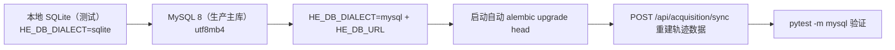
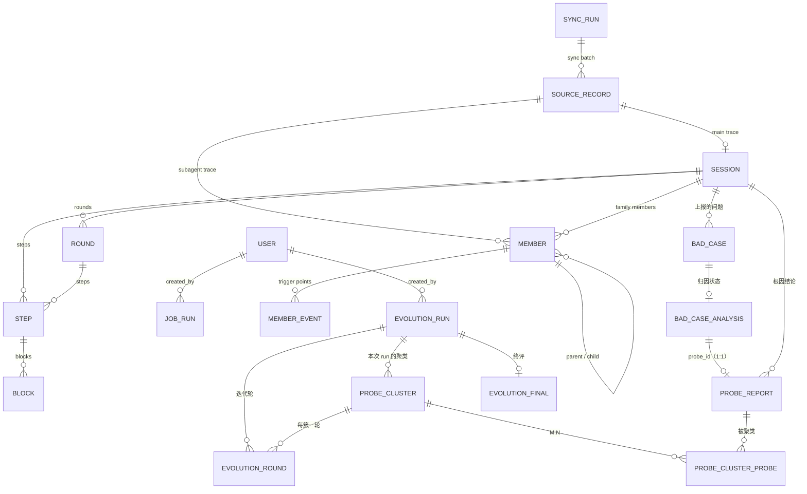

# 06 · 数据库表结构设计

> 本文回答：数据怎么存、表怎么建、索引怎么加、迁移怎么管理、哪些表由谁写入。
> 前置：[04 后端架构](04-backend-architecture.md)；配套：[05 接口设计](05-api-design.md) · [07 后端实现](07-backend-implementation.md)。
> 2026-10-22 数据模型修订：问题侧改为外部写入的 `bad_cases` + 归因结论 `probe_reports`；自进化聚类结果落 `probe_clusters`（按 run 归属）。

## 1. 存储策略与跨库约定

- **默认 MySQL 8（utf8mb4）主库**；SQLite 仅用于测试与本地开发便利。连接差异由 `Database` 接口的两个适配器吸收（[04 §4](04-backend-architecture.md)），Repository 与表结构不区分方言。
- **三类表的写入方要分清**：

| 类别 | 表 | 写入方 | 我们的权限 |
|---|---|---|---|
| 轨迹侧 | `source_records`、`sessions`、`members`、`rounds`、`steps`、`blocks`、`member_events`、`sync_runs`、`sync_state` | 本服务（acquisition 归一化） | 读写 |
| 问题侧 | `bad_cases`、`bad_case_analysis`、`probe_reports` | 外部归因/上报系统 | **只读** |
| 自进化侧 | `evolution_runs`、`probe_clusters`、`probe_cluster_probes`、`evolution_rounds`、`evolution_finals` | 本服务 | 读写 |
| 通用 | `users`、`job_runs` | 本服务 | 读写 |

- **原始层与归一化层分离**：`source_records` 存来源元数据 + **payload 原文**（SaaS 下没有"源文件"可回读，原文必须落库），其余轨迹表是归一化视图；解析规则升级时按 `parser_version` 从 payload 重放。
- **问题侧只读**：`bad_cases` 等表由外部系统写入，本服务不写、不做级联删除；表结构变更需与上游一起评审。

### 1.1 逻辑类型 → 物理类型映射

下文表格的"类型"列是**逻辑类型**；落地迁移按本表映射。

| 逻辑类型 | 用途 | SQLite | MySQL 8 |
|---|---|---|---|
| ID | 主键 / 外键 | `VARCHAR(36)` / `VARCHAR(64)` | 同左 |
| 短文本 | 名称、状态、枚举、哈希、版本 | `VARCHAR(n)` | `VARCHAR(n)` |
| 长文本 | 标题、描述、提问、工具输出、原始 payload | `TEXT` / `MEDIUMTEXT` / `LONGTEXT` | `TEXT`（64KB）/ `MEDIUMTEXT`（16MB）/ `LONGTEXT`（4GB，payload 用） |
| JSON | 结构化字段（meta_data / facts / stats） | `JSON`（底层 TEXT） | `JSON` |
| 布尔 | `is_error` / `accepted` / `verdict` | `BOOLEAN`（INTEGER） | `TINYINT(1)` |
| 时间 | 时间戳 | `DATETIME`（UTC 文本） | `DATETIME(6)` |
| 计数 | 统计数字 | `INTEGER` | `INT` / `BIGINT` |
| 浮点 | 置信度 / 严重度 / 得分 | `REAL` | `DOUBLE` |
| 自增 | 关联表/事件代理主键 | `INTEGER PRIMARY KEY AUTOINCREMENT` | `BIGINT AUTO_INCREMENT` |

硬规则：

- **所有主键、外键、唯一键、索引列一律 `VARCHAR(n)`（n ≤ 255）或整数**，不用 `TEXT`——MySQL 不允许无前缀的 TEXT 主键/FK，InnoDB 索引键上限 3072 字节。
- **正文字段用 `MEDIUMTEXT`、payload 用 `LONGTEXT`**：MySQL 的 `TEXT` 只有 64KB，工具输出上限 256KB（见 §3.7）。
- JSON 列不设 server default，默认值在应用层给；表中写出的 `DEFAULT []` 是应用层默认值。
- 时间由应用写入 UTC；不用 `NOW()`/`CURRENT_TIMESTAMP` 作为列默认值。
- 大小写不敏感搜索统一走 `sessions.search_text`（写入时 lower 拼接）。

### 1.2 切换与数据迁移

- **轨迹数据不写迁移脚本**：换库后重跑同步即可（源表仍是事实源），且 `source_records.payload` 已落库可整体搬迁。
- **问题侧数据是外部写入**：换库时由上游系统重新灌入或做一次性导入，不在本服务职责内。
- Alembic 单版本树、双方言渲染；SQLite 的 `ALTER TABLE` 限制用 `render_as_batch=True`。

### 1.3 类型约定在后文的适用方式

§3–§5 的表格沿用逻辑类型；落地按 §1.1 映射。迁移脚本是最终事实源。

## 2. ER 图

## 3. 轨迹侧表（本服务读写）

### 3.1 `source_records` —— 来源记录（原始层）

| 列 | 类型 | 约束 | 说明 |
|---|---|---|---|
| `id` | `VARCHAR(36)` | PK | ULID |
| `source_type` | `VARCHAR(16)` | NOT NULL | `source_table` / `http_api` |
| `source_ref` | `VARCHAR(255)` | NOT NULL | 来源内引用（源表行 id / 上游 session 引用） |
| `session_id` | `VARCHAR(36)` | NOT NULL | 根会话 id |
| `member_session_id` | `VARCHAR(36)` | NOT NULL | 该 agent/subagent 自己的 session id |
| `kind` | `VARCHAR(16)` | NOT NULL | `main` / `subagent` |
| `payload` | `LONGTEXT` | NOT NULL | 该 agent 的原始 JSONL 文本 |
| `content_hash` | `CHAR(64)` | NOT NULL | payload 哈希（判变更） |
| `line_count` | `INTEGER` | NOT NULL | 行数（家族树比例尺） |
| `parser_version` | `INTEGER` | NOT NULL | 解析器版本（触发重放） |
| `first_sync_run_id` | `VARCHAR(36)` | FK → `sync_runs.id` | 首次同步批次 |
| `synced_at` | `DATETIME` | NOT NULL | 最近同步时间 |

索引：`UNIQUE(source_type, source_ref)`、`INDEX(session_id)`、`INDEX(member_session_id)`、`INDEX(parser_version)`。

**幂等规则**：同一 `(source_type, source_ref)` 且 `content_hash` 相同 → 跳过；hash 变化 → 事务内删除该记录派生的行并重放；来源侧删除 → 保留业务数据并记日志（首版不级联删除）。

### 3.2 `sessions` —— 根会话（列表与摘要的读模型）

| 列 | 类型 | 约束 | 说明 |
|---|---|---|---|
| `id` | `VARCHAR(36)` | PK | 根会话 id |
| `short_title` | `VARCHAR(255)` | NOT NULL | 列表卡标题 |
| `title` | `TEXT` | NOT NULL | 完整标题 |
| `search_text` | `VARCHAR(512)` | NOT NULL | `lower(title + repo)`，搜索用 |
| `repo_name` | `VARCHAR(255)` | NOT NULL | 仓库名 |
| `project_path` | `TEXT` | NOT NULL | 项目路径 |
| `model` | `VARCHAR(64)` | NULL | 主模型 |
| `started_at` / `ended_at` | `DATETIME` | NOT NULL | 首末事件时间（UTC） |
| `duration_seconds` | `INTEGER` | NOT NULL | 真实跨度 |
| `status` | `VARCHAR(16)` | NOT NULL | `ok` / `partial` / `fail`（规则见 §7.2） |
| `skill_names` | `JSON` | NOT NULL | 递归聚合的 skill 名 |
| `rounds_count` / `steps_count` / `tools_count` / `errors_count` / `agents_count` | `INTEGER` | NOT NULL | 冗余聚合 |
| `bad_cases_count` | `INTEGER` | NOT NULL | 该会话问题数（同步时由问题侧表回填或查询时聚合） |
| `tokens_total` | `BIGINT` | NOT NULL | 全家族 token |
| `source_type` | `VARCHAR(16)` | NOT NULL | 来源类型 |
| `source_ref` | `VARCHAR(255)` | NOT NULL | 来源引用 |
| `main_record_id` | `VARCHAR(36)` | FK → `source_records.id` | 主 agent 的来源记录 |
| `imported_at` / `updated_at` | `DATETIME` | NOT NULL | — |

索引：`INDEX(started_at DESC)`、`INDEX(status)`、`INDEX(repo_name)`。

> `bad_cases_count` 来自问题侧（外部写入），同步轨迹时不能算；实现上在查询时 `LEFT JOIN` 聚合，或由定时任务刷新（见 [07 §3](07-backend-implementation.md)）。

### 3.3 `members` —— 家族成员（agent / subagent）

| 列 | 类型 | 约束 | 说明 |
|---|---|---|---|
| `id` | `VARCHAR(64)` | PK | 主会话固定 `main`；子 agent 用稳定 id |
| `session_id` | `VARCHAR(36)` | FK → `sessions.id` ON DELETE CASCADE | 根会话 |
| `member_session_id` | `VARCHAR(36)` | **UNIQUE NOT NULL** | 该 agent 自己的 session id（问题侧 `bad_case_session_id` 关联此列） |
| `parent_member_id` | `VARCHAR(64)` | FK → `members.id` NULL | 根为 NULL |
| `kind` | `VARCHAR(16)` | NOT NULL | `main` / `subagent` |
| `agent_type` | `VARCHAR(64)` | NULL | `general-purpose` / `Explore` / `workflow` |
| `description` | `TEXT` | NULL | 触发它的 Agent 调用描述 |
| `tool_use_id` | `VARCHAR(128)` | NULL | 父会话里对应 Agent 调用的 id |
| `transcript_record_id` | `VARCHAR(36)` | FK → `source_records.id` | 子转录来源记录 |
| `lines` | `INTEGER` | NOT NULL | 转录行数（家族树条宽） |
| `depth` | `INTEGER` | NOT NULL | 根=0 |
| `sort_key` | `DOUBLE` | NOT NULL | 树内排序 |

索引：`INDEX(session_id)`、`INDEX(parent_member_id)`、`UNIQUE(member_session_id)`。

### 3.4 `member_events` —— 家族树触发点

| 列 | 类型 | 约束 | 说明 |
|---|---|---|---|
| `id` | BIGINT | PK AUTOINCREMENT | — |
| `member_id` | `VARCHAR(64)` | FK → `members.id` ON DELETE CASCADE | — |
| `event_index` | `INTEGER` | NOT NULL | 成员内顺序 |
| `line_no` | `INTEGER` | NOT NULL | 转录行号 |
| `kind` | `VARCHAR(16)` | NOT NULL | `skill` / `agent` / `workflow` |
| `name` | `VARCHAR(255)` | NULL | skill 名 |
| `description` | `TEXT` | NULL | 子 agent / workflow 描述 |
| `tool_use_id` | `VARCHAR(128)` | NULL | 触发调用 id |

索引：`UNIQUE(member_id, event_index)`、`INDEX(member_id, line_no)`。

### 3.5 `rounds` / `3.6 steps` / `3.7 blocks`

结构与原设计一致（内部表，供统计与诊断证据；时间线裁撤后不对外暴露）：`rounds(session_id, seq, prompt_text, started_at, duration_seconds, tokens, step_count, tool_count, agent_count, meta JSON)`；`steps(round_id, member_id, seq, message_id, started_at, model, tokens)`；`blocks(step_id, seq, kind, name, call_id, input_text MEDIUMTEXT, result_text MEDIUMTEXT, is_error, subagent_member_id)`。

### 3.8 `sync_runs` —— 同步批次

| 列 | 类型 | 说明 |
|---|---|---|
| `id` | `VARCHAR(36)` PK | ULID |
| `source_type` | `VARCHAR(16)` | `source_table` / `http_api` |
| `started_at` / `finished_at` | DATETIME | — |
| `status` | `VARCHAR(16)` | `running` / `completed` / `failed` / `interrupted` |
| `watermark_before` / `watermark_after` | DATETIME | 水位线区间 |
| `records_total` / `records_done` | INTEGER | 进度 |
| `imported` / `skipped` | INTEGER | 统计 |
| `errors` | JSON | `[{sourceRef, message}]` |

### 3.9 `sync_state` —— 水位线

`source_type` PK、`watermark` NULL、`last_sync_run_id`、`updated_at`。

### 3.10 `users` —— 用户（单组织共享）

| 列 | 类型 | 说明 |
|---|---|---|
| `id` | `VARCHAR(36)` PK | ULID |
| `username` | `VARCHAR(64)` UNIQUE | 小写登录名 |
| `password_hash` | `VARCHAR(255)` | argon2id |
| `display_name` | `VARCHAR(128)` | — |
| `role` | `VARCHAR(16)` | `admin` / `member` |
| `is_active` | BOOLEAN | 停用即拒绝登录 |
| `created_at` / `last_login_at` | DATETIME | — |

### 3.11 `job_runs` —— 统一任务表

| 列 | 类型 | 说明 |
|---|---|---|
| `id` | `VARCHAR(36)` PK | ULID |
| `kind` | `VARCHAR(32)` | `sync` / `pull` / `evolution_prepare` / `evolution_advance` |
| `ref_id` | `VARCHAR(64)` NULL | 关联的 `sync_runs.id` / `evolution_runs.id` |
| `status` | `VARCHAR(16)` | `queued` / `running` / `completed` / `failed` / `interrupted` |
| `progress` | `DOUBLE` | 0..1 |
| `executor` | `VARCHAR(16)` | `local` / `ci`（V1 恒 local） |
| `external_job_id` | `VARCHAR(128)` NULL | 未来 CI 平台任务 id |
| `attempt` | `INTEGER` | 重试次数 |
| `payload` / `result` | JSON | 入参 / 结果摘要 |
| `error` | `TEXT` | 失败原因 |
| `created_by` | `VARCHAR(36)` NULL | FK → `users.id` |
| `created_at` / `started_at` / `finished_at` / `updated_at` | DATETIME | — |

索引：`INDEX(status)`、`INDEX(kind, created_at DESC)`、`INDEX(ref_id)`。

## 4. 问题侧表（外部写入，本服务只读）

### 4.1 `bad_cases` —— 上报的问题（症状）

| 列 | 类型 | 约束 | 说明 |
|---|---|---|---|
| `bad_case_id` | `VARCHAR(64)` | PK | 外部生成的稳定 id |
| `session_id` | `VARCHAR(36)` | NOT NULL | 所属根会话 |
| `bad_case_type` | `VARCHAR(16)` | NOT NULL | `self` / `discovery` |
| `object_name` | `VARCHAR(128)` | NOT NULL | 上报/发现问题的 skill 或 agent 名 |
| `object_type` | `VARCHAR(16)` | NOT NULL | `skill` / `agent` |
| `object_version` | `VARCHAR(64)` | NULL | 上报者版本 |
| `bad_case_session_id` | `VARCHAR(36)` | NOT NULL | 该对象所在 agent 的 session id（树锚点） |
| `reason` | `TEXT` | NOT NULL | 原型文案（直接展示） |
| `meta_data` | `JSON` | NULL | 上报打点数据，结构不统一 |
| `source` | `VARCHAR(64)` | NULL | 来源系统/任务标识 |
| `created_at` / `updated_at` | `DATETIME` | NOT NULL | — |

索引：`INDEX(session_id)`、`INDEX(bad_case_session_id)`、`INDEX(object_type, object_name, object_version)`。

> `object_*` 只表示**谁上报/发现了问题**，不是根因；根因在 `probe_reports`。

### 4.2 `bad_case_analysis` —— 归因状态（关联表）

| 列 | 类型 | 约束 | 说明 |
|---|---|---|---|
| `id` | BIGINT | PK AUTOINCREMENT | — |
| `bad_case_id` | `VARCHAR(64)` | **UNIQUE** FK → `bad_cases.bad_case_id` | 一条问题一行 |
| `analysis_status` | `VARCHAR(32)` | NOT NULL | `unanalyzed` / `analyzed_nonissue` / `analyzed_issue` |
| `probe_id` | `VARCHAR(64)` | NULL FK → `probe_reports.probe_id` | 仅 `analyzed_issue` 非空 |
| `analysis_result` | `JSON` | NULL | 展示快照：非问题 `{reason}`；问题 `{summary}` |
| `updated_at` | `DATETIME` | NOT NULL | — |

索引：`UNIQUE(bad_case_id)`、`INDEX(probe_id)`、`INDEX(analysis_status)`。

应用层约束（不依赖 DB CHECK，保证双库一致）：

- `analyzed_issue` → `probe_id` 必填；`analyzed_nonissue` / `unanalyzed` → `probe_id` 必须为空；
- 一条 bad_case 最多一条 probe（1:1），`probe_reports` 不存 `bad_case_id`。

### 4.3 `probe_reports` —— 归因报告（根因）

| 列 | 类型 | 约束 | 说明 |
|---|---|---|---|
| `probe_id` | `VARCHAR(64)` | PK | 外部生成 |
| `session_id` | `VARCHAR(36)` | NOT NULL | 所属根会话 |
| `probe_type` | `VARCHAR(16)` | NOT NULL | `skill` / `agent` |
| `probe_object` | `VARCHAR(128)` | NOT NULL | **真正有问题的对象**（自进化 target） |
| `object_version` | `VARCHAR(64)` | NULL | 有问题的版本 |
| `attribute_type` | `VARCHAR(16)` | NOT NULL | `model` / `prompt` / `error` |
| `probe_description` | `TEXT` | NOT NULL | 归因出的问题描述 |
| `probe_analysis` | `TEXT` | NOT NULL | 推导过程（UI 辅助校验） |
| `created_at` / `updated_at` | `DATETIME` | NOT NULL | — |

索引：`INDEX(session_id)`、`INDEX(probe_type, probe_object, object_version)`、`INDEX(attribute_type)`。

`from_bad_cases` / `from_bad_cases_count` **不落列**：查 probe 时由 `bad_case_analysis.probe_id` 反查（V1 恒 1 条；后续聚类不影响该关系）。

## 5. 自进化侧表（本服务读写）

### 5.1 `evolution_runs`

| 列 | 类型 | 说明 |
|---|---|---|
| `id` | `VARCHAR(36)` PK | `evo-…` |
| `title` | `VARCHAR(255)` | — |
| `mode` | `VARCHAR(16)` | `full`（完整自进化）/ `cluster_only`（仅聚类预览） |
| `target_type` | `VARCHAR(16)` | `skill` / `agent`（来自 probe） |
| `target_name` | `VARCHAR(128)` | `probe_object` |
| `target_version` | `VARCHAR(64)` | `object_version` |
| `window_from` / `window_to` | DATE | session 启动时间窗 |
| `models` | JSON | 模型多选 |
| `status` | `VARCHAR(16)` | `running` / `completed` |
| `progress_unit` | `INTEGER` | 状态机游标（[07 §5](07-backend-implementation.md)） |
| `stats` | JSON | 命中 session / probe / 簇数等 |
| `created_by` | `VARCHAR(36)` NULL | FK → `users.id` |
| `created_at` / `finished_at` | DATETIME | — |

索引：`INDEX(created_at DESC)`、`INDEX(status)`、`INDEX(target_type, target_name, target_version)`。

### 5.2 `probe_clusters` —— 本次 run 的聚类结果

| 列 | 类型 | 说明 |
|---|---|---|
| `probe_cluster_id` | `VARCHAR(64)` PK | 外部/本服务生成 |
| `run_id` | `VARCHAR(36)` FK → `evolution_runs.id` | **按 run 归属** |
| `seq` | `INTEGER` | 排序（严重程度降序） |
| `probe_cluster_description` | `TEXT` | 簇描述（V1 占位文案） |
| `probe_cluster_type` | `VARCHAR(16)` | `model` / `prompt` / `error` |
| `created_at` | DATETIME | — |

索引：`UNIQUE(run_id, seq)`、`INDEX(run_id)`。

### 5.3 `probe_cluster_probes` —— 簇 ↔ probe 多对多

| 列 | 类型 | 说明 |
|---|---|---|
| `id` | BIGINT PK AUTOINCREMENT | — |
| `probe_cluster_id` | `VARCHAR(64)` FK | — |
| `probe_id` | `VARCHAR(64)` FK | — |

约束：`UNIQUE(probe_cluster_id, probe_id)`；索引：`INDEX(probe_id)`。

### 5.4 `evolution_rounds` —— 每簇的迭代轮

| 列 | 类型 | 说明 |
|---|---|---|
| `id` | `VARCHAR(36)` PK | — |
| `run_id` | `VARCHAR(36)` FK | — |
| `probe_cluster_id` | `VARCHAR(64)` FK | 该轮针对的簇 |
| `seq` | `INTEGER` | 第几轮 |
| `status` | `VARCHAR(16)` | `pending` / `evaluating` / `accepted` / `rejected` |
| `patch` | JSON | `{file, lines[]}` |
| `eval_current` / `eval_candidate` | DOUBLE | 评测分 |
| `accepted` | BOOLEAN | — |
| `commit_hash` / `commit_message` | `VARCHAR(40)` / `VARCHAR(255)` | 接纳时写入 |

索引：`UNIQUE(run_id, seq)`、`INDEX(probe_cluster_id)`。

### 5.5 `evolution_finals`

`run_id` PK、`best_version`、`verdict`、`best_score`、`init_score`、`metrics` JSON。

## 6. 索引与容量估算

| 表 | 量级（单组织） | 说明 |
|---|---|---|
| `source_records` | 10³–10⁴ | 每个 agent 一条；payload 占主要体积 |
| `sessions` | 10³ | — |
| `members` | 10⁴ | 单会话最多几十个子 agent |
| `member_events` | 10⁴ | — |
| `rounds` / `steps` / `blocks` | 10⁵–10⁶ | 内部统计与证据 |
| `bad_cases` | 10³–10⁴ | 外部写入 |
| `probe_reports` | 10³–10⁴ | 与 bad_case 1:1 |
| `probe_clusters` | 每次 run 数条–数十条 | 按 run 归属，可随 run 清理 |
| `job_runs` | 10³ | 任务审计 |

payload 原文使 `source_records` 成为最大表，按"只写不查"设计（查询只走归一化表与问题侧表）。

## 7. 数据口径

### 7.1 轮次/家族派生（Claude Code JSONL）

| 事实 | 规则 |
|---|---|
| 没有 turn 字段 | 轮次边界 = `type=user` 且不含 `tool_result`、不是 skill 注入、不是中断、不是命令回显 |
| 工具结果内联在 user 记录 | 按 `tool_use_id` 回填到对应工具块，不切轮次 |
| 元记录 | 不进查询视图；attachment 的 SessionStart hook 只作诊断线索 |
| assistant 记录带 `message.id` 与 usage | 步骤 = `message.id`；token 聚合到轮与步 |
| 子 agent 有独立 session id | 源表按 `member_session_id` 给出；缺父子关系时按 `parent_tool_use_id` 回退 |
| 会话跨多天 | 存储绝对时刻，不假设连续时长 |

### 7.2 状态规则

- `fail`：最后一条 assistant 记录缺失或存在未恢复的致命错误。
- `partial`：存在 `is_error=true` 的工具块。
- `ok`：无错误块且正常结束。

### 7.3 密度口径

`failPer100Steps = errors_count / steps_count * 100`，`badCasesPer100Steps = bad_cases_count / steps_count * 100`，1 位小数；两条线共用 3/百步满格。

### 7.4 问题侧口径

- `bad_case.bad_case_session_id` 必须能在 `members.member_session_id` 找到；找不到时 UI 降级挂到根节点并告警（不阻塞展示）。
- `analysis_status` 与 `probe_id` 的一致性由上游保证，本服务查询时做防御性校验（不一致时按 `unanalyzed` 展示并记日志）。
- `probe.attribute_type` 决定展示子状态（模型/prompt/错误）；`probe_object@object_version` 是自进化 target 的唯一来源。

## 8. 与功能点的映射

| 功能点 | 用到的主要表 | 读写 |
|---|---|---|
| F3 Session 列表 | `sessions` + `bad_cases`（计数） | 读 |
| F4 家族摘要 | `sessions` | 读 |
| F5 家族树 | `members`、`member_events`、`bad_cases`、`bad_case_analysis` | 读 |
| F6 会话内问题列表 | `bad_cases`、`bad_case_analysis` | 只读 |
| F7 时间线（已裁撤） | `rounds`、`steps`、`blocks` 仅内部使用 | 不读接口 |
| F8 错误详情与归因 | `bad_cases`、`bad_case_analysis`、`probe_reports` | 只读 |
| F9 获取与同步 | 轨迹侧全部表 + `source_records`、`sync_runs`、`sync_state` | 写/读 |
| F10–F13 自进化 | `probe_reports`、`probe_clusters`、`probe_cluster_probes`、`evolution_*` | 写/读 |
| F14 进度推送 | `job_runs` | 写/读 |
| F15 对象/模型清单 | `probe_reports`（DISTINCT）、`sessions.model` | 读 |
| F16 模拟推进 | `evolution_runs` | 写（V1 占位推进） |
| F18 登录与鉴权 | `users` | 读/写 |
