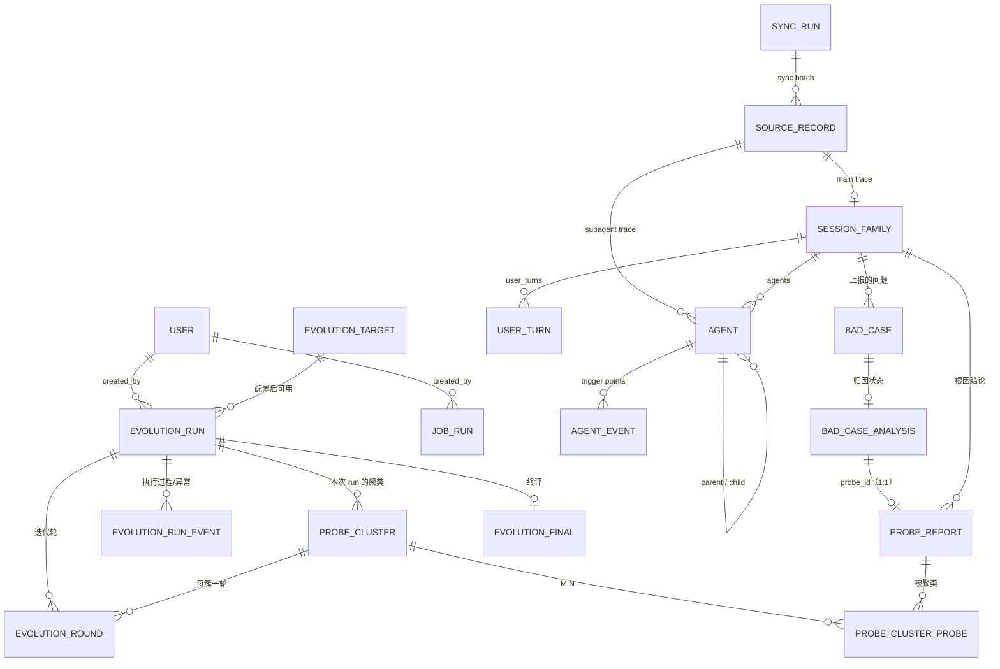

# 06 · 数据库表结构设计

> 本文回答：数据怎么存、表怎么建、索引怎么加、迁移怎么管理、哪些表由谁写入。
> 前置：[04 后端架构](04-backend-architecture.md)；配套：[05 接口设计](05-api-design.md) · [07 后端实现](07-backend-implementation.md)。
> 2026-10-22 数据模型修订：问题侧改为外部写入的 `bad_cases` + 归因结论 `probe_reports`；自进化聚类结果落 `probe_clusters`（按 run 归属）。

## 1. 存储策略与跨库约定

- **默认 MySQL 8（utf8mb4）主库**；SQLite 仅用于测试与本地开发便利。连接差异由 `Database` 接口的两个适配器吸收（[04 §4](04-backend-architecture.md)），Repository 与表结构不区分方言。
- **三类表的写入方要分清**：

| 类别 | 表 | 写入方 | 我们的权限 |
|---|---|---|---|
| 轨迹侧 | `trajectory_payloads`（外部写）、`source_records`、`session_families`、`agents`、`user_turns`、`agent_events`、`sync_runs`、`sync_lock` | 本服务（source_records/归一化） | 读写（payload 表只读） |
| 问题侧 | `bad_cases`、`bad_case_analysis`、`probe_reports` | 外部归因/上报系统 | **只读** |
| 自进化侧 | `evolution_targets`、`evolution_runs`、`evolution_run_events`、`probe_clusters`、`probe_cluster_probes`、`evolution_rounds`、`evolution_finals` | 本服务 | 读写 |
| 通用 | `users`、`job_runs` | 本服务 | 读写 |

- **原始层与归一化层分离**：`trajectory_payloads` 存原始 JSONL（外部写入/pull），`source_records` 存处理索引（不存 payload），其余轨迹表是归一化视图；解析规则升级时按 `parser_version` 从 payload 重放。
- **明细层不落库**：`messages` / `content_blocks` 只在解析期存在，用于统计、usage 去重和状态判定；业务表不存消息与工具原文，需要原文时按 `(root_session_id, agent_id)` 从 `trajectory_payloads` 回读。`user_turns` 是唯一保留的轨迹明细表，只存用户输入锚点。
- **问题侧只读**：`bad_cases` 等表由外部系统写入，本服务不写、不做级联删除；表结构变更需与上游一起评审。
- **跨写入方的派生值不落列**：轨迹侧表只存本服务归一化算得出的聚合；依赖问题侧（外部写入）的计数随上游随时变化，一律查询时聚合，不物化——会话问题数即属此类（见 §3.2、§7.3）。

### 1.1 逻辑类型 → 物理类型映射

下文表格的"类型"列是**逻辑类型**；落地迁移按本表映射。

| 逻辑类型 | 用途 | SQLite | MySQL 8 |
|---|---|---|---|
| ID | 主键 / 外键 | `VARCHAR(36)` / `VARCHAR(64)` | 同左 |
| 短文本 | 名称、状态、枚举、哈希、版本 | `VARCHAR(n)` | `VARCHAR(n)` |
| 长文本 | 标题、描述、提问、原始 payload | `TEXT` / `LONGTEXT` | `TEXT`（64KB）/ `LONGTEXT`（4GB，payload 用） |
| JSON | 结构化字段（meta_data / facts / stats） | `JSON`（底层 TEXT） | `JSON` |
| 布尔 | `is_error` / `accepted` / `verdict` | `BOOLEAN`（INTEGER） | `TINYINT(1)` |
| 时间 | 时间戳 | `DATETIME`（Asia/Shanghai 本地时间） | `DATETIME(6)` |
| 计数 | 统计数字 | `INTEGER` | `INT` / `BIGINT` |
| 浮点 | 置信度 / 严重度 / 得分 | `REAL` | `DOUBLE` |
| 自增 | 关联表/事件代理主键 | `INTEGER PRIMARY KEY AUTOINCREMENT` | `BIGINT AUTO_INCREMENT` |

硬规则：

- **所有主键、外键、唯一键、索引列一律 `VARCHAR(n)`（n ≤ 255）或整数**，不用 `TEXT`——MySQL 不允许无前缀的 TEXT 主键/FK，InnoDB 索引键上限 3072 字节。
- **正文用 `TEXT`、payload 用 `LONGTEXT`**：业务表不存工具输出原文，`TEXT` 的 64KB 足够；payload 固定 `LONGTEXT`。
- JSON 列不设 server default，默认值在应用层给；表中写出的 `DEFAULT []` 是应用层默认值。
- 时间由应用写入 Asia/Shanghai（UTC+8）；不用 `NOW()`/`CURRENT_TIMESTAMP` 作为列默认值。
- 大小写不敏感搜索统一走 `session_families.search_text`（写入时 lower 拼接）。

### 1.2 切换与数据迁移

```text
本地 SQLite（测试）──► MySQL 8（生产主库）──► HE_DB_DIALECT=mysql + URL
        ──► 启动自动 alembic upgrade head
        ──► POST /api/acquisition/sync 重跑归一化
        ──► pytest -m mysql 验证
```

- **轨迹数据不写迁移脚本**：换库后重跑归一化即可（`trajectory_payloads` 仍是事实源）；问题侧数据由外部系统重新灌入。
- **问题侧数据是外部写入**：换库时由上游系统重新灌入或做一次性导入，不在本服务职责内。
- Alembic 单版本树、双方言渲染；SQLite 的 `ALTER TABLE` 限制用 `render_as_batch=True`。

### 1.3 类型约定在后文的适用方式

§3–§5 的表格沿用逻辑类型；落地按 §1.1 映射。迁移脚本是最终事实源。

### 1.4 术语约定（避免与 Claude Code 的 turn 混淆）

- `session_family`：根会话家族；API 的 `sessionId` 指向它，`root_session_id` 也指向它。
- `agent`：Agent 会话树里的执行节点（主 agent、子 agent、workflow 合成节点、forked skill 执行体）；`agent.id` 主 agent = root session id，子 agent = 真实 `agentId`。**普通 skill 不是 agent**：只在 `agent_events(kind=skill)` 里出现，不建 `agents` 行。
- `user_turn`：一次用户提问到下一次用户提问；**不是** Claude Code agent loop 里“模型+工具”的 tool-use turn。是唯一保留的轨迹明细表，只存用户输入锚点。
- `message`：一次 assistant 模型响应（Claude 的 `message.id`）；解析期用于 usage 去重和统计，**不落表**。
- `content_block`：消息内的 `text` / `thinking` / `tool_use` / `tool_result` 块；解析期用于统计工具与错误，**不落表**。
- `evolution_round`：自进化的一次迭代轮，与轨迹的 `user_turn` 无关。

## 2. ER 图



## 3. 轨迹侧表（本服务读写）

### 3.0 `trajectory_payloads` —— 原始 JSONL（外部写入，本服务只读）

> 由第三方脚本/上游接口写入；本服务**不保存第二份 payload**，按 `(root_session_id, agent_id)` 读取。`root_session_id` 是 Claude Code 的根 `sessionId`；`agent_id` 主 agent 用根 session id，子 agent 用真实 `agentId`。

| 列 | 类型 | 约束 | 说明 |
|---|---|---|---|
| `root_session_id` | `VARCHAR(36)` | PK 组成 | 主 agent 的 session id；同一会话的主/子 agent 相同 |
| `agent_id` | `VARCHAR(64)` | PK 组成 | 主 agent = root session id；子 agent = provider `agentId` |
| `agent_kind` | `VARCHAR(16)` | NOT NULL | `main` / `subagent` |
| `payload` | `LONGTEXT` | NOT NULL | 该 agent 的原始 JSONL 全文 |
| `agent_meta` | `JSON` | NULL | 子 agent 的 `*.meta.json`（`toolUseId/agentType/spawnDepth/taskKind/teamName/model`） |
| `content_hash` | `CHAR(64)` | NOT NULL | payload 哈希 |
| `line_count` | `INTEGER` | NOT NULL | 行数 |
| `source_type` | `VARCHAR(16)` | NOT NULL | `script` / `http_api` |
| `updated_at` | `DATETIME` | NOT NULL | 脚本/接口最近写入时间 |

主键：`PRIMARY KEY(root_session_id, agent_id)`；索引：`INDEX(updated_at)`。

- 主 agent 行：`agent_id == root_session_id`。
- 子 agent 行：`agent_id` 是 JSONL 行和 meta 文件里的真实 `agentId`。
- 本服务只读；pull 路径由本服务写入（见 [07 §2](07-backend-implementation.md)）。

### 3.1 `source_records` —— 处理索引（不存 payload）

| 列 | 类型 | 约束 | 说明 |
|---|---|---|---|
| `id` | `BIGINT` | PK AUTOINCREMENT | 代理主键 |
| `root_session_id` | `VARCHAR(36)` | NOT NULL | 主 agent 的 session id |
| `agent_id` | `VARCHAR(64)` | NOT NULL | 主 agent = root session id；子 agent = 真实 `agentId` |
| `kind` | `VARCHAR(16)` | NOT NULL | `main` / `subagent` |
| `source_type` | `VARCHAR(16)` | NOT NULL | `script` / `http_api` |
| `line_count` | `INTEGER` | NOT NULL | 行数（Agent 执行流图比例尺） |
| `received_at` | `DATETIME` | NOT NULL | 首次发现该 payload 的时间 |
| `processed_at` | `DATETIME` | NULL | 最近一次归一化完成时间；NULL = 待处理 |
| `processed_hash` | `CHAR(64)` | NULL | 已归一化时的 payload 哈希 |
| `parser_version` | `INTEGER` | NULL | 已使用的解析器版本 |
| `last_sync_run_id` | `VARCHAR(36)` | NULL FK → `sync_runs.id` | 最近一次归一化批次 |

索引：`UNIQUE(root_session_id, agent_id)`、`INDEX(processed_at)`、`INDEX(parser_version)`。

**待处理判定**：`processed_hash IS NULL`，或 `processed_hash != trajectory_payloads.content_hash`，或 `parser_version < 当前解析器版本`。

**幂等规则**：hash 未变且解析器版本未升级 → 跳过；hash 变化 → 事务内删除该记录派生的行并重放；payload 侧删除 → 保留业务数据并记日志（首版不级联删除）。

### 3.2 `session_families` —— 根会话（列表与会话概览的读模型）

| 列 | 类型 | 约束 | 说明 |
|---|---|---|---|
| `id` | `VARCHAR(36)` | PK | 根会话 id |
| `short_title` | `VARCHAR(255)` | NOT NULL | 列表卡标题 |
| `title` | `TEXT` | NOT NULL | 完整标题 |
| `search_text` | `VARCHAR(512)` | NOT NULL | `lower(title + repo)`，搜索用 |
| `repo_name` | `VARCHAR(255)` | NOT NULL | 仓库名 |
| `project_path` | `TEXT` | NOT NULL | 项目路径（Claude Code `cwd`） |
| `git_branch` | `VARCHAR(255)` | NULL | Claude Code `gitBranch` |
| `cli_version` | `VARCHAR(32)` | NULL | Claude Code `version` |
| `entrypoint` | `VARCHAR(16)` | NULL | `cli` / `sdk` 等 |
| `model` | `VARCHAR(64)` | NULL | 主 agent 模型 |
| `models` | `JSON` | NOT NULL | 整棵 Agent 会话树去重后的模型列表（含子 agent） |
| `started_at` / `ended_at` | `DATETIME` | NOT NULL | 首末事件时间（Asia/Shanghai） |
| `duration_seconds` | `INTEGER` | NOT NULL | 真实跨度 |
| `status` | `VARCHAR(16)` | NOT NULL | `ok` / `partial` / `fail`（规则见 §7.2） |
| `skill_names` | `JSON` | NOT NULL | 递归聚合的 skill 名（来自 `agent_events(kind=skill)`，含 forked skill 的父 skill 事件） |
| `user_turns_count` / `messages_count` / `tools_count` / `errors_count` / `agents_count` | `INTEGER` | NOT NULL | 冗余聚合；整棵树口径。`messages_count / tools_count / errors_count / tokens_total` 按 agent 求和；`user_turns_count` 取轮次行数；`agents_count` 只数 `kind=subagent` 且 `task_kind != forked_skill` 的节点（含 workflow-subagent / teammate），不含 main、workflow 合成节点与 skill fork |
| `tokens_total` | `BIGINT` | NOT NULL | 整棵 Agent 会话树 token |
| `source_type` | `VARCHAR(16)` | NOT NULL | `script` / `http_api` |
| `main_record_id` | `BIGINT` | FK → `source_records.id` | 主 agent 的处理记录 |
| `imported_at` / `updated_at` | `DATETIME` | NOT NULL | — |

索引：`INDEX(started_at DESC)`、`INDEX(status)`、`INDEX(repo_name)`。

> 会话问题数（API 的 `stats.badCases`）**不落列**：它来自问题侧（外部写入），随上报、修改、删除实时变化，本服务既无写入路径也收不到失效通知，物化必然陈旧。实现上在列表/概览装配时，按当前页会话 id 做一次 `COUNT(*) … GROUP BY bad_case_session_id`（走 §4.1 的 `INDEX(bad_case_session_id)`），无记录按 0 计（见 [07 §3.1](07-backend-implementation.md)）。

### 3.3 `agents` —— Agent 会话树节点（main / subagent / workflow / forked skill）

> 一行 = 一个执行节点：有独立转录的节点（main / subagent / forked skill），或没有转录的 workflow 合成节点。**普通 skill 不建行**——`Skill` 调用只落 `agent_events(kind=skill)`；forked skill 因有独立转录而建行（`task_kind=forked_skill`）。

| 列 | 类型 | 约束 | 说明 |
|---|---|---|---|
| `id` | `VARCHAR(64)` | PK | 节点 id：主 agent = root session id；子 agent = 真实 `agentId`；workflow = 合成 `wf_...` |
| `root_session_id` | `VARCHAR(36)` | FK → `session_families.id` ON DELETE CASCADE | 根会话 |
| `parent_agent_id` | `VARCHAR(64)` | FK → `agents.id` NULL | 根为 NULL；workflow-subagent 指向 workflow |
| `kind` | `VARCHAR(16)` | NOT NULL | `main` / `subagent` / `workflow`；forked skill 落在 `subagent`，由 `task_kind` 区分 |
| `agent_type` | `VARCHAR(64)` | NULL | `general-purpose` / `Explore` / 自定义 teammate 名 / `workflow` / `workflow-subagent`；forked skill 为 NULL |
| `task_kind` | `VARCHAR(32)` | NULL | `in_process_teammate` / `forked_skill`；普通子 agent 为 NULL |
| `team_name` | `VARCHAR(128)` | NULL | agent team 的 teamName |
| `name` | `VARCHAR(255)` | NULL | `meta.name`（命名子 agent / teammate 的显示名）；forked skill 为 NULL |
| `skill_name` | `VARCHAR(255)` | NULL | forked skill 的 `skillName`（来自 `.forked-skill.json`）；其他节点为 NULL |
| `model` | `VARCHAR(64)` | NULL | 实际 assistant `message.model`；主/子 agent 可不同 |
| `requested_model` | `VARCHAR(64)` | NULL | meta.model 请求别名，如 `sonnet` |
| `description` | `TEXT` | NULL | 触发它的 Agent 调用描述 |
| `tool_use_id` | `VARCHAR(128)` | NULL | 父会话里触发该节点的调用 id；workflow 填父 workflow 调用；teammate/forked skill 可为 NULL |
| `spawn_depth` | `INTEGER` | NOT NULL | meta.spawnDepth；根=0 |
| `transcript_record_id` | `BIGINT` | FK → `source_records.id` NULL | 子转录处理记录；workflow 无独立转录时为 NULL |
| `lines` | `INTEGER` | NOT NULL | 转录行数（Agent 执行流图条宽）；workflow 为 0 |
| `messages_count` | `INTEGER` | NOT NULL | 该节点自己的 assistant message 数；用于 `×N` 间隔计算与会话求和 |
| `tokens_total` | `BIGINT` | NOT NULL | 该节点自己的 token 合计；会话总量 = 各节点求和 |
| `tools_count` | `INTEGER` | NOT NULL | 该节点自己的 `tool_use` 块数；会话总量 = 各节点求和 |
| `errors_count` | `INTEGER` | NOT NULL | 该节点自己的 `is_error` 块数；会话总量 = 各节点求和 |
| `meta` | `JSON` | NULL | 原始 `*.meta.json`，保留 provider 自定义字段 |
| `sort_key` | `DOUBLE` | NOT NULL | 树内排序 |

索引：`UNIQUE(root_session_id, id)`、`INDEX(parent_agent_id)`、`INDEX(task_kind)`、`INDEX(model)`。

**显示名口径**：主节点由 API 固定为“主会话”；其余节点按 `name` → `skill_name` → `agent_type` 取（见 [05 §3.2](05-api-design.md)），DB 不存派生 label。

**统计口径**：`messages_count / tokens_total / tools_count / errors_count` 都是本节点自己的量；`session_families` 的对应列是整棵树求和。workflow 合成节点四项均为 0。

### 3.4 `agent_events` —— Agent 会话树触发点

| 列 | 类型 | 约束 | 说明 |
|---|---|---|---|
| `id` | BIGINT | PK AUTOINCREMENT | — |
| `agent_id` | `VARCHAR(64)` | FK → `agents.id` ON DELETE CASCADE | — |
| `event_index` | `INTEGER` | NOT NULL | agent 内顺序 |
| `line_no` | `INTEGER` | NOT NULL | 转录行号 |
| `message_offset` | `INTEGER` | NOT NULL | 该触发点之前已经出现的 assistant message 数 |
| `kind` | `VARCHAR(16)` | NOT NULL | `skill` / `agent` / `workflow` |
| `name` | `VARCHAR(255)` | NULL | 触发对象名：skill 名 / agent 类型 / workflow 名 |
| `description` | `TEXT` | NULL | 子 agent / workflow 描述 |
| `tool_use_id` | `VARCHAR(128)` | NULL | 触发调用 id |

索引：`UNIQUE(agent_id, event_index)`、`INDEX(agent_id, line_no)`、`INDEX(agent_id, message_offset)`。

> `kind=skill` 只是触发事件，不是节点：普通 skill 只有这一条事件；forked skill 额外有 `agents` 行（`tool_use_id` 可空），装配时用 `skill_name` 关联回该事件。

### 3.5 `user_turns` —— 用户输入锚点（主 agent）

| 列 | 类型 | 约束 | 说明 |
|---|---|---|---|
| `id` | `VARCHAR(36)` | PK | ULID |
| `root_session_id` | `VARCHAR(36)` | FK → `session_families.id` ON DELETE CASCADE | 所属根会话 |
| `seq` | `INTEGER` | NOT NULL | 用户轮次顺序，从 1 开始 |
| `prompt_text` | `TEXT` | NOT NULL | 该轮首个真实用户提问 |
| `started_at` | `DATETIME` | NOT NULL | 该轮开始时间 |
| `line_no` | `INTEGER` | NOT NULL | 该轮首条用户记录在主 agent 转录中的行号 |
| `message_offset` | `INTEGER` | NOT NULL | 该轮开始前已出现的 assistant message 数 |

索引：`UNIQUE(root_session_id, seq)`、`INDEX(root_session_id, line_no)`。

- 只从主 agent 的 `type=user` 字符串切分；排除 `isMeta=true`、`<local-command-caveat>`、`<command-name>`、`<task-notification>`、`<system-reminder>`。
- `last-prompt` / `queue-operation` 不作为轮次来源；`attachment.queued_command` 的 `origin.kind=human` 可作为候选。
- 只存“用户输入”本身，不存轮级统计；会话与节点的消息/工具/错误/token 统计见 §3.2、§3.3。
- `line_no` / `message_offset` 与 `agent_events` 同语义，供未来把用户输入渲染到 Agent 执行流图；完整时间线由外部平台承担。

### 3.6 `sync_runs` —— 归一化批次

| 列 | 类型 | 说明 |
|---|---|---|
| `id` | `VARCHAR(36)` PK | ULID |
| `source_type` | `VARCHAR(16)` | `script` / `http_api` |
| `started_at` / `finished_at` | DATETIME | — |
| `status` | `VARCHAR(16)` | `running` / `completed` / `failed` / `interrupted` |
| `records_total` / `records_done` | INTEGER | 进度 |
| `imported` / `skipped` | INTEGER | 统计 |
| `errors` | JSON | `[{sessionId, message}]` |

### 3.7 `sync_state`（已取消）

不再维护水位线：待处理状态由 `source_records.processed_hash / parser_version` 表达，扫描 `trajectory_payloads` 与 `source_records` 的差异即可。

### 3.7.1 `sync_lock` —— 单飞锁（禁止并发同步）

| 列 | 类型 | 说明 |
|---|---|---|
| `name` | `VARCHAR(32)` PK | 固定 `sync` |
| `job_id` | `VARCHAR(36)` | 当前持有锁的 `job_runs.id` |
| `owner` | `VARCHAR(64)` | 实例 id（多实例排查用） |
| `acquired_at` | `DATETIME` | 获取时间 |
| `expires_at` | `DATETIME` | TTL（30 分钟）；崩溃后可回收 |

- 获取：`INSERT INTO sync_lock(name, job_id, owner, acquired_at, expires_at) VALUES ('sync', …)`；主键冲突 = 已有任务。
- 释放：任务完成/失败时 `DELETE WHERE name='sync' AND job_id=:job_id`。
- scheduler 与 `POST /acquisition/sync` 共用此锁；拿不到锁时返回正在执行的 `jobId`，不重复入队。
- V1 单实例再加进程内 `asyncio.Lock`；多实例依赖此表（或 MySQL `GET_LOCK`）。

### 3.8 `users` —— 用户（单组织共享）

| 列 | 类型 | 说明 |
|---|---|---|
| `id` | `VARCHAR(36)` PK | ULID |
| `username` | `VARCHAR(64)` UNIQUE | 小写登录名；登录查行的唯一入口 |
| `password_hash` | `VARCHAR(255)` | argon2id PHC 串（`$argon2id$v=19$m=…,t=…,p=…$<salt>$<hash>`）；盐与参数自描述，故不另设盐列 |
| `must_change_password` | BOOLEAN NOT NULL DEFAULT true | 密码由他人设定且本人尚未更换；建号置 true，本人改密成功置 false |
| `display_name` | `VARCHAR(128)` | — |
| `role` | `VARCHAR(16)` | `admin` / `member` |
| `is_active` | BOOLEAN | 停用即拒绝登录 |
| `created_at` / `updated_at` / `password_changed_at` / `last_login_at` | DATETIME | `password_changed_at` 随每次改密更新 |

硬规则：

- **明文密码不落任何列**：只存 argon2id 单向哈希。校验时用该行 PHC 串里的盐与参数对提交的密码重算，再恒定时间比较摘要——不存在"密码转哈希后查表"的路径（见 [07 §8.1](07-backend-implementation.md)）。
- **`password_hash` 不出服务边界**：任何 DTO、API 响应、SSE payload 都不含该列；对外用户对象只有 `{id, username, displayName, role, mustChangePassword}`。
- **密码与哈希不进日志与宽文本列**：不得写入 `job_runs.payload`、`evolution_run_events.payload/error_detail` 或任何 `TEXT` 列，脱敏清单见 [09 R15](09-review-guide.md)。
- **`must_change_password` 由服务端强制**：该标记为 true 的 principal 只放行改密、登出与 `GET /auth/me`，其余请求 `403 PASSWORD_CHANGE_REQUIRED`（见 [07 §8.2](07-backend-implementation.md) · [05 §8](05-api-design.md)），不依赖前端守卫。

### 3.9 `job_runs` —— 统一任务表

| 列 | 类型 | 说明 |
|---|---|---|
| `id` | `VARCHAR(36)` PK | ULID |
| `kind` | `VARCHAR(32)` | `sync` / `pull` / `evolution_prepare` / `evolution_advance` / `evolution_apply` / `evolution_finalize` / `evolution_retry` |
| `ref_id` | `VARCHAR(64)` NULL | 关联的 `sync_runs.id` / `evolution_runs.id` |
| `status` | `VARCHAR(16)` | `queued` / `running` / `completed` / `failed` / `interrupted` |
| `progress` | `DOUBLE` | 0..1 |
| `executor` | `VARCHAR(16)` | `local` / `ci`（V1 恒 local） |
| `external_job_id` | `VARCHAR(128)` NULL | 未来 CI 平台任务 id |
| `attempt` | `INTEGER` | 重试次数 |
| `payload` / `result` | JSON | 入参 / 结果摘要 |
| `error` | `TEXT` | 失败原因 |
| `created_by` | `VARCHAR(36)` NULL | FK → `users.id` |
| `created_at` / `started_at` / `finished_at` / `updated_at` | DATETIME | — |

索引：`INDEX(status)`、`INDEX(kind, created_at DESC)`、`INDEX(ref_id)`。

## 4. 问题侧表（外部写入，本服务只读）

### 4.1 `bad_cases` —— 上报的问题（症状）

| 列 | 类型 | 约束 | 说明 |
|---|---|---|---|
| `bad_case_id` | `VARCHAR(64)` | PK | 外部生成的稳定 id |
| `bad_case_session_id` | `VARCHAR(36)` | NOT NULL | 所属根会话（Claude Code `sessionId`） |
| `bad_case_type` | `VARCHAR(16)` | NOT NULL | `self` / `discovery` |
| `object_name` | `VARCHAR(128)` | NOT NULL | 上报/发现问题的 skill 或 agent 名 |
| `object_type` | `VARCHAR(16)` | NOT NULL | `skill` / `agent` |
| `object_version` | `VARCHAR(64)` | NULL | 上报者版本 |
| `bad_case_agent_id` | `VARCHAR(64)` | NULL | 上报/发现问题的 agent：主 agent 为 NULL，子 agent 为真实 `agentId`；它是锚点计算的起点，不一定是卡片宿主（`discovery + agent` 锚到父节点，见 §7.4） |
| `reason` | `TEXT` | NOT NULL | 原型文案（直接展示） |
| `meta_data` | `JSON` | NULL | 上报打点数据，结构不统一 |
| `source` | `VARCHAR(64)` | NULL | 来源系统/任务标识 |
| `created_at` / `updated_at` | `DATETIME` | NOT NULL | — |

索引：`INDEX(bad_case_session_id)`、`INDEX(bad_case_agent_id)`、`INDEX(object_type, object_name, object_version)`。

> `object_*` 只表示**谁上报/发现了问题**，不是根因；根因在 `probe_reports`。
> `bad_case_session_id` 是根会话 id；`bad_case_agent_id` 是上报/发现问题的 agent：主 agent 为 NULL，子 agent 为真实 `agentId`。它记录的是“谁上报/发现”，不是“根因在谁”，也**不等于卡片宿主**：`self + agent` 挂 A 本身；`discovery + agent` 挂 A 的父节点 P 中调用 A 的 Agent 触发点；`skill` 型挂 A 中该 skill 的最后一次触发（`self` 卡片在药丸下方，`discovery` 在上方）。
> 该列必须指向包含 `object_*` 触发记录的 agent——skill 型锚点只在该 agent 的 `agent_events` 里查找，找不到时退化为 `eventIndex=-1`（挂 A 节点）。API 将两列组装为 `badCaseAgent {sessionId, agentId}`，它是上报人，不一定是卡片宿主。

### 4.2 `bad_case_analysis` —— 归因状态（关联表）

| 列 | 类型 | 约束 | 说明 |
|---|---|---|---|
| `id` | BIGINT | PK AUTOINCREMENT | — |
| `bad_case_id` | `VARCHAR(64)` | **UNIQUE** FK → `bad_cases.bad_case_id` | 一条问题一行 |
| `analysis_status` | `VARCHAR(32)` | NOT NULL | `unanalyzed` / `analyzed_nonissue` / `analyzed_issue` |
| `probe_id` | `VARCHAR(64)` | NULL FK → `probe_reports.probe_id` | 仅 `analyzed_issue` 非空 |
| `analysis_result` | `JSON` | NULL | 展示快照：非问题 `{reason, reasoning[]}`（`reasoning` 为有序推导步骤数组）；问题 `{summary}` |
| `updated_at` | `DATETIME` | NOT NULL | — |

索引：`UNIQUE(bad_case_id)`、`INDEX(probe_id)`、`INDEX(analysis_status)`。

应用层约束（不依赖 DB CHECK，保证双库一致）：

- `analyzed_issue` → `probe_id` 必填；`analyzed_nonissue` / `unanalyzed` → `probe_id` 必须为空；
- 一条 bad_case 最多一条 probe（1:1），`probe_reports` 不存 `bad_case_id`。

### 4.3 `probe_reports` —— 归因报告（根因）

| 列 | 类型 | 约束 | 说明 |
|---|---|---|---|
| `probe_id` | `VARCHAR(64)` | PK | 外部生成 |
| `session_id` | `VARCHAR(36)` | NOT NULL | 所属根会话 |
| `probe_type` | `VARCHAR(16)` | NOT NULL | `skill` / `agent` |
| `probe_object` | `VARCHAR(128)` | NOT NULL | **真正有问题的对象**（自进化 target） |
| `object_version` | `VARCHAR(64)` | NULL | 有问题的版本 |
| `attribute_type` | `VARCHAR(16)` | NOT NULL | `model` / `prompt` / `error` |
| `probe_description` | `TEXT` | NOT NULL | 归因出的问题描述 |
| `probe_analysis` | `TEXT` | NOT NULL | Markdown 文本：推导过程，可含换行、列表、代码块；前端按 Markdown 渲染（禁用裸 HTML） |
| `created_at` / `updated_at` | `DATETIME` | NOT NULL | — |

索引：`INDEX(session_id)`、`INDEX(probe_type, probe_object, object_version)`、`INDEX(attribute_type)`。

`from_bad_cases` / `from_bad_cases_count` **不落列**：查 probe 时由 `bad_case_analysis.probe_id` 反查（V1 恒 1 条；后续聚类不影响该关系）。`session_id` 同样是外部契约的根会话 id，对应 `session_families.id`。

## 5. 自进化侧表（本服务读写）

### 5.1 `evolution_targets` —— 可自进化的对象配置

> 只有在这张表里配置且 `enabled=true` 的 skill/agent 才能进入自进化流程；向导的"对象/版本"下拉与配置页都读这张表。

| 列 | 类型 | 约束 | 说明 |
|---|---|---|---|
| `id` | `VARCHAR(36)` | PK | ULID |
| `object_type` | `VARCHAR(16)` | NOT NULL | `skill` / `agent` |
| `object_name` | `VARCHAR(128)` | NOT NULL | 对象名（如 `deep-research`） |
| `repo_url` | `VARCHAR(1024)` | NOT NULL | 远端 git 仓库地址（https/ssh；不含凭据）；创建 run 时快照到 `evolution_runs.repo_url` |
| `sub_dir` | `VARCHAR(512)` | NOT NULL | 对象目录相对仓库根（如 `skills/deep-research`）；创建 run 时快照到 `evolution_runs.sub_dir` |
| `default_ref` | `VARCHAR(128)` | NOT NULL | 默认基线分支或 tag（如 `main` / `v2.0.0`） |
| `enabled` | BOOLEAN | NOT NULL DEFAULT true | 关闭后不进入向导候选 |
| `created_by` | `VARCHAR(36)` | NULL | FK → `users.id` |
| `created_at` / `updated_at` | `DATETIME` | NOT NULL | — |

约束：`UNIQUE(object_type, object_name)`；索引：`INDEX(enabled)`。

### 5.2 `evolution_runs`

| 列 | 类型 | 说明 |
|---|---|---|
| `id` | `VARCHAR(36)` PK | `evo-…` |
| `title` | `VARCHAR(255)` | — |
| `mode` | `VARCHAR(16)` | `full`（完整自进化）/ `cluster_only`（仅聚类预览） |
| `target_config_id` | `VARCHAR(36)` | FK → `evolution_targets.id` |
| `target_type` | `VARCHAR(16)` | `skill` / `agent`（来自 probe） |
| `target_name` | `VARCHAR(128)` | `probe_object` |
| `target_version` | `VARCHAR(64)` | 本次使用的 tag/版本；决定 checkout 的基线 |
| `repo_url` | `VARCHAR(1024)` | 被进化对象（skill/agent）所在的远端仓库；创建 run 时从 target 配置快照，不是自进化服务代码仓 |
| `sub_dir` | `VARCHAR(512)` NOT NULL | 对象目录相对仓库根（如 `skills/deep-research`）；从 target 配置快照，避免配置变更后历史 run 无法定位 |
| `repo_path` | `VARCHAR(1024)` | 本地缓存仓库路径 `data/repos/{target_id}`；只读缓存，不直接在这里改代码 |
| `base_ref` | `VARCHAR(128)` | checkout 的 tag/branch，与 `target_version` 对应 |
| `base_commit` | `CHAR(40)` | 解析后的基线 commit（不可变，复现依据） |
| `branch_name` | `VARCHAR(128)` | run 分支 `evo/{YYYYMMDD}-{run_id}`；只含已接纳 commit |
| `workspace_path` | `VARCHAR(1024)` | 本次 run 的独立工作区 `data/workspaces/{run_id}`；patch/commit 都在这里 |
| `remote_name` | `VARCHAR(64)` | push 目标 remote，默认 `origin` |
| `push_status` | `VARCHAR(16)` | 最近一次 push 的聚合状态：`pending` / `pushing` / `succeeded` / `failed` / `skipped` |
| `pushed_at` | `DATETIME` | 最近一次 push 成功时间 |
| `push_error` | `TEXT` | 最近一次 push 失败原因（脱敏 stderr 摘要） |
| `window_from` / `window_to` | DATE | session 启动时间窗 |
| `models` | JSON | 模型多选 |
| `status` | `VARCHAR(16)` | `preparing` / `running` / `blocked` / `completed` / `failed` / `interrupted` |
| `blocked_stage` | `VARCHAR(16)` NULL | `patch` / `push` / `eval`；仅 `status=blocked` 时非空 |
| `retry_attempts` | `INTEGER` | 自动退避重试已执行次数（0..3） |
| `next_retry_at` | `DATETIME` NULL | 下一次自动退避时间；NULL = 不再自动重试 |
| `eval_status` | `VARCHAR(16)` | 最近一轮评测聚合：`pending` / `evaluating` / `completed` / `failed` / `timeout` |
| `error_stage` | `VARCHAR(32)` NULL | 失败阶段：`prepare` / `clone` / `cluster` / `patch` / `eval` / `commit` / `push` / `deciding` |
| `error_message` | `TEXT` NULL | 失败摘要（脱敏，供列表/详情头部展示） |
| `error_at` | `DATETIME` NULL | 失败发生时间 |
| `progress_unit` | `INTEGER` | 状态机游标（[07 §5](07-backend-implementation.md)） |
| `stats` | JSON | 命中 session / probe / 簇数等 |
| `created_by` | `VARCHAR(36)` NULL | FK → `users.id` |
| `created_at` / `finished_at` | DATETIME | — |

索引：`INDEX(created_at DESC)`、`INDEX(status)`、`INDEX(push_status)`、`INDEX(status, next_retry_at)`、`INDEX(target_type, target_name, target_version)`、`INDEX(target_config_id)`。

> `repo_url` 指向**被进化对象（skill/agent）所在的 git 仓库**，不是自进化服务代码仓。一次 run 的仓库生命周期：clone 到 `repo_path` 缓存 → 复制到独立 `workspace_path` → checkout `target_version`（解析 `base_commit`）→ 建 `branch_name` → 每轮从 run 分支拉 `candidate_ref`、应用 `patch`、commit、push → 外部评测 → 接纳后 fast-forward run 分支、拒绝删除 candidate ref。仓库记录代码/分支/commit，`evolution_rounds` / `evolution_run_events` 记录过程与评测/接纳结果；后端只做 git 操作，不执行仓库里的脚本，评测由外部 gateway 完成。
> `repo_url` 与 `sub_dir` 都是创建 run 时的配置快照；prepare 只读这两个字段，不读 `evolution_targets` 的当前值。

### 5.3 `probe_clusters` —— 本次 run 的聚类结果

| 列 | 类型 | 说明 |
|---|---|---|
| `probe_cluster_id` | `VARCHAR(64)` PK | 外部/本服务生成 |
| `run_id` | `VARCHAR(36)` FK → `evolution_runs.id` | **按 run 归属** |
| `seq` | `INTEGER` | 创建顺序（1..M）；不随 severity 重排 |
| `probe_cluster_description` | `TEXT` | 簇描述（V1 占位文案） |
| `probe_cluster_type` | `VARCHAR(16)` | `model` / `prompt` / `error` |
| `confidence` | `DOUBLE` NULL | 簇级置信度 0–1；第 2 步归因完成后写入 |
| `impact` | `DOUBLE` NULL | 影响面 0–10；建簇时按 `probe_cluster_type` 映射并固化（V1：`error=9` / `prompt=7` / `model=5`） |
| `severity` | `DOUBLE` NULL | 排序分 0–10；第 3 步按 `confidence × impact × 报告频次权重` 写入 |
| `rank` | `INTEGER` NULL | 严重度排名（1 = 最高）；第 3 步写入；迭代顺序按它 |
| `created_at` | DATETIME | — |

索引：`UNIQUE(run_id, seq)`、`INDEX(run_id)`、`INDEX(run_id, rank)`。

> `impact` 是 **V1 的 type 固定映射**，不是真实影响面：`error=9` / `prompt=7` / `model=5`。写入后固化，后续调整映射常量只影响新 run，历史行保留当时的值。
> `confidence` 在第 2 步归因完成时写入（簇级，一个簇一个值）；`severity` / `rank` 在第 3 步排序完成时写入。三个值落库后接口只读，不再用占位计算；重跑对应步骤时覆盖同 run 的值。
> `severity = round(min(10, confidence × impact × reportWeight), 1)`，`reportWeight = 1 + 0.1 × min(reportCount - 1, 5)`；`reportCount` 是簇内 probe 反查到的 distinct `bad_case_id` 数（V1 通常等于 probe 数），封顶 10。
> `seq` 只表示创建顺序，`rank` 才是严重度排名；两者分开避免 `UNIQUE(run_id, seq)` 在重排时冲突。

### 5.4 `probe_cluster_probes` —— 簇 ↔ probe 多对多

| 列 | 类型 | 说明 |
|---|---|---|
| `id` | BIGINT PK AUTOINCREMENT | — |
| `probe_cluster_id` | `VARCHAR(64)` FK | — |
| `probe_id` | `VARCHAR(64)` FK | — |

约束：`UNIQUE(probe_cluster_id, probe_id)`；索引：`INDEX(probe_id)`。

### 5.5 `evolution_rounds` —— 每簇的迭代轮

| 列 | 类型 | 说明 |
|---|---|---|
| `id` | `VARCHAR(36)` PK | — |
| `run_id` | `VARCHAR(36)` FK | — |
| `probe_cluster_id` | `VARCHAR(64)` FK | 该轮针对的簇 |
| `seq` | `INTEGER` | 第几轮 |
| `status` | `VARCHAR(16)` | `pending` 排队未开始 / `patching` 生成并应用 patch、commit candidate / `pushing` 推送 candidate ref / `evaluating` 等待评测 / `deciding` 根据评测结果接纳或拒绝 / `accepted` 已接纳 / `rejected` 已拒绝 / `failed` 不可恢复失败 |
| `started_at` / `finished_at` | DATETIME NULL | 进入 `patching` 时写开始时间；终态时写结束时间 |
| `duration_ms` | `INTEGER` NULL | 耗时（毫秒） |
| `error_message` | `TEXT` NULL | 本轮失败原因（脱敏）；`status=failed` 时非空 |
| `patch` | JSON | `{file, lines[]}`（占位内容，真实落盘） |
| `candidate_ref` | `VARCHAR(255)` | 本轮评测用的远端临时分支，如 `evo/.../candidate/r1` |
| `candidate_commit` | `CHAR(40)` NULL | candidate commit SHA（评测对象） |
| `candidate_message` | `TEXT` NULL | candidate commit message |
| `push_status` | `VARCHAR(16)` | `pending` / `pushing` / `succeeded` / `failed` |
| `push_attempts` | `INTEGER` | 本轮 push 已尝试次数（含立即重试与退避） |
| `pushed_at` / `push_error` | DATETIME NULL / TEXT NULL | 最近成功时间 / 脱敏失败原因 |
| `eval_external_id` | `VARCHAR(128)` NULL | 评测平台返回的 evalId |
| `eval_status` | `VARCHAR(16)` | `pending` / `evaluating` / `completed` / `failed` / `timeout` |
| `eval_attempts` | `INTEGER` | 提交评测次数 |
| `eval_next_poll_at` | DATETIME NULL | 下一次轮询评测状态的时间 |
| `eval_started_at` / `eval_finished_at` | DATETIME NULL | 评测起止 |
| `eval_current` / `eval_candidate` | DOUBLE | 评测分（V1 占位） |
| `eval_result` | JSON NULL | 评测平台返回的规范化结果 + 原始 payload |
| `eval_error` | `TEXT` NULL | 评测失败/超时摘要（脱敏） |
| `accepted` | BOOLEAN | 与 `status` 同步：`accepted=true` / `rejected=false`；未到 `deciding` 时为 false |
| `commit_hash` / `commit_message` | `VARCHAR(40)` / `TEXT` | 接纳后的最终 commit（amend 后）；拒绝时清空 |

索引：`UNIQUE(run_id, seq)`、`INDEX(probe_cluster_id)`、`INDEX(run_id, status)`、`INDEX(eval_status, eval_next_poll_at)`。

> `patching` 覆盖 patch 生成 → 落盘 → candidate commit；`started_at` 在进入 `patching` 时写。patch 失败包括：生成失败（无输出 / 格式非法 / LLM 超时）、应用失败（上下文不匹配、文件冲突、`sub_dir` 不存在）、candidate commit 失败（hook / 脏工作区 / 权限）。可重试 → run `blocked`、`blocked_stage=patch`，本轮停在 `patching`；不可恢复 → 本轮 `failed`、run `failed`、`error_stage=patch`。
> `deciding`：拿到评测结果后执行接纳/拒绝、fast-forward / 删 ref。`accepted` / `rejected` 是终态，`accepted` 布尔列与 `status` 同步。

### 5.6 `evolution_finals` —— 终评结果

| 列 | 类型 | 说明 |
|---|---|---|
| `run_id` | `VARCHAR(36)` PK, FK → `evolution_runs.id` | 一个 run 一行 |
| `best_version` | `VARCHAR(64)` | 终评选出的最佳版本（tag/分支） |
| `verdict` | `BOOLEAN` | 自进化是否有效；`true` = 有效 |
| `best_score` | `DOUBLE` | 最佳 candidate 的终评分（V1 占位） |
| `init_score` | `DOUBLE` | 初始基线分（V1 占位） |
| `metrics` | `JSON` | 终评指标数组（分数、对比项等，结构见 [05 §3.6](05-api-design.md) 的 final payload） |

终评完成时写入；V1 的分数与指标为占位值，真实评测接入后只替换数据来源，表结构不变。

### 5.7 `evolution_run_events` —— 执行过程与异常（追加）

> 自进化的**过程数据源**：每次状态变化、candidate、评测、推送、异常都落一行；Web UI 通过 API 读它，不依赖 SSE 历史。

| 列 | 类型 | 约束 | 说明 |
|---|---|---|---|
| `id` | BIGINT PK AUTOINCREMENT | — | 代理主键 |
| `run_id` | `VARCHAR(36)` | FK → `evolution_runs.id` | — |
| `seq` | `INTEGER` | NOT NULL | run 内单调递增，从 1 开始 |
| `event_type` | `VARCHAR(48)` | NOT NULL | 见下表 |
| `level` | `VARCHAR(8)` | NOT NULL | `info` / `warn` / `error` |
| `stage` | `VARCHAR(32)` | NOT NULL | `prepare` / `cluster` / `step` / `candidate` / `push` / `eval` / `apply` / `final` |
| `step_index` | `INTEGER` NULL | — | 对应六步的 step（0–5） |
| `cluster_id` | `VARCHAR(64)` NULL | — | 关联 `probe_clusters` |
| `evolution_round_id` | `VARCHAR(36)` NULL | — | 关联 `evolution_rounds` |
| `job_id` | `VARCHAR(36)` NULL | — | 关联 `job_runs` |
| `message` | `VARCHAR(512)` | NOT NULL | 人可读摘要 |
| `payload` | JSON NULL | — | 执行信息（commit、eval、push、文件、耗时等） |
| `error_type` | `VARCHAR(128)` NULL | — | 异常类名/错误码 |
| `error_message` | `TEXT` NULL | — | 脱敏错误消息 |
| `error_detail` | `TEXT` NULL | — | 脱敏后的堆栈/命令输出，截断 8KB |
| `created_at` | `DATETIME` | NOT NULL | 事件时间 |

约束：`UNIQUE(run_id, seq)`；索引：`INDEX(run_id, created_at)`、`INDEX(event_type)`、`INDEX(level)`、`INDEX(cluster_id)`。

**event_type 取值**：

| 类别 | 事件 |
|---|---|
| 生命周期 | `run_created`、`prepare_started`、`workspace_prepared`、`clusters_created`、`step_advanced`、`run_blocked`、`run_resumed`、`final_completed`、`run_failed`、`run_interrupted` |
| 迭代 | `candidate_committed`、`candidate_pushed`、`eval_submitted`、`eval_polled`、`eval_completed`、`eval_failed`、`eval_timeout`、`cluster_accepted`、`cluster_rejected` |
| 推送 | `push_started`、`push_retry_scheduled`、`push_succeeded`、`push_failed` |

- `payload` 示例：candidate `{commit, patchHash, files[], durationMs}`；eval `{current, candidate, delta, verdict}`；push `{remote, branch, commit}`；error `{stage, command, exitCode}`。
- **异常必须落库**：任何未捕获异常在 job 边界记录 `run_failed`，并更新 `evolution_runs.status=failed` / `error_*`；进程重启导致的残留任务记录 `run_interrupted`。
- 保留策略：随 run 保留；`app/cli.py clean-runs --keep N` 级联删除事件。

## 6. 索引与容量估算

| 表 | 量级（单组织） | 说明 |
|---|---|---|
| `trajectory_payloads` | 10³–10⁴ | 每个 agent 一行；payload 占主要体积（外部写） |
| `source_records` | 10³–10⁴ | 每个 agent 一行；处理索引，不存 payload |
| `session_families` | 10³ | — |
| `agents` | 10⁴ | 单会话最多几十个子 agent |
| `agent_events` | 10⁴ | — |
| `user_turns` | 10⁴ | 主 agent 每轮一行；只存用户输入锚点 |
| `bad_cases` | 10³–10⁴ | 外部写入 |
| `probe_reports` | 10³–10⁴ | 与 bad_case 1:1 |
| `evolution_targets` | 10¹–10² | 每个可进化 skill/agent 一行 |
| `evolution_runs` | 10² | — |
| `evolution_run_events` | 每 run 数十–数百条 | 执行过程与异常；随 run 清理 |
| `probe_clusters` | 每次 run 数条–数十条 | 按 run 归属，可随 run 清理 |
| `job_runs` | 10³ | 任务审计 |
| `sync_lock` | 1 | 单飞锁，固定一行 |

`trajectory_payloads.payload` 使该表成为最大表，按"外部写、本服务只读"设计；查询只走归一化表与问题侧表。消息/内容块不落库，需要原文时按 `(root_session_id, agent_id)` 从 payload 回读。

## 7. 数据口径

### 7.1 用户轮次/消息与 Agent 会话树派生（Claude Code JSONL）

| 事实 | 规则 |
|---|---|
| 没有 user turn 字段 | 用户轮次边界 = 主 agent `type=user` 字符串，且 `isMeta!=true`、不含 `tool_result`、不以 `<local-command-caveat>` / `<command-name>` / `<task-notification>` / `<system-reminder>` 开头 |
| 工具结果内联在 user 记录 | 按 `tool_use_id` 回填到对应工具块，不切用户轮次 |
| 元记录 | `last-prompt` / `queue-operation` 不参与轮次切分与统计；`attachment.queued_command` 的 `origin.kind=human` 可作候选 |
| assistant 记录带 `message.id` 与 usage | 消息 = 唯一 `message.id`；同一 id 的多行 usage 只取一次，不按 content block 行重复求和；仅解析期使用，不落表 |
| 子 agent 共享 root session | 子 agent JSONL 的 `sessionId` 与主 session 相同；`agentId` 才是子 agent 身份；`trajectory_payloads` 用 `(root_session_id, agent_id)` 区分 |
| 父 agent 关系 | 子 agent 的 `*.meta.json.toolUseId` 指向父 Agent 调用；teammate/forked skill 可为 NULL |
| 普通 skill 与 forked skill | 普通 `Skill` 调用只产生 `agent_events(kind=skill)`，不建 `agents` 行；forked skill 有独立 JSONL，建 `agents` 行（`task_kind=forked_skill`、`skill_name` 非空、`name` 为空），并用 `skill_name` 关联父 skill 事件 |
| 会话跨多天 | 存储绝对时刻，不假设连续时长 |
| 会话统计口径 | 整棵树：每个 agent 解析时累计 `messages_count / tokens_total / tools_count / errors_count`，组装时求和写 `session_families`；`user_turns_count` 取该会话的 `user_turns` 行数；`agents_count` 数 `kind=subagent` 且非 forked skill 的节点（不含 main/workflow） |

### 7.2 状态规则

- `fail`：最后一条 assistant 记录缺失或存在未恢复的致命错误。
- `partial`：存在 `is_error=true` 的工具块。
- `ok`：无错误块且正常结束。

### 7.3 密度口径

`failPer100Messages = errors_count / messages_count * 100`，`badCasesPer100Messages = badCases / messages_count * 100`，1 位小数；两条线共用 3/百消息满格。其中 `messages_count` 是整棵树口径的同步聚合列（各 agent 求和），`badCases` 是查询时按会话聚合的 `bad_cases` 数（不落 `session_families` 列，见 §3.2）。

### 7.4 问题侧口径

- `bad_case.bad_case_agent_id` 先按 `agents.id` 解析为上报人 A；为空时 A = main。找不到时 UI 降级挂到根节点并告警（不阻塞展示）。
- 锚点按 `bad_case_type + object_type` 计算：

| `type` | `object_type` | 锚定 agent | `eventIndex` |
|---|---|---|---|
| `self` | `agent` | A | `-1`（挂 A 节点） |
| `self` | `skill` | A | A 中该 skill 的**最后一次**触发 |
| `discovery` | `skill` | A | A 中该 skill 的**最后一次**触发 |
| `discovery` | `agent` | **A 的父节点 P** | P 中调用 A 的 `agent` 事件 |

- `discovery + agent` 预期 A 是 subagent；A 为 main 属异常数据，锚 main、`eventIndex=-1` 并告警。
- skill 触发按 `object_name` 在该 agent 的 `agent_events` 里取最后一条 `kind=skill` 事件；找不到 → `-1` 并告警。
- agent 调用用 `A.tool_use_id` 在 P 的 `agent_events` 里匹配 `kind=agent` 事件，不按 `object_name`（同类型 subagent 会撞）；匹配不到 → `-1` 并告警。
- 上报契约：`bad_case_agent_id` 指向的 agent 必须包含 `object_*` 的触发记录；否则 skill 型锚点只能落到 `-1`。
- `analysis_status` 与 `probe_id` 的一致性由上游保证，本服务查询时做防御性校验（不一致时按 `unanalyzed` 展示并记日志）。
- `probe.attribute_type` 决定展示子状态（模型/prompt/错误）；`probe_object@object_version` 是自进化 target 的唯一来源。

## 8. 与功能点的映射

| 功能点 | 用到的主要表 | 读写 |
|---|---|---|
| F3 Session 列表 | `session_families` + `bad_cases`（计数） | 读 |
| F4 会话概览 | `session_families` + `bad_cases`（计数） | 读 |
| F5 Agent 执行流图 | `agents`、`agent_events`、`bad_cases`、`bad_case_analysis` | 读 |
| F6 会话内问题列表 | `bad_cases`、`bad_case_analysis` | 只读 |
| F7 时间线（已裁撤） | `user_turns`（用户输入锚点，预留执行流展示） | 不读接口 |
| F8 错误详情与归因 | `bad_cases`、`bad_case_analysis`、`probe_reports` | 只读 |
| F9 轨迹接入与归一化 | `trajectory_payloads`（只读）、`source_records`、`sync_runs`、`sync_lock` + `session_families`、`agents`、`user_turns`、`agent_events` | 读写（payload 只读） |
| F10–F13 自进化 | `evolution_targets`、`probe_reports`、`probe_clusters`、`probe_cluster_probes`、`evolution_*` | 写/读 |
| F19 进化对象配置 | `evolution_targets` | 写/读 |
| F20 执行日志与异常 | `evolution_run_events`、`evolution_runs.error_*`、`evolution_rounds.error_*` | 写/读 |
| F14 进度推送 | `job_runs`、`evolution_rounds.eval_next_poll_at` | 写/读 |
| F15 对象/模型清单 | `evolution_targets`（对象/版本）、`agents.model`（模型去重） | 读 |
| F18 登录与鉴权 | `users` | 读/写 |
