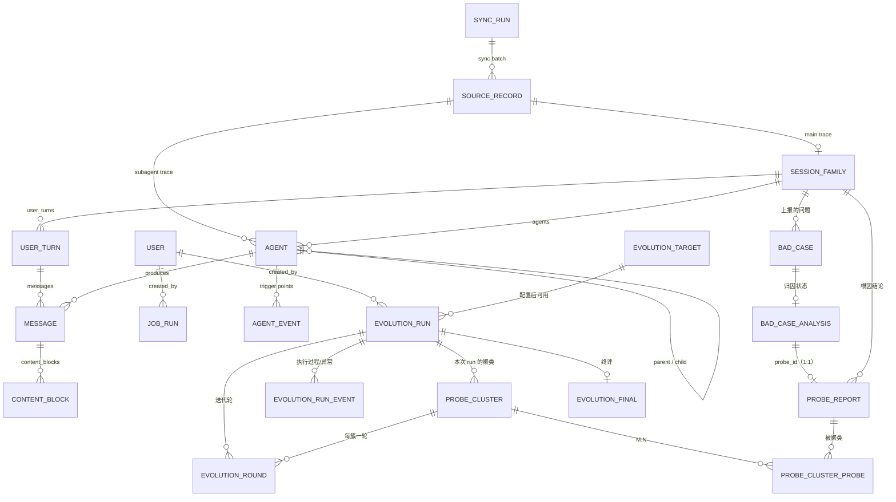

# 06 · 数据库表结构设计

> 本文回答：数据怎么存、表怎么建、索引怎么加、迁移怎么管理、哪些表由谁写入。
> 前置：[04 后端架构](04-backend-architecture.md)；配套：[05 接口设计](05-api-design.md) · [07 后端实现](07-backend-implementation.md)。
> 2026-10-22 数据模型修订：问题侧改为外部写入的 `bad_cases` + 归因结论 `probe_reports`；自进化聚类结果落 `probe_clusters`（按 run 归属）。

## 1. 存储策略与跨库约定

- **默认 MySQL 8（utf8mb4）主库**；SQLite 仅用于测试与本地开发便利。连接差异由 `Database` 接口的两个适配器吸收（[04 §4](04-backend-architecture.md)），Repository 与表结构不区分方言。
- **三类表的写入方要分清**：

| 类别 | 表 | 写入方 | 我们的权限 |
|---|---|---|---|
| 轨迹侧 | `trajectory_payloads`（外部写）、`source_records`、`session_families`、`agents`、`user_turns`、`messages`、`content_blocks`、`agent_events`、`sync_runs`、`sync_lock` | 本服务（source_records/归一化） | 读写（payload 表只读） |
| 问题侧 | `bad_cases`、`bad_case_analysis`、`probe_reports` | 外部归因/上报系统 | **只读** |
| 自进化侧 | `evolution_targets`、`evolution_runs`、`evolution_run_events`、`probe_clusters`、`probe_cluster_probes`、`evolution_rounds`、`evolution_finals` | 本服务 | 读写 |
| 通用 | `users`、`job_runs` | 本服务 | 读写 |

- **原始层与归一化层分离**：`trajectory_payloads` 存原始 JSONL（外部写入/pull），`source_records` 存处理索引（不存 payload），其余轨迹表是归一化视图；解析规则升级时按 `parser_version` 从 payload 重放。
- **问题侧只读**：`bad_cases` 等表由外部系统写入，本服务不写、不做级联删除；表结构变更需与上游一起评审。

### 1.1 逻辑类型 → 物理类型映射

下文表格的"类型"列是**逻辑类型**；落地迁移按本表映射。

| 逻辑类型 | 用途 | SQLite | MySQL 8 |
|---|---|---|---|
| ID | 主键 / 外键 | `VARCHAR(36)` / `VARCHAR(64)` | 同左 |
| 短文本 | 名称、状态、枚举、哈希、版本 | `VARCHAR(n)` | `VARCHAR(n)` |
| 长文本 | 标题、描述、提问、工具输出、原始 payload | `TEXT` / `MEDIUMTEXT` / `LONGTEXT` | `TEXT`（64KB）/ `MEDIUMTEXT`（16MB）/ `LONGTEXT`（4GB，payload 用） |
| JSON | 结构化字段（meta_data / facts / stats） | `JSON`（底层 TEXT） | `JSON` |
| 布尔 | `is_error` / `accepted` / `verdict` | `BOOLEAN`（INTEGER） | `TINYINT(1)` |
| 时间 | 时间戳 | `DATETIME`（Asia/Shanghai 本地时间） | `DATETIME(6)` |
| 计数 | 统计数字 | `INTEGER` | `INT` / `BIGINT` |
| 浮点 | 置信度 / 严重度 / 得分 | `REAL` | `DOUBLE` |
| 自增 | 关联表/事件代理主键 | `INTEGER PRIMARY KEY AUTOINCREMENT` | `BIGINT AUTO_INCREMENT` |

硬规则：

- **所有主键、外键、唯一键、索引列一律 `VARCHAR(n)`（n ≤ 255）或整数**，不用 `TEXT`——MySQL 不允许无前缀的 TEXT 主键/FK，InnoDB 索引键上限 3072 字节。
- **正文字段用 `MEDIUMTEXT`、payload 用 `LONGTEXT`**：MySQL 的 `TEXT` 只有 64KB，工具输出上限 256KB（见 §3.7）。
- JSON 列不设 server default，默认值在应用层给；表中写出的 `DEFAULT []` 是应用层默认值。
- 时间由应用写入 Asia/Shanghai（UTC+8）；不用 `NOW()`/`CURRENT_TIMESTAMP` 作为列默认值。
- 大小写不敏感搜索统一走 `session_families.search_text`（写入时 lower 拼接）。

### 1.2 切换与数据迁移

```text
本地 SQLite（测试）──► MySQL 8（生产主库）──► HE_DB_DIALECT=mysql + URL
        ──► 启动自动 alembic upgrade head
        ──► POST /api/acquisition/sync 重跑归一化
        ──► pytest -m mysql 验证
```

- **轨迹数据不写迁移脚本**：换库后重跑归一化即可（`trajectory_payloads` 仍是事实源）；问题侧数据由外部系统重新灌入。
- **问题侧数据是外部写入**：换库时由上游系统重新灌入或做一次性导入，不在本服务职责内。
- Alembic 单版本树、双方言渲染；SQLite 的 `ALTER TABLE` 限制用 `render_as_batch=True`。

### 1.3 类型约定在后文的适用方式

§3–§5 的表格沿用逻辑类型；落地按 §1.1 映射。迁移脚本是最终事实源。

### 1.4 术语约定（避免与 Claude Code 的 turn 混淆）

- `session_family`：根会话家族；API 的 `sessionId` 指向它，`root_session_id` 也指向它。
- `agent`：主 agent、子 agent 或 workflow 执行节点；`agent.id` 是全局唯一节点 id（ULID），`agent_session_id` 是该节点的会话 id（workflow 为合成 id），两者不是同一个值。
- `user_turn`：一次用户提问到下一次用户提问；**不是** Claude Code agent loop 里“模型+工具”的 tool-use turn。
- `message`：一次 assistant 模型响应（Claude 的 `message.id`）；**不是** content block。
- `content_block`：消息内的 `text` / `thinking` / `tool_use` / `tool_result` 块。
- `evolution_round`：自进化的一次迭代轮，与轨迹的 `user_turn` 无关。

## 2. ER 图



## 3. 轨迹侧表（本服务读写）

### 3.0 `trajectory_payloads` —— 原始 JSONL（外部写入，本服务只读）

> 由第三方脚本/上游接口写入；本服务**不保存第二份 payload**，只通过 `session_id` 读取。该 `session_id` 是外部契约字段，语义为**实际 agent 的 session id**，对应内部 `agents.agent_session_id`；根会话 id 另由 `root_session_id` 给出。

| 列 | 类型 | 约束 | 说明 |
|---|---|---|---|
| `session_id` | `VARCHAR(36)` | PK | 实际 agent 的 session id（主 agent 或 subagent） |
| `root_session_id` | `VARCHAR(36)` | NOT NULL | 主 agent 的 session id；同一会话的主/子 agent 相同 |
| `kind` | `VARCHAR(16)` | NOT NULL | `main` / `subagent` |
| `payload` | `LONGTEXT` | NOT NULL | 该 agent 的原始 JSONL 全文 |
| `content_hash` | `CHAR(64)` | NOT NULL | payload 哈希 |
| `line_count` | `INTEGER` | NOT NULL | 行数 |
| `source_type` | `VARCHAR(16)` | NOT NULL | `script` / `http_api` |
| `updated_at` | `DATETIME` | NOT NULL | 脚本/接口最近写入时间 |

索引：`INDEX(root_session_id)`、`INDEX(updated_at)`。

- 主 agent 行：`session_id == root_session_id`。
- 本服务只读；pull 路径由本服务写入（见 [07 §2](07-backend-implementation.md)）。

### 3.1 `source_records` —— 处理索引（不存 payload）

| 列 | 类型 | 约束 | 说明 |
|---|---|---|---|
| `id` | `BIGINT` | PK AUTOINCREMENT | 代理主键 |
| `root_session_id` | `VARCHAR(36)` | NOT NULL | 主 agent 的 session id |
| `agent_session_id` | `VARCHAR(36)` | **UNIQUE NOT NULL** | 实际 agent 的 session id；对应 `trajectory_payloads.session_id` |
| `kind` | `VARCHAR(16)` | NOT NULL | `main` / `subagent` |
| `source_type` | `VARCHAR(16)` | NOT NULL | `script` / `http_api` |
| `line_count` | `INTEGER` | NOT NULL | 行数（Agent 执行流图比例尺） |
| `received_at` | `DATETIME` | NOT NULL | 首次发现该 payload 的时间 |
| `processed_at` | `DATETIME` | NULL | 最近一次归一化完成时间；NULL = 待处理 |
| `processed_hash` | `CHAR(64)` | NULL | 已归一化时的 payload 哈希 |
| `parser_version` | `INTEGER` | NULL | 已使用的解析器版本 |
| `last_sync_run_id` | `VARCHAR(36)` | NULL FK → `sync_runs.id` | 最近一次归一化批次 |

索引：`UNIQUE(agent_session_id)`、`INDEX(root_session_id)`、`INDEX(processed_at)`、`INDEX(parser_version)`。

**待处理判定**：`processed_hash IS NULL`，或 `processed_hash != trajectory_payloads.content_hash`，或 `parser_version < 当前解析器版本`。

**幂等规则**：hash 未变且解析器版本未升级 → 跳过；hash 变化 → 事务内删除该记录派生的行并重放；payload 侧删除 → 保留业务数据并记日志（首版不级联删除）。

### 3.2 `session_families` —— 根会话（列表与会话概览的读模型）

| 列 | 类型 | 约束 | 说明 |
|---|---|---|---|
| `id` | `VARCHAR(36)` | PK | 根会话 id |
| `short_title` | `VARCHAR(255)` | NOT NULL | 列表卡标题 |
| `title` | `TEXT` | NOT NULL | 完整标题 |
| `search_text` | `VARCHAR(512)` | NOT NULL | `lower(title + repo)`，搜索用 |
| `repo_name` | `VARCHAR(255)` | NOT NULL | 仓库名 |
| `project_path` | `TEXT` | NOT NULL | 项目路径 |
| `model` | `VARCHAR(64)` | NULL | 主 agent 模型 |
| `models` | `JSON` | NOT NULL | 整棵 Agent 会话树去重后的模型列表（含子 agent） |
| `started_at` / `ended_at` | `DATETIME` | NOT NULL | 首末事件时间（Asia/Shanghai） |
| `duration_seconds` | `INTEGER` | NOT NULL | 真实跨度 |
| `status` | `VARCHAR(16)` | NOT NULL | `ok` / `partial` / `fail`（规则见 §7.2） |
| `skill_names` | `JSON` | NOT NULL | 递归聚合的 skill 名 |
| `user_turns_count` / `messages_count` / `tools_count` / `errors_count` / `agents_count` | `INTEGER` | NOT NULL | 冗余聚合 |
| `bad_cases_count` | `INTEGER` | NOT NULL | 该会话问题数（同步时由问题侧表回填或查询时聚合） |
| `tokens_total` | `BIGINT` | NOT NULL | 整棵 Agent 会话树 token |
| `source_type` | `VARCHAR(16)` | NOT NULL | `script` / `http_api` |
| `main_record_id` | `BIGINT` | FK → `source_records.id` | 主 agent 的处理记录 |
| `imported_at` / `updated_at` | `DATETIME` | NOT NULL | — |

索引：`INDEX(started_at DESC)`、`INDEX(status)`、`INDEX(repo_name)`。

> `bad_cases_count` 来自问题侧（外部写入），同步轨迹时不能算；实现上在查询时 `LEFT JOIN` 聚合，或由定时任务刷新（见 [07 §3](07-backend-implementation.md)）。

### 3.3 `agents` —— Agent 节点（main / subagent / workflow）

| 列 | 类型 | 约束 | 说明 |
|---|---|---|---|
| `id` | `VARCHAR(64)` | PK | 全局唯一节点 id（ULID）；`kind` 区分 main/subagent/workflow |
| `root_session_id` | `VARCHAR(36)` | FK → `session_families.id` ON DELETE CASCADE | 根会话 |
| `agent_session_id` | `VARCHAR(36)` | **UNIQUE NOT NULL** | 该节点的 session id；workflow 用合成 id（如 `wf_...`），没有独立 transcript |
| `parent_agent_id` | `VARCHAR(64)` | FK → `agents.id` NULL | 根为 NULL；workflow-subagent 指向 workflow |
| `kind` | `VARCHAR(16)` | NOT NULL | `main` / `subagent` / `workflow` |
| `agent_type` | `VARCHAR(64)` | NULL | `general-purpose` / `Explore` / `workflow` / `workflow-subagent` |
| `model` | `VARCHAR(64)` | NULL | 该 agent 使用的模型；主/子 agent 可不同 |
| `description` | `TEXT` | NULL | 触发它的 Agent 调用描述 |
| `tool_use_id` | `VARCHAR(128)` | NULL | 父会话里触发该节点的调用 id；workflow 填父 workflow 调用，workflow-subagent 可为 NULL |
| `transcript_record_id` | `BIGINT` | FK → `source_records.id` NULL | 子转录处理记录；workflow 无独立转录时为 NULL |
| `lines` | `INTEGER` | NOT NULL | 转录行数（Agent 执行流图条宽）；workflow 为 0 |
| `messages_count` | `INTEGER` | NOT NULL | 该节点自己的 assistant message 数；用于 `×N` 间隔计算 |
| `depth` | `INTEGER` | NOT NULL | 根=0 |
| `sort_key` | `DOUBLE` | NOT NULL | 树内排序 |

索引：`INDEX(root_session_id)`、`INDEX(parent_agent_id)`、`UNIQUE(agent_session_id)`、`INDEX(model)`。

### 3.4 `agent_events` —— Agent 会话树触发点

| 列 | 类型 | 约束 | 说明 |
|---|---|---|---|
| `id` | BIGINT | PK AUTOINCREMENT | — |
| `agent_id` | `VARCHAR(64)` | FK → `agents.id` ON DELETE CASCADE | — |
| `event_index` | `INTEGER` | NOT NULL | agent 内顺序 |
| `line_no` | `INTEGER` | NOT NULL | 转录行号 |
| `message_offset` | `INTEGER` | NOT NULL | 该触发点之前已经出现的 assistant message 数 |
| `kind` | `VARCHAR(16)` | NOT NULL | `skill` / `agent` / `workflow` |
| `name` | `VARCHAR(255)` | NULL | 触发对象名：skill 名 / agent 类型 / workflow 名 |
| `description` | `TEXT` | NULL | 子 agent / workflow 描述 |
| `tool_use_id` | `VARCHAR(128)` | NULL | 触发调用 id |

索引：`UNIQUE(agent_id, event_index)`、`INDEX(agent_id, line_no)`、`INDEX(agent_id, message_offset)`。

### 3.5 `user_turns` —— 用户提问轮（一次用户提问到下一次提问）

| 列 | 类型 | 约束 | 说明 |
|---|---|---|---|
| `id` | `VARCHAR(36)` | PK | ULID |
| `root_session_id` | `VARCHAR(36)` | FK → `session_families.id` ON DELETE CASCADE | 所属根会话 |
| `seq` | `INTEGER` | NOT NULL | 用户轮次顺序，从 1 开始 |
| `prompt_text` | `TEXT` | NOT NULL | 该轮首个真实用户提问 |
| `started_at` | `DATETIME` | NOT NULL | 该轮开始时间 |
| `duration_seconds` | `INTEGER` | NOT NULL | 该轮跨度 |
| `tokens` | `BIGINT` | NOT NULL | 该轮 token 总量 |
| `message_count` | `INTEGER` | NOT NULL | 该轮内 assistant 消息数 |
| `tool_count` | `INTEGER` | NOT NULL | 工具调用数 |
| `agent_count` | `INTEGER` | NOT NULL | 参与的 agent 数（含子 agent） |
| `meta` | `JSON` | NULL | 解析器附加信息 |

索引：`UNIQUE(root_session_id, seq)`、`INDEX(root_session_id, started_at)`。

### 3.6 `messages` —— assistant 消息（一次模型响应）

| 列 | 类型 | 约束 | 说明 |
|---|---|---|---|
| `id` | `VARCHAR(36)` | PK | 本服务内部消息 id |
| `user_turn_id` | `VARCHAR(36)` | FK → `user_turns.id` ON DELETE CASCADE | 所属用户轮次 |
| `agent_id` | `VARCHAR(64)` | FK → `agents.id` ON DELETE CASCADE | 产生该消息的 agent |
| `seq` | `INTEGER` | NOT NULL | 该 agent 在轮次内的消息顺序 |
| `provider_message_id` | `VARCHAR(128)` | NULL | Claude/Anthropic 的 `message.id` |
| `started_at` | `DATETIME` | NOT NULL | 消息开始时间 |
| `model` | `VARCHAR(64)` | NULL | 本次响应使用的模型 |
| `tokens` | `BIGINT` | NOT NULL | 该消息 token 数 |

索引：`UNIQUE(user_turn_id, agent_id, seq)`、`INDEX(agent_id, started_at)`、`INDEX(provider_message_id)`。

### 3.7 `content_blocks` —— 消息内容块

| 列 | 类型 | 约束 | 说明 |
|---|---|---|---|
| `id` | `BIGINT` | PK AUTOINCREMENT | — |
| `message_id` | `VARCHAR(36)` | FK → `messages.id` ON DELETE CASCADE | 所属消息 |
| `seq` | `INTEGER` | NOT NULL | 块内顺序 |
| `kind` | `VARCHAR(16)` | NOT NULL | `text` / `thinking` / `tool_use` / `tool_result` |
| `name` | `VARCHAR(128)` | NULL | 工具名 |
| `call_id` | `VARCHAR(128)` | NULL | tool_use / tool_result 配对 id |
| `input_text` | `MEDIUMTEXT` | NULL | 工具输入或块文本 |
| `result_text` | `MEDIUMTEXT` | NULL | 工具结果 |
| `is_error` | `BOOLEAN` | NOT NULL DEFAULT false | 工具/块错误标记 |
| `subagent_agent_id` | `VARCHAR(64)` | FK → `agents.id` NULL | 若该块触发子 agent，记录目标 agent |

索引：`UNIQUE(message_id, seq)`、`INDEX(call_id)`、`INDEX(subagent_agent_id)`。

### 3.8 `sync_runs` —— 归一化批次

| 列 | 类型 | 说明 |
|---|---|---|
| `id` | `VARCHAR(36)` PK | ULID |
| `source_type` | `VARCHAR(16)` | `script` / `http_api` |
| `started_at` / `finished_at` | DATETIME | — |
| `status` | `VARCHAR(16)` | `running` / `completed` / `failed` / `interrupted` |
| `records_total` / `records_done` | INTEGER | 进度 |
| `imported` / `skipped` | INTEGER | 统计 |
| `errors` | JSON | `[{sessionId, message}]` |

### 3.9 `sync_state`（已取消）

不再维护水位线：待处理状态由 `source_records.processed_hash / parser_version` 表达，扫描 `trajectory_payloads` 与 `source_records` 的差异即可。

### 3.9.1 `sync_lock` —— 单飞锁（禁止并发同步）

| 列 | 类型 | 说明 |
|---|---|---|
| `name` | `VARCHAR(32)` PK | 固定 `sync` |
| `job_id` | `VARCHAR(36)` | 当前持有锁的 `job_runs.id` |
| `owner` | `VARCHAR(64)` | 实例 id（多实例排查用） |
| `acquired_at` | `DATETIME` | 获取时间 |
| `expires_at` | `DATETIME` | TTL（30 分钟）；崩溃后可回收 |

- 获取：`INSERT INTO sync_lock(name, job_id, owner, acquired_at, expires_at) VALUES ('sync', …)`；主键冲突 = 已有任务。
- 释放：任务完成/失败时 `DELETE WHERE name='sync' AND job_id=:job_id`。
- scheduler 与 `POST /acquisition/sync` 共用此锁；拿不到锁时返回正在执行的 `jobId`，不重复入队。
- V1 单实例再加进程内 `asyncio.Lock`；多实例依赖此表（或 MySQL `GET_LOCK`）。

### 3.10 `users` —— 用户（单组织共享）

| 列 | 类型 | 说明 |
|---|---|---|
| `id` | `VARCHAR(36)` PK | ULID |
| `username` | `VARCHAR(64)` UNIQUE | 小写登录名 |
| `password_hash` | `VARCHAR(255)` | argon2id |
| `display_name` | `VARCHAR(128)` | — |
| `role` | `VARCHAR(16)` | `admin` / `member` |
| `is_active` | BOOLEAN | 停用即拒绝登录 |
| `created_at` / `last_login_at` | DATETIME | — |

### 3.11 `job_runs` —— 统一任务表

| 列 | 类型 | 说明 |
|---|---|---|
| `id` | `VARCHAR(36)` PK | ULID |
| `kind` | `VARCHAR(32)` | `sync` / `pull` / `evolution_prepare` / `evolution_advance` / `evolution_apply` / `evolution_finalize` / `evolution_retry` |
| `ref_id` | `VARCHAR(64)` NULL | 关联的 `sync_runs.id` / `evolution_runs.id` |
| `status` | `VARCHAR(16)` | `queued` / `running` / `completed` / `failed` / `interrupted` |
| `progress` | `DOUBLE` | 0..1 |
| `executor` | `VARCHAR(16)` | `local` / `ci`（V1 恒 local） |
| `external_job_id` | `VARCHAR(128)` NULL | 未来 CI 平台任务 id |
| `attempt` | `INTEGER` | 重试次数 |
| `payload` / `result` | JSON | 入参 / 结果摘要 |
| `error` | `TEXT` | 失败原因 |
| `created_by` | `VARCHAR(36)` NULL | FK → `users.id` |
| `created_at` / `started_at` / `finished_at` / `updated_at` | DATETIME | — |

索引：`INDEX(status)`、`INDEX(kind, created_at DESC)`、`INDEX(ref_id)`。

## 4. 问题侧表（外部写入，本服务只读）

### 4.1 `bad_cases` —— 上报的问题（症状）

| 列 | 类型 | 约束 | 说明 |
|---|---|---|---|
| `bad_case_id` | `VARCHAR(64)` | PK | 外部生成的稳定 id |
| `session_id` | `VARCHAR(36)` | NOT NULL | 所属根会话 |
| `bad_case_type` | `VARCHAR(16)` | NOT NULL | `self` / `discovery` |
| `object_name` | `VARCHAR(128)` | NOT NULL | 上报/发现问题的 skill 或 agent 名 |
| `object_type` | `VARCHAR(16)` | NOT NULL | `skill` / `agent` |
| `object_version` | `VARCHAR(64)` | NULL | 上报者版本 |
| `bad_case_agent_session_id` | `VARCHAR(36)` | NOT NULL | 该对象所在 agent 的 session id（树锚点） |
| `reason` | `TEXT` | NOT NULL | 原型文案（直接展示） |
| `meta_data` | `JSON` | NULL | 上报打点数据，结构不统一 |
| `source` | `VARCHAR(64)` | NULL | 来源系统/任务标识 |
| `created_at` / `updated_at` | `DATETIME` | NOT NULL | — |

索引：`INDEX(session_id)`、`INDEX(bad_case_agent_session_id)`、`INDEX(object_type, object_name, object_version)`。

> `object_*` 只表示**谁上报/发现了问题**，不是根因；根因在 `probe_reports`。
> `session_id` 是外部契约字段，语义为**根会话 id**，对应内部 `session_families.id`；`bad_case_agent_session_id` 才是实际 agent 的 session id，仅用于服务端计算问题卡 `anchor`，不在 API 中直接暴露。

### 4.2 `bad_case_analysis` —— 归因状态（关联表）

| 列 | 类型 | 约束 | 说明 |
|---|---|---|---|
| `id` | BIGINT | PK AUTOINCREMENT | — |
| `bad_case_id` | `VARCHAR(64)` | **UNIQUE** FK → `bad_cases.bad_case_id` | 一条问题一行 |
| `analysis_status` | `VARCHAR(32)` | NOT NULL | `unanalyzed` / `analyzed_nonissue` / `analyzed_issue` |
| `probe_id` | `VARCHAR(64)` | NULL FK → `probe_reports.probe_id` | 仅 `analyzed_issue` 非空 |
| `analysis_result` | `JSON` | NULL | 展示快照：非问题 `{reason}`；问题 `{summary}` |
| `updated_at` | `DATETIME` | NOT NULL | — |

索引：`UNIQUE(bad_case_id)`、`INDEX(probe_id)`、`INDEX(analysis_status)`。

应用层约束（不依赖 DB CHECK，保证双库一致）：

- `analyzed_issue` → `probe_id` 必填；`analyzed_nonissue` / `unanalyzed` → `probe_id` 必须为空；
- 一条 bad_case 最多一条 probe（1:1），`probe_reports` 不存 `bad_case_id`。

### 4.3 `probe_reports` —— 归因报告（根因）

| 列 | 类型 | 约束 | 说明 |
|---|---|---|---|
| `probe_id` | `VARCHAR(64)` | PK | 外部生成 |
| `session_id` | `VARCHAR(36)` | NOT NULL | 所属根会话 |
| `probe_type` | `VARCHAR(16)` | NOT NULL | `skill` / `agent` |
| `probe_object` | `VARCHAR(128)` | NOT NULL | **真正有问题的对象**（自进化 target） |
| `object_version` | `VARCHAR(64)` | NULL | 有问题的版本 |
| `attribute_type` | `VARCHAR(16)` | NOT NULL | `model` / `prompt` / `error` |
| `probe_description` | `TEXT` | NOT NULL | 归因出的问题描述 |
| `probe_analysis` | `TEXT` | NOT NULL | 推导过程（UI 辅助校验） |
| `created_at` / `updated_at` | `DATETIME` | NOT NULL | — |

索引：`INDEX(session_id)`、`INDEX(probe_type, probe_object, object_version)`、`INDEX(attribute_type)`。

`from_bad_cases` / `from_bad_cases_count` **不落列**：查 probe 时由 `bad_case_analysis.probe_id` 反查（V1 恒 1 条；后续聚类不影响该关系）。`session_id` 同样是外部契约的根会话 id，对应 `session_families.id`。

## 5. 自进化侧表（本服务读写）

### 5.1 `evolution_targets` —— 可自进化的对象配置

> 只有在这张表里配置且 `enabled=true` 的 skill/agent 才能进入自进化流程；向导的"对象/版本"下拉与配置页都读这张表。

| 列 | 类型 | 约束 | 说明 |
|---|---|---|---|
| `id` | `VARCHAR(36)` | PK | ULID |
| `object_type` | `VARCHAR(16)` | NOT NULL | `skill` / `agent` |
| `object_name` | `VARCHAR(128)` | NOT NULL | 对象名（如 `deep-research`） |
| `repo_url` | `VARCHAR(1024)` | NOT NULL | 远端 git 仓库地址（https/ssh；不含凭据） |
| `sub_dir` | `VARCHAR(512)` | NOT NULL | 对象目录相对仓库根（如 `skills/deep-research`） |
| `default_ref` | `VARCHAR(128)` | NOT NULL | 默认基线分支或 tag（如 `main` / `v2.0.0`） |
| `enabled` | BOOLEAN | NOT NULL DEFAULT true | 关闭后不进入向导候选 |
| `created_by` | `VARCHAR(36)` | NULL | FK → `users.id` |
| `created_at` / `updated_at` | `DATETIME` | NOT NULL | — |

约束：`UNIQUE(object_type, object_name)`；索引：`INDEX(enabled)`。

### 5.2 `evolution_runs`

| 列 | 类型 | 说明 |
|---|---|---|
| `id` | `VARCHAR(36)` PK | `evo-…` |
| `title` | `VARCHAR(255)` | — |
| `mode` | `VARCHAR(16)` | `full`（完整自进化）/ `cluster_only`（仅聚类预览） |
| `target_config_id` | `VARCHAR(36)` | FK → `evolution_targets.id` |
| `target_type` | `VARCHAR(16)` | `skill` / `agent`（来自 probe） |
| `target_name` | `VARCHAR(128)` | `probe_object` |
| `target_version` | `VARCHAR(64)` | 本次使用的 tag/版本 |
| `repo_url` | `VARCHAR(1024)` | 本次 run 使用的远端仓库地址 |
| `repo_path` | `VARCHAR(1024)` | 运行时本地快照/缓存的仓库路径 |
| `base_ref` | `VARCHAR(128)` | clone 的 tag/branch |
| `base_commit` | `CHAR(40)` | 解析后的基线 commit |
| `branch_name` | `VARCHAR(128)` | `evo/{YYYYMMDD}-{run_id}`（含日期与 runId） |
| `workspace_path` | `VARCHAR(1024)` | 本次 run 的独立工作区 |
| `remote_name` | `VARCHAR(64)` | 默认 `origin` |
| `push_status` | `VARCHAR(16)` | 最近一次 push 的聚合状态：`pending` / `pushing` / `succeeded` / `failed` / `skipped` |
| `pushed_at` | `DATETIME` | 最近一次 push 成功时间 |
| `push_error` | `TEXT` | 最近一次 push 失败原因（脱敏 stderr 摘要） |
| `window_from` / `window_to` | DATE | session 启动时间窗 |
| `models` | JSON | 模型多选 |
| `status` | `VARCHAR(16)` | `preparing` / `running` / `blocked` / `completed` / `failed` / `interrupted` |
| `blocked_stage` | `VARCHAR(16)` NULL | `push` / `eval`；仅 `status=blocked` 时非空 |
| `retry_attempts` | `INTEGER` | 自动退避重试已执行次数（0..3） |
| `next_retry_at` | `DATETIME` NULL | 下一次自动退避时间；NULL = 不再自动重试 |
| `eval_status` | `VARCHAR(16)` | 最近一轮评测聚合：`pending` / `evaluating` / `completed` / `failed` / `timeout` |
| `error_stage` | `VARCHAR(32)` NULL | 失败阶段：`prepare` / `clone` / `cluster` / `eval` / `commit` / `push` / `apply` |
| `error_message` | `TEXT` NULL | 失败摘要（脱敏，供列表/详情头部展示） |
| `error_at` | `DATETIME` NULL | 失败发生时间 |
| `progress_unit` | `INTEGER` | 状态机游标（[07 §5](07-backend-implementation.md)） |
| `stats` | JSON | 命中 session / probe / 簇数等 |
| `created_by` | `VARCHAR(36)` NULL | FK → `users.id` |
| `created_at` / `finished_at` | DATETIME | — |

索引：`INDEX(created_at DESC)`、`INDEX(status)`、`INDEX(push_status)`、`INDEX(status, next_retry_at)`、`INDEX(target_type, target_name, target_version)`、`INDEX(target_config_id)`。

### 5.3 `probe_clusters` —— 本次 run 的聚类结果

| 列 | 类型 | 说明 |
|---|---|---|
| `probe_cluster_id` | `VARCHAR(64)` PK | 外部/本服务生成 |
| `run_id` | `VARCHAR(36)` FK → `evolution_runs.id` | **按 run 归属** |
| `seq` | `INTEGER` | 排序（严重程度降序） |
| `probe_cluster_description` | `TEXT` | 簇描述（V1 占位文案） |
| `probe_cluster_type` | `VARCHAR(16)` | `model` / `prompt` / `error` |
| `created_at` | DATETIME | — |

索引：`UNIQUE(run_id, seq)`、`INDEX(run_id)`。

### 5.4 `probe_cluster_probes` —— 簇 ↔ probe 多对多

| 列 | 类型 | 说明 |
|---|---|---|
| `id` | BIGINT PK AUTOINCREMENT | — |
| `probe_cluster_id` | `VARCHAR(64)` FK | — |
| `probe_id` | `VARCHAR(64)` FK | — |

约束：`UNIQUE(probe_cluster_id, probe_id)`；索引：`INDEX(probe_id)`。

### 5.5 `evolution_rounds` —— 每簇的迭代轮

| 列 | 类型 | 说明 |
|---|---|---|
| `id` | `VARCHAR(36)` PK | — |
| `run_id` | `VARCHAR(36)` FK | — |
| `probe_cluster_id` | `VARCHAR(64)` FK | 该轮针对的簇 |
| `seq` | `INTEGER` | 第几轮 |
| `status` | `VARCHAR(16)` | `pending` / `pushing` / `evaluating` / `applying` / `accepted` / `rejected` / `failed` |
| `started_at` / `finished_at` | DATETIME NULL | 本轮开始/结束 |
| `duration_ms` | `INTEGER` NULL | 耗时（毫秒） |
| `error_message` | `TEXT` NULL | 本轮失败原因（脱敏）；`status=failed` 时非空 |
| `patch` | JSON | `{file, lines[]}`（占位内容，真实落盘） |
| `candidate_ref` | `VARCHAR(255)` | 本轮评测用的远端临时分支，如 `evo/.../candidate/r1` |
| `candidate_commit` | `CHAR(40)` NULL | candidate commit SHA（评测对象） |
| `candidate_message` | `TEXT` NULL | candidate commit message |
| `push_status` | `VARCHAR(16)` | `pending` / `pushing` / `succeeded` / `failed` |
| `push_attempts` | `INTEGER` | 本轮 push 已尝试次数（含立即重试与退避） |
| `pushed_at` / `push_error` | DATETIME NULL / TEXT NULL | 最近成功时间 / 脱敏失败原因 |
| `eval_external_id` | `VARCHAR(128)` NULL | 评测平台返回的 evalId |
| `eval_status` | `VARCHAR(16)` | `pending` / `evaluating` / `completed` / `failed` / `timeout` |
| `eval_attempts` | `INTEGER` | 提交评测次数 |
| `eval_next_poll_at` | DATETIME NULL | 下一次轮询评测状态的时间 |
| `eval_started_at` / `eval_finished_at` | DATETIME NULL | 评测起止 |
| `eval_current` / `eval_candidate` | DOUBLE | 评测分（V1 占位） |
| `eval_result` | JSON NULL | 评测平台返回的规范化结果 + 原始 payload |
| `eval_error` | `TEXT` NULL | 评测失败/超时摘要（脱敏） |
| `accepted` | BOOLEAN | — |
| `commit_hash` / `commit_message` | `VARCHAR(40)` / `TEXT` | 接纳后的最终 commit（amend 后）；拒绝时清空 |

索引：`UNIQUE(run_id, seq)`、`INDEX(probe_cluster_id)`、`INDEX(run_id, status)`、`INDEX(eval_status, eval_next_poll_at)`。

### 5.6 `evolution_finals`

`run_id` PK、`best_version`、`verdict`、`best_score`、`init_score`、`metrics` JSON。

### 5.7 `evolution_run_events` —— 执行过程与异常（追加）

> 自进化的**过程数据源**：每次状态变化、candidate、评测、推送、异常都落一行；Web UI 通过 API 读它，不依赖 SSE 历史。

| 列 | 类型 | 约束 | 说明 |
|---|---|---|---|
| `id` | BIGINT PK AUTOINCREMENT | — | 代理主键 |
| `run_id` | `VARCHAR(36)` | FK → `evolution_runs.id` | — |
| `seq` | `INTEGER` | NOT NULL | run 内单调递增，从 1 开始 |
| `event_type` | `VARCHAR(48)` | NOT NULL | 见下表 |
| `level` | `VARCHAR(8)` | NOT NULL | `info` / `warn` / `error` |
| `stage` | `VARCHAR(32)` | NOT NULL | `prepare` / `cluster` / `step` / `candidate` / `push` / `eval` / `apply` / `final` |
| `step_index` | `INTEGER` NULL | — | 对应六步的 step（0–5） |
| `cluster_id` | `VARCHAR(64)` NULL | — | 关联 `probe_clusters` |
| `evolution_round_id` | `VARCHAR(36)` NULL | — | 关联 `evolution_rounds` |
| `job_id` | `VARCHAR(36)` NULL | — | 关联 `job_runs` |
| `message` | `VARCHAR(512)` | NOT NULL | 人可读摘要 |
| `payload` | JSON NULL | — | 执行信息（commit、eval、push、文件、耗时等） |
| `error_type` | `VARCHAR(128)` NULL | — | 异常类名/错误码 |
| `error_message` | `TEXT` NULL | — | 脱敏错误消息 |
| `error_detail` | `TEXT` NULL | — | 脱敏后的堆栈/命令输出，截断 8KB |
| `created_at` | `DATETIME` | NOT NULL | 事件时间 |

约束：`UNIQUE(run_id, seq)`；索引：`INDEX(run_id, created_at)`、`INDEX(event_type)`、`INDEX(level)`、`INDEX(cluster_id)`。

**event_type 取值**：

| 类别 | 事件 |
|---|---|
| 生命周期 | `run_created`、`prepare_started`、`workspace_prepared`、`clusters_created`、`step_advanced`、`run_blocked`、`run_resumed`、`final_completed`、`run_failed`、`run_interrupted` |
| 迭代 | `candidate_committed`、`candidate_pushed`、`eval_submitted`、`eval_polled`、`eval_completed`、`eval_failed`、`eval_timeout`、`cluster_accepted`、`cluster_rejected` |
| 推送 | `push_started`、`push_retry_scheduled`、`push_succeeded`、`push_failed` |

- `payload` 示例：candidate `{commit, patchHash, files[], durationMs}`；eval `{current, candidate, delta, verdict}`；push `{remote, branch, commit}`；error `{stage, command, exitCode}`。
- **异常必须落库**：任何未捕获异常在 job 边界记录 `run_failed`，并更新 `evolution_runs.status=failed` / `error_*`；进程重启导致的残留任务记录 `run_interrupted`。
- 保留策略：随 run 保留；`app/cli.py clean-runs --keep N` 级联删除事件。

## 6. 索引与容量估算

| 表 | 量级（单组织） | 说明 |
|---|---|---|
| `trajectory_payloads` | 10³–10⁴ | 每个 agent 一行；payload 占主要体积（外部写） |
| `source_records` | 10³–10⁴ | 每个 agent 一行；处理索引，不存 payload |
| `session_families` | 10³ | — |
| `agents` | 10⁴ | 单会话最多几十个子 agent |
| `agent_events` | 10⁴ | — |
| `user_turns` / `messages` / `content_blocks` | 10⁵–10⁶ | 内部统计与证据 |
| `bad_cases` | 10³–10⁴ | 外部写入 |
| `probe_reports` | 10³–10⁴ | 与 bad_case 1:1 |
| `evolution_targets` | 10¹–10² | 每个可进化 skill/agent 一行 |
| `evolution_runs` | 10² | — |
| `evolution_run_events` | 每 run 数十–数百条 | 执行过程与异常；随 run 清理 |
| `probe_clusters` | 每次 run 数条–数十条 | 按 run 归属，可随 run 清理 |
| `job_runs` | 10³ | 任务审计 |
| `sync_lock` | 1 | 单飞锁，固定一行 |

`trajectory_payloads.payload` 使该表成为最大表，按"外部写、本服务只读"设计；查询只走归一化表与问题侧表。

## 7. 数据口径

### 7.1 用户轮次/消息与 Agent 会话树派生（Claude Code JSONL）

| 事实 | 规则 |
|---|---|
| 没有 user turn 字段 | 用户轮次边界 = `type=user` 且不含 `tool_result`、不是 skill 注入、不是中断、不是命令回显 |
| 工具结果内联在 user 记录 | 按 `tool_use_id` 回填到对应工具块，不切用户轮次 |
| 元记录 | 不进查询视图；attachment 的 SessionStart hook 只作诊断线索 |
| assistant 记录带 `message.id` 与 usage | 消息 = `message.id`；token 聚合到用户轮次与消息 |
| 子 agent 有独立 session id | `trajectory_payloads` 按 `session_id` 给出；缺父子关系时按 `parent_tool_use_id` 回退 |
| 会话跨多天 | 存储绝对时刻，不假设连续时长 |

### 7.2 状态规则

- `fail`：最后一条 assistant 记录缺失或存在未恢复的致命错误。
- `partial`：存在 `is_error=true` 的工具块。
- `ok`：无错误块且正常结束。

### 7.3 密度口径

`failPer100Messages = errors_count / messages_count * 100`，`badCasesPer100Messages = bad_cases_count / messages_count * 100`，1 位小数；两条线共用 3/百消息满格。

### 7.4 问题侧口径

- `bad_case.bad_case_agent_session_id` 必须能在 `agents.agent_session_id` 找到；找不到时 UI 降级挂到根节点并告警（不阻塞展示）。
- `analysis_status` 与 `probe_id` 的一致性由上游保证，本服务查询时做防御性校验（不一致时按 `unanalyzed` 展示并记日志）。
- `probe.attribute_type` 决定展示子状态（模型/prompt/错误）；`probe_object@object_version` 是自进化 target 的唯一来源。

## 8. 与功能点的映射

| 功能点 | 用到的主要表 | 读写 |
|---|---|---|
| F3 Session 列表 | `session_families` + `bad_cases`（计数） | 读 |
| F4 会话概览 | `session_families` | 读 |
| F5 Agent 执行流图 | `agents`、`agent_events`、`bad_cases`、`bad_case_analysis` | 读 |
| F6 会话内问题列表 | `bad_cases`、`bad_case_analysis` | 只读 |
| F7 时间线（已裁撤） | `user_turns`、`messages`、`content_blocks` 仅内部使用 | 不读接口 |
| F8 错误详情与归因 | `bad_cases`、`bad_case_analysis`、`probe_reports` | 只读 |
| F9 轨迹接入与归一化 | `trajectory_payloads`（只读）、`source_records`、`sync_runs`、`sync_lock` + 轨迹业务表 | 读写（payload 只读） |
| F10–F13 自进化 | `evolution_targets`、`probe_reports`、`probe_clusters`、`probe_cluster_probes`、`evolution_*` | 写/读 |
| F19 进化对象配置 | `evolution_targets` | 写/读 |
| F20 执行日志与异常 | `evolution_run_events`、`evolution_runs.error_*`、`evolution_rounds.error_*` | 写/读 |
| F14 进度推送 | `job_runs`、`evolution_rounds.eval_next_poll_at` | 写/读 |
| F15 对象/模型清单 | `evolution_targets`（对象/版本）、`agents.model`（模型去重） | 读 |
| F18 登录与鉴权 | `users` | 读/写 |
