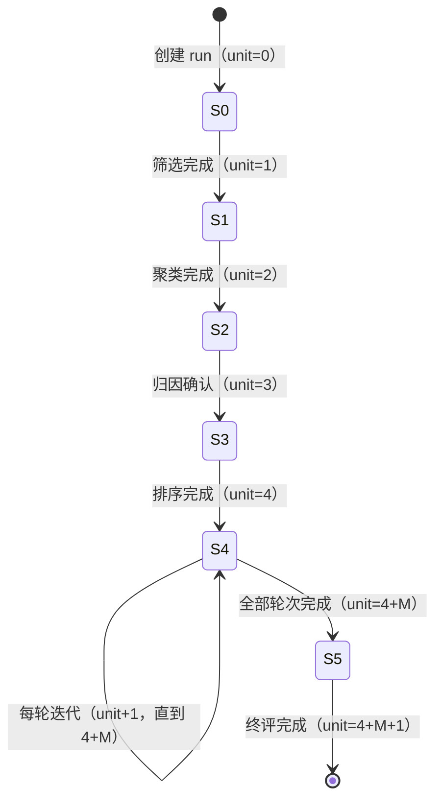

# 07 · 后端接口的实现设计

> 本文回答：每个功能域的路由、服务、外部数据接入、任务具体怎么写，状态机怎么推，同步怎么保证幂等。
> 前置：[04 后端架构](04-backend-architecture.md) · [05 接口设计](05-api-design.md) · [06 数据库设计](06-database-design.md)。
> 阅读方式：按 §2–§7 的域顺序即可；每个域都给出"职责划分 → 关键流程 → 伪代码/结构 → 测试点"。

## 1. 应用组装（`app/main.py`）

```python
def create_app(settings: Settings) -> FastAPI:
    app = FastAPI(title="harness-evolution-api", version=settings.version)
    app.add_middleware(RequestContextMiddleware)      # request_id + principal 占位
    register_exception_handlers(app)                  # AppError → 统一错误响应
    app.add_middleware(CORSMiddleware, allow_origins=settings.cors_origins)
    include_routers(app)                              # 唯一的路由注册点
    app.router.lifespan_context = lifespan(settings)  # 迁移、残留任务清理、DB 健康检查
    return app
```

`lifespan` 里做五件事（顺序固定）：

1. `database.start()`：按 `HE_DB_DIALECT` 建 engine（SQLite 加 PRAGMA / MySQL 建连接池），做一次连通性检查；失败不阻塞进程启动，由 `/api/health` 暴露 `db.ok=false`。
2. `alembic upgrade head`（幂等，空库建全表）。
3. 把 `job_runs.status = running` 的残留任务标记为 `interrupted`——避免重启后前端永远转圈。
4. 校验数据接入配置（`trajectory_payloads` 表名、上游地址；缺失只告警不阻塞）。
5. `users` 为空且配置了 `HE_ADMIN_USERNAME`/`HE_ADMIN_PASSWORD` → 播种初始管理员（幂等）。

## 2. 原始轨迹接入与归一化（`service/acquisition`）

**边界（2026-10-23）**：

- 第三方脚本只负责把有问题的 session 轨迹写进 MySQL 的 `trajectory_payloads`（每个 agent 一行，JSONL 原文）。
- 本服务**不再扫描 `he_src_*` 源表、不存第二份 payload**；`source_records` 只是处理索引，通过 `session_id` 关联 payload。
- 上游接口 pull 仍保留：拉到 payload 后先 upsert 到 `trajectory_payloads`，再走同一条归一化管线。

### 2.1 职责划分

| 文件 | 职责 |
|---|---|
| `payloads.py` | 读 `trajectory_payloads`；pull 时 upsert payload；按 `session_id` 取原文 |
| `normalize.py` | JSONL 行数组 → 轮次/步骤/块/token/元记录/家族树触发点 |
| `family.py` | 子转录与主会话关联（`toolUseId` → 父触发点），组装成员树与 `member_events` |
| `service.py` | 找出待处理 payload → 逐条归一化 → 幂等写业务表 → 更新 `source_records.processed_*`；发 SSE |
| `scheduler.py` | 每 `HE_SYNC_INTERVAL_SECONDS` 检查 pending；抢 `sync_lock` 后提交 `sync` 任务；与手动触发共用锁 |
| `router.py` | `POST /api/acquisition/sync`、`POST /api/acquisition/pull`、`GET /api/acquisition/status` |

### 2.2 待处理判定（无水位线）

```sql
SELECT tp.*
FROM trajectory_payloads tp
LEFT JOIN source_records sr ON sr.session_id = tp.session_id
WHERE sr.id IS NULL
   OR sr.processed_hash IS NULL
   OR sr.processed_hash <> tp.content_hash
   OR sr.parser_version < :current_parser_version
ORDER BY tp.updated_at
```

判定：

| 条件 | 动作 |
|---|---|
| `source_records` 无该 `session_id` | 插入处理索引，归一化并写业务表 |
| `processed_hash = content_hash` 且 `parser_version` 相同 | 跳过（累加 `skipped`） |
| hash 不同 | 删除该 session 派生的行（`blocks→steps→rounds→member_events→members`），重新归一化 |
| 解析器版本升级 | 即使 hash 相同也重放 |
| payload 侧删除 | 首版保留业务数据并记日志（不级联删除） |

- 不再维护 `sync_state.watermark`；`source_records` 的 `processed_hash/parser_version` 就是游标。
- `semantics`：一个 agent 一行；`root_session_id` 相同即同一会话家族。

### 2.2.1 定时触发与单飞锁

```python
async def scheduler_loop():
    while not stopped:
        if settings.sync_interval_seconds <= 0:          # 0 = 关闭定时
            await sleep(60)
            continue
        await sleep(settings.sync_interval_seconds)      # 默认 60s
        if await source_records.pending_count() == 0:
            continue
        await trigger_sync(source="scheduler")


async def trigger_sync(source: str) -> TriggerResult:
    async with local_sync_lock:                          # V1 进程内兜底
        existing = await sync_lock.get("sync")
        if existing and existing.expires_at > now():
            return TriggerResult(job_id=existing.job_id, reused=True)
        try:
            async with db.transaction():
                job = await jobs.insert_queued("sync", {"source": source})
                await sync_lock.acquire("sync", job.id, ttl=30 * 60)
        except SyncLockConflict:
            existing = await sync_lock.get("sync")
            return TriggerResult(job_id=existing.job_id if existing else None, reused=True)
        await jobs.start(job.id)
        return TriggerResult(job_id=job.id, reused=False)
```

- `POST /acquisition/sync` 调同一个 `trigger_sync("manual")`；已有任务时返回 `202 {jobId, reused:true}`，不重复入队。
- 入队与抢锁在同一事务：先 `INSERT sync_lock`（主键冲突即退出），再写 `job_runs`；写 job 失败则删除锁。
- `JobRunner` 串行执行；任务完成/失败在 `finally` 里释放 `sync_lock`。
- 锁 TTL 30 分钟；进程崩溃后下一次 tick 回收。
- 多实例：`sync_lock` 表承担跨进程互斥；V1 单实例再加 `asyncio.Lock`。

### 2.3 归一化（行数组 → 中间结构）

```python
@dataclass
class ParsedTranscript:
    session_id: str                 # 实际 agent id
    root_session_id: str            # 主 agent id
    agent_type: str | None
    parent_tool_use_id: str | None
    lines: int
    rounds: list[ParsedRound]       # 仅主会话有轮次
    blocks_outside_rounds: list[ParsedBlock]
    events: list[ParsedEvent]       # skill / agent / workflow 触发点
    meta: list[MetaRecord]
```

解析规则（[06 §7.1](06-database-design.md)）：

1. **逐行 JSON**：坏行记录到 `errors`，跳过该行继续。
2. **轮次切分**：`type == "user"` 且不含 `tool_result`、不是 skill 注入/中断/命令回显 → 新轮次。
3. **块归属**：assistant 按 `message.id` 聚成 step；`thinking/text/tool_use` 成块；`tool_result` 按 `tool_use_id` 回填。
4. **子 agent**：`Agent` 调用记录 `toolUseId` 与描述；有对应 payload 则 `members.kind = subagent/workflow`，`parent_member_id` 指向父成员。
5. **家族树事件**：skill 注入点、`Agent`、workflow 调用 → `member_events`，按行号编号。
6. **token**：assistant `usage` 求和，聚合到 step/round/session。
7. **行数**：payload 行数即 `members.lines`。

### 2.4 家族组装

```text
主 agent payload ──┬──► members[main]
                   └──► rounds → steps → blocks ──┐
                                                    ├──► member_events ──► 写入事务
子 agent payload ──► 按 parent_tool_use_id 找父成员  │
                     └──► 建 member ──► 把父成员里的 Agent 调用块指向该 member ──┘
```

**两个防线**：

1. 子 payload 缺 `parent_tool_use_id` → 降级挂到根，并在 `sync_runs.errors` 记警告。
2. 父成员 `member_events` 缺对应 `tool_use_id` 的 `agent` 事件 → 补一条，保证连线锚点存在。

### 2.5 处理事务、pull 与进度

```python
async def run_sync(job_id: str) -> SyncResult:
    pending = await payloads.list_pending(CURRENT_PARSER_VERSION)  # §2.2 查询
    for i, p in enumerate(pending):
        async with db.transaction():
            sr = await source_records.ensure(p)             # 无则插入处理索引
            raw = await payloads.get(p.session_id)          # 从另一张表取 JSONL
            parsed = normalize(raw)                         # 纯 CPU，线程池
            upsert_derived(sr, parsed)                      # 业务表
            await source_records.mark_processed(
                sr.id, p.content_hash, CURRENT_PARSER_VERSION, job_id)
        await jobs.update_progress(job_id, (i + 1) / max(len(pending), 1))

async def pull(session_refs: list[str]) -> SyncResult:
    bundles = await http_source.fetch_many(session_refs)
    await payloads.upsert_many(bundles)                     # 写入 trajectory_payloads
    return await run_sync(job_id)                           # 走同一管线
```

- **payload 只存一份**：`trajectory_payloads`；`source_records` 不再有 `payload/content_hash/source_ref`。
- 单条失败不中断整批（记 `errors`），全部完成 `status=completed`（有错误也 completed）。
- 进度每 5 条或 500ms 发一次。
- 归一化与 `source_records` 更新同事务；payload 是外部只读表，不在事务里改（pull 的 upsert 除外）。
- 大 payload 不经过 SSE/日志。

### 2.6 测试点

- 同一 payload 连续处理两次 → 第二次 `imported=0, skipped=N`，业务表行数不变。
- `trajectory_payloads` 新增一行 → 只处理该 `session_id`，其他 session 不受影响。
- payload 内容变化 → 该 session 派生的行被重写，`processed_hash` 更新。
- `parser_version` 升级 → 全部重放，业务表结果一致。
- 子 payload 缺 `parent_tool_use_id` → 成员仍入库，警告可见。
- 145h 跨 6 天 → `duration_seconds` 真实跨度。
- 坏行 → 其余行入库，`errors` 有记录。
- pull 返回的 payload 先落 `trajectory_payloads` 再归一化，不重复存。

### 2.7 跨库与外部表注意

- `trajectory_payloads` 由外部脚本/pull 写入；本服务除 pull 外**只读**，不在 DDL 里建外键指向它（跨服务边界）。
- 所有写操作走 `Database.transaction()`；幂等更新用事务内先删后写。
- 时间戳应用生成 UTC；不在 DDL 用 `NOW()` 默认值。
- `source_records.id` 用 BIGINT 自增（外部 payload 表由 `session_id` 关联，不需要应用生成 id）。

## 3. 会话查询（`modules/sessions`）

### 3.1 列表

```python
async def list_sessions(filters: SessionFilters) -> list[SessionListItem]:
    rows = await repo.list_sessions(filters)          # SQL 里做 q/status/sort
    return [to_list_item(r, bad_cases_count=bad_cases.count_for(r.id)) for r in rows]
```

- `q`：`search_text LIKE '%q%'`（同步时把 `lower(title + repo)` 写进 `search_text`；SQLite/MySQL 行为一致，后续可换全文索引）。
- `sort`：`latest → started_at DESC`、`rounds → rounds_count DESC`、`steps → steps_count DESC`、`agents → agents_count DESC`。
- `bad_cases_count`：从 `bad_cases` 按 `session_id` 聚合（只读表），查询时 LEFT JOIN 或由定时任务刷新；不再有 Provider。

### 3.2 摘要与家族树

- 摘要直接复用列表项（同构模型）。
- 家族树：`repo.get_members(sid)` + `repo.get_member_events(member_ids)` + `bad_cases.list_by_session(sid)`，组装成 `SessionTree`；问题与成员的关联按 `bad_case_session_id` 匹配 `members.session_id`，找不到时降级为 `main` 并在日志告警。

### 3.3 时间线（已裁撤）

时间线页面不做，`sessions` 模块**不提供轨迹读接口**。轮次/步骤/块在同步时就聚合进 `sessions` 的列（`rounds_count / steps_count / tools_count / errors_count / tokens_total`），列表与摘要只读这些列，不读 `steps` 明细。

```python
async def aggregate_session_stats(session_id: str) -> SessionStats:
    row = await repo.count_rounds_steps_tools_errors(session_id)   # 一条 GROUP BY
    tokens = await repo.sum_tokens(session_id)
    return SessionStats(**row, tokens=tokens)
```

保留 `rounds/steps/blocks` 表的理由：统计口径需要可重算；后续诊断器需要工具输入/输出/错误原文作为证据；解析规则升级时可重放。未来若恢复时间线，按 [05 §3.3](05-api-design.md) 的说明补两个端点即可，表结构不动。

## 4. 问题与归因（`service/bad_cases` + `service/probes`，只读）

### 4.1 读路径

```python
async def list_bad_cases(sid: str) -> list[BadCase]:
    session = await crud.sessions.get(sid) or raise NotFound("SESSION_NOT_FOUND")
    cases = await crud.bad_cases.list_by_session(sid)          # 问题侧表，只读
    analyses = await crud.bad_case_analysis.get_by_case_ids([c.id for c in cases])
    return [merge(c, analyses.get(c.id)) for c in cases]       # 合并状态与 probeId

async def get_bad_case(case_id: str, sid: str | None) -> BadCase:
    case = await crud.bad_cases.get(case_id) or raise NotFound("BAD_CASE_NOT_FOUND")
    if sid and case.session_id != sid:
        raise Conflict("BAD_CASE_SESSION_MISMATCH")
    return case
```

- 服务层只做**存在性 / 归属校验**与**字段合并**；问题内容全部来自外部写入的表。
- 无归因记录（`bad_case_analysis` 无行）→ 返回 `status=unanalyzed` 占位，不报错。

### 4.2 probe 读取

```python
async def get_probe(probe_id: str) -> ProbeReport:
    probe = await crud.probes.get(probe_id) or raise NotFound("PROBE_NOT_FOUND")
    sources = await crud.bad_case_analysis.list_case_ids_by_probe(probe_id)
    return ProbeReport(**probe, from_bad_cases=sources, from_bad_cases_count=len(sources))
```

- `from_bad_cases` 由 `bad_case_analysis.probe_id` 反查（V1 恒 1 条）。
- 防御校验：`analysis_status=analyzed_issue` 但 `probe_id` 为空、或 `analyzed_nonissue` 却挂了 probe → 按 `unanalyzed` 返回并记日志（不中断页面）。

### 4.3 家族树问题卡

- 取该 session 全部 `bad_cases`；用 `bad_case_session_id` 匹配 `members.session_id` 得到 `targetMemberId`；
- 按 `object_name` 在该成员的 `member_events` 里找同名触发点，得到 `anchorEventIndex`；找不到 → `-1`；
- `bad_case_type=self` / `discovery` 原样返回，由前端决定挂载方向（[08 §5](08-frontend-implementation.md)）。

## 5. 自进化（`service/evolution`）

### 5.1 状态机（unit 游标）

```text
unit 0  筛选输入        done when unit >= 1
unit 1  问题聚类        done when unit >= 2
unit 2  归因确认        done when unit >= 3
unit 3  严重程度排序    done when unit >= 4
unit 4  迭代优化        done when unit >= 4 + M（M = 簇数；每推进一次 +1 轮）
unit 5  测试集终评      done when unit >= 4 + M + 1
```



六步 `status` 映射与前端不推算的约定不变（[05 §3.5](05-api-design.md)）。

### 5.2 对象配置（`service/evolution/targets.py`）

- CRUD 维护 `evolution_targets`；写操作仅 admin（middleware 路径规则 `/api/evolution/targets*`）。
- 保存前校验：`repo_path` 存在且是 git 仓库（`git -C <path> rev-parse --git-dir`）、`sub_dir` 非空、`default_ref` 可解析（`git rev-parse <ref>`）；失败 → `422 REPO_INVALID`。
- 版本列表：`git -C <path> tag --list`（V1 只读本地 tag）；返回给向导的版本下拉。
- 唯一约束 `(object_type, object_name)` → 重复新增 `409 TARGET_EXISTS`；删除时若有进行中 run → `409 TARGET_IN_USE`。

### 5.3 创建 run：配置校验 → 工作区 → 筛选 + 占位聚类

```python
async def create_run(q: ProbeQuery, mode: str = "full") -> RunDetail:
    cfg = await targets.get_enabled(q.target_type, q.target_name) \
        or raise Conflict("TARGET_NOT_CONFIGURED")
    probes = await crud.probes.list_matching(q)        # probe_reports JOIN sessions，按 target/window/models
    if not probes:
        raise Conflict("NO_PROBES_MATCHED")

    run_id = ulid()
    ws = None
    if mode == "full":                                 # 仅聚类预览不需要工作区
        ws = Workspace.prepare(
            repo_path=cfg.repo_path, sub_dir=cfg.sub_dir,
            ref=q.version or cfg.default_ref, run_id=run_id,
        )                                              # clone 到 data/workspaces/{run_id}，建分支 evo/{YYYYMMDD}-{run_id}

    async with db.transaction():
        run = await crud.runs.insert(
            id=run_id, mode=mode, status="running", progress_unit=1,
            target_config_id=cfg.id, target_type=q.target_type,
            target_name=q.target_name, target_version=q.version or cfg.default_ref,
            repo_path=cfg.repo_path, base_ref=ws.ref if ws else None,
            base_commit=ws.base_commit if ws else None,
            branch_name=ws.branch if ws else None,
            workspace_path=ws.path if ws else None,
            stats=summarize(probes),
        )
        clusters = simple_cluster(probes)              # 见 5.4
        for seq, c in enumerate(clusters, start=1):
            cid = ulid()
            await crud.probe_clusters.insert(cid, run.id, seq, c.description, c.type)
            await crud.probe_cluster_probes.bulk_insert(cid, [p.probe_id for p in c.probes])
        if mode == "full":
            await crud.rounds.bulk_insert_pending(run.id, clusters)
        run.progress_unit = 2                          # 筛选 + 聚类完成
    return to_run_detail(run)
```

- `Workspace.prepare`：`git clone --no-hardlinks <repo_path> <workspace> --branch <ref>`（本地克隆，不走网络）→ `git checkout -b evo/{YYYYMMDD}-{run_id}` → 记录 `base_commit`。
- 仓库不可用/ref 不存在 → `422 REPO_INVALID`；clone/branch 失败 → `500 GIT_ERROR`（含 stderr 摘要，不泄露凭据）。
- 工作区目录 `data/workspaces/{run_id}`，run 结束不自动删（便于复现）；清理策略见 §6。
- `POST /evolution/runs` 与 `POST /evolution/cluster-previews` 共用这段；后者 `mode=cluster_only`，跳过工作区与迭代轮。

### 5.4 V1 占位聚类算法（可替换）

```python
def simple_cluster(probes: list[Probe]) -> list[Cluster]:
    clusters = []
    for attr in ("model", "prompt", "error"):
        group = sorted([p for p in probes if p.attribute_type == attr], key=lambda p: p.probe_id)
        if not group:
            continue                                   # 该类型 0 条 → 不产生簇
        if len(group) == 1:
            halves = [group]                           # 1 条 → 1 簇
        else:
            mid = (len(group) + 1) // 2
            halves = [group[:mid], group[mid:]]        # ≥2 条 → 前后各一簇
        for i, half in enumerate(halves, start=1):
            clusters.append(Cluster(
                type=attr,
                description=f"{attr} 类问题 · 第 {i} 组（占位聚类）",
                probes=half,
            ))
    return clusters
```

- 这是**占位算法**：只为让六步流程跑通，不追求语义质量；后续替换成真正的聚类服务时，只改 `simple_cluster` 与簇描述生成，表结构不变。
- 确定性：排序键用 `probe_id`，同输入同输出，便于测试与复现。

### 5.5 推进与提交（V1 串行本地）

```python
async def advance(run_id: str) -> RunDetail:
    run = await crud.runs.get(run_id) or raise NotFound("RUN_NOT_FOUND")
    if run.status == "completed":
        raise Conflict("RUN_ALREADY_FINISHED")
    async with db.transaction():
        if run.progress_unit == 2:
            await rank_clusters(run)                   # 按簇内 probe 数降序写 seq
        elif run.progress_unit == 3:
            pass                                       # 归因确认：probe 数据已就绪
        elif 4 <= run.progress_unit < 4 + run.cluster_count:
            await iterate_one_round(run)               # candidate commit → 评测 → amend/reset
        run.progress_unit += 1
    if run.progress_unit == 4 + run.cluster_count + 1:
        await finalize(run)                            # 写终评 + 完成后 push
    bus.publish("run.progress", ...)
    return to_run_detail(run)


async def iterate_one_round(run):
    cluster, round = await next_pending_round(run)
    ws = Workspace(run.workspace_path)
    patch = placeholder_patch(run, cluster)            # 追加一个"占位变更"小节
    ws.apply(patch)                                    # 真实写文件

    # 1) 立即提交 candidate（带追溯信息）
    candidate = ws.commit(build_candidate_message(run, cluster, round))
    await crud.rounds.mark_candidate(round.id, candidate.hash, candidate.message)

    # 2) 占位评测
    current, candidate_score = placeholder_eval(run, cluster, round)
    accepted = candidate_score >= current

    # 3) 接纳 → amend 追加评测对比；拒绝 → reset 丢弃 candidate commit
    if accepted:
        final = ws.amend(build_accepted_message(candidate.message, current, candidate_score))
        await crud.rounds.accept(round.id, candidate_score, final.hash, final.message)
    else:
        ws.reset_hard("HEAD~1")                        # 只删本轮的 candidate commit
        await crud.rounds.reject(round.id, candidate_score)
```

**commit message 约定**（candidate 阶段就带全追溯信息，便于 code review 与机器解析）：

```text
evolve(deep-research@v2.0.0): error 类问题 · 第 1 组

Harness-Run-Id: evo-20261023-01
Harness-Cluster-Id: C1
Harness-Job-Id: job-01J...
Harness-Step: 4
Harness-Round: 2
Harness-Probes: pr-050b-01, pr-050b-07
Harness-Bad-Cases: bc-050b-03, bc-050b-11
Harness-Base-Commit: 9f3c2a1f...
Harness-Target: skill:deep-research@v2.0.0
Harness-Patch-Hash: sha256:...
Harness-Created-At: 2026-10-23T09:40:12+08:00
Harness-Commit-Duration-Ms: 812

（patch 内容占位，见 patch.py）
```

接纳后 amend 追加：

```text
Evaluation:
- current: 84.6
- candidate: 87.2
- delta: +2.6
- verdict: accepted

Harness-Eval-Current: 84.6
Harness-Eval-Candidate: 87.2
Harness-Eval-Delta: +2.6
Harness-Verdict: accepted
```

- 这些 `Harness-*` trailer 是**后续提 MR 的追溯字段**：MR 生成器按 trailer 自动填标题/描述、关联 run/cluster/probe/bad_case 与评测结果，不需要再从 UI 反查。
- **拒绝的簇不留 commit**：`reset --hard HEAD~1` 只回滚本轮 candidate，不影响之前已接纳的轮次。
- **每个 candidate 一次 commit**：patch 落盘后立即提交，message 携带完整追溯信息；接纳则 `amend` 追加评测对比，拒绝则 `reset --hard HEAD~1` 丢弃该 candidate commit（不留空提交）。
- 分支名：`evo/{YYYYMMDD}-{run_id}`，例：`evo/20261023-evo-20261023-01`。
- **push 校验（V1 完成后执行）**：当前分支必须匹配 `^evo/\d{8}-.+$`、不是 `main/master`、HEAD 的父提交链包含 `base_commit`、工作区干净、最近提交都带 `Harness-Run-Id` 且等于当前 run；任一失败 → 不 push，`push_status=failed` 并记录原因。
- **push 命令**：`git push -u <remote> <branch>`（默认 `origin`）；远端已有同名分支 → 拒绝（不 force）；凭据走 SSH agent / env，不入库。
- git 操作全部 `subprocess.run([...], capture_output=True, timeout=...)`，参数列表调用、不拼 shell；git author 从 `HE_GIT_AUTHOR_*` 读。
- 崩溃恢复：candidate commit 已落库；重启后按 `evolution_rounds.status` 判断——`evaluating` 的轮次重新评测并 amend/reset，避免重复提交。

### 5.6 执行事件记录（`service/evolution/events.py`）

```python
class RunEventRecorder:
    async def record(self, run_id: str, event_type: str, *, stage: str,
                     message: str, level: str = "info",
                     step_index: int | None = None, cluster_id: str | None = None,
                     round_id: str | None = None, job_id: str | None = None,
                     payload: dict | None = None, error: Exception | None = None) -> RunEvent:
        seq = await crud.run_events.next_seq(run_id)     # MAX(seq)+1，UNIQUE(run_id, seq)
        row = await crud.run_events.insert(
            run_id=run_id, seq=seq, event_type=event_type, level=level, stage=stage,
            step_index=step_index, cluster_id=cluster_id, round_id=round_id, job_id=job_id,
            message=message, payload=payload,
            error_type=type(error).__name__ if error else None,
            error_message=sanitize(getattr(error, "message", str(error)))[:2000] if error else None,
            error_detail=sanitize_traceback(error)[:8192] if error else None,
        )
        bus.publish(f"run:{run_id}", "run.event", {"runId": run_id, "seq": seq,
                                                   "eventType": event_type, "level": level})
        return row
```

- 调用点：`run_created`、`workspace_prepared`、`clusters_created`、每轮 `candidate_committed`/`eval_completed`/`cluster_accepted|rejected`、`step_advanced`、`final_completed`、`push_started|succeeded|failed`。
- **异常必须落库**：job 边界捕获未处理异常 → `record(..., event_type="run_failed", level="error", error=e)` → 更新 `evolution_runs.status=failed/error_*`；进程启动把残留 `running` 标 `interrupted` 并记 `run_interrupted`。
- 事务：状态变更与事件尽量同事务；git 操作不可回滚，事件记录在操作前后各一条（started/finished 或 failed），保证可追溯。
- 脱敏：`sanitize` 去掉 `HE_*` 密钥、URL 凭据、token；`error_detail` 截断 8KB，HTTP 接口不返回完整命令环境。
- 事件是**过程事实来源**：SSE 只做通知，前端刷新后走 `GET /runs/{rid}/events` 读库。

### 5.7 终评与推送（V1 必须 push）

```python
async def finalize(run):
    await crud.finals.insert(run.id, build_placeholder_final(run))
    await crud.runs.complete(run.id, finished_at=now())
    await push_run(run.id)                  # 失败不回滚 run，只标记 push_status=failed


async def push_run(run_id: str) -> RunDetail:
    run = await crud.runs.get(run_id) or raise NotFound("RUN_NOT_FOUND")
    if run.status != "completed":
        raise Conflict("RUN_NOT_FINISHED")
    if run.push_status == "succeeded":
        return to_run_detail(run)           # 幂等
    if not settings.git_push:               # 仅测试/本地可关闭
        await crud.runs.mark_push_skipped(run.id)
        return to_run_detail(run)
    ws = Workspace(run.workspace_path)
    try:
        ws.validate_for_push(run)           # 分支命名/保护分支/基线/干净/ trailer
        ws.push(remote=run.remote_name or settings.git_remote, branch=run.branch_name)
        await crud.runs.mark_pushed(run.id, now())
    except GitError as e:
        await crud.runs.mark_push_failed(run.id, sanitize(str(e)))
    return to_run_detail(run)
```

- 终评完成后自动 `push_run`；`push` 失败不影响 run 的 `completed` 状态，但 `pushStatus=failed`，前端展示原因与「重试 push」。
- 重试端点 `POST /api/evolution/runs/{rid}/push` 调同一个 `push_run`；`push_status=succeeded` 时幂等返回。
- 推送目标为配置仓库的 `origin`（`HE_GIT_REMOTE`）；远端已有同名分支时拒绝，不 `--force`。
- UI 在终评区展示 `branchName`、`pushStatus`、`pushedAt`；失败时展示脱敏错误摘要。

### 5.8 六步产出

| step | 服务端组装 | 数据来源 |
|---|---|---|
| 0 | 查询条件 + `hits` + probe 行 | `probe_reports` + `sessions` |
| 1 | 簇列表 + 每簇 probe | `probe_clusters` + `probe_cluster_probes` |
| 2 | 归因确认项（对象/类型/描述/推导） | `probe_reports` |
| 3 | 按簇内 probe 数降序 | `probe_clusters` + 关联计数 |
| 4 | 逐轮 patch/eval/accept/commit | `evolution_rounds` + 簇 |
| 5 | 终评 verdict + metrics + changes | `evolution_finals` |

- 第 4 步：**patch 落盘、candidate commit、amend/reset 都是真实的**；patch 内容与评测分数是占位；终评结果占位。
- 真实 patch 生成/评测接入后，只替换 `placeholder_patch` 与 `placeholder_eval`，状态机、表与 git 流程不变。

## 6. 任务执行与 SSE（`service/jobs.py` + `service/events.py`）

### 6.1 串行执行器（V1）

V1 的同步/聚类/推进都是"秒级到分钟级、同一时刻只跑一个"的任务，且跑在服务本地，**不引入队列、不单独建 jobs 目录**：

- `service/jobs.py` 提供 `JobRunner`：`submit(kind, payload, ref_id)` 落 `job_runs` 行（`queued`），由进程内 worker 串行执行；
- **串行**用一把全局 `asyncio.Lock` 保证；同 `(kind, ref_id)` 重复提交 → `409`；
- 状态与进度写 `job_runs`（`queued/running/completed/failed/interrupted` + `progress`）；
- 重启恢复：lifespan 把残留 `running` 标 `interrupted`；若 `ref_id` 指向 evolution run，同时写 `run_interrupted` 事件；可重试的 kind（sync）重新入队；
- 未来并行/CI：新增 executor 实现（调 CI 平台接口），`job_runs.executor='ci'`、`external_job_id` 记录远端任务 id，业务 service 不变。

```python
class JobRunner:
    def __init__(self, crud, bus):
        self._crud, self._bus = crud, bus
        self._lock = asyncio.Lock()          # V1 全局串行

    async def submit(self, kind: str, payload: dict, ref_id: str | None = None,
                     created_by: str | None = None) -> JobRun:
        await self._reject_duplicate(kind, ref_id)      # 同 kind+ref 只允许一个活跃任务
        job = await self._crud.job_runs.insert(
            kind=kind, ref_id=ref_id, payload=payload,
            status="queued", executor="local", created_by=created_by)
        asyncio.create_task(self._run(job.id))
        return job

    async def _run(self, job_id: str) -> None:
        async with self._lock:
            job = await self._crud.job_runs.claim(job_id)   # → running, started_at
            try:
                await HANDLERS[job.kind](job, self._crud, self._bus)
                await self._crud.job_runs.complete(job.id)
            except Exception as e:
                await self._crud.job_runs.fail(job.id, sanitize(str(e)))
                if job.kind.startswith("evolution") and job.ref_id:
                    await RunEventRecorder(self._crud, self._bus).record(
                        job.ref_id, "run_failed", stage=job.kind, level="error",
                        message="任务执行失败", job_id=job.id, error=e)
                    await self._crud.runs.fail(job.ref_id, stage=job.kind,
                                               message=sanitize(str(e))[:2000])
                self._bus.publish("job.failed", {"jobId": job.id, "kind": job.kind})
```

- `HANDLERS`：`sync`（处理待归一化 payload）、`pull`（按需拉取并写 payload）、`evolution_prepare`（校验配置 + 准备 workspace + 筛选聚类）、`evolution_advance`（推进一轮，含落盘/commit）。
- 工作区清理：`data/workspaces/{run_id}` 默认保留最近 20 个 run；`app/cli.py clean-workspaces --keep 20` 手动清理；删除前检查无进行中 run。
- 任务体只做编排：更新领域表（`sync_runs` / `evolution_runs`）并发事件；业务规则在 `service/*` 里。

### 6.2 事件总线

```python
class EventBus:
    def __init__(self): self._subs: dict[str, set[asyncio.Queue]] = defaultdict(set)
    async def subscribe(self, topics) -> asyncio.Queue: ...
    def publish(self, event: str, data: dict): ...
```

- 每个 SSE 连接一个 `asyncio.Queue`（容量 100，满则丢最旧并记日志——进度事件可丢，不可阻塞）。
- **run 事件回放以 `evolution_run_events` 为准**：首连用 ticket 的 `lastEventId`，重连用 `Last-Event-ID`，按 `seq > cursor` 查库补发，再转入实时。
- **sync 不接 SSE**：scheduler/manual 只写 `job_runs`，前端轮询 `GET /acquisition/status` / `GET /jobs/{id}`。
- SSE 端点用 `sse-starlette` 的 `EventSourceResponse`，`ping` 间隔读配置。

### 6.3 SSE 端点

```python
@router.get("/events")
async def events(ticket: str, request: Request, last_event_id: str | None = Header(None)):
    grant = ticket_store.consume(ticket)          # 一次性：topics + 初始 cursor
    cursor = int(last_event_id or grant.last_event_id or 0)
    q = await bus.subscribe(grant.topics)

    async def gen():
        # 先回放 DB 事件（仅 run topics），再转入实时
        for ev in await replay_run_events(grant.topics, cursor):
            yield {"id": str(ev.seq), "event": ev.event, "data": json.dumps(ev.data)}
        while True:
            if await request.is_disconnected(): break
            item = await wait_for(q.get(), timeout=heartbeat)
            yield {"id": str(item.id), "event": item.event, "data": json.dumps(item.data)}
    return EventSourceResponse(gen())
```

- URL 只接受 `ticket`，**不再接受 `topics` 参数**；topics 由票据绑定。
- ticket 被使用即作废；过期/已用返回 `401 TICKET_INVALID` / `TICKET_EXPIRED`。
- 如果 `cursor` 已超出事件保留范围，先发 `event: reset`，前端重新拉 REST 快照。

## 7. 清单（`service/catalogs`）

- `GET /catalogs/targets`：`SELECT DISTINCT probe_object, probe_type, object_version FROM probe_reports`，按 `probe_type` 分组返回；只读查询，无 Provider。
- `GET /catalogs/models`：`SELECT DISTINCT model FROM sessions`；只读查询。
- 前端 `staleTime: Infinity`，整个应用会话只取一次。

## 8. 身份与鉴权（`modules/identity`）

### 8.1 登录流程

```python
@router.post("/auth/login", limiter="10/minute")          # 按 IP 限速防爆破
async def login(body: LoginRequest, db: Database, response: Response):
    user = await repo.get_user_by_username(body.username.lower())
    if not user or not user.is_active or not argon2.verify(body.password, user.password_hash):
        raise Unauthorized("AUTH_INVALID")                 # 不区分"用户不存在"与"密码错"
    access = jwt_sign({"sub": user.id, "role": user.role}, ttl=settings.access_ttl)
    refresh = jwt_sign({"sub": user.id, "typ": "refresh", "jti": ulid()}, ttl=settings.refresh_ttl)
    response.set_cookie("refresh_token", refresh, httponly=True, samesite="strict",
                        secure=settings.is_production, max_age=settings.refresh_ttl_seconds, path="/api/auth")
    await repo.touch_last_login(user.id)
    return LoginResponse(accessToken=access, expiresIn=..., user=to_public(user))
```

- 密码哈希用 **argon2id**（`argon2-cffi`）；登录响应不区分"用户不存在"与"密码错误"，防枚举。
- refresh cookie 的 `path=/api/auth`：只在刷新/登出时带回，业务请求不携带（减小暴露面）。
- 登出：删 cookie + 可选把 jti 记入短期黑名单（`auth_revocations` 小表，或首版接受 refresh 自然过期）。

### 8.2 鉴权中间件

```python
PUBLIC_PATHS = {"/api/health", "/api/auth/login", "/api/auth/refresh"}

async def auth_middleware(request, call_next):
    if request.url.path in PUBLIC_PATHS:
        return await call_next(request)
    token = bearer_token(request) or raise Unauthorized("AUTH_REQUIRED")
    try:
        claims = jwt_verify(token)
    except ExpiredSignatureError:
        raise Unauthorized("AUTH_EXPIRED")                 # 前端据此先 refresh 再重试
    request.state.principal = Principal(user_id=claims["sub"], role=claims["role"])
    return await call_next(request)
```

- **鉴权全部在 middleware**（2026-10-22 决定）：middleware 内按路径规则判定——公开 `/api/health`、`/api/auth/login|refresh`；`/api/events` 校验一次性票据；`/api/users*` 与 `POST /api/acquisition/sync` 要求 `role=admin`；其余要求登录。资源级归属校验（badCase 属于该 session）仍在 service。
- `RequestContext` = `Principal + request_id`；业务代码只读 context，不解析 header。

### 8.3 用户播种与管理

- 首次启动：`users` 表为空且配置了 `HE_ADMIN_USERNAME`/`HE_ADMIN_PASSWORD` → 播种 admin（幂等，已有用户则跳过）。
- `GET /api/users`（admin）：列出用户；`POST /api/users`（admin）：创建（初始密码由 admin 设置，首次登录提示修改——修改密码端点 `POST /api/auth/change-password`）。
- 首版不做注册、找回密码、SSO。

### 8.4 SSE 票据

```python
@router.post("/events/ticket")
async def issue_ticket(body: TicketRequest, principal: Principal = Depends(get_principal)):
    # body: { topics: ["run:evo-..."], lastEventId?: int }
    validate_topics(body.topics, principal)                  # 只允许 run:{rid}；资源存在、单组织可见
    ticket = ticket_store.issue(
        user_id=principal.user_id,
        topics=body.topics,
        last_event_id=body.lastEventId,
        ttl=60,
    )                                                        # 一次性、60 秒
    return {"ticket": ticket, "expiresIn": 60, "topics": body.topics}

# GET /api/events?ticket=... → 取出并作废；只按票据内 topics 订阅；
# 首连从 lastEventId 之后回放，重连用浏览器 Last-Event-ID。
```

- 票据存内存（TTL dict，含 topics/cursor）；多实例时换 Redis（同一接口）。
- **不传 jobId**：订阅单位是资源 topic（`run:{rid}` / `sync`）；事件里带 jobId。
- 已完成 run 不发票；前端也不应申请。
- EventSource 重连由浏览器自动带 `Last-Event-ID`；票据过期后前端重新 `POST /events/ticket` 再连。

## 9. 横切实现

| 关注点 | 实现 |
|---|---|
| 校验 | Pydantic 模型 `extra="forbid"`；路径参数用 `Annotated[str, Path(pattern=...)]` 约束 |
| 错误处理 | `register_exception_handlers`：`AppError` 族 → 对应状态码；`RequestValidationError` → 422 统一格式；其余 → 500 + request_id |
| 日志 | 每个请求一条 access log（method/path/status/duration/request_id）；服务层关键动作 info 级 |
| 只读安全 | `trajectory_payloads` 只读（pull 除外）；上游接口按契约只读；禁止把业务数据写回 payload 表 |
| 数据目录 | `HE_DATA_DIR` 必须存在且可写；启动时创建 `data/` 并 `chmod` 仅当前用户（POSIX 上） |
| 数据库 | 只依赖 `Database` 接口与 SQLAlchemy 表达式；SQLite/MySQL 切换只改 env；启动时 `health()` 失败给出明确错误 |
| 性能 | 查询全部 async；统计在同步时聚合，查询只读聚合列；列表页 SQL 分页（未来） |
| 停机 | `lifespan` 关闭时取消任务、关闭 SSE 队列、`engine.dispose()` |

## 10. 实施顺序（后端内部依赖）

```text
config/errors/Database 接口 + 迁移
  ▼
storage 模型 + repository
  ▼
identity 登录/JWT/票据
  ▼
acquisition 来源/归一化/家族
  ▼
sessions 列表/摘要/家族树 ──► contracts 导出 + 快照
  ▼
bad_cases/probes 只读服务
  ▼
evolution 服务 + 占位聚类 ──► contracts 导出 + 快照
  ▼
job_runs + SSE + sync scheduler
  ▼
catalogs + health + 收尾
```

建议一个域一个 PR：每个 PR 带路由 + 服务 + 数据访问 + 测试 + OpenAPI 快照更新。

## 11. 测试清单

| 域 | 必测 |
|---|---|
| identity | 登录/刷新/登出、错误密码 401、过期 token、admin 边界、票据一次性 |
| acquisition | 待处理判定（hash/parser_version）、坏行隔离、按 `session_id` 取 payload、子转录挂接、145h 会话 |
| sync scheduler | 单飞锁：scheduler 与手动并发只产生一个 job；TTL 过期回收；无 pending 不提交；完成后释放 |
| sessions | 4 种排序、状态筛选、搜索、聚合统计 |
| bad_cases | 列表/详情、session 归属 409、`metaData` 原样返回、未分析占位 |
| probes | `fromBadCases` 反查、1:1 约束、防御校验（状态与 probe 不一致） |
| evolution | 状态机边界（unit 0/2/4/4+M）、占位聚类算法确定性、簇落库、step 不可读 404、advance 冲突、终评字段 |
| evolution git | 临时 git 仓库：clone tag、建分支、candidate commit、接纳 amend、拒绝 reset、push 到临时 bare 仓库、push 前分支校验 |
| jobs | 串行锁、同 kind+ref 去重、重启 interrupted 恢复、job_runs 状态流转 |
| events | 订阅、补发、心跳、断线 |
| 数据库 | SQLite 全量通过；`-m mysql` 跑同一套 Repository/同步用例，结果一致 |
| 契约 | OpenAPI 快照、camelCase、错误码、未登录 401 |
