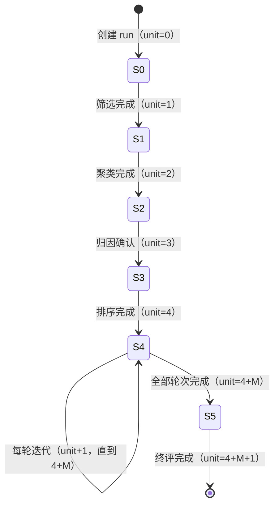

# 07 · 后端接口的实现设计

> 本文回答：每个功能域的路由、服务、外部数据接入、任务具体怎么写，状态机怎么推，同步怎么保证幂等。
> 前置：[04 后端架构](04-backend-architecture.md) · [05 接口设计](05-api-design.md) · [06 数据库设计](06-database-design.md)。
> 阅读方式：按 §2–§7 的域顺序即可；每个域都给出"职责划分 → 关键流程 → 伪代码/结构 → 测试点"。

## 1. 应用组装（`app/main.py`）

```python
def create_app(settings: Settings) -> FastAPI:
    app = FastAPI(title="harness-evolution-api", version=settings.version)
    app.add_middleware(RequestContextMiddleware)      # request_id + principal 占位
    register_exception_handlers(app)                  # AppError → 统一错误响应
    app.add_middleware(CORSMiddleware, allow_origins=settings.cors_origins)
    app.add_middleware(AuthMiddleware)                # JWT 校验 + 强制改密闸 + admin 路径规则（§8.2）
    app.add_middleware(RateLimitMiddleware)           # 仅登录端点按 IP 限速（§8.1）
    include_routers(app)                              # 唯一的路由注册点
    app.router.lifespan_context = lifespan(settings)  # 迁移、残留任务清理、DB 健康检查
    return app
```

`lifespan` 里做五件事（顺序固定）：

1. `database.start()`：按 `HE_DB_DIALECT` 建 engine（SQLite 加 PRAGMA / MySQL 建连接池），做一次连通性检查；失败不阻塞进程启动，由 `/api/health` 暴露 `db.ok=false`。
2. `alembic upgrade head`（幂等，空库建全表）。
3. 把 `job_runs.status = running` 的残留任务标记为 `interrupted`——避免重启后前端永远转圈。
4. 校验数据接入配置（`trajectory_payloads` 表名、上游地址；缺失只告警不阻塞）。
5. `users` 为空且配置了 `HE_ADMIN_USERNAME`/`HE_ADMIN_PASSWORD` → 播种初始管理员（幂等）。

## 2. 原始轨迹接入与归一化（`service/acquisition`）

**边界（2026-10-23）**：

- 第三方脚本只负责把有问题的 session 轨迹写进 MySQL 的 `trajectory_payloads`（每个 agent 一行，JSONL 原文）。
- 本服务**不再扫描 `he_src_*` 源表、不存第二份 payload**；`source_records` 只是处理索引，通过 `(root_session_id, agent_id)` 关联 payload。
- 上游接口 pull 仍保留：拉到 payload 后先 upsert 到 `trajectory_payloads`，再走同一条归一化管线。

### 2.1 职责划分

| 文件 | 职责 |
|---|---|
| `payloads.py` | 读 `trajectory_payloads`；pull 时 upsert payload + `agent_meta`；按 `(root_session_id, agent_id)` 取原文 |
| `normalize.py` | JSONL 行数组 → 用户输入锚点 / 节点统计 / Agent 会话树触发点（消息与内容块只在内存中） |
| `agent_tree.py` | 子转录与主会话关联（meta.toolUseId / `agentId`），组装 agent 树、`agent_events` 与会话统计 |
| `service.py` | 找出待处理 payload → 逐条归一化 → 幂等写业务表 → 更新 `source_records.processed_*` 与 `job_runs.progress` |
| `scheduler.py` | 每 `HE_SYNC_INTERVAL_SECONDS` 检查 pending；抢 `sync_lock` 后提交 `sync` 任务；与手动触发共用锁 |
| 路由在 `api/acquisition.py`（薄层，不在本目录） | `POST /api/acquisition/sync`、`POST /api/acquisition/pull`、`GET /api/acquisition/status` |

### 2.2 待处理判定（无水位线）

```sql
SELECT tp.*
FROM trajectory_payloads tp
LEFT JOIN source_records sr
  ON sr.root_session_id = tp.root_session_id
 AND sr.agent_id = tp.agent_id
WHERE sr.id IS NULL
   OR sr.processed_hash IS NULL
   OR sr.processed_hash <> tp.content_hash
   OR sr.parser_version < :current_parser_version
ORDER BY tp.updated_at
```

判定：

| 条件 | 动作 |
|---|---|
| `source_records` 无该 `(root_session_id, agent_id)` | 插入处理索引，归一化并写业务表 |
| `processed_hash = content_hash` 且 `parser_version` 相同 | 跳过（累加 `skipped`） |
| hash 不同 | 删除该 agent 派生的行（`agent_events→agents`；主 agent 另删 `user_turns`），重新归一化并重算会话统计 |
| 解析器版本升级 | 即使 hash 相同也重放 |
| payload 侧删除 | 首版保留业务数据并记日志（不级联删除） |

- 不再维护 `sync_state.watermark`；`source_records` 的 `processed_hash/parser_version` 就是游标。
- `semantics`：一个 agent 一行；`root_session_id` 相同即同一棵 Agent 会话树；子 agent 的 `sessionId` 也是 root，`agent_id` 才是区分键。

### 2.2.1 定时触发与单飞锁

```python
async def scheduler_loop():
    while not stopped:
        if settings.sync_interval_seconds <= 0:          # 0 = 关闭定时
            await sleep(60)
            continue
        await sleep(settings.sync_interval_seconds)      # 默认 60s
        if await source_records.pending_count() == 0:
            continue
        await trigger_sync(source="scheduler")


async def trigger_sync(source: str) -> TriggerResult:
    async with local_sync_lock:                          # V1 进程内兜底
        existing = await sync_lock.get("sync")
        if existing and existing.expires_at > now():
            return TriggerResult(job_id=existing.job_id, reused=True)
        try:
            async with db.transaction():
                job = await jobs.insert_queued("sync", {"source": source})
                await sync_lock.acquire("sync", job.id, ttl=30 * 60)
        except SyncLockConflict:
            existing = await sync_lock.get("sync")
            return TriggerResult(job_id=existing.job_id if existing else None, reused=True)
        await jobs.start(job.id)
        return TriggerResult(job_id=job.id, reused=False)
```

- `POST /acquisition/sync` 调同一个 `trigger_sync("manual")`；已有任务时返回 `202 {jobId, reused:true}`，不重复入队。
- 入队与抢锁在同一事务：先写 `job_runs` 再 `INSERT sync_lock`；主键冲突或任一步失败都整体回滚——既不留下没有 job 的锁，也不留下没有锁的孤儿 job。
- `jobs.insert_queued` + `jobs.start` 是 §6.1 `JobRunner` 的低层 API：sync 要在同一事务里落 job 与锁、提交后才让 worker 认领，因此不走 `submit` 的立即 `create_task`；其余域一律用 `submit`。
- `JobRunner` 串行执行；任务完成/失败在 `finally` 里释放 `sync_lock`。
- 锁 TTL 30 分钟；进程崩溃后下一次 tick 回收。
- 多实例：`sync_lock` 表承担跨进程互斥；V1 单实例再加 `asyncio.Lock`。

### 2.3 归一化（行数组 → 中间结构）

```python
@dataclass
class ParsedTranscript:
    agent_id: str                    # main = root_session_id；子 agent = 真实 agentId
    root_session_id: str
    agent_type: str | None
    task_kind: str | None            # in_process_teammate / forked_skill
    team_name: str | None
    name: str | None
    skill_name: str | None           # 仅 forked skill（.forked-skill.json）
    model: str | None                # 实际 message.model
    requested_model: str | None      # meta.model
    parent_tool_use_id: str | None   # meta.toolUseId
    spawn_depth: int
    lines: int
    messages_count: int              # 该 agent 的唯一 assistant message.id 数
    tokens_total: int                # usage 按 message.id 去重后求和
    tools_count: int                 # tool_use 块数
    errors_count: int                # is_error 块数
    user_turns: list[ParsedUserTurn]     # 仅主会话有用户输入锚点
    blocks_outside_user_turns: list[ParsedBlock]
    events: list[ParsedEvent]        # skill / agent / workflow 触发点
    agent_meta: dict                 # 原始 meta.json
```

解析规则（[06 §7.1](06-database-design.md)）：

0. **agent id**：主文件取 `sessionId`；子 agent 文件取行内 `agentId`（缺失时用文件名 `agent-<agentId>.jsonl`）。
1. **逐行 JSON**：坏行记录到 `errors`，跳过该行继续。
2. **用户轮次切分**：`type == "user"` 且 `isMeta != true`，content 不是 `tool_result`，且不以 `<local-command-caveat>` / `<command-name>` / `<task-notification>` / `<system-reminder>` 开头 → 新用户轮次；同时记录该行 `line_no` 与该轮开始前的 assistant message 数 `message_offset`。`last-prompt` / `queue-operation` **不作为轮次来源**；`attachment.queued_command` 的 `origin.kind=human` 可作为候选，`peer` 不算。
3. **消息与内容块归属**：assistant 按 `message.id` 聚成 message；`thinking/text/tool_use` 成 content_block；`tool_result` 按 `tool_use_id` 回填。同一个 `message.id` 的 `usage` 只取一次，不能按 content block 行重复求和。这些结构只在解析期使用，不落表。
4. **子 agent / workflow**：`Agent` 调用记录 `toolUseId`；子 agent 的 `meta.toolUseId` 指向父调用，`parent_agent_id` 指向父 agent。`task_kind=in_process_teammate` 的 teammate 没有 toolUseId，挂到 main 并记录 `team_name`；`task_kind=forked_skill` 用 meta/`.forked-skill.json` 的 `skillName` 关联父 Skill 触发点，`tool_use_id` 可为 NULL；该值写 `agents.skill_name`，`name` 仍只放 `meta.name`。`Workflow` 调用创建 `kind=workflow` 的合成节点（`agent_id=wf_...`、`lines=0`、`messages_count=0`），其 `workflow-subagent` 子节点 `parent_agent_id` 指向 workflow 节点。
5. **Agent 会话树事件**：`Skill` 工具调用、`Agent` 调用、`Workflow` 调用 → `agent_events`；**普通 skill 只落事件、不建节点**；记录 `line_no` 和 `message_offset` = 该行之前已经出现的 assistant message 数。
6. **token**：按 `message.id` 去重后的 `usage` 聚合到 `agents.tokens_total`，组装时求和到 `session_families.tokens_total`。
7. **时间**：真实 JSONL 的 `timestamp` 是 UTC `Z`；入库前转换为 Asia/Shanghai（`+08:00`）。
8. **行数**：payload 行数即 `agents.lines`。
9. **节点统计**：唯一 `message.id` 计数 → `agents.messages_count`；`tool_use` 块数 → `tools_count`；`is_error` 块数 → `errors_count`；usage 去重求和 → `tokens_total`；workflow 节点全为 0。
10. **模型**：从 assistant 消息的 `model` 字段取该 agent 的实际模型，写 `agents.model`；`meta.model` 写 `requested_model`；主 agent 同时写 `session_families.model`；整棵树去重写 `session_families.models`。
11. **会话元数据**：主 payload 的 `cwd` / `gitBranch` / `version` / `entrypoint` 写 `session_families.project_path/git_branch/cli_version/entrypoint`。

agent 写入时一并落 `model` / `requested_model` / `name` / `skill_name` / `task_kind` / `team_name` / `spawn_depth` / `lines` / `messages_count` / `tokens_total` / `tools_count` / `errors_count` / `agent_meta`；`session_families` 聚合在 Agent 会话树组装完成后计算（主 agent 模型 + 所有 agent 的 distinct 模型 + 四项统计求和）。

### 2.4 Agent 会话树组装

```text
主 agent payload ──┬──► agents[main]（含节点统计）
                   └──► user_turns（输入锚点） + agent_events ──► 写入事务
子 agent payload ──► 按 parent_tool_use_id 找父 agent
                     └──► 建 agent（含节点统计） ──► 把父 agent 里的 Agent 调用块指向该 agent
```

- `Workflow` 调用建 `kind=workflow` 的合成节点（`agent_id=wf_...`、`lines=0`、`messages_count=0`）；workflow 内部的子 agent 是 `kind=subagent`、`agent_type=workflow-subagent`，`parent_agent_id` 指向 workflow 节点。
- 普通子 agent 的父调用来自 `meta.toolUseId`；teammate（`task_kind=in_process_teammate`）没有 toolUseId，挂到 main 并保留 `team_name`；forked skill（`task_kind=forked_skill`）用 `skillName` 找父 Skill 事件。
- 普通 skill 不建节点：`Skill` 调用只写 `agent_events`；仅 forked skill（有独立转录）建 `agents` 行，`task_kind=forked_skill`、`skill_name` 非空、`name` 为空。
- 子 agent 的 `sessionId` 与主 agent 相同，不能靠 sessionId 找父；必须用 meta / `agentId`。

**两个防线**：

1. 子 payload 缺 `parent_tool_use_id` → 降级挂到根，并在 `sync_runs.errors` 记警告。
2. 父 agent `agent_events` 缺对应 `tool_use_id` 的 `agent` 事件 → 补一条，保证连线锚点存在。

### 2.5 处理事务、pull 与进度

```python
async def run_sync(job_id: str) -> SyncResult:
    pending = await payloads.list_pending(CURRENT_PARSER_VERSION)  # §2.2 查询
    for i, p in enumerate(pending):
        async with db.transaction():
            sr = await source_records.ensure(p)             # 无则插入处理索引
            raw = await payloads.get(p.root_session_id, p.agent_id)  # 从另一张表取 JSONL
            parsed = normalize(raw)                         # 纯 CPU，线程池
            upsert_derived(sr, parsed)                      # 业务表
            await source_records.mark_processed(
                sr.id, p.content_hash, CURRENT_PARSER_VERSION, job_id)
        await jobs.update_progress(job_id, (i + 1) / max(len(pending), 1))

async def pull(job_id: str, session_ids: list[str] | None = None,
               window: tuple[date, date] | None = None) -> SyncResult:
    # sessionIds 与 window 二选一（05 §4.8）；上游未配置时路由层已返回 409 UPSTREAM_NOT_AVAILABLE
    bundles = await http_source.fetch_many(session_ids=session_ids, window=window)
    await payloads.upsert_many(bundles)                     # 写入 trajectory_payloads
    return await run_sync(job_id)                           # 走同一管线
```

- **payload 只存一份**：`trajectory_payloads`；`source_records` 不再有 `payload/content_hash/source_ref`。
- 单条失败不中断整批（记 `errors`），全部完成 `status=completed`（有错误也 completed）。
- 进度每 5 条或 500ms 发一次。
- 归一化与 `source_records` 更新同事务；业务表只写 `session_families / agents / user_turns / agent_events`，消息与内容块不落库；payload 是外部只读表，不在事务里改（pull 的 upsert 除外）。
- 大 payload 不经过 SSE/日志。

### 2.6 测试点

- 同一 payload 连续处理两次 → 第二次 `imported=0, skipped=N`，业务表行数不变。
- 统计四列（`messages_count / tokens_total / tools_count / errors_count`）与 payload 实际内容一致；会话值为各 agent 求和。
- `trajectory_payloads` 新增一行 → 只处理该 `(root_session_id, agent_id)`，其他 agent/session 不受影响。
- payload 内容变化 → 该 agent 派生的行被重写，`processed_hash` 更新。
- `parser_version` 升级 → 全部重放，业务表结果一致。
- 子 payload 缺 `parent_tool_use_id` → agent 仍入库，警告可见。
- 145h 跨 6 天 → `duration_seconds` 真实跨度。
- 主/子 agent 使用不同模型 → `agents.model` 分别落库，`session_families.models` 去重包含两者。
- 坏行 → 其余行入库，`errors` 有记录。
- pull 返回的 payload 先落 `trajectory_payloads` 再归一化，不重复存。

### 2.7 跨库与外部表注意

- `trajectory_payloads` 由外部脚本/pull 写入；本服务除 pull 外**只读**，不在 DDL 里建外键指向它（跨服务边界）。
- 所有写操作走 `Database.transaction()`；幂等更新用事务内先删后写。
- 时间戳应用生成 Asia/Shanghai（UTC+8）；不在 DDL 用 `NOW()` 默认值；API 序列化带 `+08:00`。
- `source_records.id` 用 BIGINT 自增（外部 payload 表按 `(root_session_id, agent_id)` 关联，不需要应用生成 id）。

## 3. 会话查询（`service/sessions`）

### 3.1 列表

```python
async def list_sessions(filters: SessionFilters) -> list[SessionListItem]:
    rows = await repo.list_sessions(filters)          # SQL 里做 q/status/sort
    counts = await crud.bad_cases.count_by_sessions([r.id for r in rows])   # 当前页一条 GROUP BY
    return [to_list_item(r, bad_cases_count=counts.get(r.id, 0)) for r in rows]
```

- `q`：`search_text LIKE '%q%'`（同步时把 `lower(title + repo)` 写进 `search_text`；SQLite/MySQL 行为一致，后续可换全文索引）。
- `sort`：`latest → started_at DESC`、`userTurns → user_turns_count DESC`、`messages → messages_count DESC`、`agents → agents_count DESC`。
- `bad_cases_count`：**不落 `session_families` 列**。列表装配时按当前页 session id 做一次 `SELECT bad_case_session_id, COUNT(*) … GROUP BY`（只读表，走 `INDEX(bad_case_session_id)`），无记录按 0 计；会话概览复用同一口径。不做定时刷新——问题侧写入不发通知，刷新同样会陈旧；也**不支持**按问题数排序/筛选（若要支持，再单独评审物化缓存的刷新边界）。

### 3.2 会话概览与 Agent 会话树

- 会话概览直接复用列表项（同构模型）。
- Agent 会话树组装：`repo.get_agents(sid)` + `repo.get_agent_events(agent_ids)` + `bad_cases.list_by_session(sid)`，组装成 `SessionTree`；问题与 agent 的关联按 `bad_case_agent_id` 匹配 `agents.id`，为空时挂 main，找不到时降级为 `main` 并在日志告警。

### 3.3 时间线（已裁撤）

时间线页面不做，完整时间线由外部平台承担，`sessions` 模块**不提供轨迹读接口**。消息与内容块只在解析期存在、不落库；会话统计在解析期按 agent 累计，组装时对整棵树求和写入 `session_families`（`user_turns_count / messages_count / tools_count / errors_count / tokens_total`），列表与会话概览只读这些列。

```python
async def aggregate_session_stats(root_session_id: str) -> SessionStats:
    agents = await repo.get_agents(root_session_id)
    return SessionStats(
        user_turns_count=await repo.count_user_turns(root_session_id),
        messages_count=sum(a.messages_count for a in agents),
        tools_count=sum(a.tools_count for a in agents),
        errors_count=sum(a.errors_count for a in agents),
        tokens_total=sum(a.tokens_total for a in agents),
        agents_count=sum(1 for a in agents if a.kind == "subagent" and a.task_kind != "forked_skill"),
    )
```

- 增量重放：单个 agent 重新归一化后，更新它自己的四列统计，再重算该会话汇总；不需要读取其他 agent 的 payload。
- `user_turns` 只保留用户输入锚点（`prompt_text` + `line_no`/`message_offset`），供未来在 Agent 执行流图展示用户输入；不含轮级统计。
- 证据原文按 `(root_session_id, agent_id)` 从 `trajectory_payloads` 回读；不恢复消息/内容块明细表。

## 4. 问题与归因（`service/bad_cases` + `service/probes`，只读）

### 4.1 读路径

```python
async def list_bad_cases(sid: str) -> list[BadCase]:
    session = await crud.session_families.get(sid) or raise NotFound("SESSION_NOT_FOUND")
    cases = await crud.bad_cases.list_by_session(sid)          # 问题侧表，只读，按 created_at 升序（05 §4.6）
    analyses = await crud.bad_case_analysis.get_by_case_ids([c.bad_case_id for c in cases])
    return [merge(c, analyses.get(c.bad_case_id)) for c in cases]  # 合并状态/probeId/attributeType（attributeType 由 probe_id join probe_reports）

async def get_bad_case(case_id: str, sid: str | None) -> BadCase:
    case = await crud.bad_cases.get(case_id) or raise NotFound("BAD_CASE_NOT_FOUND")
    if sid and case.session_id != sid:
        raise Conflict("BAD_CASE_SESSION_MISMATCH")
    return case
```

- 服务层只做**存在性 / 归属校验**与**字段合并**；问题内容全部来自外部写入的表。
- 无归因记录（`bad_case_analysis` 无行）→ 返回 `status=unanalyzed` 占位，不报错。

### 4.2 probe 读取

```python
async def get_probe(probe_id: str) -> ProbeReport:
    probe = await crud.probes.get(probe_id) or raise NotFound("PROBE_NOT_FOUND")
    sources = await crud.bad_case_analysis.list_case_ids_by_probe(probe_id)
    return ProbeReport(**probe, from_bad_cases=sources, from_bad_cases_count=len(sources))
```

- `from_bad_cases` 由 `bad_case_analysis.probe_id` 反查（V1 恒 1 条）。
- 防御校验：`analysis_status=analyzed_issue` 但 `probe_id` 为空、或 `analyzed_nonissue` 却挂了 probe → 按 `unanalyzed` 返回并记日志（不中断页面）。

### 4.3 Agent 执行流图问题卡

- 取该 session 全部 `bad_cases`；`bad_case_agent_id` 非空时解析为上报人 A，为空时 A = main；找不到 A 时降级挂 main 并告警。
- **锚点计算不查库**：§3.2 树装配已把该 session 的 `agents` / `agent_events` 全量加载，先建内存索引再纯函数匹配。一个 session 的问题卡可能有几十张，逐卡回表就是 N+1——严禁在循环里调 `crud`。
- 按 `bad_case_type + object_type` 计算锚点：

```python
@dataclass
class AnchorIndex:                      # 由树装配阶段已加载的数据构建
    agents_by_id: dict[str, Agent]
    events_by_agent: dict[str, list[AgentEvent]]   # 按 event_index 升序

def anchor_for(bc, idx: AnchorIndex, main: Agent) -> Anchor:   # 纯函数，无 await
    A = idx.agents_by_id.get(bc.bad_case_agent_id) or main
    if bc.bad_case_agent_id and A.id == main.id:
        log.warning("bad_case_agent_id not normalized: %s", bc.bad_case_id)
    if bc.bad_case_type == "self":
        if bc.object_type == "agent":
            return Anchor(A.id, -1)
        return Anchor(A.id, last_skill_event(idx, A, bc.object_name))
    if bc.object_type == "skill":
        return Anchor(A.id, last_skill_event(idx, A, bc.object_name))
    # discovery + agent：锚到父节点调用 A 的那条 agent 事件
    if A.id == main.id:
        log.warning("discovery + agent with main reporter: %s", bc.bad_case_id)
        return Anchor(main.id, -1)
    P = idx.agents_by_id.get(A.parent_agent_id) or main
    return Anchor(P.id, agent_call_event(idx, P, A.tool_use_id))
```

- `last_skill_event`：在 `idx.events_by_agent[A.id]` 里筛 `kind=skill and name=object_name`，按 `event_index` 取最大；没有 → `-1`。
- `agent_call_event`：在 `idx.events_by_agent[P.id]` 里筛 `kind=agent and tool_use_id=A.tool_use_id`；匹配不到 → `-1`。**不要**按 `object_name` 匹配。
- 返回 `anchor: { agentId, eventIndex }`；`eventIndex` 取该事件的 `agent_events.event_index`（0 起、连续编号），API 按 `event_index` 升序返回 `events[]`，因此它同时就是前端 `events[]` 的 0-based 下标（[05 §3.2](05-api-design.md)）——不是 line、也不是 messageOffset。`badCaseAgent` 仍是上报人 A，`anchor.agentId` 在 `discovery + agent` 时等于父节点 P。

## 5. 自进化（`service/evolution`）

### 5.1 状态机（unit 游标）

```text
unit 0  筛选输入        done when unit >= 1
unit 1  问题聚类        done when unit >= 2
unit 2  归因确认        done when unit >= 3
unit 3  严重程度排序    done when unit >= 4
unit 4  迭代优化        done when unit >= 4 + M（M = 簇数；每推进一次 +1 轮）
unit 5  测试集终评      done when unit >= 4 + M + 1
```



六步 `status` 映射与前端不推算的约定不变（[05 §3.5](05-api-design.md)）。

### 5.2 对象配置（`service/evolution/targets.py`）

- CRUD 维护 `evolution_targets`；写操作仅 admin（middleware 按「方法 + 路径」判定：`POST/PUT/DELETE /api/evolution/targets*` 要求 `role=admin`，`GET` 只需登录，成员只读配置页）。
- 保存前校验：`repo_url` 可访问且 `default_ref` 可解析（`git ls-remote --exit-code <repo_url> <default_ref>`）、`sub_dir` 非空且不以 `..` 越界；失败 → `422 REPO_INVALID`。
- 版本列表：拉取/更新仓库缓存到 `data/repos/{target_id}`，执行 `git tag --list`；V1 也允许 `git ls-remote --tags` 只读查询。
- 唯一约束 `(object_type, object_name)` → 重复新增 `409 TARGET_EXISTS`；删除时若有进行中 run → `409 TARGET_IN_USE`。

### 5.3 创建 run：同步校验 → 入队

`POST /runs` 只做快速校验和建行，不 clone、不聚类：

```python
async def request_run(q: ProbeQuery, mode: str = "full") -> RunAccepted:
    cfg = await targets.get_enabled(q.target_type, q.target_name) \
        or raise Conflict("TARGET_NOT_CONFIGURED")
    matching = await crud.probes.count_matching(q)      # 只计数，快速失败
    if matching == 0:
        raise Conflict("NO_PROBES_MATCHED")

    run_id = ulid()
    async with db.transaction():
        await crud.runs.insert(
            id=run_id, mode=mode, status="preparing",
            engine_key=q.engine_key or mode,              # 执行引擎选择键（§5.4），默认 = mode
            eval_config=q.eval or default_eval_config(),  # 评测接入配置快照（§5.7，上游传入）
            progress_unit=0, target_config_id=cfg.id,
            target_type=q.target_type, target_name=q.target_name,
            target_version=q.target_version or cfg.default_ref,
            repo_url=cfg.repo_url, sub_dir=cfg.sub_dir,
        )
    job = await jobs.submit(
        "evolution_prepare",
        {"run_id": run_id, "query": q.model_dump()},
        ref_id=run_id,
    )
    return RunAccepted(run_id=run_id, job_id=job.id, status="preparing")
```

- `POST /runs` 返回 `202 {runId, jobId, status:"preparing"}`；前端立即跳详情，不等 clone。
- **两个创建期快照决定运行期行为**：`engine_key`（用哪个执行引擎，§5.4）与 `eval_config`（评测怎么接，§5.7）都在建行时落定，运行期不再读请求方或全局配置的当前值——与 `repo_url` / `sub_dir` 的快照语义一致（[06 §5.2](06-database-design.md)）。
- 仓库不可用/ref 不存在 → prepare 阶段失败；run 置 `failed`，`error_stage=clone`，用户在详情页看到原因。
- 工作区目录 `data/workspaces/{run_id}`，run 结束不自动删（便于复现）；清理策略见 §6。

### 5.4 执行引擎：`EvolutionEngine` 基类 + 工厂（六步流程的完整收口）

第 1–6 步是一个完整流程，组织上收口为一个类层级：**编排（阶段顺序、事务边界、事件记录、状态推进）只在基类写一份；随实现代际变化的部分是子类的变异点**。每个阶段方法仍是一个短 job（activity）——不 sleep、不占 worker、可恢复状态全落 DB，并发与崩溃恢复语义不变；这是 durable execution 的穷人版：job handler ≈ activity，DB 表 ≈ 执行历史，`eval_poller` ≈ 定时器触发。**替换实现 = 新增子类 + 工厂注册一个 `engine_key`**，前端、API、表结构零改动。

```text
service/evolution/engine/
  base.py          # EvolutionEngine 抽象基类：五个阶段模板 + handle() 分发
  full.py          # FullEvolutionEngine：V1 完整自进化（占位 patch / decide / final）
  cluster_only.py  # ClusterOnlyEngine：prepare 后即终态
  factory.py       # EngineFactory：engine_key → engine 类（fail fast 注册表）
```

```python
# base.py —— 基类：阶段模板 + JobRunner 统一入口
class EvolutionEngine(ABC):
    def __init__(self, run, deps: EngineDeps): ...     # run 由工厂装载；deps = crud / jobs / events / settings

    async def handle(self, job) -> None:
        stage = {"evolution_prepare": self.prepare,
                 "evolution_advance": self.advance_one_round,
                 "evolution_apply": self.apply_eval,
                 "evolution_finalize": self.finalize,
                 "evolution_retry": self.retry}[job.kind]
        await stage(job)

    # ---- 阶段模板：编排与事件记录只在这里写 ----
    async def prepare(self, job): ...            # 筛选→setup_workspace→聚类→归因→排序→build_rounds→收口→kickoff
    async def advance_one_round(self, job): ...  # §5.6：next_pending→patching→make_patch→commit→push→submit eval
    async def apply_eval(self, job): ...         # §5.8：deciding→decide→接纳(ff)/拒绝(删)→下一轮或 finalize
    async def finalize(self, job): ...           # §5.8：build_final→校验→push run 分支→completed
    async def retry(self, job): ...              # §5.8.1：按 blocked_stage+现场状态分发回上面某阶段

    # ---- 变异点：子类实现 ----
    @abstractmethod async def setup_workspace(self, run) -> Workspace | None: ...
    @abstractmethod async def build_rounds(self, run) -> None: ...
    @abstractmethod def final_status(self) -> str: ...
    @abstractmethod async def kickoff(self, run, clusters) -> None: ...
    @abstractmethod async def make_patch(self, run, round_) -> Patch: ...   # V1 占位 → 真实 LLM/规则
    @abstractmethod def decide(self, result: EvalResult) -> Decision: ...  # 接纳判定 + 一句话理由
    @abstractmethod async def build_final(self, run) -> Final: ...          # 终评
    @abstractmethod def gateway(self) -> EvalGateway: ...                   # 评测接入（§5.7）
```

`prepare` 模板的全貌（其余阶段模板见 §5.6 / §5.8）：

```python
    async def prepare(self, job) -> None:
        run = self.run                                  # 工厂已按 engine_key 装载
        q = ProbeQuery(**job.payload["query"])
        probes = await crud.probes.list_matching(q)    # probe_reports JOIN session_families
        if not probes:
            raise Conflict("NO_PROBES_MATCHED")

        ws = await self.setup_workspace(run)           # 差异点①：clone / 建 run 分支

        # 第 1 步问题聚类：写簇与簇内 probe（unit 1 → 2）
        async with db.transaction():
            clusters = simple_cluster(probes)
            cluster_rows, link_rows = [], []
            for seq, c in enumerate(clusters, start=1):
                cid = ulid()
                cluster_rows.append((cid, run.id, seq, c.description, c.type, TYPE_IMPACT[c.type]))
                link_rows += [(cid, p.probe_id) for p in c.probes]
            await crud.probe_clusters.bulk_insert(cluster_rows)        # 同事务批量写入，不逐簇 RTT
            await crud.probe_cluster_probes.bulk_insert(link_rows)
            await crud.runs.set_progress(run.id, progress_unit=2)
        await events.record(run.id, "clusters_created", stage="cluster", step_index=1,
                            message=f"聚类完成：{len(clusters)} 个簇")

        # 第 2 步归因确认：逐簇写 probe_clusters.confidence（unit 2 → 3）
        await attribution_step(run.id)
        # 第 3 步严重程度排序：写 probe_clusters.severity / rank（unit 3 → 4）
        await severity_step(run.id)

        async with db.transaction():
            await self.build_rounds(run)               # 差异点②：按 rank 建迭代轮
            await crud.runs.mark_prepared(
                run.id,
                status=self.final_status(),            # 差异点③：running / completed
                progress_unit=4,
                repo_path=ws.repo_path if ws else None, base_ref=ws.ref if ws else None,
                base_commit=ws.base_commit if ws else None,
                branch_name=ws.branch if ws else None,
                workspace_path=ws.path if ws else None,
                finished_at=now() if self.final_status() == "completed" else None,
                stats=summarize(probes),
            )
        await self.kickoff(run, clusters)              # 差异点④：是否提交 evolution_advance
```

两个 V1 子类：

```python
# full.py —— 完整自进化
class FullEvolutionEngine(EvolutionEngine):
    async def setup_workspace(self, run):
        cache = RepoCache.ensure_by_url(run.repo_url)  # 本地仓库缓存
        return Workspace.prepare(repo_path=cache.path, sub_dir=run.sub_dir,
                                 ref=run.target_version, run_id=run.id)   # clone → 建 evo/... 分支
    async def build_rounds(self, run):
        # 按 rank（严重度降序）建迭代轮：evolution_rounds.seq 即执行顺序
        await crud.evolution_rounds.bulk_insert_pending(run.id)
    def final_status(self): return "running"
    async def kickoff(self, run, clusters):
        if clusters:
            await jobs.submit("evolution_advance", {"run_id": run.id}, ref_id=run.id)
    async def make_patch(self, run, round_): return placeholder_patch(run, round_.cluster_id)
    def decide(self, result) -> Decision:                                  # V1：采纳外部 verdict
        return Decision(result.accepted, decision_sentence(result, result.accepted))
    async def build_final(self, run): return build_placeholder_final(run)
    def gateway(self): return build_eval_gateway(self.run.eval_config)     # 创建期快照（§5.7）

# cluster_only.py —— 仅聚类预览：prepare 后即终态
class ClusterOnlyEngine(EvolutionEngine):
    async def setup_workspace(self, run): return None  # 不 clone、不建分支
    async def build_rounds(self, run): pass            # 不建 evolution_rounds
    def final_status(self): return "completed"         # 聚类完成即终态，归入历史组
    async def kickoff(self, run, clusters): pass       # 不进入迭代
    # advance/apply/finalize/retry 不会被调度（kickoff 不提交后续 job、run 已终态）；
    # 防御起见仍给出实现：直接 raise ConfigError("cluster_only 无迭代阶段")
```

```python
# factory.py —— 唯一选择点（fail fast）
class EngineFactory:
    _REGISTRY = {"full": FullEvolutionEngine, "cluster_only": ClusterOnlyEngine}

    @classmethod
    def for_run(cls, run, deps: EngineDeps) -> EvolutionEngine:
        try:
            return cls._REGISTRY[run.engine_key](run, deps)
        except KeyError:
            raise ConfigError(f"unknown engine_key: {run.engine_key}")  # 新增引擎必须显式注册
```

JobRunner 的 evolution handler 只剩装配，五个 `evolution_*` kind 一个入口：

```python
async def evolution_dispatch(job) -> None:
    run = await crud.runs.get(job.ref_id) or raise NotFound("RUN_NOT_FOUND")
    await EngineFactory.for_run(run, deps).handle(job)
```

- **扩展方式**：新增执行类型（m6 的真实执行器 `LlmEvolutionEngine`、增量补簇 `incremental`、只筛选的 `dry_run`）= 新子类 + 注册一行；`engine_key` 随 run 落库（[06 §5.2](06-database-design.md)），历史 run 永远由当时的引擎复现，不受后续注册表变更影响。
- **为什么是 ABC 模板方法而不是 Protocol**：六步流程的差异是"同一编排里的若干变异点"，编排本身有共享实现，Protocol 表达不了；纯出站接缝（`PayloadSource`、`EvalGateway`）才用 Protocol（接口 + 实现成对，见 [04 §5](04-backend-architecture.md)）。
- **事件记录由父类统一**：`events.record(...)` 调用全部在基类模板里（先统一，后续确有差异化需求再开子类口子），保证 F20 执行日志不因子类遗漏而缺行。
- `eval_poller` / `blocked_sweeper` 是进程级基础设施循环，不属于 engine；但遇到具体 run 时同样经 `EngineFactory.for_run` 解析，用 `engine.gateway` 调外部评测（§5.7）。
- `POST /cluster-previews` 与 `POST /runs` 共用同一入口；差异全部收敛在 `ClusterOnlyEngine`：不建 workspace、不建 `evolution_rounds`、不提交 advance；聚类与 `confidence`/`severity` 落库后 run 直接 `completed`（终态，归入历史组），前端轮询到 `completed` 再拉 `steps/clusters`（[08 §11](08-frontend-implementation.md)）。
- `Workspace.prepare`：从 `data/repos/{target_id}` 缓存本地克隆 → 建 `evo/{YYYYMMDD}-{run_id}` 分支；缓存由 `RepoCache.ensure_by_url(repo_url)` 拉取/更新。
- prepare 只读 run 快照（`repo_url` / `sub_dir` / `target_version` / `engine_key` / `eval_config`），不读 `evolution_targets` 的当前值；target 配置后续变更不影响已创建的 run。
- `TYPE_IMPACT = {"error": 9, "prompt": 7, "model": 5}`：建簇时写入 `probe_clusters.impact` 并固化；第 2 步归因完成更新 `confidence`，第 3 步排序完成更新 `severity` / `rank`，`build_step_payload` 只读这些列。
- 第 2/3 步必须是独立写库点：归因步骤写 `confidence`，排序步骤写 `severity` / `rank`，**之后才**按 rank 顺序创建/推进 `evolution_rounds`。不能沿用"聚类后直接建轮次"的路径，否则分数没有落库时机，迭代顺序也不是严重度顺序。
- `attribution_step` / `severity_step` 各自独立事务、各记一条 `step_advanced` 事件；V1 在 prepare 模板内顺序调用，后续需要独立重跑时可拆成独立 job，接口与表不变。

### 5.5 V1 占位聚类算法（可替换）

```python
TYPE_IMPACT = {"error": 9, "prompt": 7, "model": 5}   # V1 固定映射，后续可替换
```

```python
def simple_cluster(probes: list[Probe]) -> list[Cluster]:
    clusters = []
    for attr in ("model", "prompt", "error"):
        group = sorted([p for p in probes if p.attribute_type == attr], key=lambda p: p.probe_id)
        if not group:
            continue                                   # 该类型 0 条 → 不产生簇
        if len(group) == 1:
            halves = [group]                           # 1 条 → 1 簇
        else:
            mid = (len(group) + 1) // 2
            halves = [group[:mid], group[mid:]]        # ≥2 条 → 前后各一簇
        for i, half in enumerate(halves, start=1):
            clusters.append(Cluster(
                type=attr,
                description=f"{attr} 类问题 · 第 {i} 组（占位聚类）",
                probes=half,
            ))
    return clusters
```

- 这是**占位算法**：只为让六步流程跑通，不追求语义质量；后续替换成真正的聚类服务时，只改 `simple_cluster` 与簇描述生成，表结构不变。
- 确定性：排序键用 `probe_id`，同输入同输出，便于测试与复现。

### 5.6 单轮执行：candidate → push → 提交评测（`EvolutionEngine.advance_one_round`）

push 是评测的前置条件，不再等 run 结束后统一 push。

```text
run 分支：      evo/{YYYYMMDD}-{run_id}
candidate ref： evo/{YYYYMMDD}-{run_id}/candidate/r{round_seq}
```

```python
# base.py —— advance 模板：编排与事件在父类；patch 内容与评测接入是子类变异点
async def advance_one_round(self, job):
    run = self.run
    if run.status != 'running':
        return
    round = await evolution_rounds.next_pending(run.id)
    if round is None:
        await jobs.submit('evolution_finalize', {'run_id': run.id}, ref_id=run.id)
        return

    ws = Workspace(run.workspace_path)
    await evolution_rounds.mark_patching(round.id, started_at=now())
    candidate_ref = f'{run.branch_name}/candidate/r{round.seq}'
    ws.create_candidate(run.branch_name, candidate_ref)   # 从已接纳基线拉临时分支

    patch = await self.make_patch(run, round)             # 变异点：V1 占位 → 真实 LLM/规则
    ws.apply(patch)
    candidate = ws.commit(build_candidate_message(run, round))
    await evolution_rounds.mark_candidate(round.id, candidate_ref, candidate.hash, candidate.message)

    await evolution_rounds.mark_pushing(round.id)        # 进入 pushing，push 失败时本轮停在此状态
    try:
        await push_with_retry(ws, candidate.hash, candidate_ref)  # 3 次 / 5s
    except GitPushError as e:
        await block_run(run, stage='push', error=e,
                        retryable=is_transient_git_error(e))
        raise RunBlocked('push blocked')

    submission = await self.gateway().submit(EvalRequest(
        run_id=run.id, evolution_round_id=round.id, repo_url=run.repo_url,
        ref=candidate_ref, commit=candidate.hash,
        target_type=run.target_type, target_name=run.target_name,
        target_version=run.target_version,
        cluster_id=round.cluster_id,
        idempotency_key=f'{run.id}:{round.seq}:{candidate.hash}',
    ))
    await evolution_rounds.mark_evaluating(
        round.id, eval_external_id=submission.eval_id,
        eval_status='evaluating',
        eval_next_poll_at=now() + timedelta(seconds=settings.eval_poll_seconds),
    )
    await events.record(run.id, 'eval_submitted', stage='eval', evolution_round_id=round.id,
                        message=f'已提交评测 {submission.eval_id}', payload={'ref': candidate_ref})
```

```python
async def push_with_retry(ws, commit: str, ref: str):
    for attempt in range(1, 4):
        try:
            await ws.push_commit(commit, ref)
            return
        except GitPushError as e:
            if attempt == 3 or not is_transient_git_error(e):
                raise
            await asyncio.sleep(5)
```

```python
async def block_run(run, stage: str, error: Exception, retryable: bool,
                    retry_attempts: int = 0):
    delay = (1, 5, 15)[retry_attempts] if retryable and retry_attempts < 3 else None
    await runs.mark_blocked(
        run.id, stage=stage, error=sanitize(str(error)),
        retry_attempts=retry_attempts,
        next_retry_at=now() + timedelta(minutes=delay) if delay else None,
    )
    await events.record(run.id, "run_blocked", stage=stage, level="warn",
                        message=f"{stage} 失败，流程暂停", error=error)
```

- 立即重试只针对网络/超时/远端 5xx 等瞬时错误；认证、权限、分支保护、non-fast-forward 立即失败。
- push 失败后 **不提交评测**，本轮停在 `pushing`，run 进入 `blocked`。
- `blocked_stage=push`，`retry_attempts=0`；瞬时错误设置 `next_retry_at=now+1min`，永久错误 `next_retry_at=NULL`。
- 自动退避由 `blocked_sweeper` 处理：1min / 5min / 15min 各 1 次 push；3 次仍失败则不再自动重试。
- 手动 `POST /runs/{rid}/retry` 会立即入队；成功则继续，失败重新进入 blocked。

### 5.7 评测接入与轮询（gateway 由上游入参决定）

**gateway 选择上游传入**：`POST /runs` / `POST /cluster-previews` 的 body 可带可选的 `eval` 配置（如 `{"mode": "http", "baseUrl": "...", "apiKeyRef": "HE_EVAL_API_KEY"}`——密钥永远走 env 引用，配置值不落库）；建行时快照到 `evolution_runs.eval_config`，缺省用全局 `HE_EVAL_*` 构造。`engine.gateway()` 按该快照构造，同一进程内不同 run 可接不同评测平台；外部字段变化只改 `EvalMapper` / `HttpEvalGateway`。

评测等待不能放在 JobRunner 的 handler 里 `sleep`，否则单 worker 会被占住。用独立轻量循环：

```python
async def eval_poller_loop():
    while not stopped:
        due = await evolution_rounds.list_eval_due(now())          # eval_status=evaluating AND next_poll_at<=now
        for round in due:
            engine = EngineFactory.for_run(await runs.get(round.run_id), deps)
            gw = engine.gateway()                                  # 该 run 的评测接入（创建期快照）
            status = await gw.get_status(round.eval_external_id)
            if status.status in ('queued', 'running'):
                await evolution_rounds.set_eval_next_poll(round.id, now() + timedelta(minutes=5))
            elif status.status == 'completed':
                result = await gw.get_result(round.eval_external_id)
                await evolution_rounds.save_eval_result(round.id, result)
                await jobs.submit('evolution_apply', {'evolution_round_id': round.id}, ref_id=round.run_id)
            elif status.status in ('failed', 'timeout'):
                await block_run_by_id(round.run_id, stage='eval', error=status.message)
        await asyncio.sleep(30)
```

- 轮询间隔 `HE_EVAL_POLL_SECONDS=300`；扫描节奏 30s，只查 `next_poll_at<=now` 的行。
- `next_poll_at` 落库，进程重启后可继续，不依赖内存 sleep。
- 超时兜底：网关长时间不返回终态时，按 `eval_started_at + HE_EVAL_TIMEOUT_SECONDS`（默认 2h）判 `timeout`，与网关返回的 `failed/timeout` 走同一条 `blocked(stage=eval)` 路径。
- `eval_poller` 只做 DB 读写和外部 HTTP，不执行 git，也不持有 JobRunner 全局锁。
- 评测失败/超时 → `run.status=blocked`、`blocked_stage=eval`；不自动重新提交，等 `/retry` 或人工处理。

评测适配层（Protocol 接缝，接口 + 实现成对）：

```python
class EvalGateway(Protocol):
    async def submit(self, req: EvalRequest) -> EvalSubmission: ...
    async def get_status(self, eval_id: str) -> EvalStatus: ...
    async def get_result(self, eval_id: str) -> EvalResult: ...
```

- `EvalRequest` / `EvalResult` 是内部稳定模型；
- `HttpEvalGateway` 负责 URL、鉴权、超时；
- `EvalMapper` 负责内部模型 ↔ 外部 JSON；
- 外部接口字段变化时只改 `EvalMapper` 和 `HttpEvalGateway`，业务 service 不动；
- V1 可用 `FakeEvalGateway` 返回占位分数，但 push 必须真实发生。

### 5.8 应用评测结果、重试与终评（`apply_eval` / `finalize` / `retry` 模板）

```python
# base.py —— apply 模板：接纳判定 decide() 是子类变异点，返回 Decision（含人话理由）
async def apply_eval(self, job):
    round = await evolution_rounds.get(job.payload['evolution_round_id'])
    run = self.run
    ws = Workspace(run.workspace_path)
    result = await evolution_rounds.get_eval_result(round.id)
    await evolution_rounds.mark_deciding(round.id)

    decision = self.decide(result)               # 变异点：V1 external-verdict → 真实阈值/规则
    if decision.accepted:
        # 1) 先在 candidate 上 amend：改写 subject 并追加"为什么接纳"
        final = ws.amend(build_accepted_message(run, round, result, decision))
        await ws.force_push_candidate(final.hash, round.candidate_ref)  # --force-with-lease
        # 2) 回到 run 分支并 fast-forward 到接纳后的 candidate
        await ws.switch(run.branch_name)
        await ws.fast_forward(run.branch_name, final.hash)
        await ws.push_branch(run.branch_name)
        await ws.delete_remote_ref(round.candidate_ref)
        await ws.delete_local_branch(round.candidate_ref)
        await evolution_rounds.accept(round.id, result.candidate_score, final.hash, final.message)
    else:
        await ws.delete_remote_ref(round.candidate_ref)
        await ws.switch(run.branch_name)             # 回到已接纳基线，不 reset 掉之前轮次
        await ws.delete_local_branch(round.candidate_ref)
        await evolution_rounds.reject(round.id, result.candidate_score)
        # 拒绝不改写 commit message（理由进 cluster_rejected 事件 payload）

    await events.record(run.id,
                        'cluster_accepted' if decision.accepted else 'cluster_rejected',
                        stage='apply', evolution_round_id=round.id,
                        message=decision.reason, payload={'reason': decision.reason})
    await jobs.submit('evolution_advance', {'run_id': run.id}, ref_id=run.id)
```

```python
@dataclass
class Decision:
    accepted: bool
    reason: str        # 一句话人话理由：写进 commit message 与 cluster_accepted/rejected 事件


def decision_sentence(result, accepted: bool) -> str:      # V1：把分数比较翻成人话
    cmp_word = "高于" if accepted else "未高于"
    verdict = "接纳" if accepted else "拒绝"
    return (f"候选分 {result.candidate_score:.1f} {cmp_word}基线 {result.current_score:.1f}"
            f"（{result.delta:+.1f}），按 external-verdict 规则{verdict}")
```

- 接纳时 run 分支 **只 fast-forward，不 force-push**；candidate ref 上才允许 `--force-with-lease`。
- 拒绝时删除 candidate ref，切回 run 分支；run 分支 HEAD 不变，不 reset 之前已接纳轮次。
- patch 阶段失败（生成 / 落盘 / commit）：可重试错误走 `block_run(stage='patch')`，run `blocked`、本轮停在 `patching`；不可恢复错误把本轮置 `failed`、run 置 `failed`（`error_stage` 按子步骤记 `patch` / `commit`）。重试从 `patching` 重新生成 patch，不进入 push/eval。
- candidate 删除失败不阻塞流程：记 warn 日志，并把 `cleanupError` 写进 `cluster_accepted` / `cluster_rejected` 事件的 `payload`（事件类型严格以 [06 §5.7](06-database-design.md) 枚举为准，不新增 event_type），后续 `clean-candidates` 清理。
- 若 accept 阶段 push candidate/run 分支失败：走同一 `block_run` + `RunBlocked`，run 进入 `blocked`，保留 candidate ref 和评测结果；`/retry` 从 apply 继续，不重新评测。
- 因此 `apply_eval` 内所有 push 也必须包在 `try/except GitPushError` 中，不能落入 JobRunner 的通用 `run_failed` 分支。

#### 5.8.1 阻塞重试策略

```text
push 失败（瞬时错误）
  → 3 次立即（间隔 5s）
  → 仍失败：run.blocked, blocked_stage=push
  → next_retry_at = now + 1min
  → blocked_sweeper 到点入队 evolution_retry（1 次 push）
  → 失败：+5min
  → 失败：+15min
  → 仍失败：next_retry_at=NULL，保持 blocked
```

- 自动退避每次只做 1 次 push；`evolution_retry` 先把 `retry_attempts += 1` 再执行，失败后按 `1min → 5min → 15min` 安排下一次；第 3 次后 `next_retry_at=NULL`。
- 初始 `block_run` 不重置为“无重试”：`retry_attempts=0`，首次失败后 1min 进入第一次退避；手动 `/retry` 才把计数重置为 0。
- 手动 `POST /runs/{rid}/retry` 立即入队；`push` 阶段按正常 3 次立即重试，`eval` 阶段重新 submit；成功则继续，失败重新进入 blocked。
- `retry` 是基类模板：按 `blocked_stage` + 现场状态分发回本 engine 的阶段方法，两种"继续"情形都不重新评测、不重跑迭代：`push` 且本轮已有评测结果 → 调 `apply_eval` 继续（重推 amended candidate / run 分支）；final 已落库 → 调 `finalize` 继续（最终 push）；否则重推当前 candidate。`eval` → 重新 submit 评测（新 evalId）。
- 认证/权限/分支保护/non-fast-forward 等永久错误不进入自动退避；直接 `blocked` + `next_retry_at=NULL`，等人工修复后 `/retry`。
- `eval` 失败/超时不自动重试；`/retry` 重新 submit 评测（新 evalId），旧的 `eval_external_id` 保留在事件 payload 中。
- 手动重试会重置自动退避计数；若再次进入同一阶段失败，重新从 3 次立即 + 1/5/15min 开始。
- 所有登录用户可调用 `/retry`；同一 run 已有 retry job 时返回 `202 {jobId, reused:true}`，不重复入队。

- 终评（`finalize` 模板；终评内容 `build_final` 是子类变异点）：

```python
# base.py —— finalize 模板
async def finalize(self, job):
    run = self.run
    await finals.insert(run.id, await self.build_final(run))   # 变异点：占位 → 真实终评
    ws = Workspace(run.workspace_path)
    ws.validate_for_push(run)                 # 分支命名/基线/工作区干净/trailer
    await ws.push_branch(run.branch_name)     # accepted commits 每轮已推，最后再校验一次
    await runs.complete(run.id, finished_at=now(), push_status='succeeded')
```

- 终评写入先落库；run 分支最终 push 成功后才把 run 置 `completed`。
- 最终 push 失败同样进入 `blocked(stage=push)`，保留 final 与 run 分支，`/retry` 继续，不重新跑迭代。

**commit message 约定**：推送后不可变，按"**不了解本项目的人也能读懂**"写——人读的叙事在上，机器 trailer 在下。两个 builder：`build_candidate_message(run, round)` 与 `build_accepted_message(run, round, result, decision)`，结构固定为 **subject → 问题 → 分析 → 改动 →（接纳后）为什么接纳 → 追溯 → trailer**。

candidate（未评测，假设式）：

```text
evolve(deep-research@v2.0.0): 针对「检索索引读取失败」的候选变更

## 问题
deep-research 在读取快照前未校验 userTurn 字段，子 agent 直接按索引读取导致越界，
表现为检索索引读取失败（ENOENT）。来源问题：bc-050b-03、bc-050b-11。

## 分析
1. 从 bad_case 的 reason 与 meta_data 定位到索引读取步骤。
2. 同批次有校验的 subagent 未报错，说明是步骤缺失而非环境问题。
3. 修复思路：读取前校验快照字段，缺失时回退到最近一次有效轮次。
…（完整推导见下方归因链接）

## 改动
- skills/deep-research/SKILL.md（+3 / −0；patch sha256:1f2a…）
- 注意：V1 为占位 patch，内容不是真实修复，仅用于贯通流程。

## 状态
候选变更，尚未评测；评测完成后本消息会被 amend 改写为结论。

## 追溯
- 自进化运行：[evo-20261023-01](https://harness.example.com/evolution/runs/evo-20261023-01?step=iteration)
- 问题簇：[C1 检索索引读取失败](https://harness.example.com/evolution/runs/evo-20261023-01?step=clusters&cluster=C1)
- 根因归因：
    - [pr-050b-03](https://harness.example.com/sessions/050b81ba-…/errors?case=bc-050b-03&tab=attr)（检索索引读取失败）
    - [pr-050b-07](https://harness.example.com/sessions/2b7e9d4f-…/errors?case=bc-2b7e-01&tab=attr)（索引未校验快照字段）
- 来源问题：
    - [bc-050b-03](https://harness.example.com/sessions/050b81ba-…/errors?case=bc-050b-03&tab=desc)（session：研究"用户数据驱动自进化"提到的所有方法）
    - [bc-050b-11](https://harness.example.com/sessions/050b81ba-…/errors?case=bc-050b-11&tab=desc)（session：同上）
- 基线：`9f3c2a1f`（tag `v2.0.0`）

---
Harness-Run-Id: evo-20261023-01
Harness-Cluster-Id: C1
Harness-Round: 2
Harness-Probes: pr-050b-03, pr-050b-07
Harness-Bad-Cases: bc-050b-03, bc-050b-11
Harness-Base-Commit: 9f3c2a1f…
Harness-Patch-Hash: sha256:1f2a…
Harness-Created-At: 2026-10-23T09:40:12+08:00
```

接纳后 amend（subject 改为断言式，追加"为什么接纳"）：

```text
evolve(deep-research@v2.0.0): 修复检索索引未校验导致的越界读取

## 问题
…（与 candidate 相同，事实不变）

## 分析
…

## 改动
…

## 为什么接纳
候选分 87.2 高于基线 84.6（+2.6），按 external-verdict 规则接纳。

## 追溯
…（同 candidate：运行 / 簇 / 根因归因 / 来源问题逐条缩进）

---
Harness-Run-Id: evo-20261023-01
Harness-Cluster-Id: C1
Harness-Round: 2
Harness-Probes: pr-050b-03, pr-050b-07
Harness-Bad-Cases: bc-050b-03, bc-050b-11
Harness-Base-Commit: 9f3c2a1f…
Harness-Patch-Hash: sha256:1f2a…
Harness-Evaluated-Commit: ab12…（评测时的 candidate commit）
Harness-Verdict: accepted
Harness-Decision-Rule: external-verdict
```

- **subject 说人话**：`evolve(对象@版本): <一句话问题/结论>`，≤ 72 字符；candidate 用假设式（"针对…的候选变更"），接纳后改写为断言式（"修复…"）；正文事实部分不改写。
- **"为什么接纳"是一句话**：`Decision.reason` 由 engine 的 `decide()` 生成，把分数比较翻成人话（V1：`候选分 87.2 高于基线 84.6（+2.6），按 external-verdict 规则接纳`）；规则标识另写 `Harness-Decision-Rule` trailer 供机器筛选；真实执行器换阈值/多指标规则时，下游（message、"为什么接纳"段、`cluster_accepted` 事件）形状不变。
- **链接规则**：URL 前缀取 `HE_WEB_BASE_URL`（[04 §9](04-backend-architecture.md)，由 `.env` 注入、不落库），路径按 [05 §5](05-api-design.md) 深链拼接（run → `?step=…`、簇 → `?step=clusters&cluster={id}`、问题 → `/sessions/{sid}/errors?case=…&tab=desc|attr`）；**未配置时只输出 ID、不输出链接**（避免相对路径死链）。链接只含 ID，不含任何 token/凭据。
- **多来源逐行**：根因归因（probe）与来源问题（bad case）可能有多条，每条独立一行、缩进一级（4 空格 / 一个 tab）；同一行不并列多个链接，保证在 `git log` 终端里也逐条对齐。
- **截断与脱敏**：`probe_analysis` 超过 30 行或 3000 字符时按行截断并附"完整推导见归因链接"；strip HTML；不写 payload 原文、token、环境变量（与 [09 R15](09-review-guide.md) 同一清单）。
- **trailer 只在末尾**：`Harness-Run-Id` 必填（push 校验依赖）；`Job-Id` / `Step` / 耗时等已落 `evolution_run_events` 的字段不重复进 message。
- **拒绝不改写**：rejected 轮次保留 candidate message（随后删除 candidate ref），拒绝理由进 `cluster_rejected` 事件 payload。
- `Harness-Evaluated-Commit` 记录评测时的 candidate commit（amend 后 hash 会变，但代码内容相同）。
- 每个 candidate 一次 commit；拒绝不产生合并提交，接纳只做 amend + fast-forward。
- 分支命名：run 分支 `evo/{YYYYMMDD}-{run_id}`；candidate ref `evo/{YYYYMMDD}-{run_id}/candidate/r{n}`。
- push 校验：run 分支匹配 `^evo/\d{8}-.+$`、不是 `main/master`、父提交链包含 `base_commit`、工作区干净、提交带 `Harness-Run-Id`。
- 远端已有同名 candidate ref：`--force-with-lease` 只允许覆盖自己的旧值；run 分支不 force。
- 崩溃恢复：按 `evolution_rounds.status` / `eval_external_id` / `next_poll_at` 恢复；`patching` 从重新生成 patch 开始（先清理本轮 workspace 脏改动），`pushing` 从 push 继续，`evaluating` 不重复提交评测，`deciding` 从 apply 继续。

### 5.9 执行事件记录

- **事件记录由 `EvolutionEngine` 基类模板统一调用**（父类统一，子类不直接调 `events.record`）：`run_created`、`prepare_started`、`workspace_prepared`、`clusters_created`、`step_advanced`、`candidate_committed`、`candidate_pushed`、`push_started|succeeded|failed`、`push_retry_scheduled`、`eval_submitted`、`eval_polled`、`eval_completed`、`eval_failed`、`eval_timeout`、`cluster_accepted|rejected`、`run_blocked`、`run_resumed`、`final_completed`、`run_failed`、`run_interrupted`——`event_type` 严格以 [06 §5.7](06-database-design.md) 的枚举为准。patch 阶段不新增事件类型：生成/落盘/提交的信息并入 `candidate_committed` 的 `payload`（`patchHash/files/durationMs`），失败按可重试性记 `run_blocked` 或 `run_failed`（`stage=patch`/`commit`）。
- 异常必须落库；`run.blocked` 与 `run.failed` 区分：可重试的外部失败记 `run_blocked`，不可恢复错误记 `run_failed`。
- 脱敏、截断、SSE 只通知的约定不变。

### 5.10 六步产出

| step | 服务端组装 | 数据来源 |
|---|---|---|
| 0 `input` | 查询条件 + `hits` + probe 行 | `probe_reports` + `session_families` + `bad_cases` / `bad_case_analysis`（命中计数） |
| 1 `clusters` | 簇列表 + 每簇 probe | `probe_clusters` + `probe_cluster_probes` |
| 2 `attribution` | 归因确认项（对象/类型/描述/推导/confidence） | `probe_reports` + `probe_clusters.confidence` |
| 3 `severity` | rank/clusterId/title/confidence/impact/probeCount/reportCount/severity | `probe_clusters`（confidence/impact/severity/rank）+ 关联计数 |
| 4 `iteration` | 逐轮 candidate → push → eval → accept/reject | `evolution_rounds` + `probe_clusters` + `probe_reports`（`ProbeRow`） |
| 5 `final` | 终评 verdict + metrics + changes | `evolution_finals` |

- 六个端点：`GET /runs/{rid}/steps/{input|clusters|attribution|severity|iteration|final}`；共享 `build_step_payload(run, key)`，只按 key 组装对应 DTO。
- `confidence` 是簇级：第 2 步一个簇一个值；`impact` 是建簇时的 type 固定映射；`severity = round(min(10, confidence × impact × reportWeight), 1)`，`reportWeight = 1 + 0.1 × min(reportCount - 1, 5)`。三个值都落 `probe_clusters`，`build_step_payload` 不重新计算。

```python
def report_weight(n: int) -> float:
    return 1 + 0.1 * min(max(n - 1, 0), 5)       # reportCount=1 → 1.0；6+ → 1.5

severity = round(min(10, confidence * impact * report_weight(report_count)), 1)
```
- `StepPayload` 用 `key` 判别；`index` 只用于排序/展示，不参与路由分发。

- 第 4 步：patch 落盘、candidate commit、candidate push、amend/fast-forward/拒绝删 ref 都是真实的；patch 内容与评测分数是占位；终评结果占位。
- 真实 patch/评测接入后，新增 `EvolutionEngine` 子类（覆盖 `make_patch` / `decide` / `build_final` / `gateway`）并注册新 `engine_key`，状态机、表与 git 流程不变（§5.4）。

## 6. 任务执行与 SSE（`service/jobs.py` + `service/events.py`）

### 6.1 串行执行器（V1）

V1 的同步/聚类/推进都是"秒级到分钟级、同一时刻只跑一个"的任务，且跑在服务本地，**不引入队列、不单独建 jobs 目录**：

- `service/jobs.py` 提供 `JobRunner`：`submit(kind, payload, ref_id)` 落 `job_runs` 行（`queued`），由进程内 worker 串行执行；
- **串行**用一把全局 `asyncio.Lock` 保证；同 `(kind, ref_id)` 已有活跃任务时按 kind 区分：`sync` / `evolution_retry` 命中去重，service 层捕获后返回已有 job（路由层 `202 {jobId, reused:true}`，见 §2.2.1 / §5.8.1）；`evolution_prepare` / `evolution_advance` / `evolution_apply` 冲突抛 `RUN_BUSY`（409）；
- 状态与进度写 `job_runs`（`queued/running/completed/failed/interrupted` + `progress`）；
- 重启恢复：lifespan 把残留 `running` 标 `interrupted`；若 `ref_id` 指向 evolution run，同时写 `run_interrupted` 事件；可重试的 kind（sync）重新入队；
- 未来并行/CI：新增 executor 实现（调 CI 平台接口），`job_runs.executor='ci'`、`external_job_id` 记录远端任务 id，业务 service 不变。

```python
class JobRunner:
    def __init__(self, crud, bus):
        self._crud, self._bus = crud, bus
        self._lock = asyncio.Lock()          # V1 全局串行

    async def submit(self, kind: str, payload: dict, ref_id: str | None = None,
                     created_by: str | None = None) -> JobRun:
        await self._reject_duplicate(kind, ref_id)      # 命中抛 DuplicateJobError，service 层按 kind 转 202 reused / 409 RUN_BUSY
        job = await self._crud.job_runs.insert(
            kind=kind, ref_id=ref_id, payload=payload,
            status="queued", executor="local", created_by=created_by)
        asyncio.create_task(self._run(job.id))
        return job

    async def _run(self, job_id: str) -> None:
        async with self._lock:
            job = await self._crud.job_runs.claim(job_id)   # → running, started_at
            try:
                await HANDLERS[job.kind](job, self._crud, self._bus)
                await self._crud.job_runs.complete(job.id)
            except RunBlocked as e:
                await self._crud.job_runs.fail(job.id, sanitize(str(e)))
                # run 已由 block_run 标为 blocked，不能再标 failed
            except Exception as e:
                await self._crud.job_runs.fail(job.id, sanitize(str(e)))
                if job.kind.startswith("evolution") and job.ref_id:
                    await RunEventRecorder(self._crud, self._bus).record(
                        job.ref_id, "run_failed", stage=job.kind, level="error",
                        message="任务执行失败", job_id=job.id, error=e)
                    await self._crud.runs.fail(job.ref_id, stage=job.kind,
                                               message=sanitize(str(e))[:2000])
                self._bus.publish("job.failed", {"jobId": job.id, "kind": job.kind})
```

- `HANDLERS`：`sync`、`pull`、`evolution_dispatch`（五个 `evolution_*` kind 的统一入口：经 `EngineFactory` 按 run 的 `engine_key` 解析 engine，再按 `job.kind` 分发到阶段方法，见 §5.4）。
- **评测轮询不占 worker**：`service/evolution/eval_poller.py` 独立轻量循环；**退避重试**由 `service/evolution/blocked_sweeper.py` 每 30s 扫描 `blocked` + `next_retry_at`，到点入队 `evolution_retry`。
- `evolution_retry` 的自动退避每次只做 **1 次 push**；手动 `POST /retry` 可立即入队并按正常 3 次立即重试。
- `RunBlocked` 必须与普通失败区分：可重试的外部失败只置 `blocked`；`run_failed` 只用于不可恢复错误。
- 工作区清理：`data/workspaces/{run_id}` 默认保留最近 20 个 run；`app/cli.py clean-workspaces --keep 20` 手动清理；删除前检查无进行中 run。
- 任务体只做编排：更新领域表（`sync_runs` / `evolution_runs`）并发事件；业务规则在 `service/*` 里。

### 6.2 事件总线

```python
class EventBus:
    def __init__(self): self._subs: dict[str, set[asyncio.Queue]] = defaultdict(set)
    async def subscribe(self, topics) -> asyncio.Queue: ...
    def publish(self, event: str, data: dict): ...
```

- 每个 SSE 连接一个 `asyncio.Queue`（容量 100，满则丢最旧并记日志——进度事件可丢，不可阻塞）。
- **run 事件回放以 `evolution_run_events` 为准**：首连用 ticket 的 `lastEventId`，重连用 `Last-Event-ID`，按 `seq > cursor` 查库补发，再转入实时。
- **sync 不接 SSE**：scheduler/manual 只写 `job_runs`，前端轮询 `GET /acquisition/status` / `GET /jobs/{id}`。
- SSE 端点用 `sse-starlette` 的 `EventSourceResponse`，`ping` 间隔读配置。

### 6.3 SSE 端点

```python
@router.get("/events")
async def events(ticket: str, request: Request, last_event_id: str | None = Header(None)):
    grant = ticket_store.consume(ticket)          # 一次性：topics + 初始 cursor
    cursor = int(last_event_id or grant.last_event_id or 0)
    q = await bus.subscribe(grant.topics)

    async def gen():
        # 先回放 DB 事件（仅 run topics），再转入实时
        for ev in await replay_run_events(grant.topics, cursor):
            yield {"id": str(ev.seq), "event": ev.event, "data": json.dumps(ev.data)}
        while True:
            if await request.is_disconnected(): break
            try:
                item = await wait_for(q.get(), timeout=heartbeat)
                yield {"id": str(item.id), "event": item.event, "data": json.dumps(item.data)}
            except TimeoutError:
                yield {"event": "ping", "data": "{}"}    # 心跳（HE_SSE_HEARTBEAT_SECONDS），防代理断流
    return EventSourceResponse(gen())
```

- URL 只接受 `ticket`，**不再接受 `topics` 参数**；topics 由票据绑定。
- ticket 被使用即作废；过期/已用返回 `401 TICKET_INVALID` / `TICKET_EXPIRED`。
- 如果 `cursor` 已超出事件保留范围，先发 `event: reset`，前端重新拉 REST 快照。

## 7. 清单（`service/catalogs`）

- `GET /catalogs/targets`：读 `evolution_targets`（`enabled=true`），按 `object_type` 分组；每个对象带 `repoUrl/subDir/defaultRef/versions`，`versions` 来自仓库缓存 tag；只读查询。
- `GET /catalogs/models`：`SELECT model, COUNT(DISTINCT root_session_id) AS session_count, COUNT(*) AS agent_count FROM agents WHERE model IS NOT NULL GROUP BY model ORDER BY agent_count DESC`；只读查询。
- 前端 `staleTime: Infinity`（[03 §7](03-frontend-architecture.md)）：靠显式失效刷新，不靠轮询——targets 配置变更失效 `["catalogs"]` 与 `["evolution","targets"]`，同步完成后失效 `["catalogs"]`（模型清单随归一化更新）。

## 8. 身份与鉴权（`service/identity`）

### 8.1 登录流程

```python
@router.post("/auth/login", limiter="10/minute")          # 按 IP 限速防爆破
async def login(body: LoginRequest, db: Database, response: Response):
    user = await repo.get_user_by_username(body.username.lower())
    # 用户不存在时也跑一次同参校验，让两条失败路径耗时相当（防账号枚举）
    passed = hasher.verify(user.password_hash if user else DUMMY_HASH, body.password)
    if not user or not user.is_active or not passed:
        raise Unauthorized("AUTH_INVALID")                 # 不区分"用户不存在"与"密码错"
    access = jwt_sign({"sub": user.id, "role": user.role, "mcp": user.must_change_password},
                      ttl=settings.access_ttl)             # mcp = must-change-password
    refresh = jwt_sign({"sub": user.id, "typ": "refresh", "jti": ulid()}, ttl=settings.refresh_ttl)
    response.set_cookie("refresh_token", refresh, httponly=True, samesite="strict",
                        secure=settings.is_production, max_age=settings.refresh_ttl_seconds, path="/api/auth")
    await repo.touch_last_login(user.id)
    return LoginResponse(accessToken=access, expiresIn=..., user=to_public(user))
```

- **密码校验用 `argon2-cffi` 的 `PasswordHasher`（argon2id）**：`hasher.verify(stored_hash, password)`——**哈希串在前、明文在后**；盐与参数从该 PHC 串里解析。把明文当哈希传入会抛 `InvalidHashError`，两边都是 `str`，类型检查发现不了（`verify_secret` 同样 hash 在前）。
- `DUMMY_HASH` 是启动时对固定串算好的常量哈希，只用于抹平"用户不存在"的耗时差；登录失败一律 `AUTH_INVALID`，不区分用户是否存在，防枚举。
- `to_public(user)` 只含 `{id, username, displayName, role, mustChangePassword}`，`password_hash` 不出服务。
- access token 带 `mcp`（must-change-password）声明，middleware 据此强制改密（§8.2）；改密后前端走一次 `/auth/refresh`，`refresh` 重读用户行并重签该声明，从而拿到 `mcp=false` 的新 token。
- refresh cookie 的 `path=/api/auth`：只在刷新/登出时带回，业务请求不携带（减小暴露面）。
- 登出：删 cookie + 可选把 jti 记入短期黑名单（`auth_revocations` 小表，或首版接受 refresh 自然过期）。

### 8.2 鉴权中间件

```python
PUBLIC_PATHS = {"/api/health", "/api/auth/login", "/api/auth/refresh"}
ALLOWED_WHEN_MUST_CHANGE = {"/api/auth/change-password", "/api/auth/logout", "/api/auth/me"}

async def auth_middleware(request, call_next):
    if request.url.path in PUBLIC_PATHS:
        return await call_next(request)
    token = bearer_token(request) or raise Unauthorized("AUTH_REQUIRED")
    try:
        claims = jwt_verify(token)
    except ExpiredSignatureError:
        raise Unauthorized("AUTH_EXPIRED")                 # 前端据此先 refresh 再重试
    if claims.get("mcp") and request.url.path not in ALLOWED_WHEN_MUST_CHANGE:
        raise Forbidden("PASSWORD_CHANGE_REQUIRED")        # 首次登录必须改密，服务端硬卡
    request.state.principal = Principal(user_id=claims["sub"], role=claims["role"])
    return await call_next(request)
```

- **鉴权全部在 middleware**（2026-10-22 决定）：middleware 内按路径规则判定——公开 `/api/health`、`/api/auth/login|refresh`；`/api/events` 校验一次性票据；`/api/users*` 与 `POST /api/acquisition/sync` 要求 `role=admin`；其余要求登录。资源级归属校验（badCase 属于该 session）仍在 service。
- **强制改密也在 middleware**：`mcp` 为 true 的请求只放行改密、登出与 `me`，其余 `403 PASSWORD_CHANGE_REQUIRED`；前端守卫只是体验层，越权不依赖它（[08 §4.1](08-frontend-implementation.md)）。
- `RequestContext` = `Principal + request_id`；业务代码只读 context，不解析 header。

### 8.3 用户播种与管理

- 首次启动：`users` 表为空且配置了 `HE_ADMIN_USERNAME`/`HE_ADMIN_PASSWORD` → 播种 admin（幂等，已有用户则跳过）；播种时 `hasher.hash(HE_ADMIN_PASSWORD)` 入库并置 `must_change_password=true`，首次登录强制改掉 env 里的初始密码。
- `GET /api/users`（admin）：列出用户；`POST /api/users`（admin）：创建（初始密码由 admin 设置并立即哈希，`must_change_password=true`，用户首次登录必须自行改密——修改密码端点 `POST /api/auth/change-password`）。
- 改密（`POST /api/auth/change-password`）：`hasher.verify(user.password_hash, body.old_password)` 校验旧密码 → `hasher.hash(body.new_password)` 写入 `password_hash`、更新 `password_changed_at`、置 `must_change_password=false`；旧密码错 → `401 AUTH_INVALID`。响应 `204`，前端随后换 token（§8.1）。
- 首版不做注册、找回密码、SSO。

### 8.4 SSE 票据

```python
@router.post("/events/ticket")
async def issue_ticket(body: TicketRequest, principal: Principal = Depends(get_principal)):
    # body: { topics: ["run:evo-..."], lastEventId?: int }
    validate_topics(body.topics, principal)                  # 只允许 run:{rid}；资源存在、单组织可见
    ticket = ticket_store.issue(
        user_id=principal.user_id,
        topics=body.topics,
        last_event_id=body.lastEventId,
        ttl=60,
    )                                                        # 一次性、60 秒
    return {"ticket": ticket, "expiresIn": 60, "topics": body.topics}

# GET /api/events?ticket=... → 取出并作废；只按票据内 topics 订阅；
# 首连从 lastEventId 之后回放，重连用浏览器 Last-Event-ID。
```

- 票据存内存（TTL dict，含 topics/cursor）；多实例时换 Redis（同一接口）。
- **不传 jobId**：订阅单位是资源 topic（仅 `run:{rid}`；sync 不提供 SSE topic，见 [05 §4.1](05-api-design.md)）；事件里带 jobId。
- 已完成 run 不发票；前端也不应申请。
- EventSource 重连由浏览器自动带 `Last-Event-ID`；票据过期后前端重新 `POST /events/ticket` 再连。

## 9. 横切实现

| 关注点 | 实现 |
|---|---|
| 校验 | Pydantic 模型 `extra="forbid"`；路径参数用 `Annotated[str, Path(pattern=...)]` 约束 |
| 错误处理 | `register_exception_handlers`：`AppError` 族 → 对应状态码；`RequestValidationError` → 422 统一格式；其余 → 500 + request_id |
| 日志 | 每个请求一条 access log（method/path/status/duration/request_id）；服务层关键动作 info 级 |
| 只读安全 | `trajectory_payloads` 只读（pull 除外）；上游接口按契约只读；禁止把业务数据写回 payload 表 |
| 数据目录 | `HE_DATA_DIR` 必须存在且可写；启动时创建 `data/` 并 `chmod` 仅当前用户（POSIX 上） |
| 数据库 | 只依赖 `Database` 接口与 SQLAlchemy 表达式；SQLite/MySQL 切换只改 env；启动时 `health()` 失败给出明确错误 |
| 性能 | 查询全部 async；轨迹统计在解析期按 agent 累计、组装时汇总，查询只读聚合列；跨写入方的派生值（如问题数）查询时聚合；列表页 SQL 分页（未来） |
| 停机 | `lifespan` 关闭时取消任务、关闭 SSE 队列、`engine.dispose()` |

## 10. 实施顺序（后端内部依赖）

```text
config/errors/Database 接口 + 迁移
  ▼
db/models + db/crud（repository）
  ▼
identity 登录/JWT/票据
  ▼
acquisition 来源/归一化/Agent 会话树组装
  ▼
sessions 列表/会话概览/Agent 会话树 ──► contracts 导出 + 快照
  ▼
bad_cases/probes 只读服务
  ▼
evolution 服务 + 占位聚类 ──► contracts 导出 + 快照
  ▼
job_runs + SSE + sync scheduler
  ▼
catalogs + health + 收尾
```

建议一个域一个 PR：每个 PR 带路由 + 服务 + 数据访问 + 测试 + OpenAPI 快照更新。

## 11. 测试清单

| 域 | 必测 |
|---|---|
| identity | 登录/刷新/登出、错误密码 401、过期 token、admin 边界、票据一次性 |
| acquisition | 待处理判定（hash/parser_version）、坏行隔离、按 `(root_session_id, agent_id)` 取 payload、子转录挂接、145h 会话、普通 skill 不建 `agents` 行、forked skill 恰好一行且 `skill_name` 正确、整树统计四列与 payload 一致 |
| sync scheduler | 单飞锁：scheduler 与手动并发只产生一个 job；TTL 过期回收；无 pending 不提交；完成后释放 |
| session_families | 4 种排序、状态筛选、搜索、整树聚合统计（各 agent 求和）；问题数按会话聚合（无记录=0、外部新增后列表立即可见） |
| bad_cases | 列表/详情、session 归属 409、`metaData` 原样返回、未分析占位 |
| probes | `fromBadCases` 反查、1:1 约束、防御校验（状态与 probe 不一致） |
| evolution | 状态机边界（preparing/running/blocked/completed）、占位聚类确定性、簇落库、step 不可读 404、自动逐轮、终评字段、`/retry` 仅 blocked；engine 工厂 fail fast（未知 `engine_key`）、`cluster_only` 终态不推进、`make_patch`/`decide`/`build_final` 变异点可用 fake 子类单测 |
| evolution git | 临时 git 仓库：clone、run 分支、candidate ref、push 重试（3 次立即 + 1/5/15min）、接纳 fast-forward、拒绝删 ref、run 分支不被污染 |
| eval_poller | 到期扫描、每 5min 轮询、completed→apply、failed/timeout→blocked、重启后从 `next_poll_at` 恢复 |
| blocked_sweeper | 只对可重试错误退避；1/5/15min 各一次；3 次后不再自动；`/retry` 手动恢复 |
| jobs | 串行锁、同 kind+ref 去重、重启 interrupted 恢复、job_runs 状态流转、RunBlocked 不误标 run failed |
| events | 订阅、补发、心跳、断线 |
| 数据库 | SQLite 全量通过；`-m mysql` 跑同一套 Repository/同步用例，结果一致 |
| 契约 | OpenAPI 快照、camelCase、错误码、未登录 401 |
