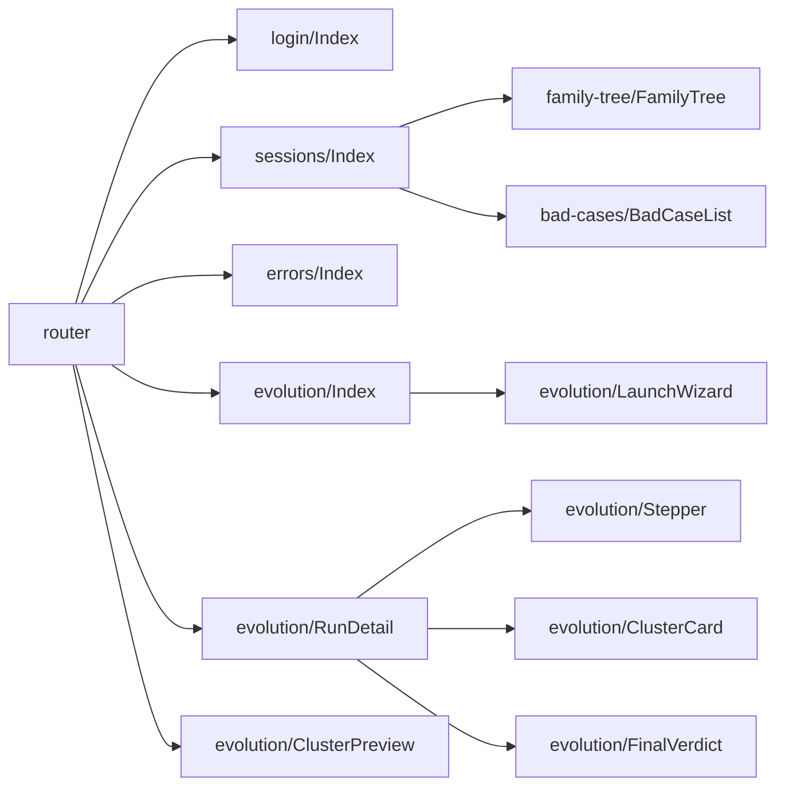
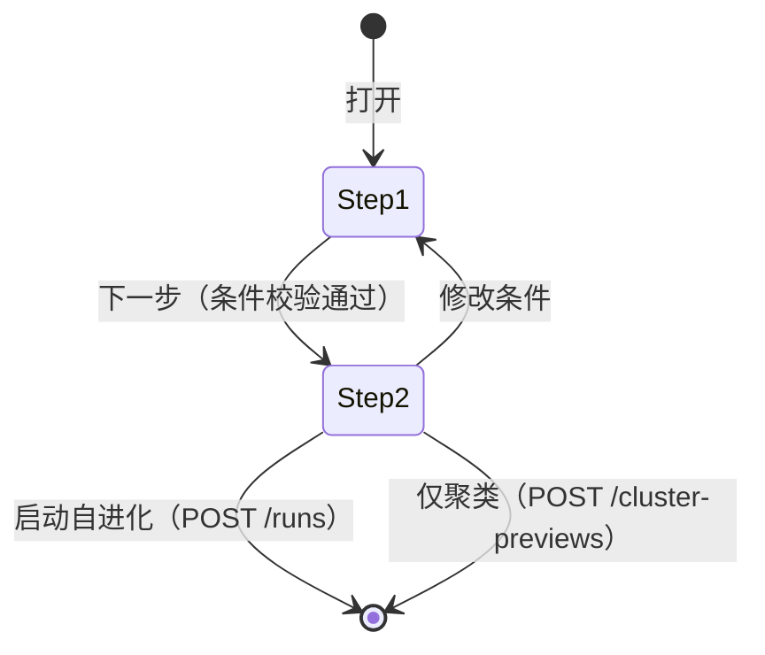
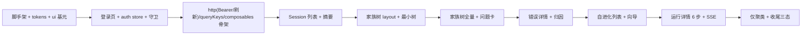

# 08 · 前端的实现设计

> 本文回答：每个页面用什么组件、数据怎么取、交互怎么实现、家族树怎么落地、V1 占位实现前端要注意什么。
> 前置：[03 前端架构](03-frontend-architecture.md) · [05 接口设计](05-api-design.md)；验收基准：[原型 HTML](../14-15-ui-prototype/harness-evolution.html) 与截图。

## 1. 页面与路由实现映射

| 路由 | 页面组件 | 主要数据 | 对应原型 |
|---|---|---|---|
| `/login` | `pages/login/Index.vue` | `POST /auth/login` | 登录页（唯一公开页） |
| `/sessions`、`/sessions/:sid` | `pages/sessions/Index.vue` | `GET /sessions`、`GET /sessions/{sid}`、`/tree`、`/bad-cases` | Session 浏览器 + 家族摘要 |
| `/sessions/:sid/errors` | `pages/errors/Index.vue` | `GET /sessions/{sid}/bad-cases`、`GET /bad-cases/{badCaseId}`、`/analysis`、`GET /probes/{probeId}` | 错误详情与归因 |
| `/evolution` | `pages/evolution/Index.vue` | `GET /evolution/runs`、`GET /catalogs/*` | 自进化列表 + 启动向导 |
| `/evolution/runs/:rid` | `pages/evolution/RunDetail.vue` | `GET /evolution/runs/{rid}`、`/steps/{n}` | 运行详情（6 步） |
| `/evolution/cluster/:previewId` | `pages/evolution/ClusterPreview.vue` | `GET /evolution/cluster-previews/{id}` | 仅聚类结果 |

> 时间线页面（原型 B 页）已裁撤，不设路由、不建页面，详见 §6。



## 2. 数据层实现

### 2.1 `api/http.ts`

```ts
export class ApiError extends Error {
  constructor(public status: number, public code: string, message: string, public details?: unknown) { super(message) }
}

async function request<T>(path: string, init?: RequestInit, _retried = false): Promise<T> {
  const token = useAuthStore().accessToken
  const res = await fetch(`${baseUrl}${path}`, {
    ...init,
    headers: { "content-type": "application/json", ...(token ? { authorization: `Bearer ${token}` } : {}), ...init?.headers },
  })
  if (res.status === 401 && !_retried && !path.startsWith("/api/auth/")) {
    await useAuthStore().refresh()              // refresh cookie 换新的 access token
    return request<T>(path, init, true)         // 只自动重试一次；refresh 失败则由 store 跳登录页
  }
  if (!res.ok) {
    const body = await res.json().catch(() => null)
    throw new ApiError(res.status, body?.error?.code ?? "HTTP_ERROR", body?.error?.message ?? res.statusText, body?.error?.details)
  }
  return res.json() as Promise<T>
}
```

- 基址：开发期 `/api`（Vite 代理到后端）；生产同源。
- 取消：`AbortController` 由 vue-query 传入 `signal`，http 层透传。
- 不在这里做重试——重试策略归 queryClient（4xx 不重试）。
- 401 处理只在 http 层这一处：先 refresh 一次再重放；`AUTH_EXPIRED` 且 refresh 也失败 → 清登录态 + 跳 `/login?redirect=…`。
- **避免循环依赖**：`http.ts` 不直接 import auth store；refresh 通过注入的回调（`setRefreshHandler`）或独立的 `authApi.ts` 完成，由 store 在初始化时注册。

### 2.2 `api/queryClient.ts`

```ts
export const queryClient = new QueryClient({
  defaultOptions: {
    queries: {
      staleTime: 30_000,
      gcTime: 5 * 60_000,
      refetchOnWindowFocus: false,
      retry: (count, err) => !(err instanceof ApiError && err.status < 500) && count < 2,
    },
  },
})
```

### 2.3 `api/queryKeys.ts`

```ts
export const keys = {
  sessions: (f?: SessionFilters) => ["sessions", f ?? {}] as const,
  session: (sid: string) => ["session", sid] as const,
  tree: (sid: string) => ["session", sid, "tree"] as const,
  badCases: (sid: string) => ["session", sid, "bad-cases"] as const,
  badCase: (badCaseId: string) => ["bad-case", badCaseId] as const,
  badCaseAnalysis: (badCaseId: string) => ["bad-case", badCaseId, "analysis"] as const,
  probe: (probeId: string) => ["probe", probeId] as const,
  sessionProbes: (sid: string) => ["session", sid, "probes"] as const,
  runs: () => ["evolution", "runs"] as const,
  run: (rid: string) => ["evolution", rid] as const,
  runStep: (rid: string, n: number) => ["evolution", rid, "step", n] as const,
  preview: (id: string) => ["evolution", "preview", id] as const,
  catalogs: () => ["catalogs"] as const,
  sources: () => ["acquisition", "sources"] as const,
  syncStatus: () => ["acquisition", "status"] as const,
}
```

失效规则：

| 动作 | 失效 |
|---|---|
| `POST /evolution/runs` | `["evolution","runs"]` |
| `POST /advance` / SSE `run.progress` | `["evolution", rid]` 前缀（详情 + 全部 step） |
| `POST /api/acquisition/sync` 完成（SSE） | `["sessions"]`、所有 `["session", …]` 前缀 |

### 2.4 composables 签名

```ts
// useAuth.ts
useLogin()          // mutation：成功 → 写 stores/auth + 跳 redirect
useLogout()         // mutation：登出 → 清态 + 跳 /login
useCurrentUser()    // 读 stores/auth（app 启动时 tryRefresh 填充）

// useSessions.ts
useSessionList(filters: Ref<SessionFilters>)        // GET /sessions?…
useSessionSummary(sid: Ref<string>)                  // GET /sessions/{sid}
useSessionTree(sid: Ref<string>)                     // GET /sessions/{sid}/tree
useSessionBadCases(sid: Ref<string>)                 // GET /sessions/{sid}/bad-cases

// useBadCases.ts
useBadCase(badCaseId: Ref<string>)
useBadCaseAnalysis(badCaseId: Ref<string>)           // enabled: 有 badCaseId
useProbe(probeId: Ref<string>)                       // enabled: 有 probeId
useSessionProbes(sid: Ref<string>)

// useEvolution.ts
useRuns()
useRun(rid: Ref<string>)
useRunStep(rid: Ref<string>, step: Ref<number>)      // enabled: step 可达
useProbeQuery()                                      // mutation → POST /evolution/probes/query
useCreatePreview()  usePreview(id)
useStartRun()  useAdvance(rid)

// useAcquisition.ts
useSources()          // GET /acquisition/sources
useSyncStatus()       // GET /acquisition/status
useTriggerSync()      // mutation：POST /acquisition/sync → 返回 jobId，SSE 跟进度
usePullSessions()     // mutation：POST /acquisition/pull（按 sessionRefs / window）

// useCatalogs.ts
useTargets()  useModels()                            // staleTime: Infinity
```

- 所有 composable 返回 `{ data, isLoading, isError, error, refetch }`，页面不直接碰 `http.ts`。
- `filters` 必须是 `computed`/`ref`（参考报告踩过的坑：传普通对象会把筛选冻结成首帧快照）。

### 2.5 SSE（`composables/useEvents.ts`）

```ts
export function useEvents(handlers: Record<string, (data: any) => void>) {
  let es: EventSource | null = null
  const connect = async () => {
    const { ticket } = await request<{ ticket: string }>("/api/events/ticket", { method: "POST" })
    es = new EventSource(`/api/events?ticket=${ticket}&topics=${topics}`)   // 断线重连时浏览器自动带 Last-Event-ID 头
    for (const [type, fn] of Object.entries(handlers)) es.addEventListener(type, e => fn(JSON.parse(e.data)))
    es.onerror = () => { es?.close(); setTimeout(connect, 3000) }   // 断线 3 秒重连（重新取票）
  }
  onMounted(() => { if (useAuthStore().isLoggedIn) void connect() })
  onUnmounted(() => es?.close())
}
```

- 只在 `App.vue` 建立一次连接；订阅的 topic 由当前页面通过 `provide/inject` 注册（run 详情页订阅自己的 `run:{rid}`）。
- EventSource 不能自定义请求头，所以用**一次性票据**（[05 §4.1](05-api-design.md)）；每次重连重新取票，票据不过期复用。
- 收到 `run.progress` / `sync.progress` 后**只失效 queryKey**，不直接改缓存数据（避免 SSE 与 REST 数据不一致）。
- 事件处理做 500ms 去抖：连续推进时合并成一次重取。
- 登出时主动 `es.close()`；重新登录后由 App.vue 重建。

## 3. 家族树（`components/family-tree/`）

### 3.1 文件结构

```text
family-tree/
  FamilyTree.vue          # 画布容器：VueFlow、fitView、focus、Teleport 问题列表
  layout.ts               # 纯函数：chainOf / buildGraph / 布局常量（移植自原型）
  layout.spec.ts          # 布局单测（demo-nested 用例）
  nodes/AgentNode.vue  nodes/BadCaseNode.vue  nodes/CollapseNode.vue
  edges/OrthEdge.vue  edges/BadCaseEdge.vue  edges/DiscoveryEdge.vue  edges/TriggerEdge.vue
  types.ts                # TreeNode / TreeEdge / BadCaseAnchor
```

### 3.2 布局核心（对原型逻辑的保留与简化）

保留（原样移植，仅补类型）：

- `chainOf(events, lines)`：按行号排序事件 → 触发点药丸 + `×N` 间隙药丸 → 返回 `{ items, offsets, width }`；宽度用 canvas `measureText` 精测（字体与 CSS 一致）。
- 布局常量：`LINK_W=10 / PILL_PAD=18 / CDOT=10 / BOX_PAD=10 / BOX_EDGE=1 / AGENT_BOX_H=80 / ROW_STEP=124 / INDENT=46 / MIN_STEP=38`。
- 兄弟分支的竖直通道聚合（24px 内的触发点共用一个 trunk）、问题卡左右侧判定（检测是否与兄弟分支竖直段相交）。
- 折叠规则：子节点 > 8 且未展开 → 生成 `collapse` 节点。

简化（因为后端给了显式归属）：

- 不再需要 `findingsBudget` 与"最后一个 agent"兜底：后端返回的每个 bad_case 带 `targetMemberId`（由 `badCaseSessionId` 解析）+ `anchorEventIndex`；`badCaseType` 决定挂载方向。
- 两类锚定规则（对应真实的 `self` / `discovery`）：
  1. **`self`（对象自身问题）**：卡挂在 `targetMemberId` 对应对象自身的触发点上——skill 用下方对齐（`TriggerEdge`），agent 用节点右侧/左侧（`BadCaseEdge`，按相交检测选边）。
  2. **`discovery`（发现前置步骤问题）**：卡挂在发现者（`object`）的触发点正上方（`DiscoveryEdge`），表达"它发现了前置步骤的问题"。
  3. 无锚点（`anchorEventIndex = -1`）：挂在目标成员节点右侧，避免卡片漂浮。

```ts
// layout.ts 关键签名
export function buildGraph(tree: SessionTree, expanded: Set<string>): { nodes: TreeVNode[]; edges: TreeVEdge[] }
export function chainOf(events: TreeEvent[], lines: number): Chain
export function badCaseAnchors(cases: BadCase[], tree: SessionTree): BadCaseAnchor[]
```

### 3.3 Vue Flow 集成

```vue
<VueFlow
  :nodes="nodes" :edges="edges"
  :node-types="nodeTypes" :edge-types="edgeTypes"
  :nodes-draggable="false" :nodes-connectable="false"
  :min-zoom="0.2" :max-zoom="2.5"
  @node-click="onNodeClick"
  @nodes-initialized="onNodesInitialized"
>
  <Background :gap="22" color="#e6e9ef" />
  <Controls position="bottom-right" :show-interactive="false" />
</VueFlow>
```

要点：

- `fitView` 必须等节点测量完成后执行（原型 `FitTree` 的教训）：监听 `onNodesInitialized` 再调 `fitView({ padding: 0.12 })`。
- 定位问题（从问题列表点击）→ `setCenter(node.x + w/2, node.y + h/2, { zoom: max(current, 0.85), duration: 260 })`，并给目标 bad_case 节点加 `active` class（红色描边）。
- 节点内部需要多个 Handle（`h{i}` 源、`ht{i}` 目标、`rep{i}`、`in`、`in-left`、`caseout`）——Vue Flow 的 `<Handle>` 支持 `id` 与 `position`，写法与 React 版逐行对应。
- 画布内问题列表用 `<Teleport to="#bad-case-list">`（原型用 `createPortal`）。
- 折叠节点点击 → 更新 `expanded` Set → 重新 `buildGraph`（纯函数重算，节点数少，不需要增量更新）。

### 3.4 问题列表联动

- 列表按 `createdAt` 升序；卡片点击 → `locate(badCaseId)`：滚动画布到视野中心 + 高亮。
- ID 徽章显示 `badCaseId` 前 8 位（`title` 给全量）；点击 → `window.open(badCaseDeepLink(...), "_blank")`。

## 4. 登录页与顶栏用户区（`pages/login/Index.vue`）

### 4.1 登录页

```text
Index.vue（居中卡片，无顶栏）
├── LoginForm.vue
│   ├── username / password 输入（el-input，回车提交）
│   ├── 错误提示条（AUTH_INVALID → "用户名或密码错误"）
│   └── 登录按钮（loading 态）
└── 页脚说明：组织内部系统，账号由管理员分配
```

- 提交：`useLogin().mutate({username, password})`；成功后写 `stores/auth`（access token + user）→ 跳 `route.query.redirect ?? "/sessions"`。
- 已登录访问 `/login` 直接跳 `/sessions`（路由守卫处理）。
- 首次登录要求改密码（后端 `mustChangePassword` 标记，可选，首版可省）。

### 4.2 顶栏用户区

`TopNav.vue` 右侧新增：演示数据角标（`phase=demo` 时显示）、同步入口按钮（触发 `POST /acquisition/sync`，显示最近同步时间）、当前用户名 + 下拉（退出登录）。退出：调 `POST /auth/logout` → 清 `stores/auth` → 断 SSE → 跳 `/login`。

### 4.3 同步入口与状态

- 顶栏同步按钮点击后显示 SSE 进度（小进度条或 Message 提示）；完成后失效 `["sessions"]` 前缀自动刷新列表。
- `GET /acquisition/status` 在顶栏 hover 时展示最近一次同步结果（imported/skipped/errors 摘要）。

## 5. Session 浏览器页（`pages/sessions/Index.vue`）

### 5.1 组件树

```text
Index.vue
├── SessionList.vue（左栏）
│   ├── SearchBox.vue
│   ├── StatusChips.vue
│   ├── SortSelect.vue
│   └── SessionCard.vue × N
└── FamilySummary.vue（右栏）
    ├── SummaryHeader.vue（标题/状态/meta/CTA）
    ├── StatStrip.vue（9 项）
    ├── FamilyTree.vue（画布）
    └── BadCaseList.vue（Teleport 目标）
```

### 5.2 交互细节

| 交互 | 实现 |
|---|---|
| 搜索 | 输入 300ms 防抖 → 更新 `filters.q` → queryKey 变化自动重取 |
| 状态筛选 | 三个 chip 单选（全部/完成/有失败）；`partial` 与 `fail` 都算"有失败"（原型只有 ok/partial） |
| 排序 | 4 个选项直传后端 `sort` |
| 选中 session | 路由到 `/sessions/:sid`；Pinia `selection` 记录当前 sid（列表高亮与详情共享） |
| 三态 | 列表加载：骨架 4 张；空：`EmptyState`（"没有匹配当前筛选的 session"）；失败：`ErrorState` + 重试 |
| 首屏无选中 | 自动选第一个 session（原型行为），URL 同步 |

### 5.3 密度条

后端给 `failPer100Steps / badCasesPer100Steps`，前端只做视觉：`width = min(100, rate / 3 * 100)%`，满格 3/百步。颜色用 `--red` / `--orange`。

## 6. 时间线页（已裁撤，不做）

2026-10-22 评审决定：**时间线页面（原型 B 页）不做**。本方案不再实现 `pages/timeline/*`、轮次吸顶、事件过滤 chips、步骤卡、展开/折叠与跳转轮次；相应路由、composable（`useTimeline`）与 queryKey 均已移除。

裁撤带来的前端调整：

| 位置 | 调整 |
|---|---|
| Session 摘要 CTA | 只保留「打开错误详情」，移除「打开时间线」 |
| 错误详情页头 | 移除「打开时间线」按钮，只保留「返回 Session」 |
| 面包屑 | 不再有"Session 浏览器 › 标题"的时间线面包屑；Session 页用顶栏 + 返回链接 |
| 数据层 | 不请求轮次/步骤/块；列表与摘要只用 `sessions` 的聚合字段（轮次、步骤、工具失败、token） |
| 代码高亮/长输出折叠 | 随页面一并移除，首版不引 highlight.js |

保留下来的能力：会话统计（轮次数、步骤数、工具失败数、token）仍由同步时聚合，展示在列表卡与摘要统计条上；这些数字不依赖时间线页面。

## 7. 错误详情页（`pages/errors/Index.vue`）

### 7.1 布局与数据

```text
Index.vue（grid: 340px 1fr）
├── ErrorSidebar.vue（错误列表：全部错误 + bad_case 卡）
└── ErrorMain.vue
    ├── ErrorHeader.vue（meta + 动作）
    ├── ErrorFlow.vue（Vue Flow，复用 FamilyTree 的布局与节点，仅过滤 bad_case 节点）
    └── ErrorTabs.vue
        ├── BadCaseDescription.vue（问题描述 tab：reason + metaData）
        └── ProbeReport.vue（归因 tab：probe 结论与推导）
```

数据：页面初始化 `useSessionBadCases(sid)` 拿全部 bad_case（含 `analysis.status/probeId`）；选中后 `useBadCase(badCaseId)` + `useBadCaseAnalysis(badCaseId)`，归因 tab 再 `useProbe(probeId)` 取详情。

### 7.2 选中与联动

| 行为 | 实现 |
|---|---|
| 选中错误 | URL 写 `?case={badCaseId}&tab=desc`；本地选中由 URL 派生（刷新可恢复） |
| 执行流过滤 | 选中时只保留该 `badCaseId` 对应的节点及其边；agent/skill 节点保留 |
| 全部错误 | `case` 参数移除，恢复完整执行流 + 空态详情 |
| Tab 切换 | URL `tab=desc|attr`；归因 tab 需要 `analysis.probeId` |
| 再点已选中卡 | 保持选中，不取消 |
| 未分析 | 归因 tab 显示"尚未分析"空态（外部归因未写入），不提供"触发分析"按钮 |

### 7.3 归因报告渲染顺序（固定）

1. 结论横幅：`analyzed_issue` + `probe.attributeType` → 问题（模型/prompt/错误）；`analyzed_nonissue` → 非问题；`unanalyzed` → 未分析
2. 非问题原因（`analysis.result.reason`）**或** 问题分类 + 根因对象（`probe.probeObject @ objectVersion`）
3. 归因出的问题描述（`probe.probeDescription`）
4. 分析推导过程（`probe.probeAnalysis`）
5. 来源 bad_case（`probe.fromBadCases`，显示 badCaseId 截短 + 链接）

> 注意：问题描述 tab 的"关联对象"是 **bad_case 的 object（上报者）**；归因 tab 的"根因对象"是 **probe.probeObject**，`discovery` 场景下两者不同，不要混用。

## 8. 自进化列表页（`pages/evolution/Index.vue`）

```text
Index.vue
├── PageHeader.vue（标题 + 启动按钮）
├── RunGroup.vue（"正在执行"）
│   └── RunCard.vue × N（进度条 + 阶段文案）
├── RunGroup.vue（"历史记录"）
│   └── RunCard.vue × N（badge + best vs 初始 + Δ + 接纳数）
└── LaunchWizard.vue（Modal，打开时挂载）
```

- 分组与排序由后端给（`running` / `history`），前端不重排。
- 进度条：`progress.percent` 直接用；阶段文案 `progress.stageLabel` 直接用（后端算）。
- 空态："当前没有正在执行的自进化"。

## 9. 启动向导（`evolution/LaunchWizard.vue`）

### 9.1 状态机



### 9.2 Step1 表单

- 对象类型分段控件（skill/agent）→ 切换后名称与版本级联重置（原型行为）。
- 名称/版本：`useTargets()` 提供（来自 `probe_reports` 的 DISTINCT 聚合）；版本取名称对应的 versions。
- 时间段：两个 `el-date-picker`，校验 `from <= to`。
- 模型多选：`useModels()` 提供的 chips，可全不选（= 全部模型）。
- 「下一步」：调 `useProbeQuery().mutate(condition)`（`POST /evolution/probes/query`），成功进 Step2；无匹配时后端 409 `NO_PROBES_MATCHED`。

### 9.3 Step2 命中确认

- 条件摘要条（chip 形式）+ 「修改条件」。
- 统计：sessions / probes / usedProbes / 按 `attributeType` 的分布条 + 图例。
- probe 表：5 列（probe ID / 归属会话 / 根因对象@版本 / 属性类型 / 来源 bad_case）；ID 显示截短 + tooltip，点击新窗口打开对应问题详情。
- 分页：每页 8 条。
- 两个出口：
  - 「启动问题聚类分析」→ `useCreatePreview()`（`POST /cluster-previews`，创建 `cluster_only` run）→ 路由 `/evolution/cluster/:runId`
  - 「启动自进化 →」→ `useStartRun()` → 路由 `/evolution/runs/:rid`

### 9.4 占位数据说明

- 命中数字来自真实 `probe_reports` 查询，不再哈希模拟。
- 若库里没有 probe 数据（开发环境），用 `fixtures` seed 后即可演示；前端不做任何桩分支。

## 10. 运行详情页（`pages/evolution/RunDetail.vue`）

### 10.1 结构

```text
RunDetail.vue
├── DetailHeader.vue（标题 + 状态 + 模拟推进按钮）
├── infoPanel（目标与输入：kv-grid + 类型分布条）
├── StepperPanel.vue
│   ├── Stepper.vue（6 步，来自 run.steps）
│   └── StepContent.vue（按 step 动态组件）
│       ├── StepFilter.vue / StepClusters.vue / StepProbeConfirm.vue
│       ├── StepRanking.vue / StepIterations.vue / StepFinal.vue
└── （step 4 内）ClusterCard.vue → DiffView / EvalCompare / CommitBlock
```

### 10.2 交互

| 交互 | 实现 |
|---|---|
| 默认选中步 | `run.steps` 中第一个 `active`；没有则最后一个 `done`；没有则第 0 步（但不可点） |
| 点击 stepper | 只允许 `clickable === true` 的节点；点击 → `?step=n` + 拉 `useRunStep` |
| Step 4 聚类展开 | 本地 `expandedClusters: Set<string>`；默认展开当前进行中的轮次 |
| 「模拟推进一轮」 | `useAdvance().mutate(rid)` → 成功后失效 `["evolution", rid]`，SSE 也会触发同样的失效（去抖去重） |
| 进度实时更新 | `useEvents` 订阅 `run:{rid}`；`run.progress` 事件 → 失效前缀；`run.completed` → 额外失效 `["evolution","runs"]` |
| 未到达的 step | 后端返回 404 `STEP_NOT_READY`；前端不请求（`enabled: step.clickable`） |

### 10.3 Step4 迭代卡

- 卡片头：排名、簇类型 chip、probe 数、状态 badge（待执行 / 评测中 / 已接纳 Δ / 未接纳 Δ）。
- 展开内容顺序：簇内 probe 列表 → patch diff → 评测对比 → commit / 拒绝说明。
- `DiffView`：行首 `+`/`-`/`@@` 着色；原型的 diff 行数组直接渲染即可，不需要解析 unified diff。
- `EvalCompare`：两条横向条（current 灰 / candidate 绿或红），宽度按 `max(cur,cand)*1.06` 归一（原型算法）。

## 11. 仅聚类页（`pages/evolution/ClusterPreview.vue`）

- 顶部 banner："仅聚类分析：未执行 patch 生成与评测迭代" + 「以这批问题启动自进化 →」。
- 输入概况：session / probe / 聚类数。
- 聚类列表：每簇展示类型、probe 数、簇内 probe 列表（可展开）。
- 数据来自 `mode=cluster_only` 的 run（`GET /runs/{rid}/steps/1`）；「启动自进化」用同一条件再创建 `mode=full` 的 run。

## 12. 样式与视觉实现

### 12.1 设计令牌（`styles/tokens.css`）

从原型 `:root` 原样移植：`--bg/--bg-panel/--bg-card/--bg-inset/--border/--text/--text-dim/--text-faint/--blue/--green/--orange/--red/--purple/--cyan/--mono`。

### 12.2 状态色与类型色（前端常量，唯一允许的"静态数据"）

```ts
export const ANALYSIS_STATUS_META = {
  unanalyzed:        { label: "未分析", cls: "unanalyzed" },
  analyzed_nonissue: { label: "非问题", cls: "nonissue" },
  "issue-model":     { label: "是问题-模型问题", cls: "issue-model" },
  "issue-prompt":    { label: "是问题-prompt缺失某些提示词", cls: "issue-prompt" },
  "issue-error":     { label: "是问题-错误", cls: "issue-error" },
} as const

// 展示值由 analysis.status + probe.attributeType 推导（见 §7.3）
export const TYPE_COLOR: Record<string, string> = {
  nonissue: "var(--text-faint)",
  error: "var(--red)",
  prompt: "var(--orange)",
  model: "var(--purple)",
}
```

### 12.3 与 Element Plus 的分工

- EP 只用于：日期选择、下拉、分页、Modal 基础行为、Message 提示。
- 其余全部自研（卡片、chip、badge、statstrip、density、stepper、cluster、diff、eval bar）——原型就是自研样式，直接复用其 CSS 结构可保证视觉一致。
- EP 主题只覆盖主色/圆角/字号（`element-overrides.css`）。

## 13. 三态、错误与加载

每个页面统一：

| 状态 | 表现 |
|---|---|
| 加载 | 骨架屏（列表 4 张卡；家族摘要 1 个 panel；详情 1 个 panel） |
| 空 | `EmptyState`：图标 + 一句人话 + 可选操作 |
| 错误 | `ErrorState`：错误码/消息 + 「重试」；404 显示"不存在或已删除"；409（如 RUN_BUSY）显示 Message 提示不整页报错 |

全局：`app.config.errorHandler` 捕获未处理异常 → `ElMessage.error` + 控制台上报（不白屏）。

## 14. 测试计划

| 类型 | 范围 | 工具 |
|---|---|---|
| 纯函数 | `layout.ts`（chainOf/buildGraph/锚定）、`badCaseId.ts`（截短/深链）、`queryKeys.ts` | Vitest |
| 组件 | SessionCard 密度条、Stepper 状态、ClusterCard 展开、DiffView 着色 | Vue Test Utils |
| 契约 | 生成类型能被真实响应赋值（编译期）；`openapi` 生成物不含 `any` | `vue-tsc` + `pnpm contract:check` |
| 交互 | 向导两步流转、深链进入 errors 页恢复选中、SSE 事件触发重取 | VTU + MSW（仅组件测试） |
| 视觉回归（后续） | 关键页面截图对比原型 | Playwright（暂不进 CI） |

## 15. 实施顺序（前端内部依赖）



每个 PR 建议：一个页面或一个组件族 + 对应测试 + 与后端接口的联调截图（放 PR 描述）。原型截图可作为视觉对照：
- 家族树：[execution-flow](../14-15-ui-prototype/screenshot-claude-code-execution-flow.png)
- 错误详情：[errors](../14-15-ui-prototype/screenshot-claude-code-errors.png)
- 归因：[attribution](../14-15-ui-prototype/screenshot-claude-code-attribution.png)
- 问题卡：[problem](../14-15-ui-prototype/screenshot-claude-code-problem.png)

## 16. V1 占位实现的前端说明（重要）

- **前端没有 mock 分支**：所有数据来自真实 HTTP 与真实表。开发/演示时用 `fixtures` seed 造数。
- 登录态：V1 也必须登录（初始管理员由后端 env 播种），鉴权链路从一开始就是真实的；SSE 票据每次重连都重新申请。
- 「模拟推进」按钮在 V1 可见（编排真实、patch/评测为占位）；真实执行器接入后隐藏按钮。
- 真实执行接入时前端**零改动**：接口形状不变，只是数据来源从占位值换成真实执行结果。
