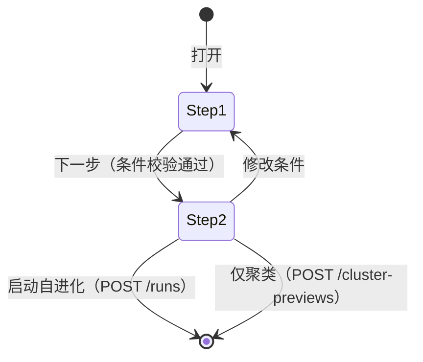

# 08 · 前端的实现设计

> 本文回答：每个页面用什么组件、数据怎么取、交互怎么实现、Agent 执行流图怎么落地、V1 占位实现前端要注意什么。
> 前置：[03 前端架构](03-frontend-architecture.md) · [05 接口设计](05-api-design.md)；验收基准：[原型 HTML](../14-15-ui-prototype/harness-evolution.html) 与截图。

## 1. 页面与路由实现映射

| 路由 | 页面组件 | 主要数据 | 对应原型 |
|---|---|---|---|
| `/login` | `pages/login/Index.vue` | `POST /auth/login` | 登录页（唯一公开页） |
| `/change-password` | `pages/login/ChangePassword.vue` | `POST /auth/change-password`、`POST /auth/refresh`、`GET /auth/me` | 首次登录强制改密（需登录） |
| `/sessions`、`/sessions/:sid` | `pages/sessions/Index.vue` | `GET /sessions`、`GET /sessions/{sid}`、`/tree`、`/bad-cases` | Session 浏览器 + 会话概览 |
| `/sessions/:sid/errors` | `pages/errors/Index.vue` | `GET /sessions/{sid}/bad-cases`、`GET /bad-cases/{badCaseId}`、`/analysis`、`GET /probes/{probeId}` | 错误详情与归因 |
| `/evolution` | `pages/evolution/Index.vue` | `GET /evolution/runs`、`GET /catalogs/*` | 自进化列表 + 启动向导 |
| `/evolution/targets` | `pages/evolution/targets/Index.vue` | `GET/POST/PUT/DELETE /evolution/targets`、`GET .../versions` | **进化对象配置页（新增）** |
| `/evolution/runs/:rid` | `pages/evolution/RunDetail.vue` | `GET /evolution/runs/{rid}`、`/steps/{key}` | 运行详情（6 步） |
| `/evolution/cluster/:previewId` | `pages/evolution/ClusterPreview.vue` | `GET /evolution/runs/{rid}`、`/steps/clusters` | 仅聚类结果 |

> 时间线页面（原型 B 页）已裁撤，不设路由、不建页面，详见 §6。
> `/evolution/cluster/:previewId` 的 `previewId` 即 `mode=cluster_only` run 的 `runId`（[05 §4.12](05-api-design.md)），页面复用 run 详情的数据接口（`GET /runs/{rid}` + `steps/clusters`），不单独建数据通道。

```text
router
├── /login ───────────────────────► login/Index
├── /change-password ─────────────► login/ChangePassword
├── /sessions ────────────────────► sessions/Index
│                                     ├──► agent-tree/AgentTree
│                                     └──► bad-cases/BadCaseList
├── /sessions/:sid/errors ────────► errors/Index
├── /evolution ───────────────────► evolution/Index
│                                     └──► pages/evolution/components/LaunchWizard
├── /evolution/runs/:rid ─────────► evolution/RunDetail
│                                     ├──► pages/evolution/components/Stepper
│                                     ├──► pages/evolution/components/ClusterCard
│                                     ├──► pages/evolution/components/FinalVerdict
│                                     └──► pages/evolution/components/RunLogPanel
├── /evolution/cluster/:previewId ─► evolution/ClusterPreview
└── /evolution/targets ───────────► evolution/targets/Index
```

## 2. 数据层实现

### 2.1 API 模块拆分

请求函数按域放，**不建 `api/index.ts` barrel**；模型来自 `packages/contracts`，筛选类型放对应域文件。

| 文件 | 内容 |
|---|---|
| `api/http.ts` | 传输层（Bearer/401 刷新/403 改密跳转/`ApiError`/取消） |
| `api/queryClient.ts` | 全局缓存策略 |
| `api/queryKeys.ts` | queryKey 工厂（集中） |
| `api/auth.ts` | login / refresh / logout / changePassword / me |
| `api/sessions.ts` | 列表 / 会话概览 / Agent 会话树 / 问题 |
| `api/badCases.ts` | 问题详情 / 归因状态 |
| `api/probes.ts` | 归因结论 |
| `api/evolution.ts` | runs / 六步 / 事件 / 配置 / 启动（runs、cluster-previews）/ 重试 |
| `api/acquisition.ts` | 同步 / 拉取 / 状态 |
| `api/catalogs.ts` | 对象 / 模型清单 |

### 2.2 `api/http.ts`

```ts
export class ApiError extends Error {
  constructor(public status: number, public code: string, message: string, public details?: unknown) { super(message) }
}

async function request<T>(path: string, init?: RequestInit, _retried = false): Promise<T> {
  const token = useAuthStore().accessToken
  const res = await fetch(`${baseUrl}${path}`, {
    ...init,
    headers: { "content-type": "application/json", ...(token ? { authorization: `Bearer ${token}` } : {}), ...init?.headers },
  })
  if (res.status === 401 && !_retried && !path.startsWith("/api/auth/")) {
    await useAuthStore().refresh()              // refresh cookie 换新的 access token
    return request<T>(path, init, true)         // 只自动重试一次；refresh 失败则由 store 跳登录页
  }
  if (!res.ok) {
    const body = await res.json().catch(() => null)
    throw new ApiError(res.status, body?.error?.code ?? "HTTP_ERROR", body?.error?.message ?? res.statusText, body?.error?.details)
  }
  return res.json() as Promise<T>
}
```

- 基址：开发期 `/api`（Vite 代理到后端）；生产同源。
- 取消：`AbortController` 由 vue-query 传入 `signal`，http 层透传。
- 不在这里做重试——重试策略归 queryClient（4xx 不重试）。
- 401 处理只在 http 层这一处：先 refresh 一次再重放；`AUTH_EXPIRED` 且 refresh 也失败 → 清登录态 + 跳 `/login?redirect=…`。
- `403 PASSWORD_CHANGE_REQUIRED` 也在这里兜底：说明本地 `mustChangePassword` 已陈旧，置 store 标记后跳 `/change-password?redirect=…`，不把业务页渲染成错误态（正常路径由路由守卫先拦，见 [03 §6](03-frontend-architecture.md)）。
- **避免循环依赖**：`http.ts` 不直接 import auth store 或 router；refresh 与改密跳转都通过注入的回调（`setRefreshHandler` / `setPasswordChangeHandler`）完成，由 store 在初始化时注册。

### 2.3 `api/queryClient.ts`

```ts
export const queryClient = new QueryClient({
  defaultOptions: {
    queries: {
      staleTime: 30_000,
      gcTime: 5 * 60_000,
      refetchOnWindowFocus: false,
      retry: (count, err) => !(err instanceof ApiError && err.status < 500) && count < 2,
    },
  },
})
```

### 2.4 `api/queryKeys.ts`

```ts
export type StepKey = "input" | "clusters" | "attribution" | "severity" | "iteration" | "final"

export const keys = {
  sessions: (f?: SessionFilters) => ["sessions", f ?? {}] as const,
  session: (sid: string) => ["session", sid] as const,
  tree: (sid: string) => ["session", sid, "tree"] as const,
  badCases: (sid: string) => ["session", sid, "bad-cases"] as const,
  badCase: (badCaseId: string) => ["bad-case", badCaseId] as const,
  badCaseAnalysis: (badCaseId: string) => ["bad-case", badCaseId, "analysis"] as const,
  probe: (probeId: string) => ["probe", probeId] as const,
  sessionProbes: (sid: string) => ["session", sid, "probes"] as const,
  runs: () => ["evolution", "runs"] as const,
  run: (rid: string) => ["evolution", rid] as const,
  runStep: (rid: string, key: StepKey) => ["evolution", rid, "step", key] as const,
  runEvents: (rid: string, afterSeq = 0) => ["evolution", rid, "events", afterSeq] as const,
  catalogs: () => ["catalogs"] as const,
  syncStatus: () => ["acquisition", "status"] as const,
  targets: () => ["evolution", "targets"] as const,
  targetVersions: (id: string) => ["evolution", "targets", id, "versions"] as const,
}
```

失效规则：

| 动作 | 失效 |
|---|---|
| `POST /evolution/runs` | `["evolution","runs"]` |
| `POST /runs/{rid}/retry` / SSE `run.progress` | `["evolution", rid]` 前缀（详情 + 全部 step） |
| sync job 完成（轮询 `GET /jobs/{jobId}` 发现；sync 无 SSE） | `["sessions"]`、所有 `["session", …]` 前缀、`["catalogs"]`（模型清单随归一化更新） |

> 仅聚类预览页复用 `keys.run(rid)` / `keys.runStep(rid, "clusters")`：`previewId` 即 `cluster_only` run 的 runId，不单设 queryKey。

### 2.5 composables 签名

```ts
// useAuth.ts
useLogin()          // mutation：成功 → 写 stores/auth + 跳 redirect（mustChangePassword=true 时被守卫改道改密页）
useLogout()         // mutation：登出 → 清态 + 跳 /login
useCurrentUser()    // 读 stores/auth（app 启动时 tryRefresh 填充）
useChangePassword() // mutation：改密 → 成功后 refresh() + 重取 me → 跳 redirect

// useSessions.ts
useSessionList(filters: Ref<SessionFilters>)        // GET /sessions?…
useSessionSummary(sid: Ref<string>)                  // GET /sessions/{sid}
useSessionTree(sid: Ref<string>)                     // GET /sessions/{sid}/tree
useSessionBadCases(sid: Ref<string>)                 // GET /sessions/{sid}/bad-cases

// useBadCases.ts
useBadCase(badCaseId: Ref<string>)
useBadCaseAnalysis(badCaseId: Ref<string>)           // enabled: 有 badCaseId
useProbe(probeId: Ref<string>)                       // enabled: 有 probeId
useSessionProbes(sid: Ref<string>)

// useEvolution.ts
useRuns()
useRun(rid: Ref<string>)
useRunStep(rid: Ref<string>, key: Ref<StepKey>)      // enabled: 该 step 可达
useRunEventLog(rid: Ref<string>)                     // GET /evolution/runs/{rid}/events（afterSeq 分页拉取，日志面板数据源；REST 是事实源）
useProbeQuery()                                      // mutation → POST /evolution/probes/query
useCreatePreview()
useStartRun()   useRetry(rid)

// useAcquisition.ts
useSyncStatus()       // GET /acquisition/status
useTriggerSync()      // mutation：POST /acquisition/sync → 后台处理待归一化 payload；轮询 status，不订 SSE
usePullSessions()     // mutation：POST /acquisition/pull（按 sessionIds / window）

// useTargets.ts
useTargets()          // GET /catalogs/targets（向导候选；仅 enabled）
useTargetConfigs()    // GET /evolution/targets（配置页 CRUD）
useTargetVersions(id) // GET /evolution/targets/{id}/versions（仓库 tag）
useCreateTarget() useUpdateTarget() useDeleteTarget()   // admin 写操作

// useCatalogs.ts
useModels()           // GET /catalogs/models（来自 agents.model 聚合；staleTime ∞，见 [03 §7](03-frontend-architecture.md)，靠写路径显式失效刷新）
```

- 所有 composable 返回 `{ data, isLoading, isError, error, refetch }`，页面不直接碰 `http.ts`。
- `filters` 必须是 `computed`/`ref`（参考报告踩过的坑：传普通对象会把筛选冻结成首帧快照）。

### 2.6 SSE（`composables/useRunEvents.ts`）

```ts
export function useRunEvents(rid: Ref<string>, loadedSeq: Ref<number>, isActive: Ref<boolean>) {
  let es: EventSource | null = null
  let closed = false
  const connect = async () => {
    if (closed) return
    const { ticket } = await request<{ ticket: string }>("/api/events/ticket", {
      method: "POST",
      body: JSON.stringify({ topics: [`run:${rid.value}`], lastEventId: loadedSeq.value }),
    })
    es = new EventSource(`/api/events?ticket=${ticket}`)
    es.addEventListener("run.event", e => { appendEvent(JSON.parse(e.data)); loadedSeq.value = ... })
    es.addEventListener("run.progress", () => invalidateRun(rid.value))
    es.addEventListener("run.blocked", () => { es?.close(); invalidateRun(rid.value) })
    for (const type of ["run.completed", "run.failed", "run.interrupted"]) {
      es.addEventListener(type, () => { closed = true; es?.close(); invalidateRun(rid.value) })
    }
    es.addEventListener("reset", () => { es?.close(); void reloadRunSnapshot(rid.value) })
    es.onerror = () => { es?.close(); if (!closed) setTimeout(connect, 3000) }  // 重连重新取票
  }
  onMounted(() => { if (isActive.value) void connect() })
  watch(isActive, active => { if (active) void connect(); else es?.close() })
  onUnmounted(() => { closed = true; es?.close() })
}
```

- **页面级，不是全局**：App.vue 不建立常驻 SSE；只有 `preparing/running` 的 run 详情才调用 `useRunEvents`；`isActive` 由 `run.status` computed 得出，`blocked` 时关闭并走轮询/重试。
- **先 REST 后 SSE**：页面先并行拉 `run` / `step` / `events?afterSeq=0`（分页拉完）渲染初版，再把**已加载的最后一条事件 seq** 传给 ticket 的 `lastEventId`，补齐快照与流之间的空档。
- **已完成 run**：不取 ticket、不建 SSE；翻 step / 日志继续走 REST。
- **同步动作不订阅 SSE**：后台 scheduler / admin 手动只写 `job_runs`；前端轮询 `GET /acquisition/status` 或 `GET /jobs/{id}`。
- 重连时浏览器自动带 `Last-Event-ID`；服务端从 DB 事件回放。收到 `reset` 说明游标已失效，前端重新拉 REST 快照。
- 收到 `run.progress` 只失效 queryKey；`run.event` 可增量 append（DB 事件是事实源）。
- 离开页面、run 终态、登出都主动 `es.close()`。

## 3. Agent 执行流图（`components/agent-tree/`）

### 3.1 文件结构

```text
agent-tree/
  AgentTree.vue           # 画布容器：VueFlow、fitView、focus、Teleport 问题列表
  layout.ts               # 纯函数：chainOf / buildGraph / 布局常量（移植自原型）
  layout.spec.ts          # 布局单测（demo-nested 用例）
  nodes/AgentNode.vue  nodes/BadCaseNode.vue  nodes/CollapseNode.vue
  edges/OrthEdge.vue  edges/BadCaseEdge.vue  edges/DiscoveryEdge.vue  edges/TriggerEdge.vue
  types.ts                # TreeNode / TreeEvent / TreeEdge / BadCaseAnchor
```

- `TreeEvent`：`line`、`kind`、`name?`、`desc?`、`toolUseId?`、`messageOffset`。
- `TreeNode`：`agentId`、`parentAgentId`、`kind`、`agentType`、`taskKind`、`spawnDepth`、`label`、`messagesCount`、`events`。
- 节点标题直接用后端 `label`，不在前端按 `agentType` / skill 名重算；普通 skill 只是 `events[]` 里的触发点，没有自己的节点。

### 3.2 布局核心（对原型逻辑的保留与简化）

保留（布局结构原样移植；`×N` 口径改为 message 间隔）：

- `chainOf(events, messagesCount)`：按 `messageOffset` 排序事件 → 触发点药丸 + `×N` 间隔药丸 → 返回 `{ items, offsets, width }`；宽度用 canvas `measureText` 精测（字体与 CSS 一致）。
- `×N` 的 N 是 **assistant message 间隔**，不是 JSONL 行号差：
  - 首个触发点之前：`first.messageOffset`
  - 两个触发点之间：`next.messageOffset - current.messageOffset`
  - 尾部：`messagesCount - last.messageOffset`
  - 无事件时：整段作为一个尾部间隔，N=`messagesCount`
  - `line` 仍用于显示 `L30`、排序 tie-break 和调试，不参与 N 的计算。
- 布局常量：`LINK_W=10 / PILL_PAD=18 / CDOT=10 / BOX_PAD=10 / BOX_EDGE=1 / AGENT_BOX_H=80 / ROW_STEP=124 / INDENT=46 / MIN_STEP=38`。
- 兄弟分支的竖直通道聚合（24px 内的触发点共用一个 trunk）、问题卡左右侧判定（检测是否与兄弟分支竖直段相交）。
- 折叠规则：子节点 > 8 且未展开 → 生成 `collapse` 节点。

简化（因为后端给了显式归属）：

- 不再需要 `findingsBudget` 与"最后一个 agent"兜底：后端返回的每个 bad_case 带 `anchor {agentId, eventIndex}`；`badCaseType` 决定挂载方向。
- 锚定规则（`self` / `discovery` 两类 + 无锚点兜底）：
  1. **`self`（对象自身问题）**：`anchor.agentId` 就是上报人 A；skill 卡挂在 A 的该 skill 触发药丸下方（`TriggerEdge`），agent 卡挂在 A 节点右侧/左侧（`BadCaseEdge`，按相交检测选边）。
  2. **`discovery`（发现前置步骤问题）**：卡挂在发现者的触发点正上方（`DiscoveryEdge`）。发现者是 skill 时触发点在 A 内；发现者是 subagent A 时，触发点是**父节点 P 中调用 A 的 Agent 药丸**，`anchor.agentId = P`，不等于 `badCaseAgent.agentId`。
  3. 无锚点（`anchor.eventIndex = -1`）：挂在 `anchor.agentId` 节点右侧，避免卡片漂浮。
- 前端只用 `anchor` 定位，不用 `badCaseAgent` 反推宿主；`badCaseAgent` 用于展示"谁上报"。
- 同一触发点有多张问题卡时保持 pill 的 x 中心成列：`self-skill` 向下串联，`discovery` 向上串联；第一张由 pill 的上/下锚点连接，后续卡由上一张卡的同向锚点继续连接。

```ts
// layout.ts 关键签名
export function buildGraph(tree: SessionTree, expanded: Set<string>): { nodes: TreeVNode[]; edges: TreeVEdge[] }
export function chainOf(events: TreeEvent[], messagesCount: number): Chain
export function badCaseAnchors(cases: BadCase[], tree: SessionTree): BadCaseAnchor[]
```

### 3.3 Vue Flow 集成

```vue
<VueFlow
  :nodes="nodes" :edges="edges"
  :node-types="nodeTypes" :edge-types="edgeTypes"
  :nodes-draggable="false" :nodes-connectable="false"
  :min-zoom="0.2" :max-zoom="2.5"
  @node-click="onNodeClick"
  @nodes-initialized="onNodesInitialized"
>
  <Background :gap="22" color="#e6e9ef" />
  <Controls position="bottom-right" :show-interactive="false" />
</VueFlow>
```

要点：

- `fitView` 必须等节点测量完成后执行（原型 `FitTree` 的教训）：监听 `onNodesInitialized` 再调 `fitView({ padding: 0.12 })`。
- 定位问题（从问题列表点击）→ `setCenter(node.x + w/2, node.y + h/2, { zoom: max(current, 0.85), duration: 260 })`，并给目标 bad_case 节点加 `active` class（红色描边）。
- 节点只为真实边占用的方向创建 Handle：`h{i}` 从 pill 下沿连接子 Agent 或 `self-skill` 卡，`rep{i}` 从 pill 上沿连接 `discovery` 卡，另有 `in`、`finding-left/right` 与问题卡的上下/堆叠锚点；不再用 Agent 节点内的 stub 补画连接。
- 画布内问题列表用 `<Teleport to="#bad-case-list">`（原型用 `createPortal`）。
- 折叠节点点击 → 更新 `expanded` Set → 重新 `buildGraph`（纯函数重算，节点数少，不需要增量更新）。

### 3.4 问题列表联动

- 列表按 `createdAt` 升序；卡片点击 → `locate(badCaseId)`：滚动画布到视野中心 + 高亮。
- ID 徽章显示 `badCaseId` 前 8 位（`title` 给全量）；点击 → `window.open(badCaseDeepLink(...), "_blank")`。

## 4. 登录页、强制改密与顶栏用户区（`pages/login/*`）

### 4.1 登录页与强制改密

```text
Index.vue（居中卡片，无顶栏）
├── LoginForm.vue
│   ├── username / password 输入（el-input，回车提交）
│   ├── 错误提示条（AUTH_INVALID → "用户名或密码错误"）
│   └── 登录按钮（loading 态）
└── 页脚说明：组织内部系统，账号由管理员分配
```

- 提交：`useLogin().mutate({username, password})`；成功后写 `stores/auth`（access token + user）→ 跳 `route.query.redirect ?? "/sessions"`。
- 已登录访问 `/login` 直接跳 `/sessions`（路由守卫处理）。
- **首次登录强制改密**：账号只能由 admin 创建或由 env 播种，初始密码一律由他人设定，因此登录响应带 `user.mustChangePassword=true`；此时业务端点回 `403 PASSWORD_CHANGE_REQUIRED`，前端只放行 `/change-password`。

`pages/login/ChangePassword.vue`（同款居中卡片，需登录，未登录跳 `/login`）：

```text
ChangePasswordCard.vue
├── 提示条：初始密码由管理员分配，首次登录请设置自己的密码
├── oldPassword / newPassword / confirmPassword（el-input type=password）
├── 本地校验：两次新密码一致、新密码不等于旧密码
└── 提交 → POST /auth/change-password → 成功后 refresh() + 重取 me → 跳 redirect ?? "/sessions"
```

- 成功后**必须换一次 token**：access token 的 `mcp` 声明是登录时签的，改密后要 `POST /auth/refresh`（重读用户行重签）再 `GET /auth/me` 拿到 `mustChangePassword=false`，守卫才放行到 `redirect`。
- 守卫：`user.mustChangePassword === true` 时，除 `/change-password` 与 `/login` 外的导航一律重定向到 `/change-password?redirect=<原路径>`（[03 §6](03-frontend-architecture.md)）。
- 兜底：http 层收到 `403 PASSWORD_CHANGE_REQUIRED`（本地标记已陈旧）时置 store 标记并跳改密页，不渲染业务页错误态。

### 4.2 顶栏用户区

`TopNav.vue` 右侧：演示数据角标（`phase=demo`）、轨迹处理状态（`pending` 数量，hover 展示 `GET /acquisition/status` 摘要）、当前用户名 + 下拉（退出登录）。普通用户不提供“同步”按钮；admin 下拉里可有「立即处理」（`POST /acquisition/sync`，幂等，返回已有 jobId 时只提示）。退出：调 `POST /auth/logout` → 清 `stores/auth` → 关页面级 SSE → 跳 `/login`。

### 4.3 轨迹处理状态

- 顶栏只展示 `pending` 数量与最近一次处理结果（`GET /acquisition/status`），不建立 SSE。
- 后台 scheduler 默认每 60s 处理；admin 的「立即处理」触发后，前端轮询 `GET /jobs/{jobId}` 或 `GET /acquisition/status`，完成后失效 `["sessions"]` 前缀。
- 普通用户不需要手动触发；数据会在下一轮 scheduler 自动出现。

## 5. Session 浏览器页（`pages/sessions/Index.vue`）

### 5.1 组件树

```text
Index.vue
├── SessionList.vue（左栏）
│   ├── SearchBox.vue
│   ├── StatusChips.vue
│   ├── SortSelect.vue
│   └── SessionCard.vue × N
└── SessionOverview.vue（右栏）
    ├── SummaryHeader.vue（标题/状态/meta/CTA）
    ├── StatStrip.vue（9 项）
    ├── AgentTree.vue（画布）
    └── BadCaseList.vue（Teleport 目标）
```

### 5.2 交互细节

| 交互 | 实现 |
|---|---|
| 搜索 | 输入 300ms 防抖 → 更新 `filters.q` → queryKey 变化自动重取 |
| 状态筛选 | 三个 chip 单选（全部/完成/有失败）；`partial` 与 `fail` 都算"有失败"（原型只有 ok/partial）；对应 `status=all/ok/problem`（[05 §4.2](05-api-design.md)） |
| 排序 | 4 个选项直传后端 `sort` |
| 选中 session | 路由到 `/sessions/:sid`；列表高亮由当前路由参数派生，**不再用 Pinia 存当前 sid** |
| 数据加载 | `useSessionSummary` / `useSessionTree` / `useSessionBadCases` 三个 query **并行**；会话概览先到先渲染，树和问题列表各自 skeleton，互不阻塞 |
| 三态 | 列表加载：骨架 4 张；空：`EmptyState`（"没有匹配当前筛选的 session"）；失败：`ErrorState` + 重试 |
| 首屏无选中 | 自动选第一个 session（原型行为），URL 同步 |

### 5.3 密度条

后端给 `failPer100Messages / badCasesPer100Messages`，前端只做视觉：`width = min(100, rate / 3 * 100)%`，满格 3/百消息。颜色用 `--red` / `--orange`。

## 6. 时间线页（已裁撤，不做）

2026-10-22 评审决定：**时间线页面（原型 B 页）不做**，完整时间线由外部平台承担。本方案不再实现 `pages/timeline/*`、用户轮次吸顶、事件过滤 chips、消息卡、展开/折叠与跳转用户轮次；相应路由、composable（`useTimeline`）与 queryKey 均已移除。

裁撤带来的前端调整：

| 位置 | 调整 |
|---|---|
| 会话概览 CTA | 只保留「打开错误详情」，移除「打开时间线」 |
| 错误详情页头 | 移除「打开时间线」按钮，只保留「返回 Session」 |
| 面包屑 | 不再有"Session 浏览器 › 标题"的时间线面包屑；Session 页用顶栏 + 返回链接 |
| 数据层 | 不请求用户轮次/消息/内容块；列表与会话概览只用 `session_families` 的整树聚合字段（用户轮次、消息、工具失败、token） |
| 代码高亮/长输出折叠 | 随页面一并移除，首版不引 highlight.js |

保留下来的能力：会话统计（用户轮次数、消息数、工具失败数、token）由解析期按 agent 累计、组装时整树求和；这些数字不依赖时间线页面。

## 7. 错误详情页（`pages/errors/Index.vue`）

### 7.1 布局与数据

```text
Index.vue（grid: 340px 1fr）
├── ErrorSidebar.vue（错误列表：全部错误 + bad_case 卡）
└── ErrorMain.vue
    ├── ErrorHeader.vue（meta + 动作）
    ├── ErrorFlow.vue（Vue Flow，复用 AgentTree 的布局与节点，仅过滤 bad_case 节点）
    └── ErrorTabs.vue
        ├── BadCaseDescription.vue（问题描述 tab：reason + metaData）
        └── ProbeReport.vue（归因 tab：probe 结论与推导）
```

数据：页面初始化 `useSessionBadCases(sid)` 拿全部 bad_case（含 `analysis.status/attributeType/probeId`，左栏 5 态 chip 不再逐条取 probe）；选中后 `useBadCase(badCaseId)` + `useBadCaseAnalysis(badCaseId)`，归因 tab 再 `useProbe(probeId)` 取详情。

### 7.2 选中与联动

| 行为 | 实现 |
|---|---|
| 选中错误 | URL 写 `?case={badCaseId}&tab=desc`；本地选中由 URL 派生（刷新可恢复） |
| 执行流过滤 | 选中时只保留该 `badCaseId` 对应的节点及其边；相关 agent 节点与其触发点保留 |
| 全部错误 | `case` 参数移除，恢复完整执行流 + 空态详情 |
| Tab 切换 | URL `tab=desc` / `tab=attr`；归因 tab 需要 `analysis.probeId` |
| 再点已选中卡 | 保持选中，不取消 |
| 未分析 | 归因 tab 显示"尚未分析"空态（外部归因未写入），不提供"触发分析"按钮 |

### 7.3 归因报告渲染顺序（固定）

1. 结论横幅：`analyzed_issue` + `probe.attributeType` → 问题（模型/prompt/错误）；`analyzed_nonissue` → 非问题；`unanalyzed` → 未分析
2. 非问题原因（`analysis.result.reason`）**或** 问题分类 + 根因对象（`probe.probeObject @ objectVersion`）
3. 归因出的问题描述（`probe.probeDescription`）
4. 分析推导过程（`probe.probeAnalysis`，Markdown 渲染：换行、列表、代码块）
5. 来源 bad_case（`probe.fromBadCases`，显示 badCaseId 截短 + 链接）

> `probe.probeAnalysis` 是 Markdown 字符串，用 `markdown-it`（`html:false`、`breaks:true`、`linkify:true`）渲染；代码块输出 `<pre><code>`，横向滚动，不接语法高亮。外链统一加 `target="_blank" rel="noopener noreferrer"`；禁用裸 HTML，避免外部内容注入。`probeDescription` 按纯文本 + `white-space: pre-wrap` 渲染，不解析 Markdown。

> 注意：问题描述 tab 的"关联对象"是 **bad_case 的 object（上报者）**；归因 tab 的"根因对象"是 **probe.probeObject**，`discovery` 场景下两者不同，不要混用。

## 8. 自进化列表页（`pages/evolution/Index.vue`）

```text
Index.vue
├── PageHeader.vue（标题 + 启动按钮）
├── RunGroup.vue（"正在执行"）
│   └── RunCard.vue × N（进度条 + 阶段文案）
├── RunGroup.vue（"历史记录"）
│   └── RunCard.vue × N（badge + best vs 初始 + Δ + 接纳数）
└── LaunchWizard.vue（Modal，打开时挂载）
```

- 分组与排序由后端给（`running` / `history`），前端不重排。
- 进度条：`progress.percent` 直接用；阶段文案 `progress.stageLabel` 直接用（后端算）。
- `failed` / `interrupted` 的 run 显示红色/橙色状态徽章 + `error.message` 摘要（tooltip），点击进入详情并定位"执行日志"。
- 空态："当前没有正在执行的自进化"。

## 9. 启动向导（`pages/evolution/components/LaunchWizard.vue`）

### 9.1 状态机



### 9.2 Step1 表单

向导打开时**并行**加载后端清单（不在前端写死）：

```text
GET /api/catalogs/targets   → 可进化对象（skill/agent）+ repoUrl/subDir/defaultRef/versions
GET /api/catalogs/models    → 模型列表（来自 agents.model 聚合，含 session/agent 计数）
选择对象后：GET /api/evolution/targets/{id}/versions → 版本下拉
```

- 对象类型分段控件（skill/agent）→ 切换后名称与版本级联重置（原型行为）。
- 名称：`useTargets()` 提供**已配置且启用**的对象；未配置的对象不出现。
- 版本：`useTargetVersions(targetId)` 从配置仓库的 tag 列表拉取；默认选中 `defaultRef` 对应项。
- **配置入口**：名称选择器右侧一个齿轮图标，点击跳 `/evolution/targets`（配置页）；返回后失效 `["catalogs"]` 与 `["evolution","targets"]`，向导候选刷新。
- 时间段：两个 `el-date-picker`，校验 `from <= to`。
- 模型多选：`useModels()` 提供的 chips，可全不选（= 全部模型）；chip 可显示 `model` 与 `sessionCount`。
- 「下一步」：调 `useProbeQuery().mutate(condition)`（`POST /evolution/probes/query`），成功进 Step2；无匹配时后端 409 `NO_PROBES_MATCHED`。

### 9.3 Step2 命中确认

- 条件摘要条（chip 形式）+ 「修改条件」。
- 统计：sessions / badCases / analyzed / unanalyzed / probes / usedProbes / 按 `attributeType` 的分布条 + 图例。
- 未分析报告不参与命中：自进化按 probe 根因对象选取，没有 probe 的报告不进入统计与列表；界面保留「未分析」统计格并固定显示 0。
- 分布条与图例按实际命中的属性类型渲染，没有命中的类型不出现（原型的数据驱动行为）。
- probe 表：6 列（probe ID / 归属会话 / 模型 / 根因对象@版本 / 属性类型 / 来源 bad_case）；ID 显示截短 + tooltip，点击新窗口打开对应问题详情。
- 分页：每页 8 条。
- 两个出口：
  - 「仅聚类」（原型文案"启动问题聚类分析"）→ `useCreatePreview()`（`POST /cluster-previews`，返回 `202 runId`）→ 路由 `/evolution/cluster/:runId`，页面先显示“准备中”
  - 「启动自进化 →」→ `useStartRun()`（`POST /runs`，返回 `202 runId`）→ 路由 `/evolution/runs/:rid`，页面先显示“准备中”
- 202 只表示“已受理准备”；不要等接口返回簇或 RunDetail。

### 9.4 占位数据说明

- 命中数字来自真实 `probe_reports` 查询，不再哈希模拟。
- 若库里没有 probe 数据（开发环境），用 `fixtures` seed 后即可演示；前端不做任何桩分支。

### 9.5 进化对象配置页（`/evolution/targets`）

```text
Index.vue
├── 页头：标题 + "新增配置"
├── TargetTable.vue：objectType / objectName / repoUrl / subDir / defaultRef / enabled / 操作
└── TargetFormDialog.vue（新增/编辑）
    ├── objectType（skill/agent）
    ├── objectName
    ├── repoUrl（git 远端地址，https/ssh；不写 token）
    ├── subDir（相对仓库根，如 skills/deep-research）
    ├── defaultRef（基线分支或 tag，如 main / v2.0.0）
    └── enabled 开关
```

- 写操作仅 admin 可见；成员只读。
- 保存前前端做必填校验；仓库/ref/subDir 合法性由后端返回 `422 REPO_INVALID`，表单展示错误。
- 版本下拉来自该仓库的 tag；`defaultRef` 作为默认基线。
- 删除前提示"有进行中 run 时不可删除"（后端 409 `TARGET_IN_USE`）。
- 保存成功失效 `["evolution","targets"]` 前缀，向导候选刷新。

## 10. 运行详情页（`pages/evolution/RunDetail.vue`）

### 10.1 结构

```text
RunDetail.vue
├── DetailHeader.vue（标题 + 状态；无“推进一轮”按钮）
├── blockedBanner（push/eval 失败时显示阶段、错误、自动重试时间、[重试]）
├── infoPanel（目标与输入：kv-grid + 类型分布条 + 评测/推送状态）
├── StepperPanel.vue
│   ├── Stepper.vue（6 步，来自 run.steps）
│   └── StepContent.vue（按 step.key 动态组件）
│       ├── StepFilter.vue / StepClusters.vue / StepProbeConfirm.vue
│       ├── StepRanking.vue / StepIterations.vue / StepFinal.vue
├── RunLogPanel.vue（执行日志/异常，tab 或右栏）
└── （step 4 内）ClusterCard.vue → DiffView / EvalCompare / CommitBlock
```

### 10.2 交互

| 交互 | 实现 |
|---|---|
| 默认选中步 | `run.steps` 中第一个 `active`；没有则最后一个 `done`；没有则第 0 步（但不可点）；`preparing` 时显示 step 0 的准备态 |
| 工作区信息 | infoPanel 展示 `workspace.branchName / baseRef / baseCommit / repoUrl / subDir`（路径可折叠）；点击可复制分支名 |
| 推送状态 | 每轮展示 candidate `pushStatus`；终评展示最终 `pushStatus` 与 `pushedAt`；失败展示脱敏错误 + 「重试」按钮（调 `POST /runs/{rid}/retry`，不是旧的 `/push`） |
| 阻塞状态 | `status=blocked` 时顶部显示 `blockedStage`、`retryAttempts`、`nextRetryAt`、错误摘要；按钮「重试」→ `/retry` → `202 jobId`；自动退避期间显示“等待自动重试” |
| 首屏加载 | 先并行 `GET /runs/{rid}` + `/steps/{currentKey}`（`preparing` 可为空）+ `/events?afterSeq=0`（分页拉完）渲染初版；`preparing/running` 才建立 SSE，`blocked` 用轮询/重试，终态不建 |
| 执行日志 | 独立 tab「执行日志」：`useRunEventLog(rid)` 分页拉库（REST 是事实源）；默认 100 条，滚动到底加载下一页；`level=error` 过滤 |
| 异常展示 | `run.error` 存在时详情顶部显示错误横幅（stage/message/at），按钮跳日志并展开 `error.detail` |
| 实时追加 | SSE `run.event` → 把事件 append 到列表并更新 `loadedSeq`；`run.blocked/failed/interrupted` → 失效 run + events |
| 中断/阻塞恢复 | 刷新后先拉 `run` 与 `events`；`blocked` 显示“可重试”，`interrupted` 显示“任务被中断，可查看最后事件” |
| 点击 stepper | 只允许 `clickable === true` 的节点；点击 → `?step={key}` + 拉 `useRunStep` |
| 簇深链 | `?step=clusters&cluster={probeClusterId}`：切到第 2 步并滚动到该簇卡、加高亮（commit message 的「问题簇」链接落点）；簇不存在时忽略参数并提示“簇已不存在” |
| Step 4 聚类展开 | 本地 `expandedClusters: Set<string>`；默认展开当前进行中的轮次 |
| 自动推进 | 生产 UI 无「推进一轮」；后台逐轮自动执行，页面只通过 SSE/轮询更新 |
| 评测状态 | `evalStatus`：pending/evaluating/completed/failed/timeout；`evaluating` 显示“评测中，下一次轮询 …”；failed/timeout 进入 blocked |
| 进度实时更新 | 仅 `preparing/running` 时 `useRunEvents` 订阅 `run:{rid}`；`run.progress`/`run.blocked` → 失效前缀；`run.completed` → 额外失效 `["evolution","runs"]` 并关闭 |
| 未到达的 step | 后端返回 404 `STEP_NOT_READY`；前端不请求（`enabled: step.clickable`） |

### 10.3 Step4 迭代卡

- 卡片头：排名、簇类型 chip、probe 数、状态 badge（待执行 / 生成 patch 中 / 推送中 / 评测中 / 决策中 / 已接纳 Δ / 未接纳 Δ / 阻塞）。
- 展开内容顺序：簇内 probe 列表 → patch diff → candidate ref/commit → 推送状态 → 评测对比 → 最终 commit / 拒绝说明。
- 生成 patch 中：展示“正在生成/应用 patch、commit candidate”，不显示 candidate ref。
- 评测中：展示 **candidate ref + commit**（如 `.../candidate/r2`），表示已 push、等待评测；显示 `evalStatus` 与下一次轮询时间。
- 本地模式：`HE_GIT_PUSH=false` 时 candidate 只存在本地；卡片显示“本地候选（未推送）”，candidate 标签显示“已生成 · 未推送”，推送状态显示“已跳过（本地模式）”，不进入评测。
- 已接纳：展示 **amend 后的 commit**（保留追溯信息并追加 current/candidate/delta/verdict），以及 `Harness-Evaluated-Commit`（评测时的 commit）。
- 未接纳：显示“candidate 已删除，run 分支不变”；不展示 commit hash。
- blocked：显示是 patch、push 还是 eval 阶段失败；patch/push 阶段保留本轮中间状态，可重试。
- `DiffView`：行首 `+`/`-`/`@@` 着色；原型的 diff 行数组直接渲染即可，不需要解析 unified diff。
- `EvalCompare`：两条横向条（current 灰 / candidate 绿或红），宽度按 `max(cur,cand)*1.06` 归一（原型算法）。

### 10.4 执行日志与异常（`pages/evolution/components/RunLogPanel.vue`）

```text
RunLogPanel.vue
├── 工具条：级别过滤（全部/error/warn）、自动滚动开关、刷新
├── EventList.vue：时间 / stage / eventType / message / 耗时
│   └── ErrorDetail.vue（点击展开 error.type/message/detail）
└── 底部：加载更多（afterSeq 分页）
```

- 数据源：`GET /runs/{rid}/events?afterSeq=&limit=`；刷新/重进以接口为准。
- 事件颜色：`info` 灰、`warn` 橙、`error` 红；`candidate_committed` / `eval_completed` / `cluster_accepted` 用不同图标。
- `error.detail` 默认折叠，避免长堆栈撑爆布局；复制按钮只复制脱敏后的内容。
- 事件与步骤联动：点击带 `stepIndex` 的事件切到对应 step；点击 `clusterId` 滚动到簇卡。
- 运行中新增事件自动滚到底；用户手动上滚时暂停自动滚动。

## 11. 仅聚类页（`pages/evolution/ClusterPreview.vue`）

- 页面先处理 `preparing`：显示“正在筛选/聚类”，轮询 `GET /runs/{rid}` 到 `status=completed`（cluster_only 聚类完成即终态，见 [07 §5.4](07-backend-implementation.md)），再拉 `steps/clusters`。
- 顶部 banner："仅聚类分析：未执行 patch 生成与评测迭代" + 「以这批问题启动自进化 →」。
- 输入概况：session / probe / 聚类数。
- 聚类列表：每簇展示类型、probe 数、簇内 probe 列表（可展开）。
- 数据来自 `mode=cluster_only` 的 run（`GET /runs/{rid}/steps/clusters`）；「启动自进化」用同一条件再创建 `mode=full` 的 run（同样 202）。

## 12. 样式与视觉实现

### 12.1 设计令牌（`styles/tokens.css`）

从原型 `:root` 原样移植：`--bg/--bg-panel/--bg-card/--bg-inset/--border/--text/--text-dim/--text-faint/--blue/--green/--orange/--red/--purple/--cyan/--mono`。

### 12.2 状态色与类型色（前端常量，唯一允许的"静态数据"）

```ts
export const ANALYSIS_STATUS_META = {
  unanalyzed:        { label: "未分析", cls: "unanalyzed" },
  analyzed_nonissue: { label: "非问题", cls: "nonissue" },
  "issue-model":     { label: "是问题-模型问题", cls: "issue-model" },
  "issue-prompt":    { label: "是问题-prompt缺失某些提示词", cls: "issue-prompt" },
  "issue-error":     { label: "是问题-错误", cls: "issue-error" },
} as const

// 展示值由 analysis.status + analysis.attributeType 推导（见 §7.3）
export const TYPE_COLOR: Record<string, string> = {
  nonissue: "var(--text-faint)",
  error: "var(--red)",
  prompt: "var(--orange)",
  model: "var(--purple)",
}
```

### 12.3 与 Element Plus 的分工

- EP 只用于：日期选择、下拉、分页、Modal 基础行为、Message 提示。
- 其余全部自研（卡片、chip、badge、statstrip、density、stepper、cluster、diff、eval bar）——原型就是自研样式，直接复用其 CSS 结构可保证视觉一致。
- 图标统一走 `components/ui/IconRenderer.vue`，业务组件不直接 import `lucide-vue-next`；新增图标只改 `IconName` union 与映射表。
- EP 主题只覆盖主色/圆角/字号（`element-overrides.css`）。

## 13. 三态、错误与加载

每个页面统一：

| 状态 | 表现 |
|---|---|
| 加载 | 骨架屏（列表 4 张卡；会话概览 1 个 panel；详情 1 个 panel） |
| 空 | `EmptyState`：图标 + 一句人话 + 可选操作 |
| 错误 | `ErrorState`：错误码/消息 + 「重试」；404 显示"不存在或已删除"；409（如 RUN_BUSY）显示 Message 提示不整页报错 |

全局：`app.config.errorHandler` 捕获未处理异常 → `ElMessage.error` + 控制台上报（不白屏）。

## 14. 测试计划

| 类型 | 范围 | 工具 / 落点 |
|---|---|---|
| 纯函数 | `layout.ts`（chainOf/buildGraph/锚定）、`badCaseId.ts`、`queryKeys.ts` | Vitest `node` project；就近 `*.spec.ts` |
| API / composable | `api/<domain>.ts`、`useXxx` 的 query/mutation 缓存行为 | Vitest `node` + MSW `src/test/server.ts` |
| 组件 | SessionCard 密度条、Stepper 状态、ClusterCard 展开、DiffView 着色、RunLogPanel | Vitest `jsdom` project + Vue Test Utils |
| 契约 | 生成类型能被真实响应赋值（编译期）；`openapi` 生成物不含 `any` | `vue-tsc` + `pnpm contract:check` |
| 交互 | 向导两步流转、深链进入 errors 页恢复选中、SSE 事件触发重取 | VTU + MSW（仅测试，不进 dev） |
| 视觉回归（后续） | 关键页面截图对比原型 | Playwright（暂不进 CI） |

- 配置：`vitest.config.ts` 两个 project（`node` / `jsdom`），`src/test/setup.ts` 统一 `afterEach` 清理，`src/test/server.ts` 导出 MSW `server`。
- 测试文件就近：单文件模块用 `*.spec.ts`，多文件模块可放 `__tests__/`；不建独立 `tests/` 大目录。

## 15. 实施顺序（前端内部依赖）

```text
脚手架 + tokens + ui 基元（含 IconRenderer）
  ▼
登录页 + auth store + 守卫
  ▼
http/queryKeys + API 按域模块 + test setup
  ▼
Session 列表 + 会话概览
  ▼
Agent 执行流图 layout + 最小树
  ▼
Agent 执行流图全量 + 问题卡
  ▼
错误详情 + 归因
  ▼
自进化列表 + 向导 + 对象配置
  ▼
运行详情 6 步 + SSE + 执行日志
  ▼
仅聚类 + push 状态/重试 + 收尾三态
```

每个 PR 建议：一个页面或一个组件族 + 对应测试 + 与后端接口的联调截图（放 PR 描述）。原型截图可作为视觉对照：
- Agent 执行流图：[execution-flow](../14-15-ui-prototype/screenshot-claude-code-execution-flow.png)
- 错误详情：[errors](../14-15-ui-prototype/screenshot-claude-code-errors.png)
- 归因：[attribution](../14-15-ui-prototype/screenshot-claude-code-attribution.png)
- 问题卡：[problem](../14-15-ui-prototype/screenshot-claude-code-problem.png)

## 16. V1 占位实现的前端说明（重要）

- **前端没有 mock 分支**：所有数据来自真实 HTTP 与真实表。开发/演示时用 `fixtures` seed 造数。
- 登录态：V1 也必须登录（初始管理员由后端 env 播种），鉴权链路从一开始就是真实的；只有 `preparing/running` 的 run 页面才申请 SSE 票据，重连重新取票，完成/阻塞/离开即关闭。
- **自进化是真实写文件与真实 git**：每个 candidate patch 都会产生一次 commit（message 带 run/cluster/probe/bad_case 追溯）；candidate 先 push 到临时 ref 再评测；接纳后 amend + fast-forward run 分支，拒绝则删除 candidate ref、切回 run 分支（不 reset 已接纳轮次）。patch 内容与评分是占位，但 commit/amend/fast-forward/push 都是真的。UI 需明示"占位 patch / 占位评测"。
- 只有配置且启用的对象能启动自进化；配置入口在向导 Step1 的齿轮图标。
- 真实执行接入时前端**零改动**：接口形状不变，只是 patch 内容与评分换成真实结果。
