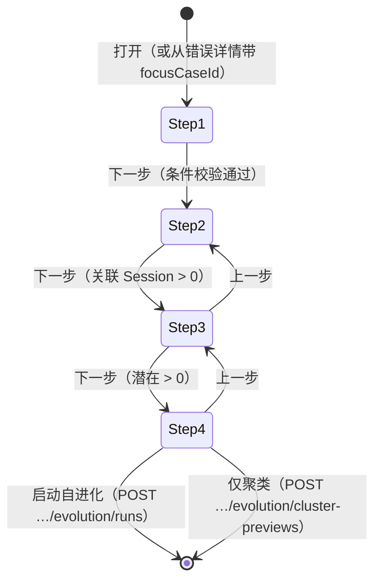

# 08 · 前端的实现设计

> 本文回答：每个页面用什么组件、数据怎么取、交互怎么实现、Agent 执行流图怎么落地、V1 占位实现前端要注意什么。
> **V2（2026-11-11）**：路由与守卫见 §1、§6；空间切换器、空间管理页与鉴权接入文案见 §4.2–§4.3；总览页见 §6；Session 列表「最新 10 + 回车查询」见 §5.2.1；错误详情多归因见 §7；向导四步见 §9；运行详情统一消费服务端给出的七步列表，历史 V1 run 由服务端适配（§10）。旧 `/sessions/**`、`/evolution/**` 在迁移期重定向（§1.4）。
> 前置：[03 前端架构](03-frontend-architecture.md) · [05 接口设计](05-api-design.md)；验收基准：[原型 HTML](../14-15-ui-prototype/harness-evolution.html) 与截图。

## 1. 页面与路由实现映射

| 路由 | 页面组件 | 主要数据 | 对应原型 |
|---|---|---|---|
| `/login` | `pages/login/Index.vue` | `POST /auth/login` | 登录页（唯一公开页） |
| `/change-password` | `pages/login/ChangePassword.vue` | `POST /auth/change-password`、`POST /auth/refresh`、`GET /auth/me` | 首次登录强制改密（需登录） |
| `/workspaces` | `pages/workspaces/Chooser.vue` | `GET /auth/session` | 空间选择（多空间/旧链接解析失败） |
| `/workspaces/:wid/overview` | `pages/overview/Index.vue` | `GET …/overview/*`、`GET …/bad-cases` | 空间总览（双 Tab） |
| `/workspaces/:wid/sessions`、`/…/sessions/:sid` | `pages/sessions/Index.vue` | `GET …/sessions`（limit 10）、`GET …/sessions/{sid}`、`/tree`、`/bad-cases` | Session 浏览器 + 会话概览 |
| `/workspaces/:wid/sessions/:sid/errors` | `pages/errors/Index.vue` | `GET …/sessions/{sid}/bad-cases`、`GET …/bad-cases/{id}/attributions`、`GET …/attributions/{at}` | 错误详情与多归因 |
| `/workspaces/:wid/evolution` | `pages/evolution/Index.vue` | `GET …/evolution/runs`、`GET …/catalogs/*` | 自进化列表 + 启动向导 |
| `/workspaces/:wid/evolution/targets` | `pages/evolution/targets/Index.vue` | `GET/POST/PUT/DELETE …/evolution/targets`、`GET .../versions` | 进化对象配置（按空间） |
| `/workspaces/:wid/evolution/runs/:rid` | `pages/evolution/RunDetail.vue` | `GET …/evolution/runs/{rid}`、`/steps/{key}` | 新 run 七步；历史 V1 run 由服务端适配后同样渲染七步 |
| `/workspaces/:wid/evolution/cluster/:previewId` | `pages/evolution/ClusterPreview.vue` | 同上（`cluster_only`） | 仅聚类结果 |
| `/workspaces/:wid/admin` | `pages/workspaces/Admin.vue` | `GET/PUT /workspaces/{wid}`、`…/members`、`…/credentials` | 空间管理四 Tab（原型） |

> 时间线页面（原型 B 页）已裁撤，不设路由、不建页面，详见 §5.4。
> `/evolution/cluster/:previewId` 的 `previewId` 即 `mode=cluster_only` run 的 `runId`（[05 §4.12](05-api-design.md)），页面复用 run 详情的数据接口（`GET /runs/{rid}` + `steps/clusters`），不单独建数据通道。

```text
router
├── /login ───────────────────────► login/Index
├── /change-password ─────────────► login/ChangePassword
├── /workspaces ──────────────────► workspaces/Chooser
└── /workspaces/:wid ─────────────► 空间壳（守卫：成员关系 + 角色）
    ├── /overview ────────────────► overview/Index（双 Tab）
    ├── /sessions ────────────────► sessions/Index
    │                                 ├──► agent-tree/AgentTree
    │                                 └──► bad-cases/BadCaseList
    ├── /sessions/:sid/errors ────► errors/Index（多归因）
    ├── /evolution ───────────────► evolution/Index
    │                                 └──► pages/evolution/components/LaunchWizard（四步）
    ├── /evolution/runs/:rid ─────► evolution/RunDetail（七步）
    ├── /evolution/cluster/:previewId ► evolution/ClusterPreview
    ├── /evolution/targets ───────► evolution/targets/Index
    └── /admin ───────────────────► workspaces/Admin（四 Tab，空间管理员及以上）
```

### 1.4 旧路由重定向（迁移期）

```text
进入 /sessions/**、/evolution/**（无 ws 前缀）
  1. 读 localStorage.lastWorkspaceId
  2. 该空间在当前 user.workspaces 内 → 重定向到 /workspaces/<wid>/<同 path>
  3. 否则只有一个空间 → 用它
  4. 否则 → /workspaces（选择页，toast「请选择工作空间」）
解析失败不静默选第一个空间（原型同款）。
```

- 重定向只发生一次（`replace` 而非 `push`，避免后退陷入循环）。
- 旧 `?issue=` / `report=` 深链生产无存量，不做兼容（[05 §5](05-api-design.md)）。
- `ws` 参数不匹配当前路由 `:wid` 时，以路由为准并清掉旧参数。

## 2. 数据层实现

### 2.1 API 模块拆分

请求函数按域放，**不建 `api/index.ts` barrel**；模型来自 `packages/contracts`，筛选类型放对应域文件。

| 文件 | 内容 |
|---|---|
| `api/http.ts` | 传输层（Bearer/401 刷新/403 改密跳转/`ApiError`/取消） |
| `api/queryClient.ts` | 全局缓存策略 |
| `api/queryKeys.ts` | queryKey 工厂（集中，全部带 `workspaceId` 首段） |
| `api/auth.ts` | login / refresh / logout / changePassword / me / **session** |
| `api/workspaces.ts` | 空间列表/创建/更新；成员 CRUD；凭据轮换（V2） |
| `api/overview.ts` | summary / trend / sources / bad-cases / targets / targets-trend / targets-cases / target-detail（V2） |
| `api/sessions.ts` | 列表（limit 10 + total）/ 会话概览 / Agent 会话树 / 问题 |
| `api/badCases.ts` | 问题详情 / **归因分页与详情**（V2）/ 归因状态（V1 冻结） |
| `api/evolution.ts` | runs / 七步 / 事件 / 配置 / 预览三段 / 启动（runs、cluster-previews）/ 重试 |
| `api/acquisition.ts` | 同步 / 拉取 / 状态 |
| `api/catalogs.ts` | 对象 / 模型清单 |

### 2.2 `api/http.ts`

```ts
export class ApiError extends Error {
  constructor(public status: number, public code: string, message: string, public details?: unknown) { super(message) }
}

async function request<T>(path: string, init?: RequestInit, _retried = false): Promise<T> {
  const token = useAuthStore().accessToken
  const res = await fetch(`${baseUrl}${path}`, {
    ...init,
    headers: { "content-type": "application/json", ...(token ? { authorization: `Bearer ${token}` } : {}), ...init?.headers },
  })
  if (res.status === 401 && !_retried && !path.startsWith("/api/auth/")) {
    await useAuthStore().refresh()              // refresh cookie 换新的 access token
    return request<T>(path, init, true)         // 只自动重试一次；refresh 失败则由 store 跳登录页
  }
  if (!res.ok) {
    const body = await res.json().catch(() => null)
    throw new ApiError(res.status, body?.error?.code ?? "HTTP_ERROR", body?.error?.message ?? res.statusText, body?.error?.details)
  }
  return res.json() as Promise<T>
}
```

- 基址：开发期 `/api`（Vite 代理到后端）；生产同源。
- 取消：`AbortController` 由 vue-query 传入 `signal`，http 层透传。
- 不在这里做重试——重试策略归 queryClient（4xx 不重试）。
- 401 处理只在 http 层这一处：先 refresh 一次再重放；`AUTH_EXPIRED` 且 refresh 也失败 → 清登录态 + 跳 `/login?redirect=…`。
- `403 PASSWORD_CHANGE_REQUIRED` 也在这里兜底：说明本地 `mustChangePassword` 已陈旧，置 store 标记后跳 `/change-password?redirect=…`，不把业务页渲染成错误态（正常路径由路由守卫先拦，见 [03 §6](03-frontend-architecture.md)）。
- **避免循环依赖**：`http.ts` 不直接 import auth store 或 router；refresh 与改密跳转都通过注入的回调（`setRefreshHandler` / `setPasswordChangeHandler`）完成，由 store 在初始化时注册。

### 2.3 `api/queryClient.ts`

```ts
export const queryClient = new QueryClient({
  defaultOptions: {
    queries: {
      staleTime: 30_000,
      gcTime: 5 * 60_000,
      refetchOnWindowFocus: false,
      retry: (count, err) => !(err instanceof ApiError && err.status < 500) && count < 2,
    },
  },
})
```

### 2.4 `api/queryKeys.ts`

```ts
export type StepKey = "range" | "sessions" | "potential" | "attribution" | "clusters" | "iteration" | "final"
export const keys = {
  session: () => ["auth", "session"] as const,
  workspaces: () => ["ws"] as const,
  ws: (wid: string) => ["ws", wid] as const,
  overviewSummary: (wid: string, f: OverviewFilters) => ["ws", wid, "overview", "summary", f] as const,
  overviewTrend: (wid: string, f: OverviewFilters) => ["ws", wid, "overview", "trend", f] as const,
  overviewSources: (wid: string, f: OverviewFilters) => ["ws", wid, "overview", "sources", f] as const,
  overviewTargets: (wid: string, f: OverviewFilters) => ["ws", wid, "overview", "targets", f] as const,
  overviewTargetTrend: (wid: string, f: OverviewFilters) => ["ws", wid, "overview", "targetsTrend", f] as const,
  overviewTargetCases: (wid: string, f: OverviewFilters) => ["ws", wid, "overview", "targetCases", f] as const,
  overviewTargetDetail: (wid: string, tid: string, f: OverviewFilters) => ["ws", wid, "overview", "target", tid, f] as const,
  badCases: (wid: string, f: CaseFilters) => ["ws", wid, "bad-cases", f] as const,
  sessions: (wid: string, f: SessionFilters) => ["ws", wid, "sessions", f] as const,
  session: (wid: string, sid: string) => ["ws", wid, "session", sid] as const,
  tree: (wid: string, sid: string) => ["ws", wid, "session", sid, "tree"] as const,
  badCase: (wid: string, badCaseId: string) => ["ws", wid, "case", badCaseId] as const,
  attributions: (wid: string, badCaseId: string) => ["ws", wid, "case", badCaseId, "attributions"] as const,
  attribution: (wid: string, badCaseId: string, atId: string) => ["ws", wid, "case", badCaseId, "attribution", atId] as const,
  runs: (wid: string) => ["ws", wid, "evolution", "runs"] as const,
  run: (wid: string, rid: string) => ["ws", wid, "evolution", rid] as const,
  runStep: (wid: string, rid: string, key: StepKey) => ["ws", wid, "evolution", rid, "step", key] as const,
  runEvents: (wid: string, rid: string, afterSeq = 0) => ["ws", wid, "evolution", rid, "events", afterSeq] as const,
  catalogs: (wid: string) => ["ws", wid, "catalogs"] as const,
  syncStatus: () => ["acquisition", "status"] as const,
  targets: (wid: string) => ["ws", wid, "evolution", "targets"] as const,
  targetVersions: (wid: string, id: string) => ["ws", wid, "evolution", "targets", id, "versions"] as const,
  adminMembers: (wid: string) => ["ws", wid, "admin", "members"] as const,
  adminMemberCandidates: (wid: string, q: string) => ["ws", wid, "admin", "member-candidates", q] as const,
  adminCredentials: (wid: string) => ["ws", wid, "admin", "credentials"] as const,
}
```

失效规则（V2：空间前缀是硬约束，切换空间不得复用旧空间缓存）：

| 动作 | 失效 |
|---|---|
| 切换空间 | 前缀 `["ws", 旧 wid]` 全部（切回时重拉） |
| `POST /evolution/runs` | `["ws", wid, "evolution", "runs"]` |
| `POST /runs/{rid}/retry` / SSE `run.progress` | `["ws", wid, "evolution", rid]` 前缀（详情 + 全部 step） |
| sync job 完成（轮询 `GET /jobs/{jobId}` 发现；sync 无 SSE） | `["ws", wid, "sessions"]`、该空间全部 `["ws", wid, "session", …]`、`["ws", wid, "catalogs"]` |
| 上报成功（管理页模拟/真实） | `["ws", wid, "overview"]`、`["ws", wid, "bad-cases"]`、`["ws", wid, "sessions"]` |
| 加/改/移成员、建/改空间 | `["ws", wid, "admin", "members"]`、`["ws", wid, "admin", "member-candidates"]` + `["auth", "session"]` + `["ws"]` |
| 轮换凭据 | `["ws", wid, "admin", "credentials"]` |

> 仅聚类预览页复用 `keys.run(rid)` / `keys.runStep(rid, "clusters")`：`previewId` 即 `cluster_only` run 的 runId，不单设 queryKey。

### 2.5 composables 签名

```ts
// useAuth.ts
useLogin()          // mutation：成功 → 写 stores/auth + 跳 redirect（mustChangePassword=true 时被守卫改道改密页）
useLogout()         // mutation：登出 → 清态 + 跳 /login
useCurrentUser()    // 读 stores/auth（app 启动时 tryRefresh 填充）
useChangePassword() // mutation：改密 → 成功后 refresh() + 重取 me → 跳 redirect
useSession()        // GET /auth/session → user + workspaces（V2 启动唯一入口；queryKey ["auth","session"]）

// useWorkspaces.ts
useWorkspaces()             // GET /workspaces
useCreateWorkspace()        // POST /workspaces（全局管理员）
useUpdateWorkspace(wid)     // PUT /workspaces/{wid}
useWorkspaceMembers(wid)    // GET /workspaces/{wid}/members
useMemberCandidates(wid, q) // 空间管理员添加成员时搜索非成员用户
useAddMember(wid) useChangeMemberRole(wid) useRemoveMember(wid) useMakeSelfAdmin(wid)
useCredentials(wid) useRotateCredential(wid) useRevokeCredential(wid)

// useOverview.ts
useOverviewSummary(wid, filters)  useOverviewTrend(wid, filters)  useOverviewSources(wid, filters)
useOverviewBadCases(wid, filters) useOverviewTargets(wid, filters) useOverviewTargetTrend(wid, filters)
useOverviewTargetCases(wid, filters) useTargetDetail(wid, tid, filters)

// useSessions.ts
useSessionList(wid, filters)       // GET /workspaces/{wid}/sessions（limit 默认 10，回车触发）
useSessionSummary(wid, sid)        // GET …/sessions/{sid}
useSessionTree(wid, sid)           // GET …/sessions/{sid}/tree
useSessionBadCases(wid, sid)       // GET …/sessions/{sid}/bad-cases（含 attributionCount/hasAttribution）

// useBadCases.ts
useBadCase(wid, badCaseId)
useAttributions(wid, badCaseId)     // 分页（2/页）
useAttribution(wid, badCaseId, atId) // 详情（含 triggerCompare）

// useEvolution.ts
useRuns(wid)  useRun(wid, rid)  useRunStep(wid, rid, key)  useRunEventLog(wid, rid)
usePreviewSessions(wid)  usePreviewPotential(wid)  usePreviewAttribution(wid)   // 向导 2–4 步
useCreatePreview(wid)   useStartRun(wid)   useRetry(wid, rid)
useTargets(wid) useTargetConfigs(wid) useTargetVersions(wid, id)
useCreateTarget(wid) useUpdateTarget(wid) useDeleteTarget(wid)

// useAcquisition.ts
useSyncStatus()       // GET /acquisition/status
useTriggerSync()      // mutation：POST /acquisition/sync → 后台处理待归一化 payload；轮询 status，不订 SSE
usePullSessions()     // mutation：POST /acquisition/pull（按 sessionIds / window）

// useCatalogs.ts
useModels(wid)        // GET /catalogs/models（来自 agents.model 聚合；staleTime ∞，靠写路径显式失效刷新）
```

- 所有 composable 返回 `{ data, isLoading, isError, error, refetch }`，页面不直接碰 `http.ts`。
- `filters` 必须是 `computed`/`ref`（参考报告踩过的坑：传普通对象会把筛选冻结成首帧快照）。

### 2.6 SSE（`composables/useRunEvents.ts`）

```ts
export function useRunEvents(rid: Ref<string>, loadedSeq: Ref<number>, isActive: Ref<boolean>) {
  let es: EventSource | null = null
  let closed = false
  const connect = async () => {
    if (closed) return
    const { ticket } = await request<{ ticket: string }>("/api/events/ticket", {
      method: "POST",
      body: JSON.stringify({ topics: [`run:${rid.value}`], lastEventId: loadedSeq.value }),
    })
    es = new EventSource(`/api/events?ticket=${ticket}`)
    es.addEventListener("run.event", e => { appendEvent(JSON.parse(e.data)); loadedSeq.value = ... })
    es.addEventListener("run.progress", () => invalidateRun(rid.value))
    es.addEventListener("run.blocked", () => { es?.close(); invalidateRun(rid.value) })
    for (const type of ["run.completed", "run.failed", "run.interrupted"]) {
      es.addEventListener(type, () => { closed = true; es?.close(); invalidateRun(rid.value) })
    }
    es.addEventListener("reset", () => { es?.close(); void reloadRunSnapshot(rid.value) })
    es.onerror = () => { es?.close(); if (!closed) setTimeout(connect, 3000) }  // 重连重新取票
  }
  onMounted(() => { if (isActive.value) void connect() })
  watch(isActive, active => { if (active) void connect(); else es?.close() })
  onUnmounted(() => { closed = true; es?.close() })
}
```

- **页面级，不是全局**：App.vue 不建立常驻 SSE；只有 `preparing/running` 的 run 详情才调用 `useRunEvents`；`isActive` 由 `run.status` computed 得出，`blocked` 时关闭并走轮询/重试。
- **先 REST 后 SSE**：页面先并行拉 `run` / `step` / `events?afterSeq=0`（分页拉完）渲染初版，再把**已加载的最后一条事件 seq** 传给 ticket 的 `lastEventId`，补齐快照与流之间的空档。
- **已完成 run**：不取 ticket、不建 SSE；翻 step / 日志继续走 REST。
- **同步动作不订阅 SSE**：后台 scheduler / admin 手动只写 `job_runs`；前端轮询 `GET /acquisition/status` 或 `GET /jobs/{id}`。
- 重连时浏览器自动带 `Last-Event-ID`；服务端从 DB 事件回放。收到 `reset` 说明游标已失效，前端重新拉 REST 快照。
- 收到 `run.progress` 只失效 queryKey；`run.event` 可增量 append（DB 事件是事实源）。
- 离开页面、run 终态、登出都主动 `es.close()`。

## 3. Agent 执行流图（`components/agent-tree/`）

### 3.1 文件结构

```text
agent-tree/
  AgentTree.vue           # 画布容器：VueFlow、fitView、focus、Teleport 问题列表
  layout.ts               # 纯函数：chainOf / buildGraph / 布局常量（移植自原型）
  layout.spec.ts          # 布局单测（demo-nested 用例）
  nodes/AgentNode.vue  nodes/BadCaseNode.vue  nodes/CollapseNode.vue
  edges/OrthEdge.vue  edges/BadCaseEdge.vue  edges/DiscoveryEdge.vue  edges/TriggerEdge.vue
  types.ts                # TreeNode / TreeEvent / TreeEdge / BadCaseAnchor
```

- `TreeEvent`：`line`、`kind`、`name?`、`desc?`、`toolUseId?`、`messageOffset`。
- `TreeNode`：`agentId`、`parentAgentId`、`kind`、`agentType`、`taskKind`、`spawnDepth`、`label`、`messagesCount`、`events`。
- 节点标题直接用后端 `label`，不在前端按 `agentType` / skill 名重算；普通 skill 只是 `events[]` 里的触发点，没有自己的节点。

### 3.2 布局核心（对原型逻辑的保留与简化）

保留（布局结构原样移植；`×N` 口径改为 message 间隔）：

- `chainOf(events, messagesCount)`：按 `messageOffset` 排序事件 → 触发点药丸 + `×N` 间隔药丸 → 返回 `{ items, offsets, width }`；宽度用 canvas `measureText` 精测（字体与 CSS 一致）。
- `×N` 的 N 是 **assistant message 间隔**，不是 JSONL 行号差：
  - 首个触发点之前：`first.messageOffset`
  - 两个触发点之间：`next.messageOffset - current.messageOffset`
  - 尾部：`messagesCount - last.messageOffset`
  - 无事件时：整段作为一个尾部间隔，N=`messagesCount`
  - `line` 仍用于显示 `L30`、排序 tie-break 和调试，不参与 N 的计算。
- 布局常量：`LINK_W=10 / PILL_PAD=18 / CDOT=10 / BOX_PAD=10 / BOX_EDGE=1 / AGENT_BOX_H=80 / ROW_STEP=124 / INDENT=46 / MIN_STEP=38`。
- 兄弟分支的竖直通道聚合（24px 内的触发点共用一个 trunk）、问题卡左右侧判定（检测是否与兄弟分支竖直段相交）。
- 折叠规则：子节点 > 8 且未展开 → 生成 `collapse` 节点。

简化（因为后端给了显式归属）：

- 不再需要 `findingsBudget` 与"最后一个 agent"兜底：后端返回的每个 bad_case 带 `anchor {agentId, eventIndex}`；`badCaseType` 决定挂载方向。
- 锚定规则（`self` / `discovery` 两类 + 无锚点兜底）：
  1. **`self`（对象自身问题）**：`anchor.agentId` 就是上报人 A；skill 卡挂在 A 的该 skill 触发药丸下方（`TriggerEdge`），agent 卡挂在 A 节点右侧/左侧（`BadCaseEdge`，按相交检测选边）。
  2. **`discovery`（发现前置步骤问题）**：卡挂在发现者的触发点正上方（`DiscoveryEdge`）。发现者是 skill 时触发点在 A 内；发现者是 subagent A 时，触发点是**父节点 P 中调用 A 的 Agent 药丸**，`anchor.agentId = P`，不等于 `badCaseAgent.agentId`。
  3. 无锚点（`anchor.eventIndex = -1`）：挂在 `anchor.agentId` 节点右侧，避免卡片漂浮。
- 前端只用 `anchor` 定位，不用 `badCaseAgent` 反推宿主；`badCaseAgent` 用于展示"谁上报"。
- 同一触发点有多张问题卡时保持 pill 的 x 中心成列：`self-skill` 向下串联，`discovery` 向上串联；第一张由 pill 的上/下锚点连接，后续卡由上一张卡的同向锚点继续连接。

```ts
// layout.ts 关键签名
export function buildGraph(tree: SessionTree, expanded: Set<string>): { nodes: TreeVNode[]; edges: TreeVEdge[] }
export function chainOf(events: TreeEvent[], messagesCount: number): Chain
export function badCaseAnchors(cases: BadCase[], tree: SessionTree): BadCaseAnchor[]
```

### 3.3 Vue Flow 集成

```vue
<VueFlow
  :nodes="nodes" :edges="edges"
  :node-types="nodeTypes" :edge-types="edgeTypes"
  :nodes-draggable="false" :nodes-connectable="false"
  :min-zoom="0.2" :max-zoom="2.5"
  @node-click="onNodeClick"
  @nodes-initialized="onNodesInitialized"
>
  <Background :gap="22" color="#e6e9ef" />
  <Controls position="bottom-right" :show-interactive="false" />
</VueFlow>
```

要点：

- `fitView` 必须等节点测量完成后执行（原型 `FitTree` 的教训）：监听 `onNodesInitialized` 再调 `fitView({ padding: 0.12 })`。
- 定位问题（从问题列表点击）→ `setCenter(node.x + w/2, node.y + h/2, { zoom: max(current, 0.85), duration: 260 })`，并给目标 bad_case 节点加 `active` class（红色描边）。
- 节点只为真实边占用的方向创建 Handle：`h{i}` 从 pill 下沿连接子 Agent 或 `self-skill` 卡，`rep{i}` 从 pill 上沿连接 `discovery` 卡，另有 `in`、`finding-left/right` 与问题卡的上下/堆叠锚点；不再用 Agent 节点内的 stub 补画连接。
- 画布内问题列表用 `<Teleport to="#bad-case-list">`（原型用 `createPortal`）。
- 折叠节点点击 → 更新 `expanded` Set → 重新 `buildGraph`（纯函数重算，节点数少，不需要增量更新）。

### 3.4 问题列表联动

- 列表按 `createdAt` 升序；卡片点击 → `locate(badCaseId)`：滚动画布到视野中心 + 高亮。
- ID 徽章显示 `badCaseId` 前 8 位（`title` 给全量）；点击 → `window.open(badCaseDeepLink(...), "_blank")`。

## 4. 登录页、强制改密与顶栏用户区（`pages/login/*`）

### 4.1 登录页与强制改密

```text
Index.vue（居中卡片，无顶栏）
├── LoginForm.vue
│   ├── username / password 输入（el-input，回车提交）
│   ├── 错误提示条（AUTH_INVALID → "用户名或密码错误"）
│   └── 登录按钮（loading 态）
└── 页脚说明：组织内部系统，账号由管理员分配
```

- 提交：`useLogin().mutate({username, password})`；成功后恢复 `auth/session` 并写 `stores/auth` → 跳 `route.query.redirect ?? 最近空间总览`；无可用空间则进 `/workspaces` 选择页。
- 已登录访问 `/login` 直接跳最近空间总览（路由守卫处理）。
- **首次登录强制改密**：账号只能由 admin 创建或由 env 播种，初始密码一律由他人设定，因此登录响应带 `user.mustChangePassword=true`；此时业务端点回 `403 PASSWORD_CHANGE_REQUIRED`，前端只放行 `/change-password`。

`pages/login/ChangePassword.vue`（同款居中卡片，需登录，未登录跳 `/login`）：

```text
ChangePasswordCard.vue
├── 提示条：初始密码由管理员分配，首次登录请设置自己的密码
├── oldPassword / newPassword / confirmPassword（el-input type=password）
├── 本地校验：两次新密码一致、新密码不等于旧密码
└── 提交 → POST /auth/change-password → 成功后 refresh() + 重取 session → 跳 redirect ?? 最近空间总览
```

- 成功后**必须换一次 token**：access token 的 `mcp` 声明是登录时签的，改密后要 `POST /auth/refresh`（重读用户行重签）再 `GET /auth/session` 拿到 `mustChangePassword=false` 与空间列表，守卫才放行到 `redirect`。
- 守卫：`user.mustChangePassword === true` 时，除 `/change-password` 与 `/login` 外的导航一律重定向到 `/change-password?redirect=<原路径>`（[03 §6](03-frontend-architecture.md)）。
- 兜底：http 层收到 `403 PASSWORD_CHANGE_REQUIRED`（本地标记已陈旧）时置 store 标记并跳改密页，不渲染业务页错误态。

### 4.2 顶栏用户区、空间切换器与空间管理页（V2）

`TopNav.vue` 右侧（从左到右）：演示数据角标（`phase=demo`）→ 轨迹处理状态（`pending` 数，hover 展示 `GET /acquisition/status` 摘要）→ **空间切换器** → 当前用户名 + 下拉（退出登录）。普通用户不提供“同步”按钮；admin 下拉里可有「立即处理」（`POST /acquisition/sync`，幂等，返回已有 jobId 时只提示）。退出：调 `POST /auth/logout` → 清 `stores/auth` → 关页面级 SSE → 跳 `/login`。

**空间切换器（`components/layout/WorkspacePicker.vue`）**：显示空间名 + `used/quota` + 我的角色；下拉列出全部可见空间与各自统计；切换 = 写路由（`/workspaces/<新wid>/<当前子路径或 overview>`）并失效 `["ws", 旧wid]` 前缀缓存。与导航争横向空间时收窄名称（原型第十一轮的布局约束）。

**强制改密下的空间信息**：改密页可显示「当前账号 · N 个空间」（来自 `GET /auth/session`），因此 `_MCP_ALLOWED_PATHS` 必须包含 `/api/auth/session`（[07 §8.2](07-backend-implementation.md)）。

**空间管理页（`pages/workspaces/Admin.vue`）**，四 Tab 对齐原型：

```text
Admin.vue
├── SpacesTab.vue        # 全局管理员：全部空间表（额度/管理员 chips/成员数/进入/成员/额度）
│   └── WorkspaceFormDialog.vue   # 创建：名称/说明/额度（≥0）/初始空间管理员多选（默认含自己）
│                                # 编辑：仅额度，校验 ≥ used（422 QUOTA_INVALID 兜底）
├── MembersTab.vue       # 成员表 + 角色下拉；空间管理员看到的 space_admin 行禁用并 tooltip
│   └── MemberFormDialog.vue  # 搜索非成员用户（不在前端加载全局用户目录）+ 选择角色
├── IngestTab.vue        # 上报地址（location.origin 拼 /api/workspaces/{wid}/bad-cases）、
│                        # 凭据 prefix/复制/轮换（明文仅展示一次 + 「我已保存」）、额度条、body 与 curl 示例
└── AuthTab.vue          # 鉴权接入说明（只读）：Cookie 会话 / 不开放注册 / 用户映射 / SSO 回调 / 服务端授权
```

- 写操作仅 `space_admin` 及以上可见（全局管理员含他空间的创建入口）；成员/只读进入页面时所有写按钮隐藏 + 顶部「只读」badge；直连 API 仍 403（前端只是护栏）。
- 凭据轮换：先创建新凭据并展示明文一次；用户确认上游已切换后再撤销旧凭据，切换窗口内新旧并存（最多 3 个有效）。
- 上报成功（接入页的「试发一条」或真实脚本）后失效总览/列表缓存，`used` 立刻可见。

### 4.3 轨迹处理状态

- 顶栏只展示 `pending` 数量与最近一次处理结果（`GET /acquisition/status`），不建立 SSE。
- 后台 scheduler 默认每 60s 处理；admin 的「立即处理」触发后，前端轮询 `GET /jobs/{jobId}` 或 `GET /acquisition/status`，完成后失效该空间的 `["ws", wid, "sessions"]` 前缀。
- 普通用户不需要手动触发；数据会在下一轮 scheduler 自动出现。

## 5. Session 浏览器页（`pages/sessions/Index.vue`）

### 5.1 组件树

```text
Index.vue
├── SessionList.vue（左栏）
│   ├── SearchBox.vue
│   ├── StatusChips.vue
│   ├── SortSelect.vue
│   └── SessionCard.vue × N
└── SessionOverview.vue（右栏）
    ├── SummaryHeader.vue（标题/状态/meta/CTA）
    ├── StatStrip.vue（9 项）
    ├── AgentTree.vue（画布）
    └── BadCaseList.vue（Teleport 目标）
```

### 5.2 交互细节

| 交互 | 实现 |
|---|---|
| 搜索（V2） | **回车触发**（Enter 或搜索按钮）：`q` 非空按 root session ID 精确查询（`limit=10`），命中替换左侧并选中；未命中显示双侧空态且**不保留旧选中**；清空再回车恢复最新 10。移除 V1 的 300ms 防抖实时查询。 |
| 根会话 ID 展示 | 左栏每张 `SessionCard` 增加一行“根会话 ID · <UUID>”；右栏 `SessionOverview` meta 在开始时间之后增加同一 ID（[13 §3.3–3.4](13-root-session-id.md)） |
| 状态筛选 | 三个 chip 单选（全部/完成/有失败）；`partial` 与 `fail` 都算"有失败"（原型只有 ok/partial）；对应 `status=all/ok/problem`（[05 §4.2](05-api-design.md)） |
| 排序 | 4 个选项直传后端 `sort` |
| 选中 session | 路由到 `/workspaces/:wid/sessions/:sid`；列表高亮由当前路由参数派生，**不再用 Pinia 存当前 sid** |
| 数据加载 | `useSessionSummary` / `useSessionTree` / `useSessionBadCases` 三个 query **并行**；会话概览先到先渲染，树和问题列表各自 skeleton，互不阻塞 |
| 三态 | 列表加载：骨架 4 张；空：`EmptyState`（"没有匹配当前筛选的 session"）；失败：`ErrorState` + 重试 |
| 首屏无选中 | 自动选第一个 session（原型行为），URL 同步 |

#### 5.2.1 最新 10 条与总数（V2）

- 接口 `GET /api/workspaces/{wid}/sessions?q=&status=&sort=&limit=10`，响应带 `total` 与 `pendingSessions`；标题区显示「最新 10 / 总数 N」，`pendingSessions>0` 时追加「N 个待同步」角标（点击只看已归一化，说明轨迹补齐中）。
- 未命中/空空间：

| 场景 | 左栏 | 右栏 |
|---|---|---|
| 搜索无结果 | 「未找到匹配 'xxx' 的 Session」+「恢复最新 10」 | 「选择左侧 Session 查看详情」 |
| 空间无 bad case | 「该工作空间还没有上报 bad case」+ 上报接入链接（管理员可见） | 同左说明 |
| Session 不属于本空间 | 跳回列表 + toast「该 Session 不在当前空间」 | 同 |

- 输入框 placeholder：「输入 root Session ID，回车查询」；V2 的 `q` 精确匹配 session ID，可与 `status`/`sort` 组合。

### 5.3 密度条

后端给 `failPer100Messages / badCasesPer100Messages`，前端只做视觉：`width = min(100, rate / 3 * 100)%`，满格 3/百消息。颜色用 `--red` / `--orange`。

### 5.4 时间线页（已裁撤，不做）

2026-10-22 评审决定：**时间线页面（原型 B 页）不做**，完整时间线由外部平台承担。本方案不再实现 `pages/timeline/*`、用户轮次吸顶、事件过滤 chips、消息卡、展开/折叠与跳转用户轮次；相应路由、composable（`useTimeline`）与 queryKey 均已移除。

裁撤带来的前端调整：

| 位置 | 调整 |
|---|---|
| 会话概览 CTA | 只保留「打开错误详情」，移除「打开时间线」 |
| 错误详情页头 | 移除「打开时间线」按钮，只保留「返回 Session」 |
| 面包屑 | 不再有"Session 浏览器 › 标题"的时间线面包屑；Session 页用顶栏 + 返回链接 |
| 数据层 | 不请求用户轮次/消息/内容块；列表与会话概览只用 `session_families` 的整树聚合字段（用户轮次、消息、工具失败、token） |
| 代码高亮/长输出折叠 | 随页面一并移除，首版不引 highlight.js |

保留下来的能力：会话统计（用户轮次数、消息数、工具失败数、token）由解析期按 agent 累计、组装时整树求和；这些数字不依赖时间线页面。

## 6. 工作空间总览页（`pages/overview/Index.vue`，V2）

### 6.1 结构

```text
Index.vue
├── tabs：bad case 总览 | 进化对象总览（URL ?tab=cases|targets；共享时间窗）
├── StatStrip.vue（6 格：bad case 总数 / 自身存在问题 / 发现前置步骤问题 / 关联 Session / 来源数 / 额度）
├── FilterBar.vue（时间 7/30/90/自定义 + 粒度日/周/月 + 来源多选）
├── components/
│   ├── SourceMultiSelect.vue（搜索 + 多选 + chip 移除 + 全选当前页）
│   ├── StackedBucketChart.vue（自研 SVG 堆叠柱：self 蓝 / discovery 紫）
│   ├── SourceBars.vue（来源分布 top6 + 其余折叠）
│   ├── SourceMatrix.vue（来源 × 时间桶矩阵，可折叠）
│   ├── BadCaseTable.vue（8 条/页 + 空态）
│   ├── TargetsOverview.vue（对象统计条 + 趋势三态 chip + 两块分布）
│   ├── TargetSideList.vue（5 条/页，可进化降序，增编删入口）
│   ├── TargetDetailCard.vue（单对象分析卡：对象+版本多选+独立时间窗）
│   └── PotentialCaseTable.vue（8 条/页 + 对象/来源/状态筛选）
└── 空态：图表空态 + 列表空态 + 无对象时「去配置进化对象」
```

### 6.2 交互与 URL

| 交互 | 行为 |
|---|---|
| 切换 Tab | 不重置时间窗与粒度；切换空间重置到 `tab=cases` |
| 来源多选 | 空 = 全部；多选 = 并集；chip 逐项移除；写 `?objects=`（逗号分隔、URL 可读） |
| 点击指标 | 「自身存在问题」/「发现前置步骤问题」→ 写列表筛选并滚到列表；「来源数」→ 聚焦来源下拉 |
| 趋势悬浮 | tooltip 显示桶标签、self/discovery 数值与占比；点击桶 → 列表按该桶时间过滤 |
| 下钻 | 行内 **bad case ID 链接**（新窗口）→ `/workspaces/:wid/sessions/:sid/errors?case=&tab=desc`；整行不可点（原型第十七轮决策） |
| 粒度降级 | 日粒度窗口 >92 天时服务端降级周并回传实际粒度，前端在副标题提示「已按周展示」 |
| 对象列表操作 | 空间管理员可「+ 新增 / 编辑 / 移除」，复用 targets 表单弹窗；移除后失效总览缓存 |
| 刷新恢复 | 从 URL 解析全部筛选并与 `wid` 校验，不匹配重定向（§1.4 的守卫规则同源） |

### 6.3 图表实现要点

- 纯函数 `chartGeometry.ts`：`niceTicks(max, 4)`（1/2/5×10ⁿ 整刻度）、`barLayout(count, width)`（柱宽 `min(28, slot*0.6)`，>60 桶提示）、`stackY(self, discovery, top, height)`；配单测（空数据、极大值、单桶、60+ 桶）。
- 不引第三方图表库（V1 令牌/视觉一致 + 不增 bundle）；轴、网格、柱用 SVG，文本用 DOM 覆盖层。
- 颜色只用 `--blue` / `--purple` / `--text-faint`；`0` 值不画柱，避免视觉噪声。

### 6.4 三态

| 状态 | 表现 |
|---|---|
| 加载 | 图表灰块骨架 + 列表 4 行骨架；不整页 spinner |
| 空 | 图表空态文案 + 「清除筛选」；列表空态；对象视角无对象给配置入口 |
| 错误 | 区块级 `ErrorState`（错误码 + 重试）；`404 WORKSPACE_NOT_FOUND` 整页跳空间选择 |

## 7. 错误详情页（`pages/errors/Index.vue`）

### 7.1 布局与数据（V2：一个 bad case × 多条归因）

```text
Index.vue（grid: 340px 1fr）
├── components/ErrorSidebar.vue（重写：可折叠 bad case 组）
│   ├── FilterChips.vue（全部 / 有归因 / 待归因）
│   ├── CaseGroup.vue × N
│   │   ├── 父行：`#no` + badCaseId 深链 + 标题 + self/discovery badge + object_name + 归因数
│   │   └── 展开态：AttributionItem.vue × ≤2（结论 badge、时间、缓存标记、→ 定位）+ 组内分页（2 条/页）
│   └── 空态 / 骨架
└── main.error-main
    ├── header.error-head（meta + 返回 Session）
    ├── section.flow-panel（Vue Flow，复用 components/agent-tree/AgentTree.vue，仅过滤 bad_case 节点）
    └── section.detail-panel
        ├── components/ProblemDescription.vue（问题描述 tab：title 短标题作标题行 + reason 描述正文作正文块 + metaData）
        └── components/AttributionReport.vue（重写：归因集合 + 多条导航 + 触发点对照）
```

数据：`useSessionBadCases(wid, sid)` 拿全部 bad_case（含 `attributionCount` / `hasAttribution`）；选中 case 后 `useAttributions(wid, badCaseId)`（分页 2/页）取子项，选中子项后 `useAttribution(wid, badCaseId, atId)` 取详情。每个展开组各自维护页码（`Record<badCaseId, number>`）。

根会话 ID 的展示位置与格式见 [13 §3](13-root-session-id.md)：左栏会话信息框显示“根会话 ID”标签 + 完整值（一行紧凑布局），右栏 `error-head` 的 meta 在开始时间之后、repo 之前增加同一 ID；两处都使用路由解析后的 `sid`，不额外请求，也不放进下方执行流面板的框内。

### 7.2 选中、展开与深链

| 行为 | 实现 |
|---|---|
| 选中 bad case | URL `?case={badCaseId}&tab=desc`；本地选中由 URL 派生（刷新可恢复）；同时自动展开该组 |
| 展开/折叠 | 本地 `Set<string>`；展开时若归因数 > 2 显示组内分页（`pageSize=2`） |
| 点归因子项 | `?case=&tab=attr&at={attributionId}`；左右切换（`N / total`）同步更新 `at` |
| 深链解析优先级 | `at` 命中用它 → 只有 `case` 取第一条 → `obj={objectName}`（原型兼容）取该对象第一条 → 回落第一条 |
| 执行流过滤 | 选中时只保留该 `badCaseId` 对应的节点及其边；相关 agent 节点与其触发点保留 |
| 全部错误 | `case`/`at` 参数移除，恢复完整执行流 + 空态详情 |
| 筛选 chips | 全部 / 有归因（`attributionCount>0`）/ 待归因；只过滤左侧列表，不改变展开态 |
| 再点已选中卡 | 保持选中，不取消 |
| 归属不符 | `sid` 与 bad case 归属不一致 → 整页错误态「该问题不属于当前 Session」（服务端 409 `BAD_CASE_SESSION_MISMATCH`） |

### 7.3 归因 Tab 渲染顺序（固定）

1. 结论横幅：`attributed` → 「可归因到本对象」+ 分类 chip；`non_target` → 「非该对象问题」；无归因 → 「尚未归因」。
2. 对象 · 版本 + 归因来源 run（可跳运行详情）+ 时间 + 缓存徽标（复用缓存 / 本次新增）。
3. 置信度 + 策略（默认/自定义，附策略一句话）。
4. 触发点对照：对象进入点 vs bad case 触发点（`order` 文案：位于对象触发点之后/之前；`unknown` 时说明轨迹时间戳待重放）。
5. 归因结论说明（`reason`）。
6. 推导过程（`reasoning`，Markdown 渲染；`reason` 按纯文本渲染）。
7. 结论边界：只作用于该对象版本，不修改 bad case，不影响其它对象的潜在关系。

> `reasoning` 与 `reason` 由服务端模板生成，前端按 Markdown 渲染（`html:false`、`breaks:true`、`linkify:true`；代码块等宽横向滚动，不接语法高亮）；外链 `target="_blank" rel="noopener noreferrer"`，禁止裸 HTML。

> 注意：问题描述 tab 的"关联对象"是 **bad_case 的 object（上报者）**；归因 tab 的"对象"是 **归因对象·版本**，`discovery` 场景下两者不同，不要混用。

> 无归因空态：「该 bad case 还没有被任何自进化运行归因。启动自进化后，会先判断它是否属于所选对象的潜在 bad case，再生成对象级归因。」+「以该 bad case 启动自进化 →」（`space_admin` 及以上可见；打开向导浮窗并预填 `focusCaseId`，不离开当前页）。

## 8. 自进化列表页（`pages/evolution/Index.vue`）

```text
Index.vue
├── PageHeader.vue（标题 + 启动按钮）
├── RunGroup.vue（"正在执行"）
│   └── RunCard.vue × N（进度条 + 阶段文案）
├── RunGroup.vue（"历史记录"）
│   └── RunCard.vue × N（badge + best vs 初始 + Δ + 接纳数）
└── LaunchWizard.vue（Modal，打开时挂载）
```

- 分组与排序由后端给（`running` / `history`），前端不重排。
- 进度条：`progress.percent` 直接用；阶段文案 `progress.stageLabel` 直接用（后端算）。
- `failed` / `interrupted` 的 run 显示红色/橙色状态徽章 + `error.message` 摘要（tooltip），点击进入详情并定位"执行日志"。
- 空态："当前没有正在执行的自进化"。

## 9. 启动向导（`pages/evolution/components/LaunchWizard.vue`）

> V2（2026-11-11）：向导从两步扩为**四步**，命中源从 probe 换成「空间 bad case → Session 关联 → 潜在 bad case → 对象归因」；V1 两步 API 进入兼容期，不再作为新页面路径。

### 9.1 状态机



### 9.2 四步表单与预览

向导打开时**并行**加载后端清单（不在前端写死；全部按空间）：

```text
GET /api/workspaces/{wid}/evolution/targets   → 本空间已配置且启用的对象（skill/agent）+ defaultRef
GET /api/workspaces/{wid}/catalogs/models     → 模型清单（V2 向导不再展示，字段保留可选）
选择对象后：GET …/evolution/targets/{id}/versions → 版本下拉（默认 defaultRef）
```

**Step 1 选择范围**

- 对象选择：`useTargetConfigs(wid)` 过滤 `enabled`；未配置的对象不出现；空间无对象时给「去配置进化对象」入口。
- 版本：tag 列表；默认选中 `defaultRef`；缺省时提交由后端回退 `defaultRef`。
- 时间段：`from/to` 必填，校验 `from <= to`（后端再判 ≤366 天）。
- **潜在策略**：默认策略单选 + 「自定义」三开关（`includeSelfReport` / `includeAfterObject` / `sameObjectOnly`）；custom 至少勾一条，否则本地拦截（后端 `422 POLICY_INVALID` 兜底）。
- 从错误详情进入（`focusCaseId`）：第 1 步显示只读提示「以 bad case <id> 启动」，自动带出它的对象/版本线索；不改变潜在判定口径。
- 「下一步」：字段级校验（对象/版本/时间段缺失标红 `aria-invalid`）→ `POST …/evolution/preview/sessions` → Step 2；`409 NO_ASSOCIATED_SESSIONS` 同样进 Step 2 渲染「没有对象版本出现过的 Session」空态并禁用前进。

**Step 2 Session 关联**

- 条件摘要 chip + 「修改条件」；统计：上报过 bad case 的 Session / 关联 / 跳过 / 版本未知 / 待轨迹同步。
- 表格 4 条/页：Session 标题 / 对象触发点时间 / 该 Session 的 bad case 数 / 潜在数；只列**对象出现过**的 Session；未出现的只进「跳过」统计，不入表。
- 空态：「没有对象版本出现过的 Session；可回第 1 步调整时间段或对象版本」+ 前进禁用。
- 分页只重新请求 `preview/sessions` 的 `page`，不重算匹配（服务端已按条件稳定排序）。

**Step 3 潜在 bad case**

- 统计：时间段内 bad case 总数 / 潜在数 / 按命中原因分布（`self_report` / `after_object` / `both`）。
- 表格 5 条/页：bad case ID（深链）/ 上报来源 `object_name` / 类型 / 触发点时间 / 来源 Session / **命中原因**；`orderState=unknown` 显示“触发点顺序待轨迹时间戳重放”。对象版本未知的 Session 已在第 2 步跳过并计数，不进入本表。
- 空态：「当前策略没有命中潜在 bad case；可返回调整时间段或策略」+ 前进禁用（`409 NO_POTENTIAL_MATCHED`）。
- 「上一步」回到 Step 2；修改策略需回 Step 1（策略影响潜在集合，前端不就地重算）。

**Step 4 归因预览与启动**

- 开关「复用缓存归因」（默认开）：切换即重新请求 `preview/attribution`。
- 四个数字（副标题写清语义）：潜在 / 复用 / 新增 / 历史非该对象；后两者是推算值（新增 = 潜在 − 复用；历史非该对象是参考值）。
- 条件摘要 + 策略 badge + 缓存开关状态。
- 两个出口：
  - 「仅聚类」→ `POST …/evolution/cluster-previews`（`mode:"cluster_only"`）→ 路由 `/workspaces/:wid/evolution/cluster/:runId`，先显示「准备中」
  - 「启动自进化 →」→ `POST …/evolution/runs` → 路由 `/workspaces/:wid/evolution/runs/:rid`，先显示「准备中」
- 202 只表示“已受理准备”；不要等接口返回簇或 RunDetail。

### 9.3 占位数据说明

- 命中数字来自真实 `bad_cases` / `agent_events` 查询（潜在匹配与 run 共用实现），不再哈希模拟。
- 若库里没有 bad case 或轨迹未归一化（开发环境），用 `fixtures` seed 后即可演示；前端不做任何桩分支。

### 9.4 与 V1 两步向导的迁移对照

| 维度 | V1（冻结） | V2 |
|---|---|---|
| 步数 | 2（条件 → 命中确认） | 4（范围 → Session 关联 → 潜在 → 归因预览） |
| 命中源 | 旧版 probe 报告（接口兼容保留） | 空间 bad case + Session 关联 + 潜在策略 |
| 筛选 | 对象/版本/时间段/模型多选 | 对象/版本/时间段/策略/缓存开关（模型多选移除） |
| 出口 | 仅聚类 / 启动 | 同左（body 增加 `policy`/`cacheEnabled`） |
| 空态码 | —（已废弃） | `409 NO_ASSOCIATED_SESSIONS` / `409 NO_POTENTIAL_MATCHED` |

V1 向导只用于理解历史 run；生产入口一律四步。

### 9.5 进化对象配置页（`/evolution/targets`）

> V2 路径为 `/workspaces/:wid/evolution/targets`（按空间隔离）；下文交互对两代路径相同。

```text
Index.vue
├── 页头：标题 + "新增配置"
├── TargetTable.vue：objectType / objectName / repoUrl / subDir / defaultRef / validationProjectId + testProjectId（合并“测试工程”列）/ enabled / 操作
└── TargetFormDialog.vue（新增/编辑）
    ├── objectType（skill/agent）
    ├── objectName
    ├── repoUrl（git 远端地址，https/ssh；不写 token）
    ├── subDir（相对仓库根，如 skills/deep-research）
    ├── defaultRef（可编辑组合框；直接输入分支或 tag，已保存对象的 tag 作为建议）
    ├── validationProjectId（验证集测试工程 ID，必填，不透明字符串）
    ├── testProjectId（测试集测试工程 ID，必填，不透明字符串）
    └── enabled 开关
```

- 写操作可见性（V2）：空间管理员及以上可写本空间配置；成员/只读只读（后端按空间角色校验）。全局管理员可写任意空间。
- 保存前前端做必填校验；仓库/ref/subDir 合法性由后端返回 `422 REPO_INVALID`，两个工程 ID 的空白/控制字符由本地校验，后端兜底返回 `422 PROJECT_ID_INVALID`；表单展示错误。
- 唯一键按空间：同一 `(objectType, objectName)` 可在不同空间各配一份，本空间内重复 → `409 TARGET_EXISTS`。
- 表格“测试工程”列合并展示两行，历史空值显示“未填写”。
- `defaultRef` 的输入文本就是表单值；失焦或直接提交不得清空。已保存对象可通过输入框内的展开按钮查看仓库 tag 建议，键盘与指针选择 tag 都只是可选快捷路径。
- 新增态没有 target id，不请求版本建议，也不显示版本加载；编辑态只在版本请求实际进行时显示加载。建议获取失败或为空时仍可直接输入并保存。
- 删除前提示"有进行中 run 时不可删除"（后端 409 `TARGET_IN_USE`）。
- 保存成功失效 `["ws", wid, "evolution", "targets"]` 前缀，向导候选刷新。


## 10. 运行详情页（`pages/evolution/RunDetail.vue`）

### 10.1 结构

```text
RunDetail.vue
├── DetailHeader.vue（标题 + 状态 + 空间 badge；无“推进一轮”按钮）
├── blockedBanner（push/eval/attribution 失败时显示阶段、错误、自动重试时间、[重试]）
├── infoPanel（目标与输入：kv-grid + 策略/缓存 chip + 类型分布条 + 评测/推送状态）
├── StepperPanel.vue（步数由 run.steps 决定：七步）
│   └── StepContent.vue（按 step.key 动态组件）
│       └── StepRange / StepSessions / StepPotential / StepAttribution / StepClusters / StepIterations / StepFinal
├── RunLogPanel.vue（执行日志/异常，tab 或右栏）
└── （iteration step 内）ClusterCard.vue → DiffView / EvalCompare / CommitBlock
```

**单一 schema**：`run.steps` 恒为七步，`steps[].key` 由后端给定，前端按 key 渲染，不推算回退。

**V2 七步的展示要点**：

| step | 展示 |
|---|---|
| 1 选择范围 | 条件摘要（对象@版本、时间窗、策略、缓存开关）+ 统计 |
| 2 Session 关联 | 4 条/页表格（Session / 对象触发点 / bad case 数 / 潜在数）+ 跳过统计 |
| 3 潜在 bad case | 5 条/页，含「命中原因」列；`unknown` 标注触发点顺序待重放 |
| 4 对象归因 | 统计四数 + 表格（来源 bad case / 归因 ID / 分类 / 现象 / 结果来源 cached\|fresh / 置信度）；对象·版本在 step 标题，不在表格重复「结论」 |
| 5 聚类与严重度 | 簇卡片按 severity 降序，每簇标题 + 聚类描述 + 可折叠来源 bad case 表（ID 可深链错误详情），默认展开第一簇（或 active 簇） |
| 6 迭代优化 | 沿用既有轮次卡（patch/candidate/push/eval/接纳），来源问题为 `cases[]` |
| 7 测试集终评 | 沿用 V1（verdict/metrics/changes） |

### 10.2 交互

| 交互 | 实现 |
|---|---|
| 默认选中步 | `run.steps` 中第一个 `active`；没有则最后一个 `done`；没有则第 0 步（但不可点）；`preparing` 时显示 step 0 的准备态 |
| 工作区信息 | infoPanel 展示 `workspace.branchName / baseRef / baseCommit / repoUrl / subDir`（路径可折叠）；点击可复制分支名 |
| 推送状态 | 每轮展示 candidate `pushStatus`；终评展示最终 `pushStatus` 与 `pushedAt`；失败展示脱敏错误 + 「重试」按钮（调 `POST /runs/{rid}/retry`，不是旧的 `/push`） |
| 阻塞状态 | `status=blocked` 时顶部显示 `blockedStage`、`retryAttempts`、`nextRetryAt`、错误摘要；按钮「重试」→ `/retry` → `202 jobId`；自动退避期间显示“等待自动重试” |
| 首屏加载 | 先并行 `GET /runs/{rid}` + `/steps/{currentKey}`（`preparing` 可为空）+ `/events?afterSeq=0`（分页拉完）渲染初版；`preparing/running` 才建立 SSE，`blocked` 用轮询/重试，终态不建 |
| 执行日志 | 独立 tab「执行日志」：`useRunEventLog(rid)` 分页拉库（REST 是事实源）；默认 100 条，滚动到底加载下一页；`level=error` 过滤 |
| 异常展示 | `run.error` 存在时详情顶部显示错误横幅（stage/message/at），按钮跳日志并展开 `error.detail` |
| 实时追加 | SSE `run.event` → 把事件 append 到列表并更新 `loadedSeq`；`run.blocked/failed/interrupted` → 失效 run + events |
| 中断/阻塞恢复 | 刷新后先拉 `run` 与 `events`；`blocked` 显示“可重试”，`interrupted` 显示“任务被中断，可查看最后事件” |
| 点击 stepper | 只允许 `clickable === true` 的节点；点击 → `?step={key}` + 拉 `useRunStep` |
| 簇深链 | `?step=clusters&cluster={clusterId}`：切到聚类步并滚动到该簇卡、加高亮（commit message 的「问题簇」链接落点）；簇不存在时忽略参数并提示“簇已不存在” |
| Step 5 聚类展开 | 本地 `expandedClusters: Set<string>`；默认展开当前进行中的轮次 |
| 自动推进 | 生产 UI 无「推进一轮」；后台逐轮自动执行，页面只通过 SSE/轮询更新 |
| 评测状态 | `evalStatus`：pending/evaluating/completed/failed/timeout；`evaluating` 显示“评测中，下一次轮询 …”；failed/timeout 进入 blocked |
| 进度实时更新 | 仅 `preparing/running` 时 `useRunEvents` 订阅 `run:{rid}`；`run.progress`/`run.blocked` → 失效当前 run 前缀；`run.completed` → 额外失效 `["ws", wid, "evolution", "runs"]` 并关闭 |
| 未到达的 step | 后端返回 404 `STEP_NOT_READY`；前端不请求（`enabled: step.clickable`） |

### 10.3 Step6 迭代卡

- 卡片头：排名、`category` chip、来源 bad case 数、状态 badge（待执行 / 生成 patch 中 / 推送中 / 评测中 / 决策中 / 已接纳 Δ / 未接纳 Δ / 阻塞）。
- 展开内容顺序：簇内来源 bad case 列表 → patch diff → candidate ref/commit → 推送状态 → 评测对比 → 最终 commit / 拒绝说明。
- 生成 patch 中：展示“正在生成/应用 patch、commit candidate”，不显示 candidate ref。
- 评测中：展示 **candidate ref + commit**（如 `.../candidate/r2`），表示已 push、等待评测；显示 `evalStatus` 与下一次轮询时间。
- 本地模式：`HE_GIT_PUSH=false` 时 candidate 只存在本地；卡片显示“本地候选（未推送）”，candidate 标签显示“已生成 · 未推送”，推送状态显示“已跳过（本地模式）”，不进入评测。
- 已接纳：展示 **amend 后的 commit**（保留追溯信息并追加 current/candidate/delta/verdict），以及 `Harness-Evaluated-Commit`（评测时的 commit）。
- 未接纳：显示“candidate 已删除，run 分支不变”；不展示 commit hash。
- blocked：显示是 patch、push 还是 eval 阶段失败；patch/push 阶段保留本轮中间状态，可重试。
- `DiffView`：行首 `+`/`-`/`@@` 着色；原型的 diff 行数组直接渲染即可，不需要解析 unified diff。
- `EvalCompare`：两条横向条（current 灰 / candidate 绿或红），宽度按 `max(cur,cand)*1.06` 归一（原型算法）。

### 10.4 执行日志与异常（`pages/evolution/components/RunLogPanel.vue`）

```text
RunLogPanel.vue
├── 工具条：级别过滤（全部/error/warn）、自动滚动开关、刷新
├── EventList.vue：时间 / stage / eventType / message / 耗时
│   └── ErrorDetail.vue（点击展开 error.type/message/detail）
└── 底部：加载更多（afterSeq 分页）
```

- 数据源：`GET /runs/{rid}/events?afterSeq=&limit=`；刷新/重进以接口为准。
- 事件颜色：`info` 灰、`warn` 橙、`error` 红；`candidate_committed` / `eval_completed` / `cluster_accepted` 用不同图标。
- `error.detail` 默认折叠，避免长堆栈撑爆布局；复制按钮只复制脱敏后的内容。
- 事件与步骤联动：点击带 `stepIndex` 的事件切到对应 step；点击 `clusterId` 滚动到簇卡。
- 运行中新增事件自动滚到底；用户手动上滚时暂停自动滚动。

## 11. 仅聚类页（`pages/evolution/ClusterPreview.vue`）

- 页面先处理 `preparing`：显示“正在关联 Session / 筛选潜在 / 生成归因 / 聚类”（V2 的 `cluster_only` 也执行 0–4 步，见 [07 §5.11](07-backend-implementation.md)），轮询 `GET /runs/{rid}` 到 `status=completed`，再拉 `steps/clusters`。
- 顶部 banner："仅聚类分析：未执行 patch 生成与评测迭代" + 「以这批问题启动自进化 →」。
- 输入概况：关联 Session / 潜在 bad case / 聚类数。
- 聚类列表：每簇展示分类、来源 bad case 数、严重程度，簇内来源 bad case 表（可展开，ID 可深链错误详情）。
- 数据来自 `mode=cluster_only` 的 run（`GET /runs/{rid}/steps/clusters`）；「启动自进化」用同一条件再创建 `mode=full` 的 run（同样 202）。

## 12. 样式与视觉实现

### 12.1 设计令牌（`styles/tokens.css`）

从原型 `:root` 原样移植：`--bg/--bg-panel/--bg-card/--bg-inset/--border/--text/--text-dim/--text-faint/--blue/--green/--orange/--red/--purple/--cyan/--mono`。

### 12.2 状态色与类型色（前端常量，唯一允许的"静态数据"）

```ts
export const ATTRIBUTION_STATE_META = {
  unanalyzed: { label: "尚未归因", cls: "unanalyzed" },
  attributed: { label: "可归因", cls: "issue" },
  non_target: { label: "非该对象问题", cls: "non-target" },
} as const

// 展示值由 attributionCount + 归因行的 conclusion/category 推导（见 §7.3）
// state tone：unanalyzed=灰、attributed=绿、non_target=橙
export const TYPE_COLOR: Record<string, string> = {
  error: "var(--red)",
  prompt: "var(--orange)",
  model: "var(--purple)",
}
```

### 12.3 与 Element Plus 的分工

- EP 只用于：日期选择、下拉、分页、Modal 基础行为、Message 提示。
- 其余全部自研（卡片、chip、badge、statstrip、density、stepper、cluster、diff、eval bar）——原型就是自研样式，直接复用其 CSS 结构可保证视觉一致。
- 图标统一走 `components/ui/IconRenderer.vue`，业务组件不直接 import `lucide-vue-next`；新增图标只改 `IconName` union 与映射表。
- EP 主题只覆盖主色/圆角/字号（`element-overrides.css`）。

## 13. 三态、错误与加载

每个页面统一：

| 状态 | 表现 |
|---|---|
| 加载 | 骨架屏（列表 4 张卡；会话概览 1 个 panel；详情 1 个 panel） |
| 空 | `EmptyState`：图标 + 一句人话 + 可选操作 |
| 错误 | `ErrorState`：错误码/消息 + 「重试」；404 显示"不存在或已删除"；409（如 RUN_BUSY）显示 Message 提示不整页报错 |

全局：`app.config.errorHandler` 捕获未处理异常 → `ElMessage.error` + 控制台上报（不白屏）。

## 14. 测试计划

| 类型 | 范围 | 工具 / 落点 |
|---|---|---|
| 纯函数 | `layout.ts`（chainOf/buildGraph/锚定）、`chartGeometry.ts`（niceTicks/barLayout/stackY）、`badCaseId.ts`、`queryKeys.ts` | Vitest `node` project；就近 `*.spec.ts` |
| API / composable | `api/<domain>.ts`、`useXxx` 的 query/mutation 缓存行为；**V2**：切换空间整树失效、上报后三处失效、成员写入后 `auth/session` 失效 | Vitest `node` + MSW `src/test/server.ts` |
| 组件 | SessionCard 密度条、Stepper 状态、ClusterCard 展开、DiffView 着色、RunLogPanel；**V2**：CaseGroup 折叠与组内分页、AttributionReport 多条导航、SourceMultiSelect、StatStrip、TargetSideList | Vitest `jsdom` project + Vue Test Utils |
| 契约 | 生成类型能被真实响应赋值（编译期）；`openapi` 生成物不含 `any` | `vue-tsc` + `pnpm contract:check` |
| 交互 | V2 向导四步流转（含空态与禁用出口）、旧链接重定向、深链 `?case=&tab=&at=` 恢复选中与定位、SSE 事件触发重取 | VTU + MSW（仅测试，不进 dev） |
| 视觉回归（后续） | 关键页面截图对比原型 | Playwright（暂不进 CI） |

- 配置：`vitest.config.ts` 两个 project（`node` / `jsdom`），`src/test/setup.ts` 统一 `afterEach` 清理，`src/test/server.ts` 导出 MSW `server`。
- 测试文件就近：单文件模块用 `*.spec.ts`，多文件模块可放 `__tests__/`；不建独立 `tests/` 大目录。

## 15. 实施顺序（前端内部依赖）

```text
脚手架 + tokens + ui 基元（含 IconRenderer）
  ▼
登录页 + auth store + 守卫
  ▼
http/queryKeys（空间前缀）+ API 按域模块 + test setup
  ▼
空间选择页 + 空间切换器 + 空间管理四 Tab（V2 地基）
  ▼
Session 列表（最新 10 + 回车）+ 会话概览
  ▼
Agent 执行流图 layout + 最小树
  ▼
Agent 执行流图全量 + 问题卡
  ▼
错误详情 + 多归因（V2）
  ▼
工作空间总览（双 Tab + 图表几何）
  ▼
自进化列表 + 四步向导 + 对象配置（按空间）
  ▼
运行详情七步 + SSE + 执行日志
  ▼
仅聚类 + push 状态/重试 + 收尾三态
```

每个 PR 建议：一个页面或一个组件族 + 对应测试 + 与后端接口的联调截图（放 PR 描述）。原型截图可作为视觉对照：
- Agent 执行流图：[execution-flow](../14-15-ui-prototype/screenshot-claude-code-execution-flow.png)
- 错误详情：[errors](../14-15-ui-prototype/screenshot-claude-code-errors.png)
- 归因：[attribution](../14-15-ui-prototype/screenshot-claude-code-attribution.png)
- 问题卡：[problem](../14-15-ui-prototype/screenshot-claude-code-problem.png)

## 16. V1 占位实现的前端说明（重要）

- **前端没有 mock 分支**：所有数据来自真实 HTTP 与真实表。开发/演示时用 `fixtures` seed 造数。
- 登录态：V1 也必须登录（初始管理员由后端 env 播种），鉴权链路从一开始就是真实的；只有 `preparing/running` 的 run 页面才申请 SSE 票据，重连重新取票，完成/阻塞/离开即关闭。
- **自进化是真实写文件与真实 git**：每个 candidate patch 都会产生一次 commit（message 带 run/cluster/attribution/bad_case 追溯）；candidate 先 push 到临时 ref 再评测；接纳后 amend + fast-forward run 分支，拒绝则删除 candidate ref、切回 run 分支（不 reset 已接纳轮次）。patch 内容与评分是占位，但 commit/amend/fast-forward/push 都是真的。UI 需明示"占位 patch / 占位评测"。
- 只有配置且启用的对象能启动自进化；配置入口在向导 Step1 提示文案内的「配置页」链接。
- 真实执行接入时前端**零改动**：接口形状不变，只是 patch 内容与评分换成真实结果。
