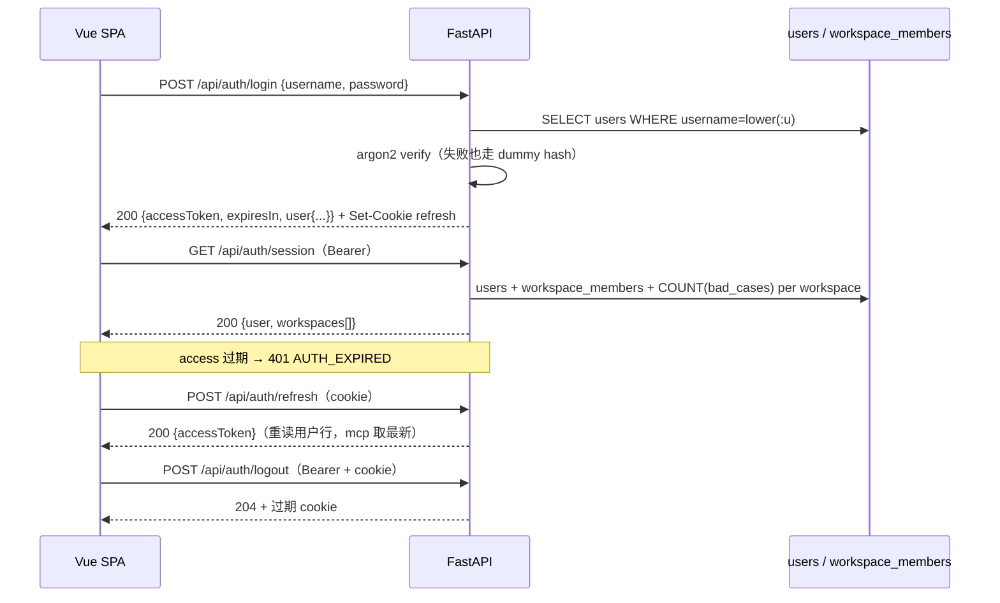
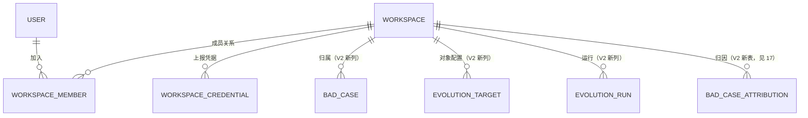

# 15 · V2 多用户鉴权接入与工作空间

> 本文回答：多用户身份如何接入（不开放注册）、工作空间/成员/额度/上报凭据的数据模型与接口、既有表如何加上空间维度、权限如何在服务端收口、迁移与回滚怎么做。
> 前置：[README 决策表](README.md) · [01 总体架构](01-architecture.md) · [05 接口设计](05-api-design.md) · [06 数据库设计](06-database-design.md) · [07 §8 身份与鉴权](07-backend-implementation.md)；配套：[16 总览](16-v2-overview.md) · [17 归因](17-v2-attribution.md)。
> 做 V2 工作空间相关 issue 前先读本文。验收基准：[V2 原型](../ui-prototype-v2/harness-evolution.html)（登录页、空间切换器、空间管理四 Tab、上报接入）与 [design-v2.md](../ui-prototype-v2/design-v2.md)。

## 1. 背景与目标

V1 是单组织共享（决策 D10）：`users` 表 + `admin/member` 两角色，登录即可见全部数据，核心表只记 `created_by`。V2 在此之上引入：

1. **多用户登录，不开放注册**：账号仍由全局管理员创建（或 env 播种唯一管理员）；对外不提供 `POST /api/auth/register`，登录页不出现注册入口。
2. **预留鉴权接入接口**：把「身份提供方」收敛为一个接缝，后续以极少改动接入 Cookie 会话与 SSO/OIDC（用户信息存储 + 回调匹配），即可完成多用户接入。
3. **多工作空间**：全局管理员（唯一）创建空间、设初始空间管理员、调额度；空间管理员拥有该空间一切操作权限；一个空间多个空间管理员；管理员可把自己加为某空间的空间管理员；空间管理员可添加成员并授予管理员以下的角色。
4. **每空间 bad case 上报接口与额度**：`POST /api/workspaces/{wid}/bad-cases`，POST body 即 `bad_cases` 表类型；上报数量上限（额度）在创建空间时可设、创建后可调。

### 1.1 与原型的三处修正

原型是交互验收基准，落地时按以下决策修正（均已与目标态对齐）：

| 原型行为 | V2 落地决策 | 理由 |
|---|---|---|
| 登录页是「演示账号列表 + 一键进入」 | 生产登录页保持 V1 的 username/password 表单；原型列表仅用于演示 | 不开放注册与账号枚举安全要求 |
| 权限矩阵含「删除工作空间」 | V2 不做空间删除/归档（见 §9 非目标）；原型也无删除入口 | 额度与成员可调已覆盖管理诉求，删除涉及数据归属清算 |
| 「把自己设为空间管理员」按钮对所有人可见 | 仅全局管理员可用（`POST /workspaces/{wid}/members/self-admin`）；普通用户不能自我提权 | 权限矩阵约定「任命/撤销空间管理员」仅全局管理员 |

原型中「Session 精确查询实为 ID 子串匹配」「下钻是行内 ID 链接而非整行点击」两处为有意设计（[16 §5](16-v2-overview.md)），不算偏差。

### 1.2 与 V1 的关系（冻结边界）

- **不冻结的部分**：`users`、登录/刷新/改密、SSE 票据、`job_runs`、轨迹归一化管线——V2 只在其上叠加空间维度，行为不变。
- **冻结的部分**：所有 V1 端点（[05 §4](05-api-design.md) 前半）继续存在，但**新增空间前缀版本**并在 V2 前端改用新路径；旧路径在迁移期按 §7 重定向/保留一个版本。V1 自进化的 probe 输入链路整体冻结（[17 §11](17-v2-attribution.md)），与本文无耦合。
- **不属于本文**：总览聚合（[16](16-v2-overview.md)）、归因与七步流程（[17](17-v2-attribution.md)）。本文只定义空间、成员、额度、凭据、上报与空间化加列这些共同地基。

## 2. 身份与鉴权接入

### 2.1 现状不变的部分

现有 identity 栈（[07 §8](07-backend-implementation.md)）全部保留，V2 不替换：

| 机制 | 现状 | V2 处理 |
|---|---|---|
| 密码存储 | `users.password_hash` 为 argon2id PHC 串；校验时用行内盐与参数重算，恒定时间比较；不存在的用户名也走 dummy hash 防时序枚举 | 不变 |
| access token | JWT，30 分钟，前端只存内存；claims 见下表 | 不变 |
| refresh token | JWT + `jti` 轮换 + 一次性撤销集合；`HttpOnly; SameSite=Strict; Path=/api/auth` cookie，14 天 | 不变 |
| 强制改密 | `must_change_password=true` 时除改密/登出/`GET /auth/me` 外一律 `403 PASSWORD_CHANGE_REQUIRED` | 放行清单需追加 `GET /api/auth/session`（§2.7） |
| 登录限流 | `LoginRateLimiter` 中间件，超限 `429` | 不变 |
| 管理员边界 | `middleware/auth.py::_ADMIN_ROUTE_RULES` 按「方法 + 路径前缀」判定 | 追加空间管理的全局管理员路径规则（§2.5） |
| 初始管理员 | 空库时用 `HE_ADMIN_USERNAME` / `HE_ADMIN_PASSWORD` 播种，`must_change_password=true` | 不变；播种时同时写入默认空间成员（§3.6） |

access token claims（`service/identity/tokens.py`，V2 不改结构）：

| claim | 含义 | 备注 |
|---|---|---|
| `sub` | `users.id` | 空间角色不放进 token |
| `role` | `admin` / `member` | 全局角色，仅用于全局管理端点 |
| `mcp` | `must_change_password` 快照 | 改密后靠 refresh 重签刷新，不靠长 token |
| `typ` | `access` / `refresh` | 混淆攻击防护 |
| `jti` / `exp` / `iat` | 标准字段 | refresh 用 `jti` 做一次性撤销 |

**空间角色不放 token**：空间成员关系可变（调角色、移除成员），放 token 会导致最长 30 分钟的越权窗口；每次请求按 `workspace_members` 现查，走 `UNIQUE(workspace_id, user_id)` 主键查找。

### 2.2 登录、刷新、登出与强制改密时序



强制改密路径：

```text
login → user.mustChangePassword=true
  → 守卫重定向 /change-password?redirect=…
  → 任何业务请求被中间件拦为 403 PASSWORD_CHANGE_REQUIRED
  → POST /auth/change-password（旧密码校验 + 新旧不同）
  → POST /auth/refresh（重签 access，mcp=false）
  → GET /auth/me（拿到最新标记）→ 放行 redirect
```

V2 只改一处：`_MCP_ALLOWED_PATHS` 追加 `/api/auth/session`，否则前端启动恢复登录态时拿不到空间列表，只能停在改密页——改密页需要显示「当前账号（含空间数）」，且 `auth/session` 本身不含敏感数据。

### 2.3 新增：会话聚合接口 `GET /api/auth/session`

前端启动（初次登录、刷新页面、切换账号）调用一次，取回「用户 + 可用空间」，是所有空间页面渲染的唯一入口：

```json
{
  "user": { "id": "u-admin", "username": "admin", "displayName": "林澈", "role": "admin", "mustChangePassword": false },
  "workspaces": [
    { "id": "ws-harness", "name": "Harness 核心研发", "mark": "核心轨迹诊断", "role": "space_admin",
      "quota": 500, "used": 128, "memberCount": 4, "lastVisitedAt": "2026-11-11T10:20:30+08:00" },
    { "id": "ws-research", "name": "调研空间", "mark": "", "role": "viewer",
      "quota": 100, "used": 12, "memberCount": 2, "lastVisitedAt": null }
  ]
}
```

- 鉴权同现有 Bearer（refresh 流程不变）；属于 [05 §1.1](05-api-design.md) 允许的静态元数据聚合，不违反「详情页禁止整页单接口」。
- `workspaces[].role` 是该用户在此空间的 `workspace_members.role`；全局管理员对**任意空间**视为 `space_admin`，未被写入成员表也返回该角色（`memberCount` 照实统计真实成员行）。
- `lastVisitedAt` 暂不落库（V2 非目标），字段保留给前端「最近访问空间」重定向；当前由前端 localStorage 决定，服务端返回 `null`。
- **N+1 防护**：一次查询取用户 + 成员行，再一次 `GROUP BY workspace_id` 取 `used` 与 `member_count`，共 3 条 SQL；空空间不返回。全局管理员走「全部空间 LEFT JOIN 我的成员行」，普通用户走「INNER JOIN 成员行」。
- 空间数量上限不设硬限，但 `GET /api/auth/session` 响应按 `workspaces.length ≤ 200` 截断并带 `truncated: true`（极端情况下前端提示改用 `GET /api/workspaces` 分页）。

### 2.4 鉴权接入接缝（预留，V2 不切换默认）

把「认证如何发生」收敛为一个协议 + 一条会话桥 + 一个回调端点；**业务与前端契约不变**，所以接入工作可估、可测：

```text
service/identity/
  providers.py        # AuthProvider 协议 + ProviderRegistry（按 env 选择实现）
  password.py         # PasswordProvider：现有 username/password 校验（默认）
  session_bridge.py   # 会话桥：opaque 会话 Cookie ↔ access/refresh 对
  callback.py         # SSO/OIDC 回调编排：state 校验、code 换 token、sub/email 匹配
```

协议与注册（改动面只有这三处 + 一个 env）：

```python
class AuthProvider(Protocol):
    """External identity seam: verify credentials and return a mapped user id."""

    async def authenticate(self, credentials: Credentials) -> ProviderIdentity | None:
        """Return the mapped identity or None when the provider rejects the sign-in."""
```

| 接入形态 | 需要实现 | 对业务的影响 |
|---|---|---|
| 内置密码（默认） | `PasswordProvider`（已有逻辑迁移） | 无 |
| Cookie 会话（`he_session`） | 外部 IdP 完成后，`session_bridge` 签发 `he_session=<opaque>; HttpOnly; SameSite=Lax`，换发 access 时透明兑换 | 前端无需改动：仍拿 `{accessToken, expiresIn}` |
| SSO / OIDC | `GET /api/auth/callback` → `callback.py`：校验 `state`、用 `code` 换 id_token、按 `sub` 优先 / `email` 次之匹配 `users` | 未匹配返回 `403 AUTH_NO_MAPPING`，**不自动建号** |

回调状态机：

```text
GET /api/auth/callback?code=…&state=…
  ├─ 未配置 IdP（env 缺 provider 配置）→ 501 AUTH_PROVIDER_NOT_CONFIGURED
  ├─ state 缺失/不匹配（10 分钟 TTL）→ 400 AUTH_STATE_INVALID
  ├─ code 换取失败 / IdP 5xx → 502 AUTH_PROVIDER_ERROR（不落库）
  ├─ sub/email 匹配不到 users 行 → 403 AUTH_NO_MAPPING
  ├─ 匹配到但 is_active=false → 403 FORBIDDEN
  └─ 成功 → 签发与密码登录相同的一对 token → 302 回前端 redirect
```

接入步骤清单（写进 issue 验收，避免「预留」变空话）：

1. env 增加 `HE_AUTH_PROVIDER=password|oidc` 与 OIDC 段（issuer/client_id/client_secret 引用名）；未配置时 `/api/auth/callback` 恒 501。
2. `ProviderRegistry` 在 `main.py` 装配时按 env 选实现；非法组合启动失败（fail fast），不静默退回 password。
3. `users.username` 对 SSO 接入保持小写 email 或 sub 映射串；`display_name` 首次登录时按 IdP 声明更新（只更新该字段）。
4. 契约测试：`/auth/session` 在三种 provider 下的响应形状一致。

### 2.5 权限矩阵与服务端收口

| 能力 | 全局管理员 | 空间管理员 | 成员 | 只读成员 |
|---|---:|---:|---:|---:|
| 创建工作空间、设置初始额度与初始空间管理员 | ✓ | — | — | — |
| 调整空间额度、上报凭据 | ✓ | ✓ | — | — |
| 添加成员、授予 member/viewer | ✓ | ✓ | — | — |
| 任命/撤销空间管理员、把自己加为空间管理员 | ✓ | — | — | — |
| 配置进化对象（targets CRUD） | ✓ | ✓ | — | — |
| 启动自进化 / 仅聚类 | ✓ | ✓ | — | — |
| 查看总览、Session、bad case、归因、运行历史 | ✓ | ✓ | ✓ | ✓ |
| 触发轨迹同步（admin 手动处理） | ✓ | — | — | — |

两级校验的分工（顺序不可颠倒）：

```text
请求 → AuthMiddleware（已有）
         ├─ Bearer 校验、mcp 闸门、全局 admin 路径规则
         └─ request.state.principal = {userId, role}
     → 路由依赖 require_workspace_role(wid, minimum)
         ├─ 空间不存在或对我的角色不可见 → 404 WORKSPACE_NOT_FOUND（不区分「无权」防枚举）
         ├─ 全局 admin → 直通（不查成员表）
         └─ 查 workspace_members(wid, userId) → 角色等级不足 → 403 WORKSPACE_FORBIDDEN
     → 服务层再校验业务规则（额度、角色可授范围、space_admin 行保护）
```

角色等级：`viewer(1) < member(2) < space_admin(3)`；`require_workspace_role(wid, "member")` 表示「member 及以上」。全局 admin 路径规则追加：

```python
_ADMIN_ROUTE_RULES += (
    (frozenset({"POST"}), "/api/workspaces"),                    # 建空间仅全局管理员
)
```

其余空间路径不放进全局规则：空间管理员的权限依赖 `workspace_members`，无法用静态路径表表达；「空间管理员只能改额度/管成员」这类字段级差异由服务层判定（§5.3）。

### 2.6 为什么不做「空间角色进 token」

- 调角色/移除成员后，最长 30 分钟的越权窗口不可接受（空间是数据隔离边界，不是 UI 分组）。
- 成员表主键查找成本可忽略（`UNIQUE(workspace_id, user_id)`，单行命中）。
- SSE 票据已绑定 `run:{rid}`，运行详情的权限在取票时按 `workspace_id` 校验一次；事件流本身不重新鉴权（票据 60 秒）。

## 3. 数据模型

### 3.1 ER 关系



### 3.2 新表 `workspaces`

| 列 | 逻辑类型 | 约束 | 说明 |
|---|---|---|---|
| `id` | ID | PK | ULID；fixtures 用短 id（`ws-harness` 等）演示 |
| `name` | 短文本 128 | NOT NULL, UNIQUE | 空间名，重名 `409 WORKSPACE_EXISTS` |
| `mark` | 短文本 255 | NOT NULL DEFAULT '' | 说明/备注，前端空间卡片副标题 |
| `quota` | 计数 | NOT NULL | bad case 累计数量上限；创建时设置，之后可调 |
| `status` | 短文本 16 | NOT NULL DEFAULT 'active' | 预留；V2 只有 `active` |
| `created_by` | ID | NULL FK → `users.id` ON DELETE SET NULL | 创建人 |
| `created_at` / `updated_at` | 时间 | NOT NULL | 应用写入 Asia/Shanghai |

约束与索引：`UNIQUE(name)`（重名拦截走 DB 而非先查后写，避免并发漏判）、`INDEX(created_at DESC)`（管理页排序）。

**`used` 不落列**：额度使用量 = `COUNT(bad_cases WHERE workspace_id=:wid)`，实时聚合。理由同 [06 §3.2](06-database-design.md) 的会话问题数——bad case 由上报路径随时插入，物化计数没有任何失效通知可用，必然陈旧；而额度检查是低频写路径（每次上报一次 COUNT，走 `INDEX(workspace_id, created_at)` 覆盖），代价可接受。若后续上报 QPS 上量，再引入「计数缓存 + 定期校正」，不在 V2。

### 3.3 新表 `workspace_members`

| 列 | 逻辑类型 | 约束 | 说明 |
|---|---|---|---|
| `workspace_id` | ID | PK 组成, FK → `workspaces.id` ON DELETE CASCADE | — |
| `user_id` | ID | PK 组成, FK → `users.id` ON DELETE CASCADE | — |
| `role` | 短文本 16 | NOT NULL | `space_admin` / `member` / `viewer` |
| `joined_at` | 时间 | NOT NULL | 加入时间（管理页展示） |
| `updated_at` | 时间 | NOT NULL | 角色变更时间（无变更历史表，靠它兜底） |

约束：联合主键 `(workspace_id, user_id)`；索引 `INDEX(user_id)`（`auth/session` 反查我的空间）。

- 全局管理员**不必**出现在成员表；「把自己加为空间管理员」写入真实行（审计可见，且允许他在成员列表里被移除——移除不回收其全局权限）。
- 一个空间允许多个 `space_admin`；创建空间时 `spaceAdminIds[]` 至少一个（可含创建者自己）。
- 成员关系删除是物理删除（`DELETE`）；不写 `is_active` 软删——V2 不需要「离职保留审计」。

### 3.4 新表 `workspace_ingest_credentials`

| 列 | 逻辑类型 | 约束 | 说明 |
|---|---|---|---|
| `id` | ID | PK | ULID，展示为 `cred-…` 前 8 位 |
| `workspace_id` | ID | NOT NULL, FK → `workspaces.id` ON DELETE CASCADE | — |
| `credential_hash` | 短文本 64 | NOT NULL | 凭据 SHA-256 十六进制（凭据本身是 32 字节随机串，无字典攻击面，无需慢哈希） |
| `credential_prefix` | 短文本 12 | NOT NULL | 脱敏展示前缀（`whk_9f2e…`） |
| `created_by` | ID | NULL FK → `users.id` ON DELETE SET NULL | 轮换操作人 |
| `created_at` | 时间 | NOT NULL | — |
| `last_used_at` | 时间 | NULL | 最近一次成功上报时间（排障用） |
| `revoked_at` | 时间 | NULL | 非空即失效 |

约束与索引：`UNIQUE(credential_hash)`（上报时按哈希直查）、`INDEX(workspace_id, revoked_at)`（管理页列有效凭据）。

- 明文凭据**只在创建响应里返回一次**，不落库、不进日志、不进 `job_runs.payload`。
- `last_used_at` 采用「写后 60 秒内不重复更新」的节流（同一凭据高频上报时避免每请求一次 UPDATE）；实现为进程内 LRU + 时间戳，多实例下允许重复写，语义只是排障信息。
- 轮换窗口：新建一条 → 调用方切到新凭据 → 撤销旧的。接口允许并存，所以切换不是原子的，不需要 downtime。
- 凭据权限边界：只允许 `POST /bad-cases`；调其它空间端点一律 `403`（凭据不是用户身份，没有主体）。

### 3.5 既有表加列

| 表 | 加列 | 约束与索引 | 为什么 |
|---|---|---|---|
| `bad_cases` | `workspace_id VARCHAR(36) NOT NULL` | FK → `workspaces.id`；`INDEX(workspace_id, created_at)`、`INDEX(workspace_id, object_name)`、`INDEX(workspace_id, bad_case_type)` | 总览聚合（[16 §6.1](16-v2-overview.md)）与归因范围（[17 §2](17-v2-attribution.md)）都按空间过滤；三组索引分别服务时间桶、来源分布、类型分布 |
| `evolution_targets` | `workspace_id VARCHAR(36) NOT NULL` | FK；唯一键 `UNIQUE(object_type, object_name)` → `UNIQUE(workspace_id, object_type, object_name)` | 对象配置按空间隔离（原型 `EV_TARGETS` 同款）；同一对象可在不同空间各配一份 |
| `evolution_runs` | `workspace_id VARCHAR(36) NOT NULL`；`potential_policy JSON NULL`；`cache_enabled BOOLEAN NOT NULL DEFAULT false` | FK；`INDEX(workspace_id, created_at DESC)` | policy 与缓存开关是运行快照（[17 §4/§5](17-v2-attribution.md)）；运行列表按空间过滤 |
| `evolution_run_events` | `workspace_id VARCHAR(36) NOT NULL` | `INDEX(workspace_id, run_id)` | 空间级审计与「运行日志按空间导出」的预留 |
| `agents` | `tree_index INTEGER NOT NULL DEFAULT 0` | 无额外索引 | 触发点比较的兜底坐标（[17 §3](17-v2-attribution.md)） |
| `agent_events` | `triggered_at DATETIME NULL` | `INDEX(agent_id, triggered_at)` | 触发点比较的主坐标（[17 §3](17-v2-attribution.md)） |

**不改的表与理由**：

- `session_families` / `agents`（除 `tree_index`）/ `agent_events`（除 `triggered_at`）/ `user_turns` / `trajectory_payloads` / `source_records` **不加空间列**：轨迹归一化是全局管线；一个空间的 Session 集合定义为「该空间 bad case 涉及的根会话」投影（[16 §2](16-v2-overview.md)）。一个 Session 被多个空间上报 bad case 时天然多归属，加列反而要求上报前先定归属，制造无解问题。
- `users` 不加空间列：空间角色全在 `workspace_members`；全局角色仍只有 `admin/member`。
- `job_runs` 不加：任务引用的业务对象已带空间，需要时按 `ref_id` 反查；给 `job_runs` 加空间会让跨空间任务（如全局归一化）无法表达。

### 3.6 迁移与回填（alembic）

单版本迁移，顺序固定（新表 → 加列 → 回填 → 收紧 NOT NULL → 播种默认空间）：

```python
def upgrade() -> None:
    # 1) 新表（3 张）：workspaces / workspace_members / workspace_ingest_credentials
    op.create_table("workspaces", ...)
    op.create_table("workspace_members", ...)
    op.create_table("workspace_ingest_credentials", ...)
    # 2) 可空加列（SQLite 走 batch 模式）
    with op.batch_alter_table("bad_cases") as batch:
        batch.add_column(sa.Column("workspace_id", sa.String(36), nullable=True))
    # evolution_targets / evolution_runs / evolution_run_events 同理
    # 3) 默认空间行（幂等）
    op.execute("INSERT INTO workspaces (id, name, mark, quota, status, created_at, updated_at) "
               "SELECT 'ws-default', '默认空间', 'V2 迁移自动创建', (SELECT COUNT(*) + 50 FROM bad_cases), "
               "'active', :now, :now WHERE NOT EXISTS (SELECT 1 FROM workspaces WHERE id='ws-default')")
    # 4) 回填
    op.execute("UPDATE bad_cases SET workspace_id='ws-default' WHERE workspace_id IS NULL")
    op.execute("UPDATE evolution_targets SET workspace_id='ws-default' WHERE workspace_id IS NULL")
    op.execute("UPDATE evolution_runs SET workspace_id='ws-default' WHERE workspace_id IS NULL")
    op.execute("UPDATE evolution_run_events SET workspace_id='ws-default' WHERE workspace_id IS NULL")
    # 5) 收紧 NOT NULL + 建 FK/索引 + evolution_targets 换唯一键
    # 6) 现有 users 全部加入默认空间（viewer；admin 不写也可见，写入仅为成员列表完整性）
```

- **幂等**：迁移可重复执行（`WHERE NOT EXISTS` + 回填只看 NULL），SQLite 测试库与 MySQL 生产库都能二次跑。
- **唯一键替换**：`evolution_targets` 先 drop 旧唯一约束再建 `(workspace_id, object_type, object_name)`；SQLite 在 batch 模式里重建表，迁移脚本两端同名。
- **回滚策略**：`downgrade()` 只删新列与索引、保留 3 张新表（避免丢成员数据）；生产回滚的实际操作是「回退应用版本 + 保留加列」（新列全部有默认值，V1 代码不认识但不会报错）。
- **默认空间 id**：`HE_DEFAULT_WORKSPACE_ID`（默认 `ws-default`），供目录同步等无空间上下文的内部写入使用。
- **播种联动**：`seed_admin_if_empty()` 之后追加一次「确保 `HE_DEFAULT_WORKSPACE_ID` 存在且全局管理员在成员表中」；空库首次启动即可用。
- **fixtures**：`app/cli.py seed` 新增「空间段」——对齐原型三空间（`ws-harness` / `ws-agent` / `ws-research`）、成员角色分布、每空间一条有效凭据（开发环境明文写到 `fixtures/seed.json` 的 `credentials` 段，仅本地）。`pnpm fixtures:check` 同步校验段落结构。

### 3.7 容量与索引预算

| 表 | 量级 | 说明 |
|---|---|---|
| `workspaces` | 10¹–10² | 单组织内部 |
| `workspace_members` | 10²–10³ | 每空间 1–20 人 |
| `workspace_ingest_credentials` | 10² | 每空间 1–3 条（轮换期并存） |
| `bad_cases.workspace_id` 索引 | 与 bad_cases 同量级 | 三组索引写入放大可控（bad case 写入是低频上报） |

额度检查的查询形态固定为 `SELECT COUNT(*) FROM bad_cases WHERE workspace_id=:wid`，走 `INDEX(workspace_id, created_at)` 的最左前缀；10⁴ 行/空间的量级下为毫秒级。

## 4. API 契约

### 4.1 通用约定（空间域）

| 项 | 约定 |
|---|---|
| 前缀 | `/api/workspaces/{workspaceId}/...`；`{workspaceId}` 不在 body 里重复 |
| 鉴权 | 用户端点走 Bearer；上报端点走**空间凭据** Bearer（独立安全方案 `WorkspaceCredential`，OpenAPI 里与 `BearerAuth` 并列） |
| 可见性 | 对当前用户不可见的空间一律 `404 WORKSPACE_NOT_FOUND`，不返回 403（防空间枚举） |
| 命名 | JSON camelCase（Pydantic `to_camel`）；DB snake_case |
| 时间 | ISO 8601 带 `+08:00`；不使用 `Z` |
| 分页 | `{items, total, page, pageSize}`；无分页的小列表 `{items}` |
| 幂等 | 建空间/加成员/建凭据非幂等（重复请求按错误码拒绝）；上报按 `badCaseId` 幂等 upsert |
| 错误 | 统一 `{error:{code,message,details}}`（[05 §8](05-api-design.md)） |
| 版本 | 不做 URL 版本号；新端点是新路径，旧路径冻结（§7） |

### 4.2 会话与空间

`GET /api/auth/session` → §2.3 响应；`must_change_password=true` 时也可调用（§2.2 的放行清单）。

`GET /api/workspaces` → 我可见的空间（不截断，管理页用）：

```json
{ "items": [
  { "id": "ws-harness", "name": "Harness 核心研发", "mark": "核心轨迹诊断",
    "role": "space_admin", "quota": 500, "used": 128, "memberCount": 4,
    "createdAt": "2026-10-01T09:00:00+08:00" }
] }
```

`POST /api/workspaces`（全局管理员）：

```json
{ "name": "Agent 平台组", "mark": "Agent 框架问题", "quota": 300, "spaceAdminIds": ["u-admin"] }
```

→ `201` 创建后的空间（含 `role=space_admin`、`used=0`、`memberCount=len(spaceAdminIds)`）。

| 校验 | 规则 | 失败 |
|---|---|---|
| `name` | trim 后 1–128 字符；重名 | `422 VALIDATION_INVALID` / `409 WORKSPACE_EXISTS` |
| `mark` | ≤255，可空 | `422` |
| `quota` | 整数 ≥ 0 | `422 QUOTA_INVALID` |
| `spaceAdminIds` | 非空、去重、全部为存在且 `is_active` 的用户 | `422 ROLE_INVALID`（details 指明哪个 id 不合法） |

`PUT /api/workspaces/{wid}`：

```json
{ "name": "Agent 平台组", "mark": "…", "quota": 400 }
```

| 调用者 | 可改字段 | 越权 |
|---|---|---|
| 全局管理员 | `name` / `mark` / `quota` | — |
| 空间管理员 | 仅 `quota` | 改 `name`/`mark` → `403 WORKSPACE_FORBIDDEN` |
| 成员 / 只读 | 无 | `403` |

`quota < used` → `422 QUOTA_INVALID`（`details: {quota, used}`）：不允许把上限调到已用量以下，避免「新上报全 409 但旧数据还在」的困惑态；确需收缩时先清理 bad case（V2 无删除接口，故实际只能调大或持平）。

### 4.3 成员与凭据

| 端点 | 权限 | 请求 | 响应 |
|---|---|---|---|
| `GET /api/workspaces/{wid}/members` | 成员及以上 | — | `{items:[{userId, username, displayName, role, joinedAt}]}`（按角色等级降序、再按 joined_at） |
| `POST /api/workspaces/{wid}/members` | 空间管理员 / 全局管理员 | `{userId, role}` | `201` 成员行；`409 MEMBER_EXISTS` |
| `PUT /api/workspaces/{wid}/members/{userId}` | 同上 | `{role}` | `200` 成员行 |
| `DELETE /api/workspaces/{wid}/members/{userId}` | 同上 | — | `204` |
| `POST /api/workspaces/{wid}/members/self-admin` | **全局管理员** | — | `200` 成员行（幂等：已存在则升为 `space_admin`） |
| `GET /api/workspaces/{wid}/credentials` | 空间管理员 / 全局管理员 | — | `{items:[{credentialId, prefix, createdAt, lastUsedAt, revokedAt}]}` |
| `POST /api/workspaces/{wid}/credentials` | 同上 | — | `201 {credentialId, prefix, credential}`（明文仅此一次；同时撤销其余有效凭据） |
| `DELETE /api/workspaces/{wid}/credentials/{cid}` | 同上 | — | `204`；`404 CREDENTIAL_NOT_FOUND` |

成员角色规则（服务层判定，全部返回 `403 WORKSPACE_FORBIDDEN` 或 `409 ROLE_LOCKED`）：

| 场景 | 全局管理员 | 空间管理员 |
|---|---|---|
| 授予 `space_admin` | 允许 | 拒绝（`403`） |
| 授予 `member` / `viewer` | 允许 | 允许 |
| 修改/移除 `space_admin` 行 | 允许 | 拒绝（`409 ROLE_LOCKED`） |
| 修改/移除自己所在的普通成员行 | 允许 | 允许（自己退出空间） |
| 移除最后一个 `space_admin` | 允许（空间可能只剩全局管理员可见） | 拒绝（`409 ROLE_LOCKED`，避免空间失去管理者） |

`POST .../credentials` 的「轮换」语义：新建 + 立即撤销旧 → 响应里只有新凭据；如果调用方希望平滑切换，用两次调用（先建后撤），`DELETE` 指定 `cid`。

### 4.4 bad case 上报接口

```text
POST /api/workspaces/{workspaceId}/bad-cases
Authorization: Bearer <workspace credential>     # 空间凭据，不是用户 JWT
Content-Type: application/json
```

请求体即 `bad_cases` 表类型（camelCase DTO，与 [05 §3.4](05-api-design.md) 的 `BadCase` 同源）：

```json
{
  "badCaseId": "BC-HC-0001",
  "sessionId": "cb819c5b-286f-4eab-a681-4ba5414b844d",
  "badCaseType": "self",
  "objectName": "deep-research",
  "objectType": "skill",
  "objectVersion": "v2.0.0",
  "badCaseAgentId": null,
  "title": "检索索引读取失败",
  "reason": "deep-research skill 自身执行时检索索引读取失败：ENOENT apps/server/src/search/index.ts:142",
  "metaData": { "file": "apps/server/src/search/index.ts", "line": 142, "error": "ENOENT" },
  "source": "ci-reporter",
  "createdAt": "2026-11-11T10:20:30+08:00"
}
```

字段映射与校验：

| 请求字段 | 目标列 | 必填 | 校验 / 默认 |
|---|---|---|---|
| `badCaseId` | `bad_case_id` | 否 | ≤64；缺省服务端生成 `BC-<空间前缀>-<seq>`；携带则按主键 upsert |
| `sessionId` | `bad_case_session_id` | 是 | 根会话 UUID（36 位，允许 8-4-4-4-12 形式；不做存在性校验——轨迹可能还没同步） |
| `badCaseType` | `bad_case_type` | 是 | `self` / `discovery` |
| `objectName` | `object_name` | 是 | trim 后 1–128 |
| `objectType` | `object_type` | 是 | `skill` / `agent` |
| `objectVersion` | `object_version` | 否 | ≤64；缺省 `null` |
| `badCaseAgentId` | `bad_case_agent_id` | 否 | ≤64；主 agent 传 `null` |
| `title` | `title` | 是 | trim 后 1–255（超长 422，不静默截断） |
| `reason` | `bad_case_description` | 否 | 任意长度 TEXT；缺省取 `title` |
| `metaData` | `meta_data` | 否 | 任意 JSON 对象；非对象 → 422 |
| `source` | `source` | 否 | ≤64 |
| `createdAt` | `created_at` | 否 | ISO 8601；缺省服务端当前时间（Asia/Shanghai）；**允许未来 5 分钟内**，更远 → 422（防脚本时区错误） |

- **空间身份只从 URL + 凭据解析**，body 不含空间字段；即使调用方伪造也不被采信。
- 幂等 upsert：同 `badCaseId` 重报 → 更新全部上游字段（`updated_at` 刷新），`used` 不变；乐观并发不需要——最后写入者胜，符合「上报方重试」语义。
- **额度**：插入前 `SELECT quota FROM workspaces WHERE id=:wid FOR UPDATE`（MySQL 行锁；SQLite 退化为写事务串行），再 `COUNT(bad_cases WHERE workspace_id=:wid)`；`used >= quota` → `409 QUOTA_EXCEEDED`（`details: {quota, used}`），不自动丢弃旧数据。upsert 已存在的 `badCaseId` 不占新额度，因此不受额度限制（允许修正在限额后上报的记录）。
- 响应：`201 {badCaseId, workspaceUsed}`；响应头 `X-HE-Workspace-Used: 129`（脚本友好，便于上报方自带监控）。
- 触发链：写入成功后**异步**触发既有 `bad_case_root_sync`（[11](11-bad-case-session-sync.md)）——只把该 `sessionId` 标记为待补轨迹，不阻塞响应；补轨迹失败不回收 bad case（下次调度重试）。上报接口本身**不要求**轨迹已存在。
- 错误矩阵：

| 场景 | 状态码 | code |
|---|---|---|
| 缺/错/已撤销凭据 | 401 | `CREDENTIAL_INVALID` |
| 凭据属于其它空间 | 403 | `WORKSPACE_FORBIDDEN`（凭据与 URL 空间不匹配） |
| 空间不存在 | 404 | `WORKSPACE_NOT_FOUND` |
| 字段校验失败 | 422 | `VALIDATION_INVALID`（details 指明字段） |
| 额度已满（新 ID） | 409 | `QUOTA_EXCEEDED` |
| 同一 `badCaseId` 并发插入撞主键 | 200 | 退化为 upsert 覆盖，响应 200 而非 201 |

curl 示例（文档里给上报方照抄）：

```bash
curl -X POST "https://he.example.com/api/workspaces/ws-harness/bad-cases" \
  -H "Authorization: Bearer $HE_WORKSPACE_CREDENTIAL" \
  -H "Content-Type: application/json" \
  -d '{"sessionId":"cb819c5b-286f-4eab-a681-4ba5414b844d","badCaseType":"self",
       "objectName":"deep-research","objectType":"skill","objectVersion":"v2.0.0",
       "title":"检索索引读取失败","reason":"ENOENT apps/server/src/search/index.ts:142",
       "metaData":{"file":"apps/server/src/search/index.ts","line":142,"error":"ENOENT"}}'
```

### 4.5 新增错误码

| code | HTTP | 触发场景 |
|---|---|---|
| `WORKSPACE_NOT_FOUND` | 404 | 空间不存在或对当前用户不可见 |
| `WORKSPACE_FORBIDDEN` | 403 | 角色不足 / 空间管理员越权字段 / 凭据与 URL 空间不匹配 |
| `WORKSPACE_EXISTS` | 409 | 同名空间已存在 |
| `MEMBER_EXISTS` | 409 | 该用户已是空间成员 |
| `ROLE_INVALID` | 422 | 角色值非法；`POST /users` 创建 admin；初始管理员列表含不存在用户 |
| `ROLE_LOCKED` | 409 | 空间管理员试图改/移除 `space_admin` 行，或移除最后一个空间管理员 |
| `CREDENTIAL_NOT_FOUND` | 404 | 凭据不存在 |
| `CREDENTIAL_INVALID` | 401 | 上报凭据缺失/错误/已撤销 |
| `QUOTA_EXCEEDED` | 409 | 空间 bad case 达到额度上限 |
| `QUOTA_INVALID` | 422 | 额度 < 0，或小于当前已用量 |
| `AUTH_NO_MAPPING` | 403 | SSO 回调按 sub/email 匹配不到用户（不自动建号） |
| `AUTH_STATE_INVALID` | 400 | OIDC `state` 缺失、过期或与 cookie 不匹配 |
| `AUTH_PROVIDER_ERROR` | 502 | IdP 换取 token 失败 |
| `AUTH_PROVIDER_NOT_CONFIGURED` | 501 | IdP 未配置时访问 `/api/auth/callback` |

## 5. 服务端实现

### 5.1 模块与文件清单

| 改动 | 文件 | 内容 |
|---|---|---|
| 新增服务 | `app/service/workspaces/schemas.py` | `Workspace` / `WorkspaceListItem` / `WorkspaceMember` / `WorkspaceCredential` / `WorkspaceWrite` / `MemberWrite` / `SessionPayload` 等 `IdentityModel` DTO 与校验器 |
| 新增服务 | `app/service/workspaces/service.py` | `WorkspaceService`：空间 CRUD、成员规则、凭据轮换、额度判定、`auth/session` 组装 |
| 新增仓储 | `app/db/crud/workspaces.py` | `WorkspaceRepository` / `WorkspaceMemberRepository` / `WorkspaceCredentialRepository` + `*Record` dataclass + `WorkspaceNameConflict` / `MemberExists` 异常 |
| 新增表模型 | `app/db/models/workspace.py` | 3 张 `Table` 定义 + `record_from_row` 映射（与 `db/models/domain.py` 同风格） |
| 新增路由 | `app/api/workspaces.py` | §4.2/§4.3 端点，`Security(BEARER_AUTH)`，错误响应声明 |
| 新增路由 | `app/api/ingest.py` | §4.4 上报端点；独立 `WORKSPACE_CREDENTIAL_AUTH` 依赖（`HTTPBearer(scheme_name="WorkspaceCredential")`），不走用户 JWT |
| 鉴权扩展 | `app/api/deps.py`（新增）或 `app/api/security.py` | `require_workspace_role(wid, minimum)` 依赖工厂；从 `request.state.principal` 取用户 |
| identity 接缝 | `app/service/identity/providers.py` / `password.py` / `session_bridge.py` / `callback.py` / `app/api/auth.py` | §2.4；`/auth/session` 端点与 `/auth/callback` 占位 |
| 中间件 | `app/middleware/auth.py` | `_MCP_ALLOWED_PATHS` 加 `/api/auth/session`；`_ADMIN_ROUTE_RULES` 加 `POST /api/workspaces` |
| 建号收紧 | `app/service/identity/service.py` | `create_user` 拒绝 `role=admin`（`422 ROLE_INVALID`） |
| 既有路由空间化 | `app/api/sessions.py`、`api/problems.py`、`api/evolution_*.py`、`api/catalogs.py` | 新增 `/api/workspaces/{wid}/...` 变体并挂 `require_workspace_role`；旧路径保留（§7） |
| 装配 | `app/main.py` | 构造 3 个 repository + `WorkspaceService`，注册 `app.state.workspaces`；scheduler 段无变化 |
| 迁移 | `alembic/versions/0014_v2_workspaces.py` | §3.6 |
| fixtures | `fixtures/*.json` + `app/cli.py seed` | 空间段、成员段、凭据段 |

### 5.2 Repository 接口

```python
class WorkspaceRepository:
    """Storage boundary for workspaces, members, credentials and quota counts."""

    async def list_for_user(self, user_id: str, *, is_admin: bool) -> tuple[WorkspaceRow, ...]: ...
    async def list_all(self) -> tuple[WorkspaceRow, ...]: ...
    async def get(self, workspace_id: str) -> WorkspaceRow | None: ...
    async def insert(self, values: Mapping[str, object]) -> WorkspaceRow: ...          # WorkspaceNameConflict
    async def update(self, workspace_id: str, values: Mapping[str, object]) -> WorkspaceRow: ...
    async def count_bad_cases(self, workspace_id: str) -> int: ...
    async def lock_quota(self, workspace_id: str) -> int: ...                          # SELECT ... FOR UPDATE，返回 quota
    async def member_of(self, workspace_id: str, user_id: str) -> MemberRow | None: ...
    async def members(self, workspace_id: str) -> tuple[MemberRow, ...]: ...
    async def upsert_member(self, workspace_id: str, user_id: str, role: str) -> MemberRow: ...
    async def update_member_role(self, workspace_id: str, user_id: str, role: str) -> MemberRow | None: ...
    async def delete_member(self, workspace_id: str, user_id: str) -> bool: ...
    async def count_admins(self, workspace_id: str) -> int: ...
    async def credentials(self, workspace_id: str) -> tuple[CredentialRow, ...]: ...
    async def insert_credential(self, workspace_id: str, *, credential_hash: str, prefix: str, created_by: str | None) -> CredentialRow: ...
    async def find_credential_by_hash(self, credential_hash: str) -> CredentialRow | None: ...
    async def revoke_credentials(self, workspace_id: str, *, except_id: str | None = None) -> int: ...
    async def revoke_credential(self, workspace_id: str, credential_id: str) -> bool: ...
    async def touch_credential(self, credential_id: str, used_at: datetime) -> None: ...
    async def member_counts(self) -> dict[str, int]: ...                                # auth/session 的 GROUP BY
    async def used_counts(self, workspace_ids: Sequence[str]) -> dict[str, int]: ...      # 批量 used
```

事务边界：读用 `database.session()`，全部写用 `database.transaction()`；`upsert_member`、`revoke_credentials`、额度检查 + 插入在同一事务内完成。异常在仓储层抛类型化异常（`WorkspaceNameConflict` / `MemberExists`），服务层翻译成 `AppError`——沿用 `evolution_targets` 的现有做法。

### 5.3 Service 规则

```python
class WorkspaceService:
    async def session_payload(self, user: Principal) -> SessionPayload: ...
    async def list(self, user: Principal) -> WorkspaceList: ...
    async def create(self, user: Principal, body: WorkspaceWrite) -> Workspace: ...
    async def update(self, user: Principal, workspace_id: str, body: WorkspaceUpdate) -> Workspace: ...
    async def members(self, workspace_id: str) -> WorkspaceMemberList: ...
    async def add_member(self, user: Principal, workspace_id: str, body: MemberWrite) -> WorkspaceMember: ...
    async def change_member_role(self, user: Principal, workspace_id: str, target_id: str, body: MemberRoleWrite) -> WorkspaceMember: ...
    async def remove_member(self, user: Principal, workspace_id: str, target_id: str) -> None: ...
    async def make_self_admin(self, user: Principal, workspace_id: str) -> WorkspaceMember: ...
    async def rotate_credential(self, user: Principal, workspace_id: str) -> IssuedCredential: ...
    async def revoke_credential(self, user: Principal, workspace_id: str, credential_id: str) -> None: ...
    async def assert_visible(self, user: Principal, workspace_id: str) -> WorkspaceRow: ...     # 404 口径
```

关键判定（顺序即错误优先级）：

```python
async def create(self, user, body):
    if user.role != "admin":
        raise AppError(403, ErrorCode.FORBIDDEN, "administrator role is required")
    admins = await self._resolve_admins(body.space_admin_ids)        # 不存在/停用 → 422 ROLE_INVALID
    async with self._db.transaction():
        ws = await self._repo.insert({...})
        for admin_id in admins:
            await self._repo.upsert_member(ws.id, admin_id, "space_admin")
    return self._to_dto(ws)

async def update(self, user, wid, body):
    ws = await self.assert_visible(user, wid)                        # 404 口径
    if user.role != "admin":
        role = await self._role_of(user, wid)
        if role != "space_admin":
            raise AppError(403, ErrorCode.WORKSPACE_FORBIDDEN, ...)
        if body.name is not None or body.mark is not None:
            raise AppError(403, ErrorCode.WORKSPACE_FORBIDDEN, "space admins may only adjust quota")
    if body.quota is not None:
        used = await self._repo.count_bad_cases(wid)
        if body.quota < used:
            raise AppError(422, ErrorCode.QUOTA_INVALID, "quota is below current usage",
                           details={"quota": body.quota, "used": used})
    ...
```

额度与插入（上报路径，事务内）：

```python
async def ingest(self, workspace_id, body):
    async with self._db.transaction():
        quota = await self._repo.lock_quota(workspace_id)             # SELECT quota ... FOR UPDATE
        existing = await self._cases.get(body.bad_case_id) if body.bad_case_id else None
        if existing is None:
            used = await self._repo.count_bad_cases(workspace_id)
            if used >= quota:
                raise AppError(409, ErrorCode.QUOTA_EXCEEDED, "workspace quota exceeded",
                               details={"quota": quota, "used": used})
            case = await self._cases.insert({... "workspace_id": workspace_id})
        else:
            if existing.workspace_id != workspace_id:
                raise AppError(403, ErrorCode.WORKSPACE_FORBIDDEN, "credential does not own this bad case")
            case = await self._cases.upsert({...})
        await self._root_sync.mark_pending(case.bad_case_session_id)   # 异步补轨迹（11 号文）
```

- 凭据校验：`sha256(token)` 查 `workspace_ingest_credentials`；`revoked_at IS NOT NULL` → `CREDENTIAL_INVALID`；`workspace_id != URL wid` → 403；成功时 `touch_credential` 节流更新。
- 凭据只允许调上报端点：`WORKSPACE_CREDENTIAL_AUTH` 把主体放进 `request.state.workspace_credential`（含 `workspace_id`），不上 `principal`；其它路由依赖 `principal`，天然拒绝凭据访问。

### 5.4 HTTP 层

- 每个端点显式声明 `responses={401,403,404,409,422: {"model": ErrorResponse}}`，与现有 router 风格一致（OpenAPI 即契约）。
- `require_workspace_role` 做成 `Security` 依赖，路径参数名必须是 `workspaceId`（`Path(alias="workspaceId")`），保证 OpenAPI 参数名与前端模板一致。
- 上报路由不挂 `BEARER_AUTH`，改用：

```python
WORKSPACE_CREDENTIAL_AUTH = HTTPBearer(
    auto_error=False,
    scheme_name="WorkspaceCredential",
    description="Per-workspace ingest credential issued in the workspace admin page.",
)
```

- 响应头 `X-HE-Workspace-Used` 由路由层写入；错误响应不含该头。

### 5.5 中间件与依赖实现要点

- **顺序**：`AuthMiddleware` 在最外层（CORS 之后、路由之前）；空间角色在依赖层（路由级），因为中间件拿不到路径参数之外的上下文，硬编码路径表无法表达 `space_admin` 语义。
- **全局管理员直通**在依赖里判定，不查成员表；`memberCount` 统计仍按真实行数。
- **不可见空间返回 404**：`assert_visible` 对普通用户只查成员表；不存在的空间与无权空间返回同一错误码与消息。
- **SSE 票据**：取票时按 `run.workspace_id` 调 `assert_visible` + 角色 ≥ viewer；票据里带 `workspace_id`，事件流不再二次查库（[05 §4.1](05-api-design.md) 的票据语义不变）。
- **登录限流**：保持不变；`/api/auth/callback` 也纳入同一限流键（按 IP），避免回调被爆破。

### 5.6 轨迹补齐联动

上报只落 bad case 行，执行流与触发点仍依赖轨迹归一化（[17 §3](17-v2-attribution.md)）。联动方式：

```text
POST /bad-cases 成功
  → bad_case_root_sync 标记 root_session_id 为 pending（幂等，已存在则重置 next_retry_at）
  → 既有 scheduler（默认 60s）挑选 pending → 拉取轨迹 → 归一化 → 触发点可用
     ├─ 拉取失败：状态表记 attempts/last_error，指数退避；bad case 仍在，UI 标注「轨迹待同步」
     └─ 3 次失败：status=failed，管理页可见，不影响 badge 之外的任何功能
```

- 上报接口**不等**轨迹：响应只保证 bad case 已入库。
- 「轨迹待同步」的可见性：Session 列表/总览把未归一化的 Session 计入 `pendingSessions` 计数（[16 §2](16-v2-overview.md)），详情页给空态。

### 5.7 配置项与装配

| 配置 | 默认 | 用途 |
|---|---|---|
| `HE_DEFAULT_WORKSPACE_ID` | `ws-default` | 无空间上下文的内部写入（目录同步、迁移回填） |
| `HE_AUTH_PROVIDER` | `password` | `password` / `oidc`；非法值启动失败 |
| `HE_OIDC_ISSUER` / `HE_OIDC_CLIENT_ID` / `HE_OIDC_CLIENT_SECRET_ENV` | 空 | 仅 `oidc` 模式必填；secret 只存 env 引用名 |
| `HE_BAD_CASE_CATALOG_SYNC_ENABLED` | `false` | 目录同步开关（§5.7 装配段同说明） |
| `HE_WORKSPACE_CREDENTIAL_TTL_DAYS` | 空（永不过期） | 可选：凭据强制轮换提醒阈值（只影响管理页提示） |

`main.py` 装配顺序（相对现有结构的增量）：

```python
workspace_repo = WorkspaceRepository(database)
workspace_service = WorkspaceService(settings, database, workspace_repo, bad_cases_repo, root_sync)
...
app.state.workspaces = workspace_service
app.state.identity = identity          # 已在
```

- 无新增 scheduler；上报触发的补轨迹复用 `bad_case_root_sync` 的既有调度。
- 目录同步默认关闭：`main.py` 里该 scheduler 的启动条件改为读配置；关闭时不注册 handler 但保留代码（[12](12-bad-case-catalog-sync.md) 的接口与状态表不动）。

### 5.8 契约生成

新增端点全部进 OpenAPI；`pnpm contract:generate` 后 `packages/contracts/src/generated/api.d.ts` 出现 `paths["/api/workspaces/{workspaceId}"]` 等；`Workspace`/`WorkspaceMember`/`BadCaseIngest` schema 自动生成。前端只 import type，不手写字段（[05 §6](05-api-design.md) 不变）。

## 6. 前端

### 6.1 路由表

| 路由 | 组件 | meta | 说明 |
|---|---|---|---|
| `/login` | `pages/login/Index.vue` | `public: true` | 公开 |
| `/change-password` | `pages/login/ChangePassword.vue` | `requiresAuth: true` | 强制改密 |
| `/workspaces` | `pages/workspaces/Chooser.vue` | `requiresAuth: true` | 空间选择（多空间或旧链接解析失败时） |
| `/workspaces/:wid/overview` | `pages/overview/Index.vue` | `requiresWorkspace: true, allow: ["viewer"]` | 空间默认落地页 |
| `/workspaces/:wid/sessions`、`/…/sessions/:sid` | `pages/sessions/Index.vue` | 同上 | 列表与概览 |
| `/workspaces/:wid/sessions/:sid/errors` | `pages/errors/Index.vue` | 同上 | 错误详情（多归因） |
| `/workspaces/:wid/evolution`、`/…/evolution/runs/:rid`、`/…/evolution/cluster/:previewId`、`/…/evolution/targets` | `pages/evolution/*` | `allow: ["space_admin"]`（targets 写操作再判） | 启动/详情/配置 |
| `/workspaces/:wid/admin` | `pages/workspaces/Admin.vue` | `allow: ["space_admin"]` | 四 Tab；「空间与额度」的创建按钮仅全局管理员可见 |

### 6.2 守卫与重定向状态机

```text
进入任意路由
  ├─ 无 access token → 尝试 POST /auth/refresh
  │     ├─ 成功 → GET /auth/session（缓存于 store）
  │     └─ 失败 → /login?redirect=…
  ├─ mustChangePassword=true 且目标不是 /change-password|/login → /change-password?redirect=…
  ├─ 路由需要 workspace 且 :wid 不在 myWorkspaces → /workspaces（选择页，不静默挑第一个）
  └─ 角色不足 → 空间首页 + toast「没有该页面的权限」（前端护栏；真实拒绝仍是 403）
```

旧链接进入（`/sessions/**`、`/evolution/**`）：

```text
1. 取 localStorage.lastWorkspaceId
2. 若在 myWorkspaces 内 → 301 等价重定向到 /workspaces/:wid/<同 path>
3. 否则若只有一个空间 → 用它
4. 否则 → /workspaces（选择页，带 toast「请选择工作空间」）
```

### 6.3 stores/auth 结构

```ts
interface WorkspaceSummary {
  id: string; name: string; mark: string;
  role: "space_admin" | "member" | "viewer";
  quota: number; used: number; memberCount: number;
  lastVisitedAt: string | null;
}
interface AuthState {
  user: { id: string; username: string; displayName: string; role: "admin" | "member"; mustChangePassword: boolean } | null;
  accessToken: string | null;
  workspaces: WorkspaceSummary[];
  currentWorkspaceId: string | null;   // 与 URL 同步，localStorage 持久化
}
```

- `currentWorkspaceId` 以 URL 为唯一真相：路由变化时写 store，切换器操作时改路由（不直接改 store）。
- 空间角色只用于渲染护栏；写操作失败按 403 处理并提示刷新。

### 6.4 queryKey 与失效矩阵

```ts
export const keys = {
  session: () => ["auth", "session"] as const,
  workspaces: () => ["ws"] as const,
  ws: (wid: string) => ["ws", wid] as const,
  overviewSummary: (wid: string, f: OverviewFilters) => ["ws", wid, "overview", "summary", f] as const,
  overviewTrend: (wid: string, f: OverviewFilters) => ["ws", wid, "overview", "trend", f] as const,
  overviewTargets: (wid: string, f: OverviewFilters) => ["ws", wid, "overview", "targets", f] as const,
  badCases: (wid: string, f: CaseFilters) => ["ws", wid, "bad-cases", f] as const,
  sessions: (wid: string, f: SessionFilters) => ["ws", wid, "sessions", f] as const,
  session: (wid: string, sid: string) => ["ws", wid, "session", sid] as const,
  tree: (wid: string, sid: string) => ["ws", wid, "session", sid, "tree"] as const,
  attributions: (wid: string, caseId: string) => ["ws", wid, "case", caseId, "attributions"] as const,
  runs: (wid: string) => ["ws", wid, "evolution", "runs"] as const,
  run: (wid: string, rid: string) => ["ws", wid, "evolution", rid] as const,
  targets: (wid: string) => ["ws", wid, "evolution", "targets"] as const,
  adminMembers: (wid: string) => ["ws", wid, "admin", "members"] as const,
  adminCredentials: (wid: string) => ["ws", wid, "admin", "credentials"] as const,
}
```

| 动作 | 失效 |
|---|---|
| 切换空间 | 前缀 `["ws", 旧 wid]` 全部（切回时重新拉，不跨空间复用） |
| 上报成功（管理页模拟/真实） | `["ws", wid, "overview"]`、`["ws", wid, "bad-cases"]`、`["ws", wid, "sessions"]` |
| 加/改/移成员 | `["ws", wid, "admin", "members"]` + `["auth","session"]`（我的空间列表可能变化） |
| 建/改空间 | `["ws"]` + `["auth","session"]` |
| 轮换凭据 | `["ws", wid, "admin", "credentials"]` |

### 6.5 页面组件树

```text
pages/workspaces/
├── Chooser.vue                 # 空间卡片列表（名称/mark/角色/used·quota）
└── Admin.vue                   # 四 Tab 壳
    ├── SpacesTab.vue           # 全部空间表（全局管理员）或当前空间额度卡
    │   └── WorkspaceFormDialog.vue   # 创建/额度（初始管理员多选、quota 校验 ≥ used）
    ├── MembersTab.vue          # 成员表 + 角色下拉（空间管理员只能 member/viewer）
    │   └── MemberFormDialog.vue
    ├── IngestTab.vue           # 上报地址、凭据（脱敏/复制/轮换）、额度条、body 示例、curl 示例
    └── AuthTab.vue             # 鉴权接入说明（只读，来自 §2.4 契约）
components/layout/
└── WorkspacePicker.vue         # 顶栏切换器：名称 + used/quota + 角色；切换写路由
```

交互细节：

| 交互 | 行为 |
|---|---|
| 创建空间 | 弹窗内联校验（名称必填、额度 ≥0、至少选一个初始管理员）；成功后 toast + 刷新 `["ws"]` |
| 额度调整 | 输入框最小值 = 当前 `used`；保存前本地校验，服务端再判 `422 QUOTA_INVALID` |
| 成员角色 | 空间管理员看到的 `space_admin` 行下拉禁用并给 tooltip；最后一个管理员不可移除 |
| 凭据轮换 | 二次确认「旧凭据立即失效」→ 成功后展示明文一次，复制按钮 + 「我已保存」关闭，弹窗关闭即不可再取 |
| 上报接入 | 地址按 `location.origin + /api/workspaces/{wid}/bad-cases` 拼；示例 body 用当前空间名占位 |
| 只读成员 | Admin 页仍可进，但所有写按钮隐藏 + 顶部「只读」badge；直连 API 403 |

### 6.6 权限护栏的定位

前端隐藏入口只是体验护栏（与原型一致）；**任何写操作都必须在服务端再校验一次**（§2.5）。E2E 用「成员账号直接调 API」验证 403，防止只有护栏没有后端拦截。

## 7. 兼容与迁移

| 对象 | V2 处理 |
|---|---|
| 旧前端路由 `/sessions/**`、`/sessions/:sid/errors*`、`/evolution/**` | 前端重定向到 `/workspaces/:wid/...`（§6.2）；服务端旧端点保留一个版本，返回与 V1 相同的 payload，但内部按 `HE_DEFAULT_WORKSPACE_ID` 过滤 |
| 旧 API 路径（无空间前缀） | 保留一个版本并标 `deprecated=true`（OpenAPI）；下个大版本删除。`/api/sessions` 等旧路径的过滤口径 = 当前用户的全部可见空间（admin 全部；member 仅所在空间），保证旧脚本不炸 |
| `POST /api/users` 建 admin | V2 起 422 `ROLE_INVALID`；已在库里的 admin 行不追溯 |
| 目录同步写入 | 落 `HE_DEFAULT_WORKSPACE_ID`；默认停用（§5.7） |
| 存量数据 | 回填默认空间（§3.6）；生产 `8.149.232.63` 当前无数据，可直接迁移 |
| contracts | 重新生成；前端旧调用替换为新路径。`api/http.ts` 不改 |
| 深链 | 旧错误页深链 `?case=…&tab=…` 保留参数名，前面加 `ws`；由重定向补 `wid` |

迁移操作顺序（生产）：

```text
1. 备份 MySQL（mysqldump 全库）
2. 部署新版本（启动时 alembic upgrade head；启动失败 → 回滚镜像，记录保留）
3. 校验：SELECT COUNT(*) FROM bad_cases WHERE workspace_id IS NULL → 必须 0
4. 创建真实空间（管理页），如需把默认空间数据迁到新空间：V2 不提供迁移接口，按 SQL 手工 UPDATE（写入 postmortem 记录）
5. 前端发布；旧书签经重定向落到默认空间
```

## 8. 测试

| 层 | 范围 | 用例（摘要） |
|---|---|---|
| 服务层单测 | 成员规则、额度、角色可授范围 | 空间管理员授 `space_admin` → 403；移除最后一个管理员 → 409；`quota < used` → 422；重名 → 409；`self-admin` 幂等 |
| 仓储层（SQLite + MySQL） | 唯一键、行锁路径、批量计数 | 并发插入同名空间只成功一条；`lock_quota` 在 MySQL 下加行锁（用两连接验证阻塞）；`used_counts` 批量结果正确 |
| 依赖/中间件 | `require_workspace_role` 全矩阵 | 4 角色 × 4 最低要求；不可见空间 404；凭据主体访问用户端点 401/403 |
| 上报接口 | 校验、幂等、额度、错误码 | 12 个字段的边界值；重复 `badCaseId` 覆盖且 used 不变；额度满 409 且旧数据不丢；凭据跨空间 403；`createdAt` 超未来 422 |
| 迁移 | 回填与幂等 | 空库 / 有 bad_cases 库 / 二次执行；SQLite batch 与 MySQL 原生 |
| 契约 | OpenAPI 快照 | 新端点在 `contract:check` 无漂移 |
| 前端单测 | store/守卫/queryKey | 无空间 → 选择页；旧链接重定向；切换空间整树失效 |
| E2E | 三段主流程 | 建空间→加成员→切成员账号看到只读；上报 curl → 总览 used+1；凭据轮换后旧凭据 401 |

门禁：`pnpm test:api`、`pnpm test:db`（含 `:mysql`）、`pnpm contract:check`、`pnpm test:e2e -- --pattern "workspaces"`。

## 9. 非目标

- 空间删除/归档与数据清算；空间级配额计费或通知。
- 公开注册、邀请链接、密码自助重置。
- 空间级 SSO 隔离（IdP 按空间分租户）——接入层按用户映射，空间授权仍由成员表判定。
- 审计日志表（成员/额度变更历史）——依赖 `updated_at` 与 git/PR 记录，后续需要再加。
- `GET /api/workspaces/{wid}` 单空间详情端点——列表 + `auth/session` 已覆盖消费场景。
- 成员软删（`is_active`）、离任交接、空间内分组。

## 10. 已确认决策

| # | 决策 | 依据 |
|---|---|---|
| W1 | 身份栈不变（JWT + refresh cookie），鉴权接入 = Provider 协议 + 会话桥 + callback 占位，V2 不切换默认 | 「预留接入接口，极少改动即可接入」的目标态；接入面收敛为 3 个文件 + 1 个 env |
| W2 | 空间 Session 集合 = 空间 bad case 涉及的根会话（投影），轨迹表不加空间列 | 轨迹管线全局共享；Session 天然多归属；加列会逼上报前定归属 |
| W3 | `used` 实时 `COUNT` 聚合，不物化 | 与 [06 §3.2](06-database-design.md) 的问题数理由一致；额度检查是低频写路径 |
| W4 | 上报凭据是独立 opaque Bearer，与用户 JWT 并存且用途分离 | 上报方是脚本/CI，不是登录用户；独立安全方案让 OpenAPI 与调用方都清楚 |
| W5 | 全局管理员唯一，`POST /users` 禁建 admin；「自任空间管理员」仅全局管理员可用 | 目标态第 1/2 点；防自我提权 |
| W6 | 目录同步默认停用，空间上报接口为主通道；根轨迹补齐保持启用 | bad case 来源收敛；触发点仍依赖归一化 |
| W7 | 不做空间删除/归档 | 原型无入口；数据清算复杂度高收益低 |
| W8 | 空间角色不进 token，每请求现查成员表 | 成员变更要立即生效；单行主键查询成本可忽略 |
| W9 | 凭据只授 `POST /bad-cases`，不映射为用户主体 | 最小权限；凭据泄漏的爆炸半径限于「往该空间写 bad case」 |
| W10 | 不可见空间统一 404（不区分无权） | 防空间枚举；错误码语义仍由 `WORKSPACE_FORBIDDEN` 承担已可见空间的越权 |
| W11 | 旧 API 路径保留一个版本并按「全部可见空间」过滤 | 旧脚本/书签不炸；显式 deprecated，下个大版本删除 |
