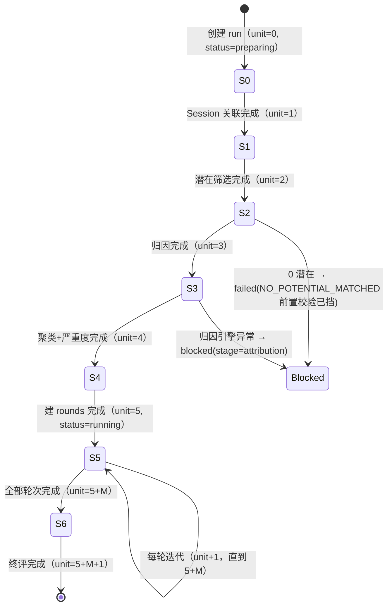

# 17 · V2 归因进入自进化与错误详情多归因

> 本文回答：归因如何从「外部 probe 只读」改为「自进化 run 内按对象·版本生成」、Session 关联与触发点坐标怎么算、潜在 bad case 的默认/自定义策略、归因缓存怎么复用、错误详情如何承载一个 bad case × 多条归因、七步流程的状态机与失败恢复、旧 probe 链路怎么退役。
> 前置：[15 工作空间](15-v2-workspaces.md) · [16 总览](16-v2-overview.md) · [05 接口设计](05-api-design.md) · [06 数据库设计](06-database-design.md) · [07 §5 自进化](07-backend-implementation.md)。
> 验收基准：[V2 原型](../ui-prototype-v2/harness-evolution.html)（向导四步 `evRenderWizard`、运行七步 `EV_STEPS`、错误详情 `ErrorApp`/`AttributionReport`）。

## 1. 背景与目标（目标态第 6/7 点）

### 1.1 V1 与 V2 的归因链路对照

| 维度 | V1 | V2 |
|---|---|---|
| 归因来源 | 外部系统写 `bad_case_analysis`（1:1）+ `probe_reports` | 本服务在 run 内生成 `bad_case_attributions`（N 条） |
| 归因粒度 | bad case 级（一条问题一个结论） | **对象 · 版本**级（一个 bad case 可有多条，互不覆盖） |
| 自进化输入 | `probe_reports`（`probe_object@object_version`） | 空间 bad case → Session 关联 → 潜在策略 → 归因 |
| Session 关联 | 无（probe 自带 session） | 显式判定「对象版本是否在该 Session 出现」 |
| 聚类输入 | probe（按 `attribute_type`） | 归因结论（按 `category`，只含可归因的） |
| 缓存 | 无 | 可选复用（按缓存键七元组） |
| 错误详情 | 单结论内嵌 | 可折叠 bad case 组 + 归因子项分页 |
| 结论语义 | 是问题 / 非问题 / 未分析 | 可归因到本对象 / 非该对象问题 / 未归因 |

### 1.2 术语

- **进化对象**：`evolution_targets` 里配置的 skill / agent（按空间隔离）。
- **对象版本**：`target_version`（tag/branch），归因身份的一部分。
- **对象进入点**：该对象在某个 Session 中最早的触发事件（§3.2）。
- **潜在 bad case**：按策略筛选后「可能与该对象有关」的 bad case（§4）。
- **非该对象问题**（`non_target`）：归因分析的结论之一，表示「该 bad case 不能归因到当前对象版本」；它不是「未分析」，也不否定 bad case 本身。
- **可归因**（`attributed`）：该 bad case 被判定为「属于当前对象版本的问题」，才进入聚类与迭代。

### 1.3 与原型的三处口径确认

| 原型表达 | 落地口径 |
|---|---|
| 「对象出现在哪些 Session」 | 按对象名在该 Session 的 `agent_events` 中出现过触发事件判定；版本不参与（§3.6 遗留项） |
| 潜在策略三开关「组合成策略」 | 勾选规则取并集，`sameObjectOnly` 作为额外过滤项（§4.2） |
| 第 4 步四个数字「潜在/复用/新增/非该对象」 | 潜在精确、复用精确；新增 = 潜在 − 复用；非该对象 = 该对象历史 `non_target` 去重数（参考值），语义见 §7.3 |

## 2. 流程重排：六步 → 七步

### 2.1 步骤与状态机

| unit | step key | 标题 | done when |
|---|---|---|---|
| 0 | `range` | 选择范围 | unit ≥ 1 |
| 1 | `sessions` | Session 关联 | unit ≥ 2 |
| 2 | `potential` | 潜在 bad case | unit ≥ 3 |
| 3 | `attribution` | 对象归因 | unit ≥ 4 |
| 4 | `clusters` | 聚类与严重度 | unit ≥ 5 |
| 5 | `iteration` | 迭代优化 | unit ≥ 5 + M（M=簇数） |
| 6 | `final` | 测试集终评 | unit ≥ 5 + M + 1 |



- V1 的「聚类」「归因置信度」「严重程度排序」三步被重排为「对象归因」在前、「聚类与严重度」合并在后：归因是聚类的前置输入（按 `category` 分组），severity/rank 仍在聚类步写入。
- `progress.unit/total` 公式从 `4+M+1` 改为 `5+M+1`；`stageLabel` 文案同步（「第 3/7 步 · 对象归因 · 12/18」）。
- `cluster_only` 模式同样执行 0–4，只是不建 rounds、不迭代、不终评——因为聚类依赖归因（V1 的 `cluster_only` 只跑 prepare，语义等价）。
- `steps_schema` 落在 `evolution_runs`（`v1` / `v2`），建行时写入；前端据此决定用哪套 step 组件渲染（§8.4）。

### 2.2 prepare 管线（重写 `service/evolution/prepare.py`）

```text
evolution_prepare(job)
 ① 校验（同步校验已在 POST 时做过一次，这里复核）
     ├─ target 属于 run.workspace_id 且 enabled
     ├─ policy 合法（custom 至少一条规则）
     ├─ 窗口合法（from ≤ to，≤ 366 天）
     └─ 校验失败 → run.failed(error_stage=prepare)，不入后续步骤

 ② Session 关联（unit 0→1）
     ├─ 空间时间窗内上报过 bad case 的 root sessions（投影口径，16 §2.1）
     ├─ 每个 session 查对象触发事件（kind 匹配 object_type，name == object_name）
     ├─ 有触发点 → 关联；无 → 跳过（只进 stats.skipped_sessions，不落表）
     └─ 写 events: sessions_linked{reported, associated, skipped}；stats 落库

 ③ 潜在筛选（unit 1→2）
     ├─ 取关联 session 内的全部 bad case（含 object_name/type/version/meta_data）
     ├─ 对每条取 bad case 触发点（锚定算法，§3.3）
     ├─ 对每条按 policy 判定（§4.2）→ included / included_reason
     ├─ 全量写 evolution_run_candidates（含 excluded，可解释）
     └─ 写 events: potential_computed{badCases, potential, policy}

 ④ 对象归因（unit 2→3）
     ├─ 对 included 候选逐条归因（§5）
     │    ├─ cache_enabled 且缓存键命中 → 复用（is_cached=true, reused_count+1）
     │    └─ 未命中 → 计算 → upsert attribution（created_run_id=本次 run）
     ├─ candidates.attribution_id 回填
     ├─ conclusion=non_target 的候选保留（可解释），不进簇
     └─ 写 events: attribution_reused / attribution_created（逐条或按批汇总）

 ⑤ 聚类与严重度（unit 3→4）
     ├─ 输入 = candidates where included AND attribution.conclusion=attributed
     ├─ simple_cluster 按 attribution.category 分组（error/prompt/model）
     ├─ 每簇：confidence（占位 0.82/0.74/0.66 按类型）、impact（error=9/prompt=7/model=5）、
     │        severity = round(min(10, confidence × impact × reportWeight), 1)、rank 降序
     ├─ 写 probe_clusters + evolution_cluster_cases；candidates.cluster_id 回填
     └─ 写 events: clusters_created{count, byType}

 ⑥ 建轮次（full 模式）
     ├─ 每簇一条 evolution_rounds（status=pending, seq=1..M）
     └─ unit=5, status=running → kickoff(round 1)

 ⑦ 收口
     └─ cluster_only: unit=5, status=completed（不建 rounds、不评测）
```

- 每一步一个短 job（activity）：不 sleep、不占 worker，状态全落 DB，崩溃后按 `progress_unit` 恢复（durable execution 的穷人版，V1 语义不变）。
- 每步失败的重试语义见 §2.3；`NO_POTENTIAL_MATCHED` 在 `POST /runs` 同步校验阶段就返回 409（不建 run），prepare 内部再判一次只作为并发剔除后的兜底 → `failed`。

### 2.3 失败、重试与恢复矩阵

| 步骤 | 可重试失败 | 不可恢复 | 结果 |
|---|---|---|---|
| ① 校验 | —（同步已挡） | target 被删/停用、policy 非法 | `failed(error_stage=prepare)` |
| ② Session 关联 | DB 超时 | — | 退避重试 3 次 → `blocked(stage=prepare)` → `/retry` |
| ③ 潜在筛选 | DB 超时 | — | 同上 |
| ④ 归因 | 引擎超时/限流 | 引擎返回非法结构 | 超时 → `blocked(stage=attribution)`；非法 → `failed(error_stage=attribution)` |
| ⑤ 聚类 | —（纯计算） | 候选集合为空（并发剔除后） | `failed(error_stage=cluster)` + 提示「无潜在 bad case」 |
| ⑥ 建轮次 | — | DB 约束冲突 | `failed(error_stage=prepare)` |
| 迭代/评测 | 见 V1（push/eval 的退避与 retry，[07 §5.6–5.8](07-backend-implementation.md)） | 同 V1 | V2 不改 |

- `blocked_stage` 新增 `attribution`（V1 只有 `patch/push/eval`）；`/retry` 按 stage 重入对应步骤：`attribution` 重跑第 ④ 步（已复用的归因不重算，只补未完成的），`prepare` 从第 ② 步重入（幂等）。
- 重入幂等：`evolution_run_candidates` 按 `(run_id, bad_case_id)` 唯一，重跑时 `upsert`；归因按缓存键唯一，重跑覆盖同键行。

### 2.4 并发与幂等

| 场景 | 手段 |
|---|---|
| 同一 run 重复入队 prepare | `job_runs` 同 `kind + ref_id` 只允许一个 `queued/running`；重复请求返回 `409 RUN_BUSY` |
| 两个 run 同时归因同一 (bad case, 对象版本) | 归因表唯一键 + upsert；后写覆盖，`reused_count` 各自递增（幂等，不产生重复行） |
| 上报并发写同一 `badCaseId` | 主键 upsert（[15 §4.4](15-v2-workspaces.md)） |
| 缓存并发填充 | 进程内 LRU + `asyncio.Lock` 按 key 串行；未命中时最多一次计算 |
| 归因批量并发 | 单 run 内串行（保持事件顺序）；跨 run 由 job 串行器保证 |

### 2.5 job payload 与事件

```python
# job_runs.payload（evolution_prepare）
{
  "run_id": "evo-20261111-01",
  "workspace_id": "ws-harness",
  "condition": { "target_type": "skill", "target_name": "deep-research", "target_version": "v2.0.0",
                 "from": "2026-08-20", "to": "2026-09-10", "models": [] },
  "policy": { "preset": "default" },
  "cache_enabled": true
}
```

事件（全部落 `evolution_run_events`，`stage` 见括号）：

| event_type | stage | payload 示例 |
|---|---|---|
| `sessions_linked` | prepare | `{reported: 31, associated: 18, skipped: 13}` |
| `potential_computed` | prepare | `{badCases: 42, potential: 18, policy: {preset: "default"}}` |
| `attribution_reused` | prepare | `{badCaseId, attributionId, objectName, objectVersion}` |
| `attribution_created` | prepare | `{badCaseId, attributionId, conclusion, category}` |
| `clusters_created` | cluster | `{count: 3, byType: {error: 2, prompt: 1}}` |

- 逐条归因事件可能很多（潜在 100+），实现按批写：每 20 条一条 `attribution_created`（payload 带 `count` 与首尾 id），避免事件表膨胀；`attribution_reused` 同理。SSE 只推批次事件，前端按 batch 追加。
- 事件 `seq` 与 `created_at` 语义不变（[06 §5.7](06-database-design.md)）。

## 3. 触发点坐标（trigger point）

潜在策略的「之后」比较需要 Session 内可比的坐标。归一化层补两个预计算列（[15 §3.5](15-v2-workspaces.md)）：

| 新列 | 表 | 写入时机 | 说明 |
|---|---|---|---|
| `triggered_at` | `agent_events`（NULL） | 归一化 | 触发事件所在 assistant message 的时间戳（从 JSONL 解析期带出） |
| `tree_index` | `agents`（NOT NULL） | 归一化 | Session 内按（父触发顺序, sort_key）DFS 赋全局递增整数，表达 spawn 先后 |

### 3.1 归一化写入规则

```python
# service/acquisition/agent_tree.py（增量）
# 1) 触发事件定位到其 tool_use 所在的 assistant message，取该 message 的 timestamp
#    （Claude Code JSONL 的每行 assistant 记录带 timestamp；解析期已有，只是此前丢弃）
triggered_at = message_timestamp_of(tool_use_block.tool_use_id)   # 找不到 → None

# 2) tree_index：DFS，先父后子；同一父节点的子节点按 sort_key（现有字段）排序
def assign_tree_index(root: AgentsForest) -> None:
    index = 0
    for node in dfs_preorder(root):        # 栈实现，深度优先、兄弟按 sort_key
        node.tree_index = index
        index += 1
```

- `parser_version` 递增，现有 payload 在下次归一化时重放补齐（`pnpm data:replay:sessions` 可手动触发）；未重放的行两列分别为 `NULL` / `0`，按 §3.5 回退。
- `triggered_at` 取不到时**不猜测**（例如 workflow 合成节点、缺少 timestamp 的老格式），留 `NULL`。

### 3.2 对象触发点（对象进入点）

```text
对象在 Session 中的触发事件集合 E(object):
    agent_events WHERE agent_id ∈ agents(root_session_id = s)
      AND kind = CASE object_type WHEN 'skill' THEN 'skill' ELSE 'agent' END
      AND name = object_name

对象进入点 enter(object, s) = argmin_{e ∈ E} key(e)
    key(e) = (e.triggered_at IS NULL, e.triggered_at ?? ∞, agent.tree_index, e.event_index)
    # 有时间的排前面（按时间）；无时间的排后面（按 tree_index + event_index 字典序）
```

- 一个 Session 内同一对象可能触发多次（skill 多次调用、agent 多次派发），进入点取最早一次。
- `E(object)` 为空 ⇒ 该 Session 与对象**不关联**（只计入 skipped）。
- `workflow` 触发事件（`kind=workflow`）不作为 skill 对象的触发点：workflow 是同名 skill 的编排产物，归属由 `kind` 区分（[06 §3.4](06-database-design.md)）。

### 3.3 bad case 触发点

bad case 的触发点 = 现有锚定算法（[06 §7.4](06-database-design.md)）算出的 `anchor` 事件，规则不变：

| `bad_case_type` + `object_type` | 锚定 | 触发点 |
|---|---|---|
| `self` + `agent` | 上报 agent A 本身 | A 的首个事件（`event_index=0`）；A 无事件时用 A 的出生点 |
| `self` + `skill` | A 中该 skill 的最后一次触发 | 该 `skill` 事件 |
| `discovery` + `skill` | A 中该 skill 的最后一次触发 | 该 `skill` 事件 |
| `discovery` + `agent` | 父节点 P 中调用 A 的 `agent` 事件 | 该 `agent` 事件 |

- 锚点事件找不到（`eventIndex=-1`）时，触发点退化为「上报 agent A 的出生点」：子 agent 取父节点中 `tool_use_id` 匹配的 `agent` 事件；主 agent 取 `session_families.started_at`。
- 仍取不到 ⇒ `case_trigger_at = NULL` 且 `tree_index` 取宿主 agent 的 0 号事件；候选行 `order_state=unknown`。

### 3.4 比较算法与真值表

```python
def order_of(object_point: Point | None, case_point: Point | None) -> Literal["after", "before", "unknown"]:
    if object_point is None or case_point is None:
        return "unknown"
    if object_point.at and case_point.at:
        return "after" if case_point.at > object_point.at else "before"
    return "after" if (case_point.tree_index, case_point.event_index) > \
                     (object_point.tree_index, object_point.event_index) else "before"
```

| 对象进入点 | bad case 触发点 | 比较轴 | 结果 |
|---|---|---|---|
| 有 `triggered_at` | 有 `triggered_at` | 时间戳 | `after` / `before`（精确） |
| 有 `triggered_at` | 无 | — | `unknown`（不满足「之后」） |
| 无 | 有 `triggered_at` | — | `unknown` |
| 无 | 无 | `(tree_index, event_index)` 字典序 | `after` / `before`（近似） |
| 任一缺失 | 任一缺失 | — | `unknown` |

- `unknown` 的候选只能经 `includeSelfReport` 命中；`after_object` 规则不命中，并在候选行记 `order_state=unknown`（运行详情可见）。
- `tree_index` 的近似误差：早派生的长任务 agent 可能晚于后派生的兄弟 agent 完成，字典序只看 spawn 顺序。文档承认该近似（§15 A4/A5），并要求 `triggered_at` 重放后以时间为准。

### 3.5 数据缺失矩阵与回退

| 缺失 | 影响 | 回退 |
|---|---|---|
| `triggered_at` 全空（未重放） | 全部比较走字典序 | 可用；`order_state=comparable`（近似）但 `stats` 记录 `approximate_order=true` |
| `tree_index` 未赋值（0） | 字典序退化 | 同一 Session 内所有 agent 的 `tree_index=0` → 只剩 `event_index` 比较，结果不可靠 → 视为 `unknown` |
| agent 无事件 | 进入点无法定位 | 该对象与 Session 不关联（计入 skipped） |
| bad case 锚点缺失 | 触发点退化到出生点 | §3.3 第二条 |
| Session 未归一化 | 一切为空 | 该 Session 不进关联集合 |

### 3.6 版本口径的遗留项

`agent_events` 不记录「触发的是对象的哪个版本」：Session 轨迹里只有 skill 名与调用参数，没有版本元数据。因此：

- **关联**：按对象名判定（§3.2），不区分版本——同一对象换版的 Session 也会关联。
- **归因身份**：`target_version` 参与缓存键与归因行，同一 bad case 对「同一对象的不同版本」是两条独立归因（这正是目标态「某版本的进化对象是否做过归因」的语义）。
- 遗留项：待上游轨迹携带对象版本（或 skill 调用参数里带版本）后，关联判定收紧到版本级；在此之前文档与 UI 文案统一说「对象在 Session 出现」，不说「该版本出现」。

## 4. 潜在 bad case 策略（policy）

### 4.1 结构与校验

```json
{ "preset": "default" }
{ "preset": "custom", "includeSelfReport": true, "includeAfterObject": true, "sameObjectOnly": false }
```

| 字段 | 类型 | 说明 |
|---|---|---|
| `preset` | `default` / `custom` | 默认策略固定两条规则取并集 |
| `includeSelfReport` | bool（custom 必填） | 规则 1：`object_name == target.name AND bad_case_type == 'self'` |
| `includeAfterObject` | bool（custom 必填） | 规则 2：同 Session 内 `case_trigger > object_enter`（§3.4） |
| `sameObjectOnly` | bool（custom 可选，默认 false） | 过滤项：只保留 `object_name == target.name` 的 bad case |

校验：`custom` 时两条规则至少一条为 true，否则 `422 POLICY_INVALID`；`preset=default` 时三个开关必须缺省（携带 → 422，避免「以为是自定义」）。policy JSON 全量快照进 `evolution_runs.potential_policy`，`policy_version` 常量（当前 `v1`）参与缓存键。

### 4.2 判定顺序（命中原因优先级）

```python
reason = None
if rule_self and case.bad_case_type == "self" and case.object_name == target.name:
    reason = "self_report"
if rule_after and order == "after":
    reason = "both" if reason else "after_object"
if reason is None:
    reason = "order_unknown" if (rule_after and order == "unknown") else "policy_excluded"
if reason in {"self_report", "after_object", "both"} and same_object_only and case.object_name != target.name:
    reason, included = "policy_excluded", False
```

- `included_reason` 封闭集合：`self_report | after_object | both | policy_excluded | order_unknown`。
- `order_unknown` 表示「本可由 after 规则命中但坐标不可比」——它 `included=false`，但比 `policy_excluded` 更有解释价值（运行详情用它提示「轨迹时间戳待重放」）。
- 同一 bad case 在多个关联 Session 内？不可能：`bad_case_session_id` 唯一，一个 bad case 只属于一个 Session。因此候选按 `(run, bad_case)` 唯一。

### 4.3 真值表（custom 三开关）

| `includeSelfReport` | `includeAfterObject` | `sameObjectOnly` | 等价语义 |
|---|---|---|---|
| ✓ | ✓ | ✗ | 默认策略（两条并集） |
| ✓ | ✗ | ✗ | 只看对象自身上报的 self |
| ✗ | ✓ | ✗ | 只看「触发点在对象之后」的（含其它对象的 self） |
| ✓ | ✗ | ✓ | 只看同对象名的 self |
| ✗ | ✓ | ✓ | 同对象名 且 在对象之后 |
| ✗ | ✗ | 任意 | 非法（`POLICY_INVALID`） |

### 4.4 实现与调用面

```python
class PotentialMatcher:
    """Single implementation shared by wizard preview, run prepare and overview."""

    async def associated_sessions(self, target: TargetRef, wid: str, window: Window) -> tuple[AssociatedSession, ...]: ...
    async def potential_cases(self, target: TargetRef, sessions: Sequence[str], policy: Policy) -> tuple[Candidate, ...]: ...
```

- `associated_sessions`：一次 SQL 取「空间时间窗内 bad case 涉及的 session」+「这些 session 内对象的触发事件」，服务层做交集（触发事件按 session 分组）。
- `potential_cases`：一次 SQL 取关联 session 内的全部 bad case（含锚点列），再批量取 `agent_events` 的坐标（按 `agent_id IN (...) AND event_index IN (...)` 或按 `triggered_at` 排序取范围），全部在内存完成判定——避免 per-case 查询。
- 依赖 `bad_cases.bad_case_agent_id` + `agents.tool_use_id` 计算锚点（复用 `service/problems/anchor.py` 的实现，不重写）。

## 5. 归因生成与缓存

### 5.1 引擎协议

```python
@dataclass(frozen=True, slots=True)
class AttributionInput:
    bad_case: BadCaseRecord
    target: TargetRef                      # type/name/version
    object_point: Point | None
    case_point: Point | None
    order: Literal["after", "before", "unknown"]
    reason: str                            # included_reason
    workspace_id: str

@dataclass(frozen=True, slots=True)
class AttributionResult:
    conclusion: Literal["attributed", "non_target"]
    category: Literal["model", "prompt", "error"] | None
    confidence: float
    reason: str
    reasoning: tuple[str, ...]

class AttributionEngine(Protocol):
    """Pluggable per-object-version attribution; the run pipeline owns caching."""

    key: str                               # 参与缓存键，如 "rule-v1"

    async def attribute(self, item: AttributionInput) -> AttributionResult: ...
```

- 工厂按 `settings.attribution_engine`（默认 `rule-v1`）选实现；未知 key 启动失败（fail fast，沿用 `EngineFactory` 模式）。
- 引擎**不碰数据库**、不做缓存——输入输出都是纯数据，便于单测与后续 LLM 化。

### 5.2 占位规则引擎（`RuleBasedEngine`，`key="rule-v1"`）

| 条件 | conclusion | category | confidence | reason 模板 |
|---|---|---|---|---|
| `reason ∈ {self_report, both}` | `attributed` | `meta_data` 含 error/exception/stack → `error`；否则 `prompt` | 0.8 | 「对象自身上报：{title}；证据：{meta 摘要}」 |
| `reason == after_object` 且 `bad_case_type == discovery` | `attributed` | `error` | 0.6 | 「触发点在对象进入点之后（{object_at} → {case_at}），属对象执行链下游」 |
| `reason == after_object` 且 `bad_case_type == self`（其它对象自报） | `attributed` | `model` | 0.5 | 「同会话内下游对象的自报问题」 |
| `order == unknown` 或 `meta_data` 为空且描述无错误特征 | `non_target` | `null` | 0.7 | 「证据不足：触发时序不可比 / 无可用证据，判定为非该对象问题」 |

`reasoning`（有序步骤，3–4 条）：定位证据 → 比较触发点 → 排除其它可能 → 结论边界。模板固定即可（前端按 Markdown 渲染推导过程，与 V1 `probeAnalysis` 同款展示）。

### 5.3 缓存读写（事务与并发）

缓存键（与表唯一键一致）：

```text
key = (workspace_id, bad_case_id, object_type, object_name, object_version,
       policy_version, attribution_engine.key)
```

```python
async def attribute_one(self, item, *, cache_enabled: bool) -> tuple[AttributionRow, bool]:
    if cache_enabled:
        row = await self._repo.find_by_key(item.key)
        if row is not None:
            async with self._db.transaction():
                await self._repo.mark_reused(row.id, run_id=self._run_id)   # reused_count+1, last_reused_run_id
            return row, True
    result = await self._engine.attribute(item)
    async with self._db.transaction():
        row = await self._repo.upsert(item.key, result, created_run_id=self._run_id)
    return row, False
```

- `cache_enabled=false`：跳过读，直接计算并覆盖同键行（`created_run_id` 更新为本次 run，`reused_count` 不变）。
- 并发同键 upsert：MySQL 用 `INSERT … ON DUPLICATE KEY UPDATE`，SQLite 用 `INSERT … ON CONFLICT DO UPDATE`（repository 适配器各自实现），单语句原子，不先查后写。
- `reused_count` 只增不减；「最后被复用时间」= `updated_at`。
- 缓存键不含时间窗：同一对象版本对同一 bad case 的结论与「哪次运行、什么时间窗」无关（这正是复用的前提）。

### 5.4 结论消费与清理

- 聚类只消费 `conclusion=attributed` 的候选；`non_target` 留在候选表与归因表，供错误详情与总览「非该对象」统计。
- 归因行随 run 保留（不删）；bad case 删除（V2 无此路径）才级联。`app/cli.py clean-runs` 不删归因（它们是跨 run 共享的）。
- 引擎升级（`rule-v2`）：新 run 用新 key 生成新行，旧行保留；错误详情按 `updated_at` 倒序展示，同键不同引擎的旧结论自然沉底。

## 6. 数据模型

### 6.1 `bad_case_attributions`

| 列 | 逻辑类型 | 约束 | 说明 |
|---|---|---|---|
| `id` | ID | PK | `AT-…`（ULID） |
| `workspace_id` | ID | NOT NULL, FK → `workspaces.id` ON DELETE CASCADE | 冗余便于空间过滤 |
| `bad_case_id` | 短文本 64 | NOT NULL, FK → `bad_cases.bad_case_id` ON DELETE CASCADE | — |
| `object_type` | 短文本 16 | NOT NULL | `skill` / `agent` |
| `object_name` | 短文本 128 | NOT NULL | — |
| `object_version` | 短文本 64 | NOT NULL | 归因只作用于「对象 · 版本」 |
| `conclusion` | 短文本 16 | NOT NULL | `attributed` / `non_target` |
| `category` | 短文本 16 | NULL | `model/prompt/error`；`non_target` 时 NULL |
| `confidence` | 浮点 | NOT NULL | 0–1 |
| `reason` | 长文本 | NOT NULL | 结论说明 |
| `reasoning` | JSON | NOT NULL | 有序推导步骤数组 |
| `policy_version` | 短文本 16 | NOT NULL | 参与缓存键 |
| `attribution_engine` | 短文本 64 | NOT NULL | 参与缓存键 |
| `created_run_id` | ID | NULL FK → `evolution_runs.id` ON DELETE SET NULL | 首次生成该结论的 run（导入数据为 NULL） |
| `last_reused_run_id` | ID | NULL FK | 最近一次复用的 run |
| `reused_count` | 计数 | NOT NULL DEFAULT 0 | 复用次数 |
| `created_at` / `updated_at` | 时间 | NOT NULL | `updated_at` 也是「最近一次归因/复用时间」 |

约束：`UNIQUE(workspace_id, bad_case_id, object_type, object_name, object_version, policy_version, attribution_engine)`；索引 `INDEX(bad_case_id)`（错误详情分页）、`INDEX(workspace_id, object_name, object_version)`（总览三态/版本分布）、`INDEX(workspace_id, updated_at)`（对象趋势落桶）。

### 6.2 `evolution_run_candidates`

| 列 | 逻辑类型 | 约束 | 说明 |
|---|---|---|---|
| `id` | ID | PK | — |
| `run_id` | ID | NOT NULL, FK → `evolution_runs.id` ON DELETE CASCADE | — |
| `workspace_id` | ID | NOT NULL | 冗余，空间审计 |
| `session_id` | ID | NOT NULL | 关联 Session |
| `bad_case_id` | 短文本 64 | NOT NULL, FK → `bad_cases` | — |
| `object_trigger_agent_id` | 短文本 64 | NULL | 对象进入点宿主 |
| `object_trigger_event_index` | 计数 | NULL | — |
| `object_trigger_at` | 时间 | NULL | — |
| `case_trigger_agent_id` / `case_trigger_event_index` / `case_trigger_at` | 同上 | NULL | bad case 触发点 |
| `order_state` | 短文本 16 | NOT NULL | `comparable` / `unknown` |
| `included` | 布尔 | NOT NULL | 是否命中策略 |
| `included_reason` | 短文本 16 | NOT NULL | §4.2 封闭集合 |
| `attribution_id` | ID | NULL FK → `bad_case_attributions.id` | 本次 run 关联的归因行 |
| `is_cached` | 布尔 | NOT NULL DEFAULT false | 本次是否走缓存 |
| `cluster_id` | 短文本 64 | NULL FK → `probe_clusters` | attributed 且入簇后回填 |
| `created_at` | 时间 | NOT NULL | — |

约束：`UNIQUE(run_id, bad_case_id)`；索引 `INDEX(run_id, included)`、`INDEX(bad_case_id)`、`INDEX(attribution_id)`、`INDEX(session_id)`。

- **Session 关联结果不单独建表**：关联 Session = 候选的 `DISTINCT session_id`（跳过的 Session 没有候选行，只进 `run.stats` 与 payload）；向导第 2 步与运行详情第 2 步都按同一推导查询。
- 全量落库（含 `included=false`）保证「为什么这个 bad case 没进潜在」可回答。

### 6.3 `evolution_cluster_cases`

| 列 | 类型 | 约束 |
|---|---|---|
| `probe_cluster_id` | `VARCHAR(64)` | PK 组成, FK → `probe_clusters` ON DELETE CASCADE |
| `candidate_id` | `VARCHAR(36)` | PK 组成, FK → `evolution_run_candidates` ON DELETE CASCADE |

沿用 `probe_clusters`（`confidence/impact/severity/rank` 语义不变，`probe_cluster_type` 由归因 `category` 驱动）；`probe_cluster_probes` 停止写入，历史 run 只读。

### 6.4 `evolution_runs` 增列

| 列 | 类型 | 说明 |
|---|---|---|
| `workspace_id` | `VARCHAR(36)` NOT NULL | 空间归属 |
| `potential_policy` | JSON NULL | 策略快照（§4.1） |
| `cache_enabled` | 布尔 NOT NULL DEFAULT false | 缓存开关 |
| `steps_schema` | `VARCHAR(8)` NOT NULL DEFAULT 'v1' | `v1` 六步 / `v2` 七步；建行时写入 |

### 6.5 容量

| 表 | 量级 | 说明 |
|---|---|---|
| `bad_case_attributions` | 10³–10⁵ | 每 (bad case × 对象版本) 一行；复用不新增行 |
| `evolution_run_candidates` | 每次 run 10¹–10³ | 随 run 清理（`clean-runs`） |
| `evolution_cluster_cases` | 每次 run 数十 | 随簇级联删除 |

## 7. 向导四步与启动 API

向导从两步扩为四步（`pages/evolution/components/LaunchWizard.vue` 重写），预览端点全部 `POST`（条件体）+ 空间前缀：

| 步 | 端点 | 请求关键字段 | 响应 |
|---|---|---|---|
| ① 选择范围（纯前端表单） | — | 对象（空间内 enabled targets）/ 版本（target 仓库 tag，默认 `defaultRef`）/ 时间段 / policy / （可选 `focusCaseId`） | — |
| ② Session 关联 | `POST /api/workspaces/{wid}/evolution/preview/sessions` | `{targetType,targetName,targetVersion,from,to,page,pageSize=4}` | 见下 |
| ③ 潜在 bad case | `POST .../preview/potential` | 同上 + `policy`、`pageSize=5` | 见下 |
| ④ 归因预览与启动 | `POST .../preview/attribution` | 同上 + `cacheEnabled` | 见 §7.3 |
| 启动 | `POST /api/workspaces/{wid}/evolution/runs` | `{targetType,targetName,targetVersion,from,to,models?,policy,cacheEnabled,mode:"full",engineKey?,eval?}` | `202 {runId,jobId,status:"preparing"}` |
| 仅聚类 | `POST .../cluster-previews` | 同上（`mode:"cluster_only"`） | 同上 |

### 7.1 第 2 步响应

```json
{
  "summary": { "reportedSessions": 31, "associatedSessions": 18, "skippedSessions": 13,
               "pendingSessions": 2 },
  "items": [
    { "sessionId": "cb819c5b-…", "title": "AI agent + 视频播放结合的开源产品调研",
      "objectTriggerAt": "2026-09-05T17:40:12+08:00", "badCaseCount": 3, "potentialCount": 2 }
  ],
  "total": 18, "page": 1, "pageSize": 4
}
```

### 7.2 第 3 步响应

```json
{
  "summary": { "badCases": 42, "potential": 18, "byReason": { "self_report": 6, "after_object": 9, "both": 3 } },
  "items": [
    { "badCaseId": "BC-HC-0007", "objectName": "deep-research", "badCaseType": "self",
      "triggerAt": "2026-09-06T09:12:00+08:00", "sessionId": "cb819c5b-…",
      "hitReason": "self_report" }
  ],
  "total": 18, "page": 1, "pageSize": 5
}
```

- `hitReason` 与运行详情第 3 步同源（§4.2），前端列名「命中原因」。
- 0 潜在 → `409 NO_POTENTIAL_MATCHED`；向导把该 409 映射为「当前策略没有命中潜在 bad case」空态并禁用两个出口（与 V1 的 `NO_PROBES_MATCHED` 处理同款）。

### 7.3 第 4 步（归因预览）

```json
{ "summary": { "potential": 18, "reused": 11, "fresh": 7, "nonTargetKnown": 4 } }
```

- **预览不执行归因**：`reused` = 潜在集合中缓存键已存在的精确数（一次 `IN` 查询）；`fresh = potential - reused`；`nonTargetKnown` = 该对象（含所选版本）历史 `non_target` 的去重 bad case 数。
- UI 文案必须写清语义：「将复用 11 条缓存归因、新增 7 条；另有 4 个历史 bad case 曾被判为非该对象问题」——避免用户以为 `nonTargetKnown` 是本次预计结果。
- 缓存关闭时第 4 步仍展示 `reused=0`（开关联动重新请求）。

### 7.4 启动请求校验（同步，失败不建 run）

| 校验 | 失败码 |
|---|---|
| target 在当前空间存在且 enabled | `409 TARGET_NOT_CONFIGURED` |
| `targetVersion` 非空（缺省取 `defaultRef`） | `422 VALIDATION_INVALID` |
| 窗口合法（`from ≤ to`、≤ 366 天） | `422 VALIDATION_INVALID` |
| policy 合法 | `422 POLICY_INVALID` |
| 关联 Session > 0 | `409 NO_ASSOCIATED_SESSIONS`（新增，见 §12.2） |
| 潜在 bad case > 0 | `409 NO_POTENTIAL_MATCHED` |
| `engineKey` 已注册 / `eval` 合法 | `422 ENGINE_INVALID`（V1 沿用） |

- `models` 字段保留但向导不再收集（默认空 = 全部模型）；V1 run 表结构不变。
- `focusCaseId`：从错误详情「以该 bad case 启动自进化」进入时，前端用 `GET /bad-cases/{id}` 预填对象与 Session 定位，并把它作为第 1 步只读提示；**不进请求体**（不改变潜在判定口径）。

## 8. 运行详情七步

### 8.1 通用外壳

```json
{ "key": "potential", "index": 2, "title": "潜在 bad case", "status": "done",
  "detail": "18 / 42", "payload": { … } }
```

- `status ∈ done|active|pending`；`clickable = status != pending`；未到达返回 `404 STEP_NOT_READY`（同 V1）。
- `detail` 给 stepper 副标题（如「18 / 42」「3 簇」）；`preparing` 时第 0 步可读、其余 404。

### 8.2 各步 payload

| step | payload 关键字段 |
|---|---|
| `range` | `condition{}`（target/版本/时间窗/policy/cacheEnabled/workspace）+ `stats{sessions, badCases, potential}` |
| `sessions` | `summary`（同 §7.1）+ `rows[]`（同 §7.1 items），4 条/页 |
| `potential` | `summary`（同 §7.2）+ `rows[]`（含 `hitReason`、`orderState`），5 条/页 |
| `attribution` | `summary{potential,reused,fresh,nonTarget}` + `rows[]`（badCaseId/attributionId/category/description/`source: cached\|fresh`/confidence）；对象·版本在 step 标题 |
| `clusters` | `clusters[]`：`{probeClusterId,title,description,category,caseCount,confidence,severity,rank,cases[]}`；按 `severity DESC, rank ASC`；`cases[]` 为来源 bad case（badCaseId/title/objectName/badCaseType/triggerAt/createdAt） |
| `iteration` | `rounds[]` 沿用 V1 结构；`probes[]` → `cases[]`（字段同上） |
| `final` | 不变（verdict/bestVersion/bestScore/initScore/metrics/changes） |

`clusters` 示例：

```json
{ "probeClusterId": "C1", "title": "检索索引读取失败", "description": "索引读取前未校验快照字段（3 个 bad case 共同表现）",
  "category": "error", "caseCount": 3, "confidence": 0.82, "severity": 7.4, "rank": 1,
  "cases": [ { "badCaseId": "BC-HC-0007", "title": "检索索引读取失败", "objectName": "deep-research",
               "badCaseType": "self", "triggerAt": "2026-09-06T09:12:00+08:00",
               "createdAt": "2026-09-06T09:20:00+08:00" } ] }
```

- 簇标题/描述占位规则：取簇内最高频 bad case `title`；描述 = 「{n} 个 bad case 共同表现」+ 归因 reason 摘要。
- `severity` 计算沿用 V1 公式，`reportCount` 改为 distinct `bad_case_id`（[05 §3.6](05-api-design.md) 的权重公式不变）。

### 8.3 与 V1 六步的映射

| V1 step | V2 step | 说明 |
|---|---|---|
| `input`（筛选输入） | `range` + `sessions` | 拆开：范围是条件，Session 关联是结果 |
| — | `potential` | 新增（潜在筛选可解释） |
| `clusters`（问题聚类） | `clusters`（聚类与严重度） | 输入从 probe 换成 attributed 候选；severity 合并进来 |
| `attribution`（LLM 归因置信度） | `attribution`（对象归因） | 位置前移，内容从「簇置信度」变为「逐 bad case 结论」 |
| `severity`（严重度排序） | 合并进 `clusters` | 少一步，stepper 更短 |
| `iteration` / `final` | 同名 | 数据结构不变 |

### 8.4 历史 run 的双轨渲染

```text
run.steps_schema = "v2" → 前端用 StepRange/StepSessions/StepPotential/StepAttributionV2/StepClustersV2
run.steps_schema = "v1" → 前端用既有 StepInput/StepClusters/StepAttribution/StepSeverity（冻结，不迭代）
```

- 后端按 schema 返回对应 key 的 steps 与 payload；旧 run 的 payload 仍从 `probe_clusters`/`probe_cluster_probes`/`probe_reports` 读（只读路径保留）。
- 前端 `RunStepContent` 按 `key` 动态渲染；两套组件并存，旧组件只修 bug 不加功能。
- `RunCard` 增补：空间 badge、策略 chip（默认/自定义）、缓存开关 chip、统计（关联 Session/潜在/可归因/复用/已跑轮次）。

### 8.5 SSE 与事件

`run.event` 的 `eventType` 新增 §2.5 的 5 个类型；`run.progress` 的 `stageLabel` 按七步文案、`percent` 分母改 `5+M+1`。SSE 机制（票据、回放、心跳、reset）不变（[05 §4.14](05-api-design.md)）。

## 9. 错误详情多归因（目标态第 7 点）

### 9.1 API

| 端点 | 说明 |
|---|---|
| `GET /api/workspaces/{wid}/bad-cases/{badCaseId}/attributions?page=1&pageSize=2` | `{items:[{attributionId, objectType, objectName, objectVersion, conclusion, category, confidence, runId, isCached, createdAt}], total, page, pageSize}`；按 `updated_at` 倒序 |
| `GET .../attributions/{attributionId}` | 完整归因：上表字段 + `reason/reasoning/policyVersion/attributionEngine/reusedCount` + `triggerCompare{objectTriggerAt, caseTriggerAt, order}`（取该归因最近一次关联的 candidates 行） |

```json
{
  "attributionId": "AT-01J9…", "objectType": "skill", "objectName": "deep-research",
  "objectVersion": "v2.0.0", "conclusion": "attributed", "category": "error",
  "confidence": 0.8, "runId": "evo-20261111-01", "isCached": true,
  "reason": "对象自身上报：检索索引读取失败；证据：ENOENT apps/server/src/search/index.ts:142",
  "reasoning": ["bad_case 上报人即 deep-research 的宿主 agent", "对象在 L142 读取索引前未校验快照字段",
                "同批次另一 subagent 有校验且未报错", "结论只作用于 v2.0.0"],
  "policyVersion": "v1", "attributionEngine": "rule-v1", "reusedCount": 3,
  "triggerCompare": { "objectTriggerAt": "2026-09-05T17:40:12+08:00",
                      "caseTriggerAt": "2026-09-06T09:12:00+08:00", "order": "after" },
  "createdAt": "2026-11-09T15:02:00+08:00", "updatedAt": "2026-11-11T10:00:00+08:00"
}
```

- 现有 `GET /sessions/{sid}/bad-cases` 的 `BadCase` 增补 `attributionCount` 与 `hasAttribution`（左栏父行与筛选 chips 用）；`analysis` 字段保留（V1 冻结语义），前端 V2 不再消费。
- `isCached` 取该归因**最近一次**关联候选的 `is_cached`（同一结论可能被多次复用）；`reusedCount` 是累计。

### 9.2 前端结构

```text
pages/errors/Index.vue（grid: 340px 1fr）
├── components/ErrorSidebar.vue（重写）
│   ├── FilterChips.vue（全部 / 有归因 / 待归因）
│   ├── CaseGroup.vue × N（父行：`#no` + badCaseId 深链 + 标题 + self/discovery badge + object_name + 归因数）
│   │   ├── 展开态：AttributionItem.vue × ≤2（结论 badge、时间、缓存标记、→ 定位）
│   │   └── 组内分页（2 条/页，父行各自维护 page）
│   └── 空态/骨架
├── main.error-main
│   ├── header.error-head（meta + 返回 Session）
│   ├── section.flow-panel（复用 AgentTree，仅过滤该 bad case 节点）
│   └── section.detail-panel
│       ├── ProblemDescription.vue（问题描述 Tab：title + reason + metaData）
│       └── AttributionReport.vue（重写：归因集合 + 多条导航）
```

### 9.3 交互状态机

```text
[全部错误] 未选中 case，右栏空态
  │ 点子行 → 选中 case → tab=desc（问题描述）；URL ?case=&tab=desc
  │ 展开/折叠（本地 Set，展开时若归因数>2 显示组内分页）
  ├─ 点子项 → tab=attr & at=attributionId；URL ?case=&tab=attr&at=
  │    └─ 多条：左右切换（N/total），切换同时更新 ?at=
  ├─ 筛选「有归因」→ 只保留 attributionCount>0 的组（不改变展开态）
  └─ 无归因 case → 归因 Tab 显示「尚未归因」+ 说明 + 「以该 bad case 启动自进化 →」
```

- 深链解析优先级：`?at=` 命中 → 用它；只有 `?case=` → 该 case 的第一条归因；`?obj=<objectName>`（V2 原型兼容参数）→ 该对象名的第一条，找不到回落第一条。
- `sid` 与 bad case 归属不一致 → 整页错误态「该问题不属于当前 Session」（`BAD_CASE_SESSION_MISMATCH`，服务端带 `sessionId` 参数校验，与 V1 一致）。

### 9.4 归因 Tab 渲染顺序（固定）

1. 结论横幅：`attributed` → 「可归因到本对象」+ 分类 chip；`non_target` → 「非该对象问题」；无归因 → 「尚未归因」。
2. 对象 · 版本 + 归因来源（runId 可跳运行详情）+ 时间 + 缓存徽标（复用缓冲/本次新增）。
3. 置信度 + 策略（默认/自定义，附策略一句话）。
4. 触发点对照：对象进入点 vs bad case 触发点（含 `order` 文案：「位于对象触发点之后/之前」）。
5. 结论说明（`reason`）。
6. 推导过程（`reasoning`，Markdown 风格有序列表；禁止裸 HTML）。
7. 结论边界说明（固定文案：只作用于该对象版本，不修改 bad case，不影响其它对象）。

### 9.5 权限

- 查看：空间 `viewer` 及以上。
- 「以该 bad case 启动自进化」按钮：`space_admin` 及以上可见；点击打开向导浮窗并预填（不离开当前页，确认启动后才跳运行详情）。

## 10. 兼容与迁移

| 对象 | 处置 |
|---|---|
| `bad_case_analysis` / `probe_reports` | 冻结只读：无生产写入路径；历史 run 详情（`steps_schema=v1`）仍读 |
| 存量 `analyzed_issue` | 一次性导入 `bad_case_attributions`（`attribution_engine='legacy-probe-import'`，`conclusion=attributed`，`category=attribute_type`，`confidence=0.8`，`reason=probe_description`，`reasoning=[probe_analysis]`，`created_run_id=NULL`），仅对开发/fixtures 库执行（生产无数据） |
| 存量 `analyzed_nonissue` | **不迁移**：「非问题」与「非该对象问题」是不同谓词；历史 bad case 视为未归因 |
| `probe_cluster_probes` | 停止写入；历史 run 保留 |
| `POST /api/evolution/probes/query` | 移除（生产无消费者）；contracts 重新生成 |
| `/api/probes/{id}`、`/api/bad-cases/{id}/analysis` | 标 `deprecated=true` 保留一个版本；错误页不再调用；下个大版本删除 |
| 旧 `?issue=` / `report=` 深链 | 生产无存量，不做兼容（[15 §7](15-v2-workspaces.md) 同步说明） |
| 历史 run 详情 | 双轨渲染（§8.4）；`clean-runs` 之外的保留策略不变 |
| contracts | `pnpm contract:generate`；steps 新 key、attribution 模型、三个预览端点全部进快照 |

## 11. 代码改动地图

| 层 | 文件 | 改动 |
|---|---|---|
| 归一化 | `service/acquisition/agent_tree.py` | `tree_index` 赋值（DFS + sort_key）；触发事件的 `triggered_at` 提取 |
| 归一化 | `db/crud/acquisition_replay.py` | 两列写入；`parser_version` 递增与重放路径 |
| 表模型 | `db/models/domain.py` | `agents.tree_index`、`agent_events.triggered_at` |
| 表模型 | `db/models/evolution.py` | `evolution_runs` 三个新列 + `steps_schema`；新表 `evolution_run_candidates`、`evolution_cluster_cases` |
| 表模型 | `db/models/attribution.py`（新） | `bad_case_attributions` |
| 存取 | `db/crud/candidates.py`（新） | `insert_many`（批量落候选）、`list_by_run`、`update_attribution`、`update_cluster` |
| 存取 | `db/crud/attributions.py`（新） | `find_by_key`、`upsert`（方言 ON CONFLICT）、`mark_reused`、`page_by_case`、`state_counts` |
| 存取 | `db/crud/cluster_cases.py`（新） | 簇 ↔ 候选写入与查询 |
| 匹配 | `service/evolution/potential.py`（新） | `PotentialMatcher`（关联 Session / 潜在判定 / 触发点坐标比较） |
| 触发点 | `service/evolution/triggers.py`（新） | `object_enter_point` / `case_trigger_point` / `compare`（复用 `service/problems/anchor.py`） |
| 归因 | `service/evolution/attribution.py`（新） | `AttributionEngine` 协议 + `RuleBasedEngine` + 缓存读写编排 |
| 管线 | `service/evolution/prepare.py` | §2.2 七段管线重写（原地替换 V1 的 probe 查询 + simple_cluster 流程） |
| 管线 | `service/evolution/stages.py` / `state.py` | 七步 payload 装配、进度公式、`steps_schema` 分派 |
| 聚类 | `service/evolution/cluster.py` | 输入换 attributed 候选；按 `category` 分组；写 `evolution_cluster_cases` |
| 启动 | `service/evolution/launch.py` | 新 body（policy/cacheEnabled）、三段预览校验、`NO_ASSOCIATED_SESSIONS` |
| 预览 | `service/evolution/preview.py`（新，替代 `probe_query.py`） | 三个预览端点服务（§7） |
| 路由 | `api/evolution_launch.py` | 预览 + 启动端点（空间前缀、凭据校验） |
| 路由 | `api/problems.py` | attributions 分页/详情端点；`BadCase` 增 `attributionCount/hasAttribution` |
| 配置 | `app/config.py` | `HE_ATTRIBUTION_ENGINE`、`HE_POTENTIAL_POLICY_VERSION`、缓存开关 |
| 装配 | `app/main.py` | 新服务注册：`potential`、`attribution`、`preview`、`overview`（[16 §7.1](16-v2-overview.md)） |
| 迁移 | `alembic/versions/0015_v2_attribution.py` | 新表 + 增列 + 回填（`steps_schema='v1'`、`workspace_id`） |
| fixtures | `fixtures/` | 触发点（`triggered_at`/`tree_index`）与多归因样例（约 1/5 未归因） |
| 前端 | `pages/evolution/components/LaunchWizard.vue` | 四步重写（策略区、两段预览、缓存开关） |
| 前端 | `pages/evolution/RunDetail.vue` + `StepRange/StepSessions/StepPotential/StepAttributionV2/StepClustersV2` | 七步组件；`RunStepContent` 按 schema 分派 |
| 前端 | `pages/errors/ErrorSidebar.vue`、`AttributionReport.vue` | 折叠组 + 归因子项分页 + 多条导航 |
| 前端 | `api/evolution.ts`、`api/badCases.ts`、`queryKeys.ts` | 新端点与 key；`attributions` 前缀失效规则 |

## 12. 测试

### 12.1 单元与集成

| 层 | 用例（摘要） |
|---|---|
| 触发点 | `triggered_at` 精确比较；缺失回退字典序；双缺失 `unknown`；对象多触发取最早；锚点缺失退化出生点 |
| 策略 | 默认两支并集；custom 5 种合法组合；`sameObjectOnly` 过滤；`POLICY_INVALID`；`included_reason` 优先级 |
| 匹配器 | 关联 Session 只含有对象触发点的；跳过的只进 stats；潜在数与向导/总览一致（同条件三处对比用例） |
| 归因 | 规则引擎四类结论；缓存命中/未命中/关闭；并发同键 upsert 不重复；`reused_count` 递增 |
| 管线 | 七步顺序与 `progress_unit`；每步失败落 `blocked/failed` 与 stage；重入幂等（候选不重复、归因不重复） |
| 聚类 | 只含 attributed；按 category 分组；severity 公式与 rank；空集合 → `failed(cluster)` |
| 契约 | 三个预览端点 + attributions 分页/详情；`contract:check` 无漂移 |
| 前端 | 向导四步流转与缓存开关；错误左栏折叠/分页/定位；`steps_schema` 双轨渲染 |

### 12.2 新增错误码

| code | HTTP | 场景 |
|---|---|---|
| `POLICY_INVALID` | 422 | custom 未启用任何规则；default 携带开关；`policy_version` 非法 |
| `NO_ASSOCIATED_SESSIONS` | 409 | 时间窗内无任何 Session 关联到该对象 |
| `NO_POTENTIAL_MATCHED` | 409 | 关联存在但潜在为 0 |
| `ATTRIBUTION_NOT_FOUND` | 404 | attributionId 不存在或不属于该 bad case |
| `STEP_NOT_READY` | 404 | 沿用 V1（新 key 同样适用） |

### 12.3 E2E

```text
seed（含空间/触发点/多归因）→ 向导四步（② 只列关联 Session、③ 命中原因列、④ 四数）
→ 启动 → 七步详情（聚类按 severity 降序、来源 bad case 深链）
→ 错误详情（折叠组、归因子项分页 2、Tab 定位、未归因空态与启动入口）
→ 第二次同条件运行：attribution 步 reused == potential
```

门禁：`pnpm test:api`、`pnpm test:gates`、`pnpm contract:check`、`pnpm test:e2e -- --pattern "evolution|errors"`。

## 13. 非目标

- 真实 LLM 归因（引擎接缝已留，规则占位先行；接入时只新增 Engine 子类）。
- 单 bad case 手动触发归因（只能经自进化 run 产生）。
- 归因结论跨对象合并/冲突仲裁（多条结论并存，不做权威排序）。
- 策略编辑器（三开关即全部自定义面）、策略版本的可视化对比。
- V1 六步详情页的视觉翻新（只冻结维护）。
- 按版本收紧 Session 关联（§3.6 遗留项，待上游轨迹带版本）。

## 14. 已确认决策

| # | 决策 | 依据 |
|---|---|---|
| A1 | 归因由本服务在 run 内生成，`bad_case_attributions` 每缓存键一行、最新真相、复用计数 | 目标态第 6 点；错误详情天然分页查询；复用不膨胀 |
| A2 | 「非该对象问题」是一等结论（`non_target`），不等于未分析、不否定 bad case | 目标态第 6 点；多对象互不覆盖 |
| A3 | 缓存键七元组：workspace + bad case + 对象身份 + 版本 + 策略版本 + 归因引擎 | 原型缓存键文案；换引擎/换策略不串缓存 |
| A4 | Session 关联按对象名（触发事件不带版本）；版本只进归因身份 | 数据现状；遗留项：agent_events 记录版本后收紧 |
| A5 | 触发点比较：`triggered_at` 优先，`(tree_index, event_index)` 字典序兜底，双缺失 `unknown` | 跨 agent 行号不可比；时间戳精确但存量缺失 |
| A6 | 候选表全量落库（含 excluded），Session 关联由候选推导不建独立表 | 可解释性优先；避免双表同步 |
| A7 | 聚类输入换 `attribution.category`，簇表沿用、成员表新起 `evolution_cluster_cases` | `probe_cluster_probes` 语义已变，另起干净的表 |
| A8 | `analyzed_nonissue` 不迁移、旧 probe 深链不做兼容 | 生产无存量；谓词不同 |
| A9 | 前端双轨渲染新旧 steps（`steps_schema` 判定），旧组件冻结 | 历史 run 不可重算 |
| A10 | 向导 UI 移除模型多选，API 字段保留 | 原型行为；减少与归因无关的筛选项 |
| A11 | 预览第 4 步不执行归因，只给「潜在/复用/新增/历史非该对象」四数并写清语义 | 预览要快且不污染归因表；数字必须可解释 |
| A12 | 归因引擎与缓存编排分离：引擎纯函数、管线管缓存与事务 | 便于 LLM 化与单测；缓存语义集中一处 |
| A13 | 逐条归因事件按批写入（每 20 条一次） | 事件表膨胀与 SSE 洪泛 |
